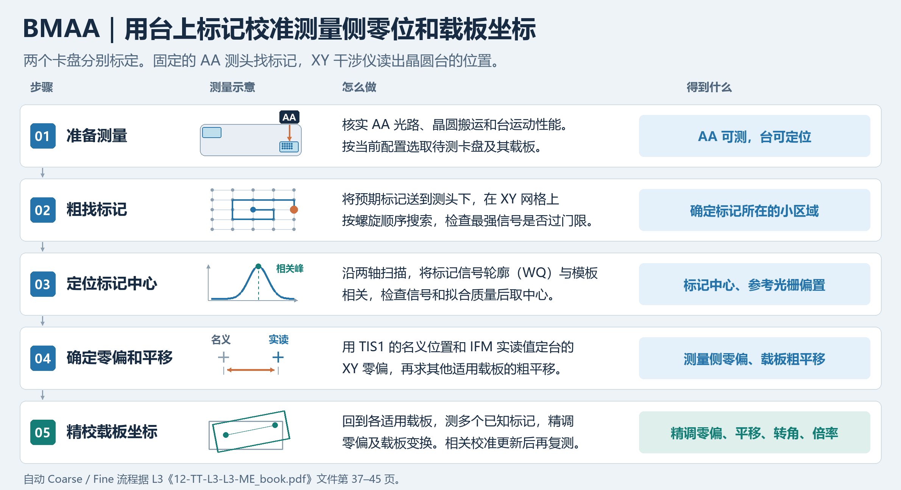
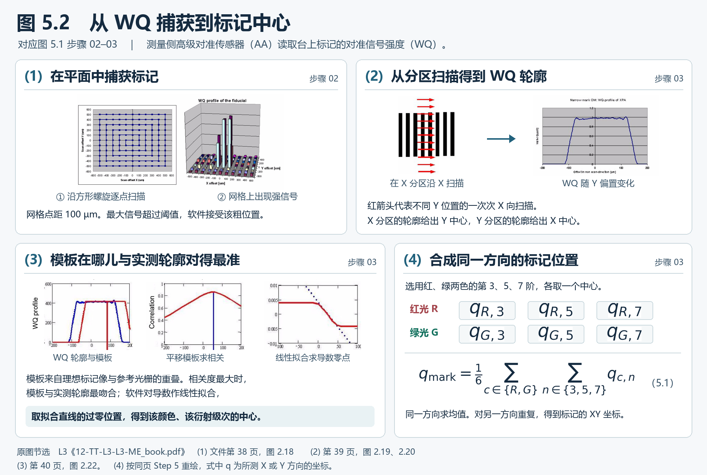
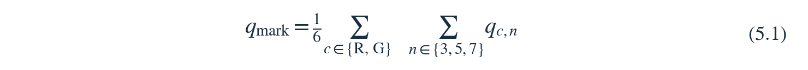
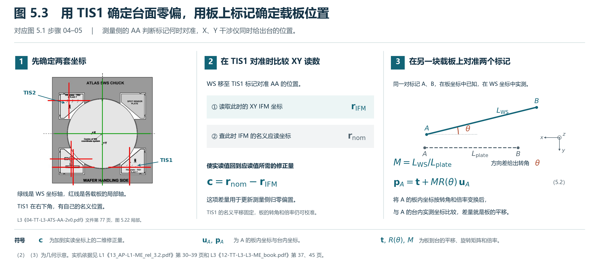
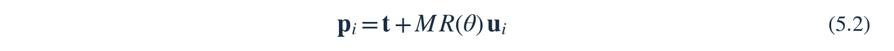
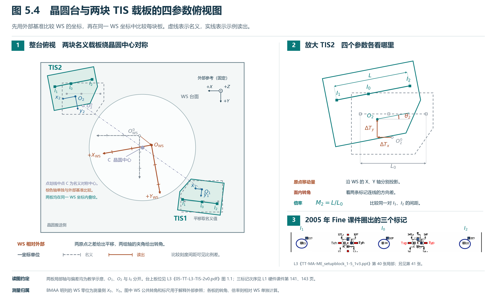
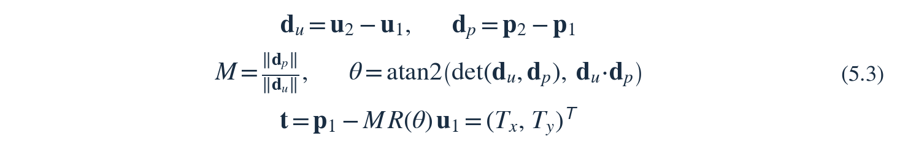
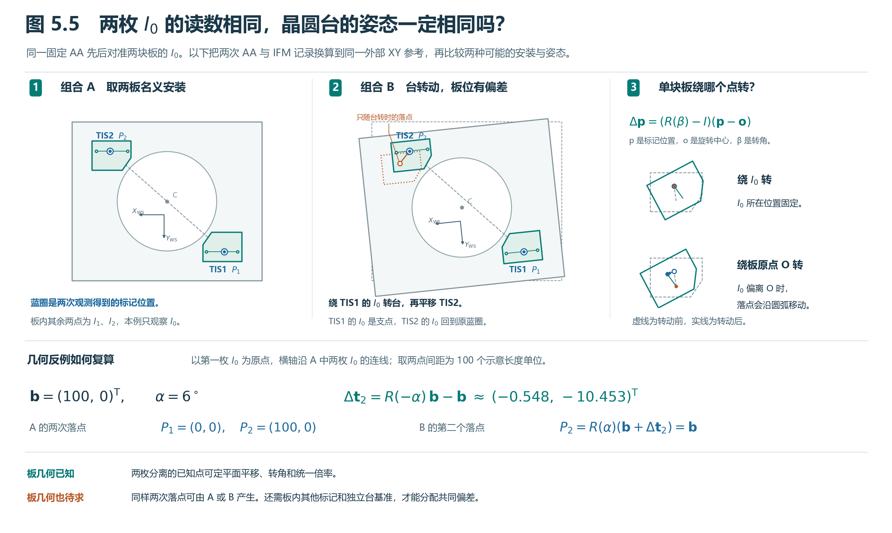

# 第 5 章　BMAA：用台上标记校准晶圆台与对准测头的 XY 关系

**本版新增**　[图 5.5　Stage Align 测两枚 I0 能确定什么](#two-i0-stage-align) · [图 5.4　两块板的名义外轮廓与安装偏差](#top-view) · [三标记的实机用途](#mark-use) · [两板实际保存哪些参数](#board-mc) · [上一版草稿](MEtrology-BMAA整理草稿_v5.md#top-view) · [本章公式图片规范](MEtrology-公式显示规范_v1.md)

[图 5.1 总流程](#overview) · [Purpose 与机器常数](#purpose) · [How 操作流程](#how) · [图 5.2 如何找准一个标记](#wq) · [图 5.3 如何由标记求零偏与板位](#trm) · [Fine 为什么要复测](#repeat) · [Level 1–3 资料汇整](BMAA资料汇整_v1.md)

**图 5.1　BMAA 自动校准总流程。** 晶圆台（WS）把自身基准板上的标记移到固定的高级对准测头（AA）下方。AA 判断标记在哪里对准，X、Y 干涉仪（IFM）给出此时台走到了哪里。把这两项观测配在一起，系统才能在台归零后，按坐标重新找到同一块板上的任意已知标记。图按 L3 自动流程绘制。[流程与原页](BMAA资料汇整_v1.md#l3)

## 5.1　Purpose　为什么做，校哪些常数

**BMAA（Basic Machine Constants for Advanced Alignment）校的是测量侧的台面 XY 基准。** 即使 WS 已完成初步归零，系统也只知道台回到了一个可重复的位置。要把某块载板上的标记送到 AA 下方，还要知道两件事：台归零后相对 AA 的 XY 偏置，以及这块板实际装在台面的哪里、朝向怎样、板上的长度单位与 IFM 的长度单位如何对应。BMAA 分别在两个卡盘上校准这些关系。TIS1、TIS2 是每个卡盘上的两块透射图像传感器基准板，板上既有 AA 可读的对准标记，也有供曝光侧 TIS 扫描的光栅。[SWZS 的初步归零基准](MEtrology.md#swzs) · [L1 载板与零位定义](BMAA资料汇整_v1.md#l1)

**进入条件。** WS 已完成初步归零并可定位，AA 硬件检查及初始化通过。L3 AA 手册对其所述配置还列出晶圆搬运机构可用、WS 的 X/Y 定位在 ±1 µm 内、面内转角在 ±5 µrad 内。初始流程图允许 BMAA 与台面初始高度／倾角支路在归零后分别开展；在执行 AA 光束倾角与对焦前，初始 BMAA 粗校和精校都须完成。出处为 L3《04-TT-L3-ATS-AA-2v0.pdf》文件第 76 页（印刷 70），以及 L3《12-TT-L3-L3-ME_book.pdf》文件第 14 页（印刷 6），图 1.3。

**表 5.1　自动版中各项量的来源和用途**

| 量 | 怎么得到 | 用在哪里 |
| --- | --- | --- |
| 测量侧 WS 的 XY 归零偏置 X0、Y0 | 用 AA 找到 TIS1 的已知标记，将此时 X/Y IFM 的实际读数与按名义几何应有的读数比较。Coarse 建立初值，Fine 细化。 | 把台归零后的 XY 坐标与固定的 AA 测头对上。TIS1 的名义平移作为基准保持固定。 |
| 各适用载板的平移、面内转角和倍率（TRM） | Coarse 求 TIS2 及有配置时 ILIAS 基准板的平移；Fine 微调上述平移，并用同一板上多个标记确定板的转角与倍率。TIS1 也可有转角和倍率。 | 在板的局部坐标和 WS 坐标之间换算。另一配置分别报告 Abbe 校准模块与置信传感器校准模块（CSCM）的 TRM。 |
| AA 光学模块（OM）的参考光栅偏移 | 自动 Coarse 中求出各通道的标记位置，分别与红、绿两色 3、5、7 阶的位置均值比较，报告偏移。 | 描述同一标记由不同参考光栅读出时的中心差异。另有独立的级次间偏移校准（SBO）。 |
| 板内标记名义坐标；捕获强度、相关度和拟合指标 | 名义坐标取自板的已有定义；后三项来自本次扫描和计算。 | 名义坐标是求 TRM 的输入，后三项判定本次测量是否可用。 |

常数分工依据 L3《TT-MA-ME_setupblock_1-5_1v3.ppt》第 33、40、46 张与 L3《04-TT-L3-ATS-AA-2v0.pdf》文件第 77–78、122 页。早期相机版在 Coarse 阶段已报告转角和倍率，详见[两版对照](BMAA资料汇整_v1.md#versions)。

**完成后可以做什么。** 台面标记的位置已知，系统可以做台面对准（stage alignment），算出 TIS 光栅在 WS 坐标中的位置，供曝光侧随后寻找这些光栅。BMWL 使用台面对准去校晶圆装载偏置；BMTIS 在曝光侧进一步建立基准标记与投影镜头的关系。L2 的部分维护测试还将 BMAA Fine 列为前置条件。[L2 后续项目及出处](BMAA资料汇整_v1.md#l2) · [L3 各测头的参考关系](BMAA资料汇整_v1.md#sequence)

## 5.2　How　台怎样走，逐步读什么

**自动流程译文。** 以下译自 L3《12-TT-L3-L3-ME_book.pdf》文件第 37–42、45 页（印刷 29–34、37）及 L3《TT-MA-ME_setupblock_1-5_1v3.ppt》第 33–41 张。保留先捕获、再确定位置、再调整载板参数的顺序。

1. **捕获标记。** 将所选台上标记移到 AA 光学模块下的预计位置。标记起初可偏离预计位置达 1 mm。按螺旋顺序搜索二维网格，相邻点间隔 100 µm，各点执行扫描。找出信号最强的位置；信号超过门限，才认为标记已可靠捕获。
2. **确定标记中心。** 在标记的 X 段，沿 X 做一组平行扫描，逐次改变 Y 偏置，取得 WQ（Wafer Quality，对准信号强度）随 Y 的轮廓。对 Y 段交换两轴，取得随 X 的轮廓。对每个通道依次执行原文的五步：① 用理想标记像与参考光栅的几何重叠定义模板；② 将实测轮廓与模板作相关；③ 对相关曲线求导；④ 用直线拟合导数的过零点，得到该通道中心；⑤ 从奇数阶通道的十个候选位置中，取红、绿两色各第 3、5、7 阶的六个位置求平均。两个方向分别处理后，得到标记 XY。
3. **检查本次定位。** 按卡盘和标记检查捕获状态，并按通道检查相关度和线性拟合。该版 TIS 示例的捕获信号要求大于 0.001，相关度大于 0.7，导数直线拟合的多重相关系数（MCC）大于 0.95。捕获失败说明搜索中信号不足；后两项失败说明轮廓形状异常，检查标记或光学模块。课件分别保存捕获和定位的 WQ 数据，可用来区分这两种情况。
4. **粗校零位和板位。** 利用 TIS1 这个平移基准确定 WS 的测量侧 XY 零位，再确定 TIS2 及适用 ILIAS 板的平移。自动流程同时给出光学模块各参考光栅的偏移。TIS1 与 IFM 如何配合，见[图 5.3](#trm)。
5. **精校两台的载板。** 重新对准各基准板的标记。2005 年 L3 课件在两块 TIS 板上选取 I1、I0、I2，见[图 5.4 的原页蓝圈](#mark-use)。如果实测标记按当前转换折回板内后偏离名义位置，就调整该板的 TRM。在两个卡盘上对所有适用载板重复，细化 WS 零偏与板平移，求板面内转角与倍率。粗校后软件已能自动找到这些标记。后续在 AA 或 IFM 参考更新后再运行 Fine。[复测时机](#repeat)

看图 5.1 时，可以沿数据追踪一次操作。**步骤 02 得到一块能继续测量的小区域；步骤 03 得到这块区域内一个可信的中心；步骤 04 把这个中心和同一时刻的台位置配对；步骤 05 比较同一载板上多个中心，确定整块板的几何。** 100 µm 是第一遍找标记的网格间距。其后测 WQ 轮廓，课件给出的窄标记定位精度为 <4 µm。[L3 阶段指标及原图](BMAA资料汇整_v1.md#l3)

## 5.3　Principle　怎样从光学信号得到台面坐标

### 一个亮点怎样变成可重复的中心（总流程 02–03）

**图 5.2　捕获与确定中心是两次不同的读数。** 左侧搜索先回答标记在哪个网格附近。随后逐条平移扫描线，标记像和参考光栅重叠得越多，WQ 通常越强；峰顶可能较平，单取最亮的一条线很难定位。将整条实测轮廓与模板比较，相关峰对应两者最匹配的位置。在峰附近求导并拟合过零点，就能给出一个通道的中心。图内原图节选自 L3《12-TT-L3-L3-ME_book.pdf》文件第 38–40 页（印刷 30–32），图 2.18、2.19、2.20、2.22。

对 X 或 Y 的一个偏置方向，图中的 q 表示通道中心，下标 c 表示红光 R 或绿光 G，下标 n 表示衍射级次。式（5.1）把课件选用的六个位置合成一个方向的标记坐标。换另一方向再算一次，就得到 XY。

### 一个中心怎样定零偏，两个标记怎样给出板的姿态（总流程 04–05）

**图 5.3　TIS1 给出台的平移基准，板内的标记对给出方向和尺度。** 原图节选自 L3《04-TT-L3-ATS-AA-2v0.pdf》文件第 77 页（印刷 71），图 5.22 右半。图中台坐标轴与几块载板的局部轴分别绘制。实际找标时固定的是 AA 测头，移动的是 WS；与 AA 对准的 IFM 读数须按台坐标约定换算成标记在台上的位置。

**先定平移基准。** 假设只观测到「标记比预期偏了一点」，这既能解释成台的零点偏了，也能解释成这块板装偏了。BMAA 规定每台 TIS1 的名义平移固定，便可把在 AA 下找到它时的 IFM 实读值与应读值之差用于修正 X0、Y0。L1 的 Chuck 2 实例很直观：TIS1 的平移校前、校后都是 (−122.5, 144.5) mm，说明基准点可以离台面中心很远；该板的转角和倍率仍可校准。出处为 L1《13_AP-L1-ME_rel_3.2.pdf》文件第 31、35、38 页。

**再用同一板的多个标记确定板位。** 式中 u 表示标记的板内名义坐标，p 表示用 AA 与 IFM 换算出的 WS 坐标，两者的下标 i 均指同一个标记。以板坐标换算到台坐标的方向，几何关系可写为式（5.2）。t 是板原点的台面位置，R 是绕 Z 轴的面内旋转矩阵，θ 是转角，M 是无量纲倍率。这是 TRM 的几何解释，图 5.3（2）把“加到 IFM 实读坐标上的修正量”定义为应读减实读。课件未说明固件写入偏置的正负号约定，以及多标记拟合的实际权重。

实际可把同一板的两个标记想成线段的两端。两端都平移相同距离，线段方向和长度保持不变；实测线段相对名义线段转了多少，就给出板的转角；长度之比给出倍率。确定这两项后，一个已知端点就足以反推出板原点的位置。这样，即使某个光栅本身没有参与对准，系统也能将其已知板内坐标换算到 WS 坐标。倍率反映板内长度与 IFM 测量长度的比例，两者的标尺差异也会进入这个量。出处为 L1《13_AP-L1-ME_rel_3.2.pdf》文件第 30–31、36 页及 L3《04-TT-L3-ATS-AA-2v0.pdf》文件第 77–78 页。

### 图 5.4　从上方看两块 TIS 相对 WS 的平移、转角和倍率（总流程 04–05）

**先选定参考系，再读四参数。** 图 5.4（1）从正 Z 一侧朝 XY 平面看，右下是 TIS1，左上是 TIS2，每块板各有自己的原点和一排 I1、I0、I2。WS 原点在台面中央附近。三套坐标中的点都在 XY 平面内；在纸面上正 X 向左、正 Y 向下，正 Z 朝向读者。坐标箭头表示方向，刻度表示长度单位。板上的 I0 是光学标记，只要知道它的板内坐标，就可以把原点选在别处。[L1 和 L3 的载板原图](BMAA-TIS双板四参数资料核查_v1.md#constants)

**两块名义载板的外形如何对应？** 在这张示意图中，将 TIS1 的名义外轮廓绕晶圆中心 C 旋转 180°，便与 TIS2 的名义外轮廓完全重合。每块板的标记名称按各自原图读取。两块板沿用上一版的示意尺寸，实际安装轮廓分别按各板的示例偏差绘制。两板的名义和实际轮廓均与晶圆边缘留有间隙，图中间隙仅示意位置关系。

**先看 WS 相对外部参考。** 可以按一般模型，给归零后的 WS 读数加上公共的 XY 平移、方向偏差和标尺误差。这样，同一个台上位置由两套坐标描述时，原点、方向和一个坐标单位的长度都可能不同。物理上一块刚体归零可以有平移和转角，图中的 WS 倍率则表示**读数标尺**。这层共同偏差会影响两块板，用它来理解外部参考与台坐标的关系。

**再固定 WS，看每块板相对台面的安装几何。** 图 5.4（2）以 TIS2 为例。板原点在 WS 两轴上的坐标是 Tx、Ty；若从图上的名义原点量到实际原点，两段投影才是平移**改变量**。用 I1 到 I2 的同向连线比较名义与实测，两线方向差给出 Rot，两线长度之比给出 Mag。倍率反映板上标记的点距与台面 IFM 长度单位之比。TIS1 也有同样四个描述字段，但它的平移承担了定义 WS 基准的作用，见[表 5.3](#board-mc)。

**表 5.2　哪份资料确切测了哪些标记**

| 资料中的步骤 | 测哪些点 | 这些点用来做什么 |
| --- | --- | --- |
| **2005 年 L3，BMAA Fine** | 第 40 张在同一排分别用蓝圈选中 I1、I0、I2，并要求两个卡盘的各板都重复。第 41 张从实物俯视图的 TIS1 引线放大到这组标记。 | 在固定 AA 下逐枚对准，用 IFM 得到台位置，把标记折回板坐标，与名义位置比较，调整每板 TRM。该版支持图中两板六标。课件没有公布各点的拟合权重或实际访问顺序。 |
| **2003 年 L1，BMAA 早期版** | Coarse 的逐板清单列 I1、I2。Fine 重复该顺序，跳过粗找用的 CMXPA。 | 该版用两端标记校板。出厂或培训版本改变时，仍须核对本机配方。 |
| **2006 年 L2，生产中的扩展水平台面对准** | 每批、每卡盘测各板 I1 和 I2；每片晶圆测两板各自的 I0。 | 同一板的两端给该板的转角和倍率；两板 I0 的位置用于更新 TIS2 相对 TIS1 的平移。这是生产中明确给出的分工和频次。 |

出处分别为 L3《TT-MA-ME_setupblock_1-5_1v3.ppt》第 40–41 张，L1《13_AP-L1-ME_rel_3.2.pdf》文件第 33、36、39 页，及 L2《TT-L2-ME-3v0.pdf》文件第 27 页（印刷 21），图 1.27。图 5.4（3）保留了 L3 原页选点标识。[原页核查与版本差异](BMAA-TIS双板四参数资料核查_v1.md#marks)

**从三枚标记到四个参数。** 对每块板分别做同一件事。先取设计给出的三点板内坐标，再将三枚标记逐一送到固定 AA 下，让 AA 判中心，并用同时对应的 IFM 台读数换算出三点的 WS 坐标。这样才得到三组“同一物理点、两套坐标”；直接把台移动指令填成板坐标会混淆方向和原点。

先只用两个外侧标记看几何。式（5.3）中，下标 1、2 分别指 I1、I2，两个差向量都从 I1 指向 I2。长度之比给倍率，用两向量的有向夹角得到转角，最后用一个端点反推出板原点的台坐标。公式里的 det 是两个平面向量的有向面积，配合点积可确定转角的正负及象限。

若使用全部三点，可像式（5.4）那样找一组四参数，使三个名义点变换后的落点尽量接近实测点。每个点提供 X、Y 两个观测量；I0 增加一个可核查的点。三点即使在同一直线上，只要外侧两点分离，就足以确定**单一倍率、保持左右手方向**的平面相似变换。算出的点位与实测点之差是拟合残差。这里给出的是等权工程解算，用来说明三标如何参与；课件没有公开控制软件的拟合权重。对 TIS1 应施加下表的名义平移约束，台的共同 XY 零偏另计。

**表 5.3　每个卡盘按 TIS1、TIS2 分别保存四参数 TRM，WS 另有测量侧零偏**

| 相对于谁 | Tx、Ty | Rot、Mag |
| --- | --- | --- |
| TIS1 → 本卡盘 WS | 两个平移字段都有值，按定义保持名义值。若 TIS1 实际装偏，在 AA 下找到它时会表现为 IFM 实读与应读的差，由 WS 的 XY 零偏吸收。 | 可由板上标记确定并更新板的面内转角和倍率。 |
| TIS2 → 同一卡盘 WS | 在 TIS1 规定的台坐标下，求出并更新该板两个平移分量。 | 同样求出并更新 TIS2 自己的转角和倍率。 |
| 归零后的 WS → 测量侧 AA | BMAA Fine 明列最终的 WS X0、Y0。它们是台的归零偏置，与某块板原点的台坐标含义不同。 | 本次查到的 BMAA Fine 输出清单没有另列 WS 公共归零转角和倍率。要把公共方向或标尺误差归到 WS，自身还需要独立的方向或长度参考。 |

例如，若把整套 WS 坐标绕一个选定原点旋转，须在两板转换中反向换算每块板原点的坐标和板轴的方向，才能保持所有标记的外部位置。只从两块板的角度字段减去同一角度，一般还会留下板原点的位移。在没有独立标尺时，台的公共倍率与板倍率也会互相影响。**六点能给出每块板在既定 WS 坐标中的四参数；仅靠这六点，不能把两块板的安装偏差和 WS 对外部参考的四项偏差全部独立分开。**

L1 的实际报表给出了这一约束的直观例子。Chuck 2 的 TIS1 平移校前、校后均为 (−122.5000000, 144.5000000) mm，其转角和倍率却都更新。TIS2 的平移则从 (144.3000000, −144.5000000) mm 变为 (144.2999652, −144.5000017) mm。这是 L1 **Coarse 报表样例**；Fine 的实际输出项目由 L3 AA 手册确认。[两板的报表字段与 Fine 出处](BMAA-TIS双板四参数资料核查_v1.md#constants)

### 图 5.5　Stage Align 读两枚 I0，能确定哪一层运动？

**先说这两个读数怎么来。** 同一个卡盘上，WS 先把 TIS1 的 I0 移到固定的 AA 测头下，再把 TIS2 的 I0 移过去。每次都由 AA 判定标记中心，并取此时的 XY 干涉仪读数。用同一个台运动参考把两次记录换算到共同的参考姿态，就可以在一张图上标出两枚 I0。图中的两个蓝圈表示这样得到的两个位置。出处为 L2《TT-L2-ME-3v0.pdf》文件第 12–13 页（印刷 6–7），图 1.7、1.9、1.10。[两种读数的物理含义](BMAA资料汇整_v1.md#l2)

**板的位置也未知时，两个点不能把台和板分开。** 图 5.5（1）把两块板放在名义位置。（2）换一套安装假设：让台绕 TIS1 的 I0 转 6°，第一枚 I0 留在原处。若 TIS2 仅随台转，它的 I0 会落到橙圈。给 TIS2 换一个平移量，就能让它的 I0 精确落回第二个蓝圈。在以两点间距为 100 的示例中，台内所需平移约为（−0.548，−10.453）；图中给出了未经取整的计算式。两套假设的 WS 面内姿态、TIS2 的安装平移各不相同，测得的两个点却逐个相同。比较的是两种可能的安装状态，每种状态中的板均与台刚性连接。

**单块板的转动会把 I0 带走吗？** 看图 5.5（3）的旋转中心。若板绕 I0 转，I0 本身没有位移，一枚点看不出这个转角；同板的 I1、I2 会移动。若板绕另一个固定点 O 转，例如板局部原点，I0 会沿以 O 为圆心的圆弧移动，弧的半径就是 O 到 I0 的距离。因而单看 I0 发生了位移，还需知道板原点、转轴和其他标记，才能判断来自平移还是转动。图（2）用平移构造了严格的反例，图（3）解释纯转动在什么条件下会改变 I0 的读数。

**如果两枚 I0 在 WS 坐标中的位置都已独立标定，结论就不同。** 两枚点须不同、身份已知，并且两次寻标用同一台运动参考换算。用两点连线的有向夹角求面内转角，用长度比求统一倍率，再用一个端点确定 XY 平移。这里沿用式（5.3）的平面保向相似关系，把式中的两点换成两块板上已知的 I0。若两套坐标均有已校准的同一物理长度单位，并将台视作刚体，倍率固定为 1。只有在所选 WS 原点恰为两枚 I0 的中点时，才可直接取读数中点作为原点；名义板外轮廓关于晶圆中心对称本身不能确定这一点。两次 XY 观测仍无法给出完整六自由度；高度、俯仰与横滚还需独立的高度或姿态信息。[式（5.3）与单板坐标解算](#mark-use)

| 再增加什么信息 | 能区分什么 |
| --- | --- |
| 同一块板再测已知板内坐标的 I1、I2 | 看板上两点连线的方向和长度。在由独立基准确定的 WS 坐标中，可求该板的旋转、倍率和平移。只增加未知载板上的点，台的共同坐标偏差仍可能由各板的 TRM 吸收。 |
| 在台本体上增加已知 WS 坐标的独立基准 | 图中的两套假设会让支点以外的台上固定点出现不同的外部位置，可用它判别 A、B。一般情形要单独确定 WS 的面内相似变换，需要足以约束位置、方向与比例的独立信息，例如两个已知且分离的台体基准点。 |

**对实机流程，按资料给出的约束读数。** 在 L2 的扩展水平台面对准中，每批、每个卡盘先用各板 I1、I2 更新该板的转角和倍率；每片再测两板 I0，确定 TIS2 相对 TIS1 的平移。BMAA 离线校准另有名义板内几何和 TIS1 固定平移基准。2005 年 L3 Fine 示图选用各板 I1、I0、I2，并调整每板 TRM 和测量侧 WS 的 XY 零偏。两者的目标、约束和计算出的参数见[表 5.2](#mark-use)和[表 5.3](#board-mc)。生产测量依据 L2《TT-L2-ME-3v0.pdf》文件第 26–27 页（印刷 20–21）图 1.27，离线校准依据 L1《13_AP-L1-ME_rel_3.2.pdf》文件第 30–31、35 页和 L3《TT-MA-ME_setupblock_1-5_1v3.ppt》第 40–41 张。图 5.5 的两种安装状态与数值为解释可辨识性而设。[三个版本的原图及逐页出处](BMAA-TIS双板四参数资料核查_v1.md#marks) · [WTAF 如何给台施加已知转角并重复对准 I0](MEtrology-WTAF整理草稿_v1.md#wtaf-algorithm)

### 为什么已经做过 Fine，还要再测

同一个标记的台坐标依赖两项测量：AA 判定对准的位置，以及此时 IFM 给出的台位置。对焦、级次间偏移或 IFM 坐标校准改变后，原先求出的板位需要与新的参考一致。L3 的整机流程在粗校后先做第一次 Fine，第二次安排在 AA 对焦、级次间偏移及测量侧 XY IFM 更新之后；第三次在相位光栅系统（PGA）的增益校准后；第四次在二阶畸变优化（SODOM）改变焦面后。后两处接 BMTIS Fine。若只是台坐标非正交或比例更新，课件还列出了用坐标前馈换算代替该项额外复跑的办法。[四次 Fine 的逐页出处及适用条件](BMAA资料汇整_v1.md#sequence)

[返回总流程](#overview) · [查完整资料与版本差异](BMAA资料汇整_v1.md) · [已审章节目录](MEtrology.md#calibration-index) · [待审第 4 章 WTAF](MEtrology-WTAF整理草稿_v1.md#wtaf-algorithm)
