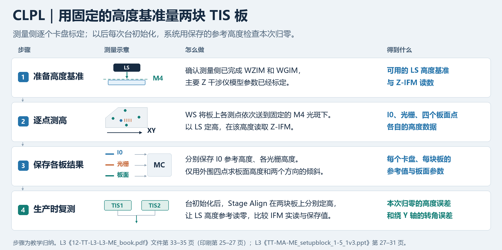
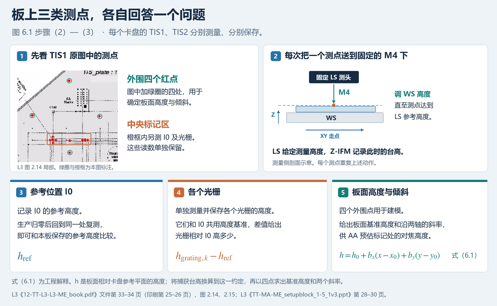
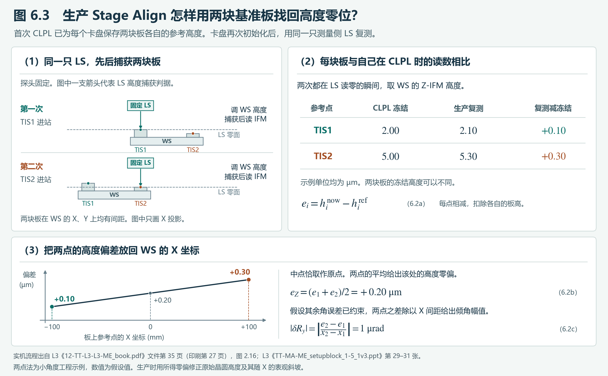

# 6. CLPL · 晶圆台基准板高度与倾角标定

[总流程](#clpl-flow) · [Purpose｜目的和机器常数](#clpl-purpose) · [How｜逐点测高](#clpl-how) · [Principle｜板面与光栅](#clpl-points) · [生产时怎样求 Z、Ry 零位误差](#clpl-production) · [维护验证与漂移监测](#clpl-verification) · [Level 1–3 原文与页码](CLPL资料汇整_v1.md#scope)

**图 6.1　CLPL 总流程。** （1）至（3）是首次标定。（4）是生产时使用标定结果。每个卡盘都装有两块 TIS 基准板，两卡盘分别完成测量。图中的 M4 是测量侧固定测高传感器（LS）的中心光斑，Z-IFM 是报告台体高度的干涉仪。对应 L3-《12-TT-L3-L3-ME_book.pdf》文件第 33–35 页（印刷第 25–27 页）和 L3-《TT-MA-ME_setupblock_1-5_1v3.ppt》第 27–31 张。[原图定位](CLPL资料汇整_v1.md#figures)

## Purpose（目的）

**CLPL（WS Fiducial Leveling Parameters test）测量晶圆台上透射像传感器（TIS）基准板的高度和倾角。** 测量回答三个问题。每块板的参考点有多高？各个光栅比该参考点高或低多少？若要对准同一块板上的另一个标记，应把台升到哪里？为此，CLPL 在测量侧建立相对于卡盘的高度基准。测量侧对准传感器（AA）据此将标记送到焦高附近，曝光侧图像传感器使用各光栅自己的高度。两边使用的是同一卡盘上可重复找到的物理参照。[L3 项目目的、测量与输出](CLPL资料汇整_v1.md#method)

**图 6.1（1）的前提。** 测量侧先做 WZIM，确定初始高度、倾角并校准 XY 走位时的一阶高度变化，再做 WGIM，校准影响 Z 读数的姿态耦合。否则台在不同 XY 位置的剩余测高误差会混进板形。CLPL 使用已经校准的主要 Z-IFM 参数，更新的是基准板数据。其结果为 AA 焦高校准和曝光侧初始高度、倾角校准（BMWZ）提供参考。BMAA 另行确定标记在台面内的位置。[WZIM](MEtrology.md#wzim) · [WGIM](MEtrology.md#wgim) · [L3 标定顺序及与 BMAA 的关系](CLPL资料汇整_v1.md#sequence)

**表 6.1　每个卡盘分别保存的物理量**

| 标定对象 | 取数位置 | 结果怎样用 |
| --- | --- | --- |
| TIS1、TIS2 各自的参考高度 | 每块板规定的参考位置，L3 正文称为 I₀ 参考位置 | 后续在同一位置复测，与本板保存值相减，判断这次台归零偏了多少。 |
| 各 TIS 光栅的高度 | 每个相应光栅位置独立测量 | 光栅与本板参考位置的高度差，为曝光侧把光栅送入焦点捕获范围提供依据。 |
| 每块 TIS 板的高度 Z 和板面倾角 Rx、Ry | 分布在板面上的四个外围点 | 由板面估计不同 XY 处的标记高度，将标记送至 AA 焦面附近。课件所述实现按高度定位，标记自身的局部倾角未作补偿。 |
| ILIAS 基准板的高度与倾角 | 仅限装有该模块的机台 | 按机台配置补测并保存附加板几何。 |

表中采用课件给出的物理名称。L1–3 未列出这一组机器常数的完整数据库字段名。另有 L2 版本列出 ABBE、CS 基准板，适用配置见资料汇整。[L3 结果清单](CLPL资料汇整_v1.md#method) · [机型与版本](CLPL资料汇整_v1.md#versions)

## How（操作流程）

**L3 方法段译文。** 仅用 LS 的中间光斑，因此仅在测量侧，用四点调平法确定两个卡盘上各自两块 TIS 板的高度和倾角。TIS1 示意图中加重的点是测高位置。下方放大图给出图像传感器以及 I₀、I₁、I₂ 所在区域，以便看清中央测点下方的结构。各类测量独立取数。板面高度和倾角只用板上另外四个位置的测量值建模。来源为 L3-《12-TT-L3-L3-ME_book.pdf》文件第 33–34 页（印刷第 25–26 页），图 2.14。[原文与图意](CLPL资料汇整_v1.md#figures)

1. **把点移到固定的 M4 下。** 选定卡盘和基准板，移动 WS 的 XY，将待测位置送到 M4 下方。调 WS 的 Z，直到 LS 高度读数为零，此时记录 Z-IFM 的台高。移到下一个 XY 位置，重复相同动作。各点使用同一个外部高度判据，记录的台高可以各不相同。对应图 6.1（2）。[L1-《13_AP-L1-ME_rel_3.2.pdf》第 24 页及 L3 课件第 28 张](CLPL资料汇整_v1.md#scope)
2. **把读数放回对应的板和测点。** 分别保留本板参考位置和各光栅位置的测量。用另外四个外围点求本板的高度和两个倾角。TIS1、TIS2 各得一套结果，再对另一卡盘完成同类测量并保存相应机器常数。三组数据的用途由原书明确，点组的实际扫描先后、重复次数和拟合权重未公开。对应图 6.1（2）至（3）。[L3-《TT-MA-ME_setupblock_1-5_1v3.ppt》第 27–30 张](CLPL资料汇整_v1.md#method)

## Principle（校准原理）

**图 6.2　为什么同一块板要分三类点测。** 对应图 6.1（2）至（3）。图 6.2（1）节选自 L3-《12-TT-L3-L3-ME_book.pdf》文件第 33 页（印刷第 25 页）图 2.14，绿圈和橙框是本稿标注。子图（2）至（5）为据原书整理的示意。[原图 2.14、2.15 的出处与解读](CLPL资料汇整_v1.md#figures)

**LS 每次都回到零，为什么还能测出高度差？** 设两处板面有高低，台保持同一姿态。较高的一处移到 M4 下时，台要降得更多，这个表面点才会回到同一 LS 零面。LS 给出“已经到达参考面”的判据，Z-IFM 给出“为此把台移到了哪里”的数值。若以向上为正，将捕获时的台高换算为表面相对卡盘的凸起量时，两者的变化方向相反。[L1 固定高度参考与 L3 原图 2.15](CLPL资料汇整_v1.md#figures)

**四点只描述板面，光栅要逐处实测。** 图 6.2（5）的式（6.1）是四点平面的工程写法。横、纵坐标取在板面上，基准点的高度和两个方向的斜率确定一个平面。AA 要找另一个位置的标记时，可以用该平面估计应送到的高度。但板面有局部起伏，某个光栅实际高多少，须查图 6.2（4）的独立测量。这个步骤给出参考点到光栅的几何高度差，后续焦点测试继续建立它与实际曝光焦面的关系。[L3 原书文件第 34 页、课件第 27–29 张](CLPL资料汇整_v1.md#sequence)

### 生产时怎样从两块板求 Z、Ry 零位误差

**图 6.3　同一块板先后两次比什么，两块板之间再比什么。** 对应图 6.1（4）。L3-《12-TT-L3-L3-ME_book.pdf》文件第 35 页（印刷第 27 页）图 2.16 给出两块板的实际位置和生产用途。图中的数值及式（6.2a–c）是小角度工程示例。[生产取数与原图](CLPL资料汇整_v1.md#use)

重新初始化后，零传感器给 IFM 建立的零位有重复性误差。生产 Stage Align 把同一卡盘的 TIS1、TIS2 先后送到测量侧 LS，分别调台到 LS 高度参考读零、记录此刻的 Z-IFM。**先让每块板与自己的历史参考比，再比较两个偏差。** 这样板与板原有的安装高度差就不会被算作本次零偏。系统用所得 Z 偏差和沿 X 的倾斜分量修正原始晶圆高度，否则，同一块晶圆可能看起来整体升高了，或沿 X 多出一项楔形倾斜。[L2-《12-TT-L2-ME-module.pdf》文件第 17–19 页及 L3 原书第 35 页](CLPL资料汇整_v1.md#use)

图 6.3 中，TIS1 比本板保存值高 **0.10 µm**，TIS2 高 **0.30 µm**。若两点的 X 坐标分别为 −100 mm、+100 mm，且其余角度误差受约束，中点的 Z 读数零偏为 **+0.20 µm**，两点间的额外高度差对应 **1 µrad** 的 Ry 零偏幅值。实际两板在 X、Y 上都错开。两个高度读数可确定资料所用的 Z、Ry 两项，同时独立估计 Rx 则还缺少观测。[原图几何与算例适用条件](CLPL资料汇整_v1.md#versions)

### 维护验证与后续 TIS 漂移监测

| 场合 | 怎样做 | 判断什么 |
| --- | --- | --- |
| L2 复核已保存的机器常数 | 确认 WS、LS 已初始化，台行程、初始化重复性、WZIM 与 WGIM 满足前提。上次更新在一周内，按维护程序第一张规格表比较。间隔较久，两轮之间不保存常数，对比连续两份报告，按第二张表判短期稳定性。 | 检查板高和倾角能否复现。各板倾角变化若同向且量级接近，需考虑共同的零传感器漂移。超规时按该版本程序处理并复验。 |
| 后续建立 TIS 漂移参考，用于扩展垂向台对准（XVSA） | 在测量侧沿 X 扫过 TIS 标记区，记录 LS 全部九个光斑的九条板形曲线。生产中批首两个卡盘各做扫描，再与漂移参考比较。 | 监测板倾角、LS 倾斜和板形变化。在 L3 所述版本里，批内其余晶圆的普通 Stage Align 使用九光斑静态测量。前文首次 CLPL 的四点板面标定只用 M4。 |

**表 6.2　同一组基准在维护和生产中的两种后续用途。** L2-《12-TT-L2-ME-module.pdf》文件第 37–38 页（印刷第 29–30 页）给出维护程序。L3-《12-TT-L3-L3-ME_book.pdf》文件第 61–62 页（印刷第 53–54 页）图 2.46 给出九光斑扫描。生产漂移报警与首次标定的验收限值须按各自程序读取。[原文、验证条件与各版报警口径](CLPL资料汇整_v1.md#versions) · [回到总流程](#clpl-flow)
