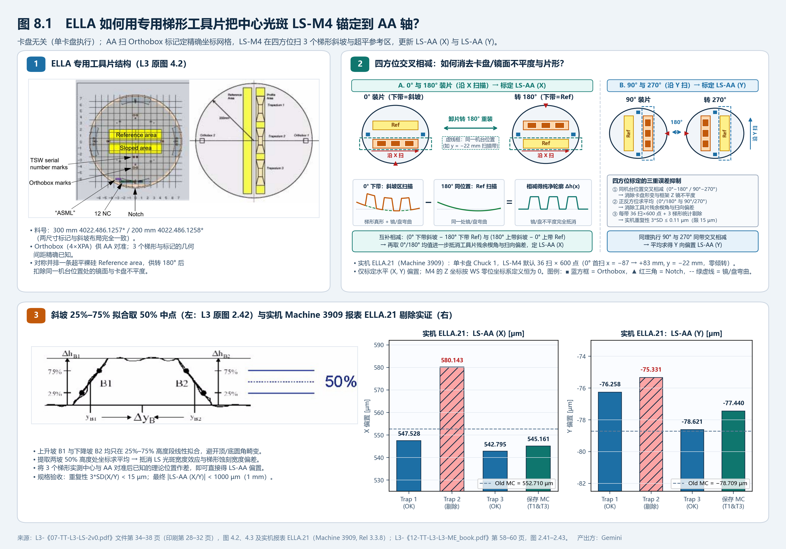
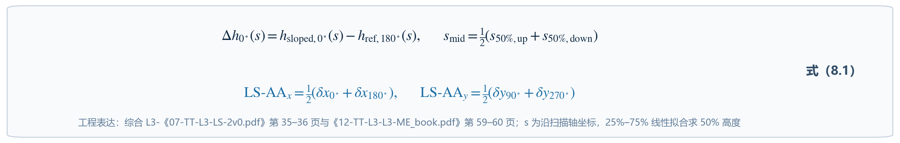
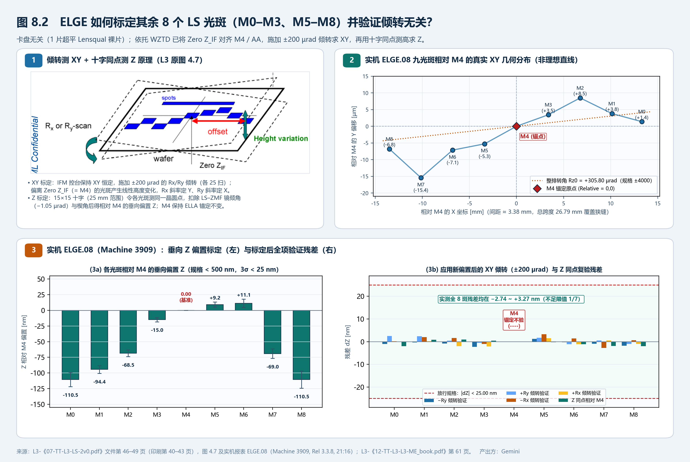
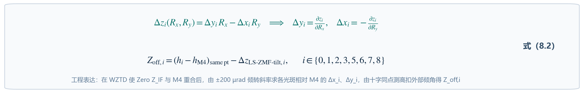
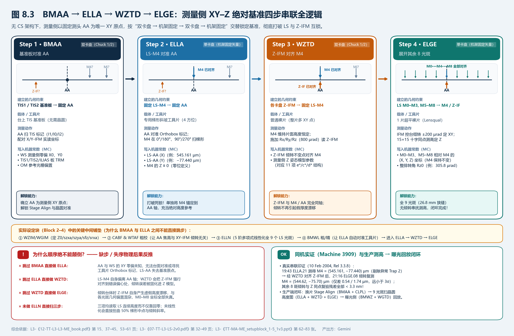
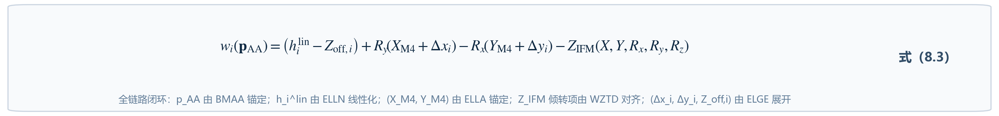

# 8. ELLA、ELGE 与测量侧四步基准链（BMAA → ELLA → WZTD → ELGE）

> 产出方：Gemini ｜ 日期：2026-11-28 ｜ 版本：v2 ｜ 基线：MEtrology-ELLA-ELGE与测量侧Z一致性整理草稿_Gemini_v1.md（Gemini）

[1. ELLA｜LS-M4 对准 AA](#ella) · [2. ELGE｜展开其余 8 光斑](#elge) · [3. BMAA–ELLA–WZTD–ELGE 全链路串联](#chain) · [为什么顺序不可颠倒](#order-why) · [同机实证与生产闭环](#closure) · [ELLA/ELGE 资料汇整](ELLA-ELGE资料汇整_Gemini_v1.md#scope) · [WZTD 第 7 章草稿](MEtrology-WZTD整理草稿_Gemini_v1.md#wztd) · [BMAA 第 5 章草稿](MEtrology-BMAA整理草稿_v6.md#bmaa) · [上版草稿 v1](MEtrology-ELLA-ELGE与测量侧Z一致性整理草稿_Gemini_v1.md#ella-elge-chain) · [成果索引](../README.md)

本审阅稿分两大部分：先逐项梳理测量侧水平传感器（LS）的两项核心光斑位置校准——**ELLA（LS–AA 偏置校准）** 与 **ELGE（LS 九光斑相对位置校准）**，再把 **BMAA → ELLA → WZTD → ELGE** 四步测量侧 XY–Z 绝对基准链及其中间铺垫（WZIM、WGIM、WTAF、ELLN、BMWL）完整串通，并以同一实机（Machine 3909）的连续报表作数值印证。

---

## 8.1　ELLA · 中心光斑 LS-M4 相对 AA 偏置校准

### Purpose（目的与机器常数）

在去除置信传感器（CS）的新设定架构（AT3.4）中，测量侧不再有 CS 来先标定 Z-IFM，而是反过来由 LS 中心光斑 **M4** 充当高度基准去标定测量侧 Z-IFM（即 [WZTD](MEtrology-WZTD整理草稿_Gemini_v1.md#wztd)）。为此，必须先独立确定 LS-M4 在测量侧 XY 坐标系中的精确水平位置，使其与测量侧唯一绝对 XY 原点——高级对准传感器 **AA**——建立直接几何联系。**ELLA（LS to AA spot position calibration / LS-AA offset calibration）仅校准中心光斑 M4 相对 AA 的水平坐标，更新 `LS-AA (X)` 与 `LS-AA (Y)` 两个机器常数。**

- **卡盘属性：** 卡盘无关（只需在单卡盘上执行，如实机报表 `ELLA.21` 选 Chuck 1），因为测量的是计量框架上两只固定测头（AA 与 LS-M4）之间的固定水平矢量。
- **为何不标定 Z：** 按晶圆台零位坐标系定义，M4 的 Z 坐标恒为 0（WZIM 已定义 M4 零输出为测量侧高度参考面）。[L3-《12-TT-L3-L3-ME_book.pdf》文件第 60 页](ELLA-ELGE资料汇整_Gemini_v1.md#ella-evidence)
- **执行前置：** 已完成 [BMAA](MEtrology-BMAA整理草稿_v6.md#bmaa)（建立 AA 基准）、粗版 [WTAF](MEtrology-WTAF整理草稿_v4.md#wtaf)（XY-IFM 倾转无关）、`WS TRIM`（复查 srxa）、**`ELLN`（LS 线性化）** 与 **`BMWL` 粗/精校**（确保系统能自动装载并对准专用工具片）。

### How（操作流程）

**L3 流程译文。** 综合 L3-《07-TT-L3-LS-2v0.pdf》文件第 34–36 页（印刷第 28–30 页）与 L3-《12-TT-L3-L3-ME_book.pdf》文件第 59–60 页（印刷第 51–52 页）：

1. **装片至 0° 方位。** 选定单个卡盘，装载专用工具片（300 mm 料号 `4022.486.1257*`；200 mm 料号 `4022.486.1258*`）。片上刻有正交对准标记（Orthobox，4×XPA）、3 个梯形斜坡（Profile/Sloped area）以及与之对称平行的超平裸硅参考区（Reference area），梯形与对准标记的距离精确已知。
2. **AA 对准建立晶圆网格。** 用 Athena AA 扫描片上 Orthobox 标记，确定工具片坐标系，从而获知 3 个梯形斜坡在 AA 坐标下的精确名义位置。
3. **M4 扫描斜坡区与参考区。** 使用中心光斑 LS-M4 沿扫描轴测出斜坡区与参考区高度轮廓（默认 36 次扫描、每次 600 点；实机报表 `ELLA.21` 首扫为 `x = −87 → +83 mm, y = −22 mm`，零倾转）。
4. **旋转 180° 重装并交叉相减。** 卸片转 180° 后重装复测：原本的超平参考区落到 0° 时斜坡区所处的同一卡盘／镜面位置。分别计算「0° 斜坡区 − 180° 参考区」与「180° 斜坡区 − 0° 参考区」，抵消卡盘与 Z 镜面不平度及晶圆系统误差。
5. **斜坡拟合求 50% 中点。** 对每个梯形的上升坡与下降坡，在 25%–75% 高度段做直线拟合，求出 50% 高度处坐标；对同一梯形的上下坡求平均，再对 0° 与 180° 结果求平均，得到 X 向偏置 `LS-AA (X)`。
6. **90° 与 270° 重复测 Y。** 将工具片分别转至 90° 与 270° 重装复测，两条带状区转为沿 Y 方向，同理求得 Y 向偏置 `LS-AA (Y)`。
7. **统计剔除与保存 MC。** 软件对 3 个梯形作统计检验并自动剔除异常梯形。确认各梯形重复性 `3*SD (X/Y) < 15 µm`、且最终 `|LS-AA (X/Y)| < 1000 µm`（1 mm）后保存 2 项 MC；若超限则不更新。

### Principle（原理与实机 ELLA.21 实证）

**图 8.1　ELLA 工具片四方位标定原理与实机报表（v2 扩充子图 2）。** 子图（1）与子图（3）左侧分别嵌入 L3-《07-TT-L3-LS-2v0.pdf》文件第 35 页图 4.2 与 L3-《12-TT-L3-L3-ME_book.pdf》文件第 59 页图 2.42；子图（2）完整拆解 0°/180°（沿 X 扫）与 90°/270°（沿 Y 扫）四方位装片、同机台扫描带互换、剖面相减消除镜/盘弯曲波形及三重误差抑制机制；子图（3）右侧为 Machine 3909（Rel 3.3.8）实机报表 `ELLA.21` 实测数据。[原页核对与单位笔误说明](ELLA-ELGE资料汇整_Gemini_v1.md#ella-evidence)

式（8.1）概括了 ELLA 消除误差的三重机制：第一重，0° 与 180° 让超平参考区精确覆盖同一机台空间坐标，相减 Δh 抵消卡盘与框架 Z 镜不平度；第二重，只在 25%–75% 线性坡段拟合，再取上升坡与下降坡 50% 高度的均值 s_mid，抵消顶底圆角畸变、LS 光斑有限尺寸平均效应及梯形刻蚀宽度误差；第三重，0°/180°（以及 90°/270°）正反方位平均进一步抵消工具片残余楔角与扫描方向偏差。

**实机 `ELLA.21`（Machine 3909, 1250D, 19:43）自动筛选示例：** 三个梯形的 X 均值依次为 547.528、580.143、542.795 µm，Y 均值依次为 −76.258、−75.331、−78.621 µm，全部重复性 `3*SD ≤ 0.108 µm`（远小于 15 µm 规格）。其中 **Trapezium 2** 报 `RESIDU_SLOPE_UP_OUT_OF_SPEC`，软件自动执行 `Excluded Trapezium: Trapezium2`，仅取 Trapezium 1 与 3 的均值写入 `LS-AA (x) = 545.161 µm`、`LS-AA (y) = −77.440 µm`（替代旧值 `552.710 / −78.709 µm`）。

---

## 8.2　ELGE · LS 九光斑相对 XYZ 位置校准

### Purpose（目的与机器常数）

LS 共有 9 个测量光斑（M0–M8），横跨约 26.8 mm 的扫描狭缝宽度。由于光学装配与成像像差，这 9 个光斑并不严格排在同一条水平直线上，且在 Z 方向也存在百纳米级的相对高度差。若不知每个光斑的精确 (X, Y, Z) 坐标，晶圆一旦存在局部倾角，各光斑报出的高度就会混入杠杆误差。**ELGE（LS spot position calibration / LS XY spot positions）在 ELLA 与 WZTD 已将 M4 与 Z-IFM 倾转不变点共同锚定到 AA 轴之后，标定其余 8 个测量光斑（M0–M3、M5–M8）相对中心光斑 M4 的 X、Y、Z 偏置，而 M4 本身保持不变。**

- **卡盘属性与耗材：** 卡盘无关，仅需 1 片超平裸片（`1 Bare Ultra-flat Lensqual Wafer`）。
- **光斑位置定义：** 每个光斑的水平坐标定义为其「倾转不变的聚焦位置」（tilt independent focus position）。[L3-《07-TT-L3-LS-2v0.pdf》文件第 46 页](ELLA-ELGE资料汇整_Gemini_v1.md#elge-evidence)

### How（操作流程与实机默认参数）

**L3 流程译文。** 综合 L3-《12-TT-L3-L3-ME_book.pdf》文件第 61 页（印刷第 53 页）与 L3-《07-TT-L3-LS-2v0.pdf》文件第 46–49 页（印刷第 40–43 页）：

1. **装载超平裸片并执行捕获。** 在单个卡盘上装载 1 片超平 Lensqual 裸片，以 `ROBUST` 模式完成高度捕获（此时零倾转中心点位于已由 WZTD 对齐的 `Zero Z_IF = M4 = AA`）。
2. **施加 Rx、Ry 倾转标定 8 光斑 XY 坐标。** 在干涉仪闭环控制下保持台体水平 XY 位置恒定，分别施加 ±200 µrad 的 Rx 倾转（默认 25 扫）与 ±200 µrad 的 Ry 倾转（默认 25 扫），同步采集全部 9 光斑高度变化：由 Rx 倾转高度斜率求各光斑 Y 坐标，由 Ry 倾转高度斜率求各光斑 X 坐标，同时报告整排光斑相对水平轴的转角 Rz0。
3. **十字同点测高标定 8 光斑 Z 偏置。** 沿 25 mm 范围执行 15×15 十字扫描（`numX/YCrossHairPositions = 15, crossHairX/YRange = 25 mm`），使每个光斑依次测量裸片上的**同一物理位置**，分离归零／晶圆楔角（`zeroing/waferwedge tilt`）与 LS 相对计量框架 Z 镜倾角（`LS to ZMF-mirror tilt`）等外部依赖后，求出各光斑相对 M4 的垂向偏置 Z（M4 恒为 0.00 nm）。
4. **应用新偏置并执行全项验证。** 软件自动加载新求得的 XYZ 光斑偏置，重新执行 ±200 µrad 的 Rx、Ry 倾转验证与 Z 同点复测，逐项比对放行规格后保存 MC。

**表 8.1　ELGE 实机默认输入与全项验收规格（据 L3-《07-TT-L3-LS-2v0.pdf》第 47–49 页 `ELGE.08`）**

| 检验阶段 | 核心检验项 | 验收规格 | Machine 3909（`ELGE.08`）实测范围 |
| --- | --- | --- | --- |
| XY 标定 | 各光斑 XY 精度最大 3σ | `< 17.50 µm` | X：`3.14–4.13 µm`；Y：`2.37–3.81 µm`（PASS） |
| XY 标定 | 光斑排水平转角 Rz0 偏差 | `±4000.00 µrad` | `+305.80 µrad`（PASS） |
| Z 标定 | 相对 M4 垂向偏置 / 最大 3σ | `< 500.00 nm` / `< 25.00 nm` | `−110.46 ~ +11.10 nm` / `3.27–13.83 nm`（PASS） |
| XY 倾转验证 | ±200 µrad 倾转下最大 `|dZ|` | `< 25.00 nm` | `−2.74 ~ +3.27 nm`（全 8 斑 PASS，M4 为 `----`） |
| Z 同点验证 | 扣 LS–ZMF 镜倾角后相对 M4 最大 `|dZ|` | `< 25.00 nm` | `−1.98 ~ +0.96 nm`（全 8 斑 PASS，M4 为 `----`） |
| 系统误差率 | 测量与系统误差最大占比 | `≤ 10.00%` | 全部 `0.00%`（PASS） |

### Principle（原理与实机 ELGE.08 数据解析）

**图 8.2　ELGE 九光斑倾转标定原理与 Machine 3909（`ELGE.08`）实测全貌。** 子图（1）嵌入 L3-《07-TT-L3-LS-2v0.pdf》文件第 46 页图 4.7；子图（2）、（3a）、（3b）直接绘制同书第 47–49 页 `ELGE.08` 实测数据。[9 光斑完整逐项数据表](ELLA-ELGE资料汇整_Gemini_v1.md#elge-evidence)

式（8.2）基于右手坐标系小角度刚体关系：由于前序 **WZTD** 已使 Z-IFM 的倾转不动轴 `Zero Z_IF` 与中心光斑 M4 完全重合，因此在 IFM 闭环保持台体 XY 与 Z_IFM 不变并施加小倾转 (Rx, Ry) 时，位于 M4 处（Δx = 0, Δy = 0）的片面高度不动；而相对 M4 偏移 (Δx_i, Δy_i) 的第 i 个光斑处的片面高度变化恰好等于 `Δy_i·Rx − Δx_i·Ry`。对 ±200 µrad 扫描求斜率即可直接解出每个光斑的相对位置 Δx_i、Δy_i。随后在 Z 向标定中，让所有光斑依次对准晶圆上同一物理点，先扣除 LS 相对计量框架 Z 镜的整体倾角（本例为 −1.05 µrad，验证时 −0.94 µrad）与归零／楔角效应，剩下的纯光斑高度差就是各光斑相对 M4 的 Z 偏置 Z_off,i。图 8.2（2）与（3a）清晰揭示了实机 LS 的真实几何：9 斑沿 X 以约 3.38 mm 间隔排开（总跨度 26.79 mm），沿 Y 并非一条直线而是呈 −15.4 ~ +8.5 µm 折线错动，沿 Z 则呈两端略低约 110 nm 的轻微弧形弯曲；标定补偿后，全部 8 个光斑在 ±200 µrad 倾转及同点复测中的残差全部收敛到 **3.3 nm 以内**。

---

## 8.3　BMAA → ELLA → WZTD → ELGE 全链路逻辑串联

**图 8.3　测量侧四步绝对基准链全逻辑总图。** 综合 L3-《12-TT-L3-L3-ME_book.pdf》文件第 15、37–45、53–61 页、L3-《07-TT-L3-LS-2v0.pdf》文件第 32–49 页与 L3-《TT-MA-ME_setupblock_1-5_1v3.ppt》第 62–83 张绘制。

### 一条核心主线：为什么必须“双卡盘 → 机架固定 → 双卡盘 → 机架固定”交替锁定？

去 CS 架构下，测量侧与曝光侧不再共用置信传感器，系统误差无法跨侧抵消，因此测量侧必须把所有水平与垂向传感器**绝对锚定到唯一的 XY 参考轴——高级对准传感器 AA**。但系统初始状态面临“死锁”：AA 知道标记在哪，却不知 LS 在哪；LS 中心光斑 M4 与其余 8 斑位置未知；两卡盘的 Z-IFM 有效倾转点也未知。**四步串联的本质，就是每次只引入 1 个新的未知几何关系、且每次都用上一步已经锁定的绝对基准去标定它：**

**表 8.2　BMAA → ELLA → WZTD → ELGE 四步基准传递总表**

| 序号与项目 | 卡盘属性 | 已锁定基准（已知） | 新对齐对象（求解） | 载体／工具 | 写入关键 MC | 为下一步解锁什么 |
| --- | --- | --- | --- | --- | --- | --- |
| **Step 1 · [BMAA](MEtrology-BMAA整理草稿_v6.md#bmaa)** | **双卡盘**（Chuck 1/2） | 固定 AA + TIS1 名义平移 | 两卡盘 WS 零偏及 TIS1/TIS2/ILIAS 板坐标 | 台上基准板 | `X0, Y0`、各载板 `TRM`、OM 光栅偏置 | 确立 **AA 为测量侧 XY 原点**；系统能做 Stage Align 与晶圆对准。 |
| **Step 2 · [ELLA](#ella)** | **单卡盘**（机架固定） | 固定 AA（Step 1）+ 工具片已知几何 | 固定测头 **LS 中心光斑 M4** 相对 AA 的水平矢量 | 专用梯形斜坡工具片（4 方位） | `LS-AA (X)`、`LS-AA (Y)`（M4 的 Z≡0） | **打破死锁！** 单独把 M4 锚定到 AA 轴，提供可信且倾转无关的高度基准。 |
| **Step 3 · [WZTD](MEtrology-WZTD整理草稿_Gemini_v1.md#wztd)** | **双卡盘**（Chuck 1/2） | 已锚定到 AA 的 **LS-M4**（Step 2） | 各卡盘 **Z-IFM** 有效倾转点及姿态耦合模型 | 普通裸片（全片多 XY 点，±800 µrad） | 两卡盘 Z-IFM 倾转不变点与姿态参数（对应 11 项 `e*/c*/d*`） | **Z-IFM 与 LS-M4 / AA 完全同轴**；倾转晶圆台时 Z-IFM 不再产生假高度漂移。 |
| **Step 4 · [ELGE](#elge)** | **单卡盘**（机架固定） | 同轴重合的 **Z-IFM = M4 = AA**（Step 3） | 其余 8 个 LS 光斑（M0–M3、M5–M8）相对 M4 的 XYZ | 1 片超平裸片（±200 µrad + 十字扫描） | 8 光斑相对 M4 的 `(X, Y, Z)` 与 `Rz0`（M4 不动） | **全 9 光斑（26.8 mm 狭缝）统一到 AA 与 Z-IFM 坐标**，输出无倾转串扰的晶圆高度图。 |

### 中间不可忽略的实际设定铺垫（设定块 1–4 完整视角）

概念上四步链直指 `BMAA → ELLA → WZTD → ELGE`，但在真实机台设定块（L3-《12-TT-L3-L3-ME_book.pdf》图 1.3–1.4、图 2.35）中，BMAA（设定块 2/8）与 ELLA（设定块 4/8）之间还穿插了四类必要铺垫，缺一不可：

1. **Z 基准与线性行走预标定（设定块 1/8 + 4/8 起点）：** [WZIM](MEtrology.md#wzim) 先确立 M4 零输出为 Z0 并消除一阶行走倾斜 `szxa/szya`；[WGIM / WS TRIM](MEtrology.md#wgim) 消除 Rz 耦合与 Z 镜不平行（`srxa`）并确定 `sfz`；[CLPL](MEtrology-CLPL整理草稿_v1.md#clpl) 标定两块 TIS 基准板高度，供后续每次归零复测 Z/Ry 零偏。
2. **AA 焦高与 XY 倾转预标定（设定块 3/8）：** CABF 粗定 AA 焦高、粗版 [WTAF](MEtrology-WTAF整理草稿_v4.md#wtaf) 消除测量侧 XY-IFM 倾转依赖，保证 ELLA 对准 Orthobox 时 AA 读数准确。
3. **LS 线性化（设定块 4/8 `ELLN`）：** WZIM 与 CLPL 仅让 M4 回零工作（LS = 0），而 ELLA 扫梯形斜坡、WZTD 读连续高度差、ELGE 扫 9 光斑高度变化都需要 LS 在 `±1.25 µm` 线性区内给出精确连续读数，因此必须先用 5 阶多项式完成全 9 光斑线性化。
4. **晶圆装载偏置（设定块 4/8 `BMWL` 粗/精）：** BMAA 只标定了台上基准板；要让 ELLA 在 0°/90°/180°/270° 自动装载并精确找到工具片上的 Orthobox 标记，必须先经 BMWL 标定晶圆搬运装载偏置。

### 为什么四步顺序绝不能跳过或颠倒？

- **若跳过 BMAA 直接做 ELLA：** WS 归零后相对 AA 的位置未知，既无法完成 Stage Align，也无法把工具片 Orthobox 标记送到 AA 下方，ELLA 失去测量原点。
- **若跳过 ELLA 直接做 WZTD：** LS-M4 相对 AA 存在未知偏心（如 Machine 3909 达 `545 µm`）；WZTD 会强行把 Z-IFM 倾转不变点对齐到这个错误的偏心位置，导致后续所有涉及 AA 与 LS 联合的测量都固化了系统倾转偏差。
- **若跳过 WZTD 直接做 ELGE：** 在 IFM 控台下施加 Rx、Ry 倾转时，未校准的 Z-IFM 自身会产生虚假高度变化，叠加到所有 9 个光斑的实测斜率上，解算出的 M0–M8 水平坐标全部失真。
- **若未做 ELLN 就跑 ELLA / WZTD / ELGE：** LS 原始 `AC/DC` 信号存在非线性，直接扭曲 ELLA 的 25%–75% 斜坡拟合中点与 WZTD / ELGE 的倾转高度斜率。

### 同机实证与生产高度图统一闭环

**1. 同机串联的实证闭环（Machine 3909，Release 3.3.8，10 Feb 2004）：** 在 L3-《07-TT-L3-LS-2v0.pdf》刊载的同一天连续实机记录中，19:43 的 `ELLA.21` 用梯形工具片将 M4 从旧值 `(552.710, −78.709) µm` 更新为 **`(545.161, −77.440) µm`**；随后执行 WZTD 将 Z-IFM 对齐至 M4；仅 1.5 小时后的 21:16，`ELGE.08` 在倾转模式下独立观测到 M4 位于 **`(544.62, −75.70) µm`**——两种完全不同物理机理的独立测量（梯形几何扫描 vs. Z-IFM 倾转斜率）仅差 **`0.54 µm`（X）和 `1.74 µm`（Y）**，完全落在 `3σ`（`3.26 / 2.37 µm`）测量噪声内；同时其余 8 个光斑标定后在 ±200 µrad 倾转验证与 Z 同点验证中的残差全部压缩至 **3.3 nm 以内**（限值 25 nm）。[详细实机对比](ELLA-ELGE资料汇整_Gemini_v1.md#machine-3909)

**2. 一条公式看懂四步如何汇入生产晶圆高度图（式（8.3））：**

生产中每片晶圆进入测量侧，先经 Stage Align（由 **BMAA** 提供的载板坐标与 **CLPL** 提供的板面参考高度修正本次归零误差），随后 9 个 LS 光斑（M0–M8）横扫全片生成晶圆高度图（Wafer Map）。式（8.3）中的每一项都精确对应前序标定的物理分工：

- **片面坐标 `p_AA`**：由 **BMAA**（及 WTAF）确保每条高度数据精准绑定到 AA 定义的测量侧 XY 坐标；
- **线性化高度 `h_i^lin`**：由 **ELLN** 将各光斑原始 `AC/DC` 信号线性化至 `±1.25 µm` 内残差 `< 10 nm`；
- **中心光斑锚点 `(X_M4, Y_M4)`**：由 **ELLA** 锚定到 AA 轴（Z 偏置恒为 0）；
- **其余 8 光斑相对偏置 `(Δx_i, Δy_i, Z_off,i)`**：由 **ELGE** 补齐 26.8 mm 狭缝内全部光斑的非直线水平错动与百纳米级垂向偏置；
- **卡盘高度 `Z_IFM`**：由 **WZIM + WGIM + WZTD** 消除行走倾斜、镜面不平行与全姿态倾转依赖。

在后续维护或生产监控中，L3 的 `ELFP`（Subtest 8）与 L2 的 Leveling Qualification（`Tilt dependency (Spot position)`）只需在 M4 捕获后倾转 ±200 µrad 并核查全部 9 光斑是否满足 `LS − IF = 0`，即可一次性检验整条 `ELLA → WZTD → ELGE` 链的长期稳定性；而在曝光侧，通过 `BMWZ` 与 `WGTD` 将曝光侧 Z-IFM 同样绝对锚定到投影镜头像面后，测量侧记录的晶圆高度图便能以纳米级一致性在曝光侧精准回放，杜绝大倾角或边缘场离焦。

[返回顶部](#ella-elge-chain) · [ELLA/ELGE 资料汇整](ELLA-ELGE资料汇整_Gemini_v1.md#scope) · [WZTD 第 7 章草稿](MEtrology-WZTD整理草稿_Gemini_v1.md#wztd) · [BMAA 第 5 章草稿](MEtrology-BMAA整理草稿_v6.md#bmaa) · [上版草稿 v1](MEtrology-ELLA-ELGE与测量侧Z一致性整理草稿_Gemini_v1.md#ella-elge-chain) · [成果索引](../README.md)
