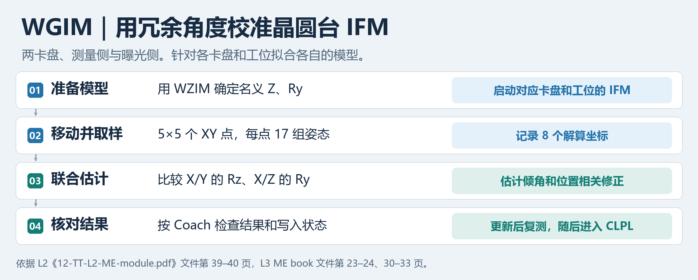
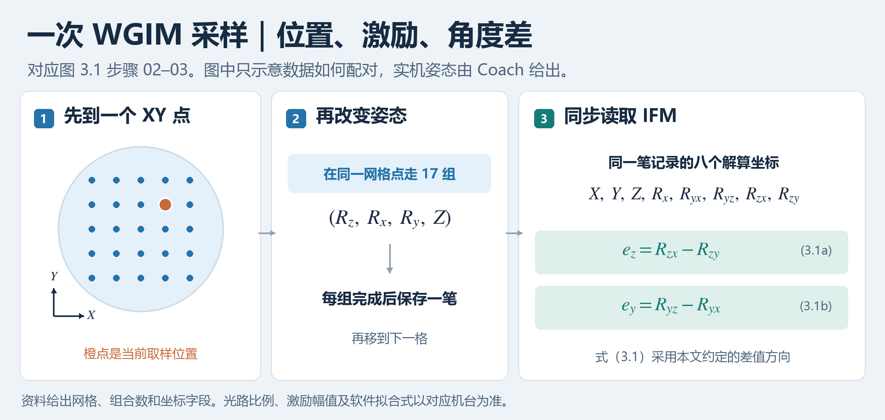
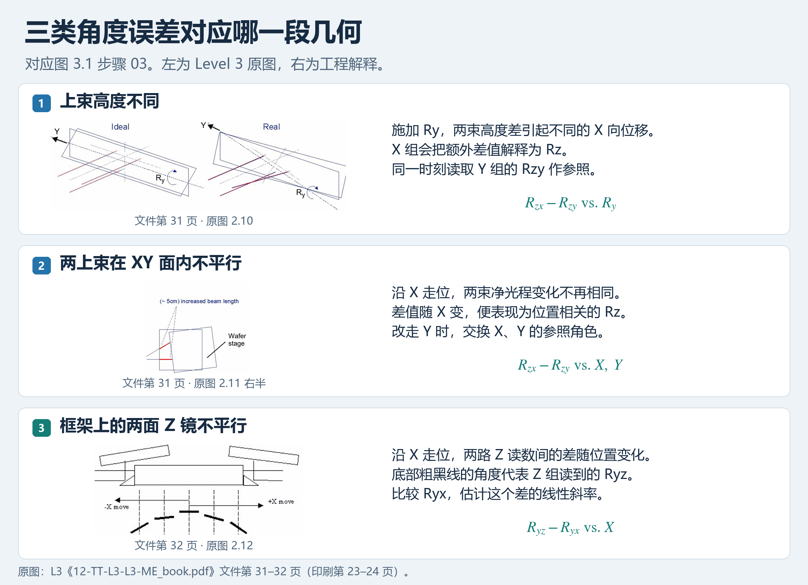
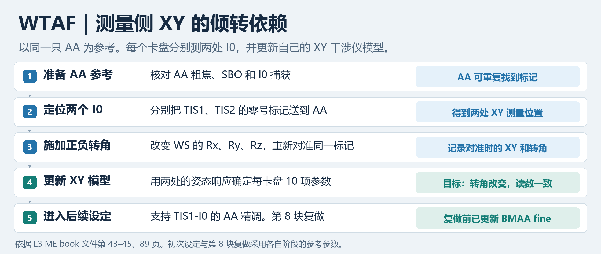
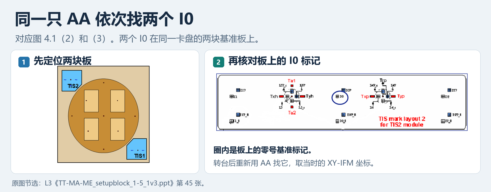
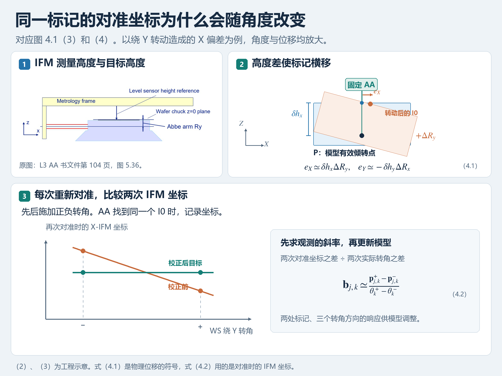

# MEtrology 校准项目报告 · WGIM 与 WTAF 整理草稿 v1

本稿供审阅，拟接在正式报告的 WZIM 之后。沿用正式报告的整理范式，先看总流程，再看 Purpose、How 和 Principle。[正式报告目录](MEtrology.md#calibration-index) · [整理范式](MEtrology.md#report-format)

## 项目目录

| 项目 | 实际比较什么 | 快速跳转 |
| --- | --- | --- |
| [3. WGIM — WS TRIM](#wgim) | 同一姿态下，比较由不同 IFM 光束解算的 Rz 和 Ry。 | [总流程](#wgim-procedure-diagram) · [Purpose](#wgim-purpose) · [How](#wgim-procedure) · [Principle](#wgim-principle) · [资料汇整](WGIM资料汇整_v1.md) |
| [4. WTAF — 测量侧 XY 干涉仪的倾转依赖](#wtaf) | 转动 WS 前后，用 AA 重新找到同一基准标记，比较找到时的 XY-IFM 坐标。 | [总流程](#wtaf-procedure-diagram) · [Purpose](#wtaf-purpose) · [How](#wtaf-procedure) · [Principle](#wtaf-principle) · [资料汇整](WTAF资料汇整_v1.md) |

[WZIM](MEtrology.md#wzim)先用 LS 建立初始高度和倾角基准，再由 WGIM 修正 IFM 的姿态串扰。首次设定中，WGIM 后做基准板调平（CLPL），再完成 AA 光束倾角与焦点的前置校准，随后做 WTAF。该顺序见 L3-《12-TT-L3-L3-ME_book.pdf》文件第 14–15、33、43–45 页（印刷第 6–7、25、35–37 页）。

## 3. WGIM — 晶圆台干涉仪倾斜与旋转校准

[总流程图](#wgim-procedure-diagram) · [Purpose](#wgim-purpose) · [How](#wgim-procedure) · [Principle](#wgim-principle) · [采样矩阵](#wgim-sampling) · [几何与机架原图](#wgim-source-figures) · [Level 1–3 资料汇整](WGIM资料汇整_v1.md)

同一个 WS 偏航 **Rz** 可以由 X 组和 Y 组干涉仪各算一次。同一个绕 Y 的倾角 **Ry** 可以由 X 组和 Z 组各算一次。WGIM（WS TRIM）让台体有计划地平移、升降和转动，同时记录两组角度读数差。通过读数差随位置、倾角的变化，求解模型修正。

**图 3.1　WGIM 总流程。** （01）[准备名义台高和倾角](#wgim-purpose)。（02）[改变 XY 位置和姿态并取样](#wgim-sampling)。（03）[用两组冗余角度差估计修正](#wgim-principle)。（04）[按 Coach 核对并处理结果](#wgim-verification)。测量动作依据 L2-《12-TT-L2-ME-module.pdf》文件第 39–40 页（印刷第 31–32 页），设定顺序见 L3-《12-TT-L3-L3-ME_book.pdf》文件第 23–24、30–33 页（印刷第 15–16、22–25 页）。

### Purpose（目的）

**修正三个效应。** 理想情况下，WS 平移或改变 Rx、Ry 时，来自两组 IFM 的 Rz 应报告相同的偏航角。入射束高度或方向存在差异时，两组 Rz 会随姿态、位置产生差值。Z 链的 Ryz 还会因为计量框架上的两面 Z 镜不平行而随 X 走位改变。WGIM 更新这些修正项，使不同测量链对同一姿态给出的角度一致，并改善 Z 模型。范围为**两个卡盘、测量侧和曝光侧**，参数分别求得。见 L3-《12-TT-L3-L3-ME_book.pdf》文件第 30–32 页（印刷第 22–24 页），L3-《TT-MA-ME_setupblock_1-5_1v3.ppt》第 19 张。

**前置与后续。** 初始计量设定先运行 [WZIM](MEtrology.md#wzim)，用确定的名义高度和 Ry 运行 WGIM。之后可进入 CLPL，测 TIS 等基准板的高度和倾角。CLPL 需要 WS 换 XY 位置时高度大致保持一致。Spot Sensor Position 支路也在 WGIM 后开始，再做 RS 旋转／位置偏置与掩模装载偏置。维护验证另按对应版本的 Coach 前置。见 L3-《12-TT-L3-L3-ME_book.pdf》文件第 14–15、23–24、30、33 页（印刷第 6–7、15–16、22、25 页）。[初设和维护的区别](WGIM资料汇整_v1.md#sequence)

**表 3.1　WGIM 涉及的机器常数**

| 参数或功能项 | 从什么观测估计 | 用途与出处 |
| --- | --- | --- |
| Rz 的倾角修正项 | 比较改变 Rx/Ry 时 Rzx 与 Rzy 的差 | 补偿上束高度差等几何误差造成的偏航读数耦合。L2-《12-TT-L2-ME-module.pdf》文件第 40 页，L3 ME book 文件第 30–31 页。 |
| Rz 的 XY 位置修正项 | 比较不同 X/Y 位置的 Rzx 与 Rzy | 补偿光束在 XY 面内不平行造成的偏航读数随位置变化。L2-《12-TT-L2-ME-module.pdf》文件第 40 页，L3 ME book 文件第 31 页。 |
| srxa | 比较不同 X 位置的 Ryz 与 Ryx | 处理 Ryz 的 X 向一阶项。复查时观察计量框架镜支承的漂移。L3 ME book 文件第 32、57 页。 |
| sfz | 具体尺度拟合步骤待查对应版本报表 | Z 解算的比例系数。L3-《TT-MA-ME_setupblock_6-8_1v3.ppt》第 35 张备注将其归于 TRIM。 |

Rz 修正的完整字段、各参数的写入符号以及保存状态，均按目标机台 WGIM 报表核对。[常数与证据范围](WGIM资料汇整_v1.md#constants)

### How（操作流程）

#### 原文操作译文

下列操作译自 L2-《12-TT-L2-ME-module.pdf》文件第 39–40 页（印刷第 31–32 页）中 **WS Tilt Rotation Interferometer Matrix** 条目（Coach csme072.adj）。L2-《TT-L2-ME-3v0.pdf》文件第 58 页（印刷第 52 页）的 csme072.per 条目同样记载网格、姿态组合、记录量和结果处置，前置条件转引对应 Coach。

> **前置条件。** 确认已完成 BMAA Fine、BMWL Fine、BMTIS Fine、WS 非正交性与比例校准、WS 绝对台格试验以及 Combined FOCAL。
>
> **测量。** 将卡盘移到若干网格位置。使用覆盖整个晶圆区域的 5×5 网格。每个 XY 网格点施加 17 种由旋转 Rz、倾斜 Rx/Ry 和高度 Z 组成的不同组合。在每个位置测量台体坐标 X、Y、Z、Rx、Ryx、Ryz、Rzx、Rzy。条件允许时，并行测量测量侧和曝光侧的卡盘。
>
> **建模。** 为了校准旋转比例效应，WS 移到若干 X 和 Y 位置。X 平移后，将 Rzx 修正到与 Rzy 一致，因为此处把 Rzy 当作不受 X 平移影响的参照。Y 平移后，将 Rzy 修正到与 Rzx 一致，因为此处把 Rzx 当作不受 Y 平移影响的参照。镜面不平会扰动这些值，校准假设镜面平整度足以满足要求。
>
> 为了校准 Rz 的倾角依赖，WS 施加多组 Rx 和 Ry。施加 Rx 后，将 Rzy 修正到与 Rzx 一致，此处假设 Rzx 不受 Rx 转动影响。施加 Ry 后，将 Rzx 修正到与 Rzy 一致，此处假设 Rzy 不受 Ry 转动影响。
>
> 为了校准 Z 镜不平行造成的 Ry 误差，WS 移到若干 X 位置。X 平移后，将 Ryz 修正到与 Ryx 一致，因为 X 平移对 Ryx 的影响较小。
>
> 上述说明按三个效应分段。实际测量在多个位置和倾角进行，用一个联合数学模型校准三类效应。
>
> **结果与处置。** 界面显示 OK/NOK。检查结果，各项均在规格内时无需进一步操作。超限时，原文的处置为保存机器常数后再次运行试验，以确认修正。

**初设与验证。** 以上译文列出的各项前置属于 L2 的后期验证语境。初始设定的 WGIM 位于 WZIM 和 CLPL 之间。L3 设定序列 4/8 会再跑 WGIM，重点是 X 对 Ryz 的贡献 srxa。L2 的 .per 版还出现在季度维护清单中。见 L3-《12-TT-L3-L3-ME_book.pdf》文件第 23–24、57 页，L2-《12-TT_L2_ME_2v3new.pdf》文件第 29 页（第 57 张）。[版本对照](WGIM资料汇整_v1.md#sequence)

#### 步骤 02–03　每组姿态保存一笔记录，再做通道比较

**图 3.2　WGIM 测量记录的结构。** 对应[总图步骤 02–03](#wgim-procedure-diagram)。（1）把卡盘带到一个 XY 网格点。（2）在该点执行 17 组姿态。（3）每组读取八个**解算坐标**，用同一笔记录的 Rzx 和 Rzy 求式（3.1a），用 Ryz 和 Ryx 求式（3.1b）。软件随后用多个位置和姿态的记录联合估计修正。图中的差值方向是本文约定。来源为 L2-《12-TT-L2-ME-module.pdf》文件第 39–40 页（印刷第 31–32 页）。

#### 步骤 04　检查校准结果与保存状态

先按对应 Coach 核对各项结果，再看报表中机器常数是否保存。维护验证全部合格时结束。若启用候选常数修正超限结果，按 Coach 复测，确认角度差的相应依赖已减小。复查 srxa 时可对照同一卡盘、同一侧的历史值。源文给出 OK/NOK，具体验收门限待查对应机台的 Coach 和报表。见 L2-《TT-L2-ME-3v0.pdf》文件第 58 页，L3-《12-TT-L3-L3-ME_book.pdf》文件第 57 页。[验证与记录线索](WGIM资料汇整_v1.md#method)

### Principle（校准原理）

三路 X 光给出台体的 X、Rzx、Ryx，三路 Y 光给出 Y、Rzy、Rx，两路 Z 测量光及其参考光给出 Z、Ryz。两组 Rz 读数有同一个实际 Rz 分量，两组 Ry 读数也有同一个实际 Ry 分量。同时读数后相减，共同的实际角度一阶相消，剩下的是两组测量链的**相对误差**。再看相对误差随激励怎么变，就可以估计待修正的项。选参照时要用该动作下受影响较小的一组读数。

**图 3.3　三个效应的几何来源。** 对应[总图步骤 03](#wgim-procedure-diagram)。左列依次引用 L3-《12-TT-L3-L3-ME_book.pdf》文件第 31、32 页（印刷第 23、24 页）的原图 2.10、原图 2.11 右半、原图 2.12。右列为工程解释。[原图定位](WGIM资料汇整_v1.md#source-figures)

1. **改变 Rx 或 Ry，找 Rz 倾角耦合。** 对 X 组来说，正常的 Rz 会让两个在不同 Y 位置的上束读到不同的 X 向位移。当两束高度也不同时，施加 Ry 也会让它们读到不同的 X 向位移。这个额外差值会进入 Rzx。此时用 Y 组的 Rzy 作参照，比较 Rzx−Rzy 随 Ry 的变化。对 Y 组，用 Rx 作激励，Rzx 作参照。课件的放大倾角只用于说明几何。
2. **改变 X 或 Y，找 Rz 的位置耦合。** 两束上方测量光的方向在 XY 面内有夹角时，移动同一段距离在两束方向上的光程变化可能不同。IFM 会把随位置增长的差值解释成偏航。沿 X 取样，以 Rzy 为参照估计 Rzx 的变化。沿 Y 取样时，对调参照通道。镜面局部形状也会影响差值，课件用镜面平整度假设支持这个近似。L1-《06_AP-L1-Imaging_Overlay.pdf》第 44 页给出 X 走位诱发 Rz 的示例，L2-《12-TT-L2-ME-module.pdf》文件第 40 页给出参照关系。
3. **改变 X，找 Z 链的表观 Ry。** 两面固定 Z 镜的高度沿 X 变化不同时，平移会改变两路 Z 净读数之差，因此 Ryz 随 X 改变。看图 3.3（3）底部每根粗线的**倾角**，它表示该 X 位置的 Ryz。实际台体 Ry 同时进入 Ryx 与 Ryz。比较 Ryz−Ryx 随 X 的斜率，可估计 Z 链的相对一阶误差。沿用图 3.2 的差值方向，修正即从 Ryz 扣除这个斜率乘 X 位移。软件把符号写进 srxa 的方式按目标版本核对。实机以 Ryx 控制 Ry，Ryz 影响 Z 反馈。

**联合模型与残差。** 以上三类激励说明每个依赖怎样可观测。L2 资料明确由同一数学模型使用全部姿态与位置数据。L3 原书对 Ryz 一阶依赖的概述同时列 X 和 Y，原图及课件演示集中在 X，具名参数为 srxa。图 3.3（3）的五笔粗线连起来还呈现高度弯曲，该较高阶的 Z 效应另由后续校准处理。无 Confidence Sensor 的版本把剩余 M/E 相对 X 向抛物项交给 Combined FOCAL。见 L2-《12-TT-L2-ME-module.pdf》文件第 40 页、L3-《12-TT-L3-L3-ME_book.pdf》文件第 32、54–55 页、L3-《TT-MA-ME_setupblock_6-8_1v3.ppt》第 42 张。[版本和曲率证据](WGIM资料汇整_v1.md#sequence)

[回到总图](#wgim-procedure-diagram) · [WZIM 名义台高与倾角](MEtrology.md#wzim-purpose) · [下一章 WTAF](#wtaf) · [返回项目目录](#calibration-index)

## 4. WTAF — 测量侧 XY 干涉仪倾转依赖

[总流程图](#wtaf-procedure-diagram) · [Purpose](#wtaf-purpose) · [How](#wtaf-procedure) · [Principle](#wtaf-principle) · [参数与出处](WTAF资料汇整_v1.md#wtaf-evidence-constants) · [同序列前段的 WGIM](#wgim)

**图 4.1　WTAF 总流程。**（1）[准备 AA 参考](#wtaf-purpose)。（2）[找到两块板的 I₀](#wtaf-marks)。（3）[改变姿态，重新对准](#wtaf-tilt)。（4）[按位置响应更新模型](#wtaf-fit)。（5）[接入后续设定和复做](#wtaf-follow-up)。流程依据 L3-《12-TT-L3-L3-ME_book.pdf》文件第 43–45、89 页（印刷第 35–37、81 页）。

### Purpose（目的）

**解决什么。** 从固定的先进对准传感器（AA）看，WS 改变 Rx、Ry 或 Rz 后，同一个对准标记会在不同的 XY-IFM 坐标处被找到。WTAF 用 AA 作参考修正这部分倾转误差，使测量侧的 XY 坐标对应 AA 对准位置。对同一个标记，改变台体转角后，重新对准得到的 XY 应保持一致。两卡盘分别校准。[图 4.3 为什么倾转会带来平移](#wtaf-principle)

**前置条件。** 非阿贝校准模组（ACM）路线先用 CABF 标定 AA 光束倾角和焦高。AA 的焦高至少已粗定，SBO（Shifts Between Orders，各衍射级次给出的对准位置偏移）已准到足以作参考，BMAA coarse 提供 TIS 板上标记的查找条件。[Level 1–3 前置证据](WTAF资料汇整_v1.md#wtaf-evidence-levels)

**表 4.1　每卡盘的测量侧模型参数**

| 证据 | 量 | 用法 |
| --- | --- | --- |
| L3 ME book 文件第 43、44 页 | XY 阿贝臂 ax、ay。更新会覆盖先前确定的 Ry 阿贝臂。 | 补偿 IFM 有效测量高度与对准标记目标高度分离形成的倾转误差。按轴看，Ry 倾转主要进入 X，Rx 倾转主要进入 Y。 |
| L3 ME book 文件第 44 页 | 测量侧 XY IFM 模型每卡盘共有 10 项，含阿贝臂。 | 修正 X、Y 对 Rx、Ry、Rz 的响应。完整字段、符号和保存值需用对应版本 WTAF 报表核对。 |

L3-《04-TT-L3-ATS-AA-2v0.pdf》文件第 109 页（印刷第 103 页）也列有 MI 字段 ifm-ax、ifm-ay，出现在 CABF 的版本说明中。[参数证据](WTAF资料汇整_v1.md#wtaf-evidence-constants)

**后续。** 初次 WTAF 为 TIS1-I₀ 上的 AA 精调提供条件。XY 模型改动会影响基准板的坐标转换，随后 BMAA fine 更新板的平移、旋转、倍率（TRM）。第 7 设定块更新 BMAA fine 后，在第 8 块复做测量侧 WTAF。第 8 块流程图还列出曝光侧 WGTD 与镜面图标定，随后进入 WS 非正交与比例校准。见 L3-《12-TT-L3-L3-ME_book.pdf》文件第 43–45、89 页（印刷第 35–37、81 页），图 2.82。[后续关联项目](WS-IFM机器常数校准项目_v4.md#mc-wgtd)

### How（操作流程）

#### 原文操作译文

译自 L3-《12-TT-L3-L3-ME_book.pdf》文件第 44 页（印刷第 36 页）WTAF 的 Method 及其后续说明。

> 在每个 XY 位置，施加 Rx、Ry、Rz 转动不应影响对准位置。干涉仪模型中的 10 项参数随卡盘而定，参数见测试报告，由 TIS1-I₀ 和 TIS2-I₀ 的测量求得。
>
> 1. 用对准传感器测量 TIS1 和 TIS2 上的 I₀ 标记。
> 2. 施加正、负 Rx、Ry、Rz 转动，并调整 XY 干涉仪模型。
> 3. 更新机器常数后，对卡盘的所有 XY 位置，XY 对准位置均不随所施加的正、负 Rx、Ry、Rz 转动而改变。
>
> 本测试细调测量侧 XY 位置受 Rx、Ry、Rz 转动的影响。TIS1-I₀ 和 TIS2-I₀ 上的信息足以用于建立干涉仪参数模型。这两个标记在 X、Y 两方向相距较远。
>
> 后面可能重复此测试的原因有三个：AA 焦面尚未最终确定，衍射级次间偏移尚未最终确定，Z 模型尚未完成校准。预计这三者都不会严重影响当前测试的有效性。
>
> 现在执行此测试，是因为前置条件要求对准传感器的焦高至少已经粗定。本测试为在 TIS1-I₀ 上微调 AA 焦高提供前置条件。

非 ACM 路线的前后顺序见同书文件第 43 页（印刷第 35 页）的 Method，以及 L3-《TT-MA-ME_setupblock_1-5_1v3.ppt》第 42、44 张。

> 标定对准光束倾角和焦高（CABF）。标定包含阿贝臂在内的 XY 干涉仪模型（WTAF）。核查对准光束倾角和焦高校准（CABF）。

第 8 块复做说明译自同书文件第 89 页（印刷第 81 页）的 WS XY Interferometer Setup at Measure side。

> 测量侧 WS XY 干涉仪校准已在第 3 设定块、AA 光束倾角和焦高试验之后介绍过。本测试使测量侧的 WS XY 坐标不受施加的台体转动与倾斜影响，也就是使 WS 旋转中心与 AA 传感器位置一致。现在重复此测试，是因为第 7 设定块已更新 BMAA fine，并且要为整个 WS 范围标定阿贝臂。

#### 按总图操作

**图 4.1（1）、（2）先准备 AA，再找标记。** 让 AA 在已知的焦高附近工作，确认能找到当前卡盘的零号标记。将 TIS1-I₀ 和 TIS2-I₀ 分别移到同一只 AA 下。两处标记提供相距较远的两组 XY 测量位置。

**图 4.2　WTAF 的两块板与零号标记。** （1）是卡盘俯视图。（2）是 TIS2 板详图，蓝圈为 I₀。两幅均节选自 L3-《TT-MA-ME_setupblock_1-5_1v3.ppt》第 45 张。[Level 2 的对准读数关系与原图定位](WTAF资料汇整_v1.md#wtaf-evidence-figures)

**图 4.1（3）改变姿态，再找同一标记。** 施加正、负 Rx、Ry、Rz。每次改变姿态后，用 AA 重新找该标记，比较重新对准时的 XY-IFM 坐标。要与不同角度的坐标对应，还要保留转角。对两处标记分别取得这些数据，再换另一个卡盘做同类测量。课件未列加角量、每组轮次或转角施加顺序。AA 找标记、IFM 给出 XY 坐标的分工见 L2-《12-TT-L2-ME-module.pdf》文件第 18–19 页（印刷第 10–11 页）。

**图 4.1（4）、（5）更新模型，接入后续设定。** 用两处标记在多个姿态下的对准结果约束每卡盘的 XY 模型参数。校正目标是转角变化后，模型给同一个标记的 XY 不变。两处标记用于求参数，所得模型应覆盖卡盘 XY 范围。课件未列拟合矩阵和验收阈值。首次结果交给 AA 精调与 BMAA fine，后段复做按该设定块的参考状态执行。[复做依据](#wtaf-follow-up)

### Principle（校准原理）

**图 4.3　阿贝臂如何造成对准坐标的姿态依赖。** （1）取自 L3-《04-TT-L3-ATS-AA-2v0.pdf》文件第 104 页（印刷第 98 页）图 5.36，标出 IFM 测量高度与目标高度的间隔。（2）、（3）为工程示意，对应[图 4.1（3）、（4）](#wtaf-procedure-diagram)。

**先看高度差。** 当模型的等效倾转点 P 未落在 AA 所找的标记高度上，固定 P 的 XY、转动台体会使标记横移。图 4.3（2）取一个 X–Z 剖面，残余高度差 δhₓ 是从模型有效倾转点到标记的竖直距离。按右手坐标，小幅正 Ry 使高处标记沿 +X 移动，移动量约为高度差乘角度，见式（4.1）。对 Y，正 Rx 使高处标记沿 −Y 移动。Rz 还会把等效倾转点与标记之间的平面距离变成 XY 横移，所以也要测正、负 Rz。

**再看实测量。** 标记横移后，系统需要改变台体 XY 才能把标记重新送回固定 AA 的对准位置。用两次重新对准的 XY-IFM 坐标之差除以实际转角差，得到该标记、该转角方向的响应斜率。式（4.2）中 j 表示两处 I₀，k 表示三种转角方向，坐标是二维向量。图 4.3（3）的斜率是重新对准所需坐标的变化，图 4.3（2）的箭头是固定倾转点时标记的物理横移。

**最后调整模型。** 两处标记相距较远，能为随位置变化的倾转影响提供不同的约束。利用不同位置和转角方向的数据更新模型，使重新对准的坐标对转角的斜率接近零。此时相当于让模型的有效倾转参考对准 AA 所找的位置。式（4.1）、（4.2）用于说明辨识原理。资料给出测量动作、每卡盘参数项数和校准目标。见 L3-《12-TT-L3-L3-ME_book.pdf》文件第 44、89 页（印刷第 36、81 页）。[完整出处与版本差异](WTAF资料汇整_v1.md#wtaf-evidence-levels) · [返回总流程](#wtaf-procedure-diagram) · [返回草稿目录](#calibration-index)
