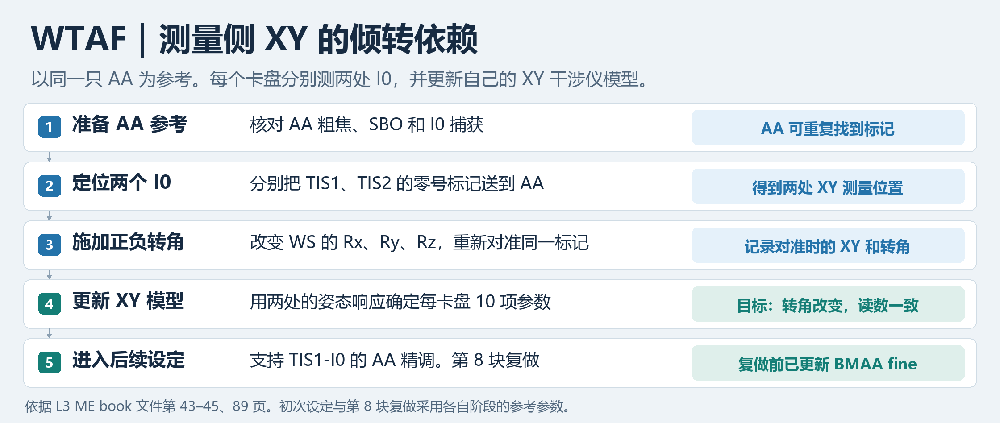
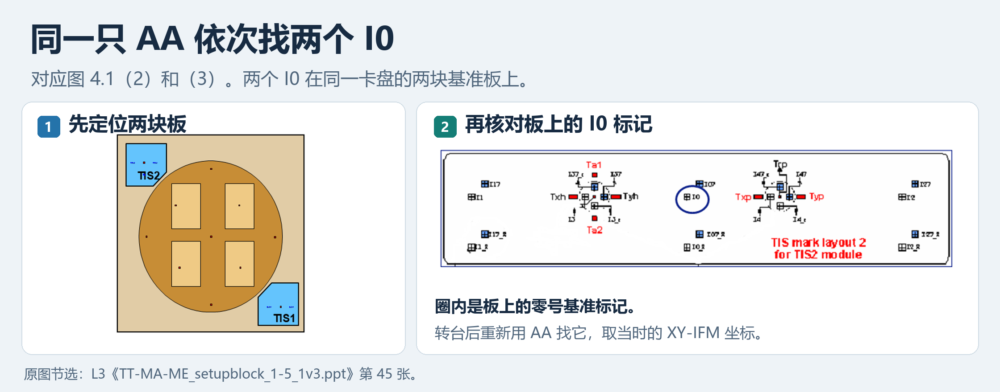
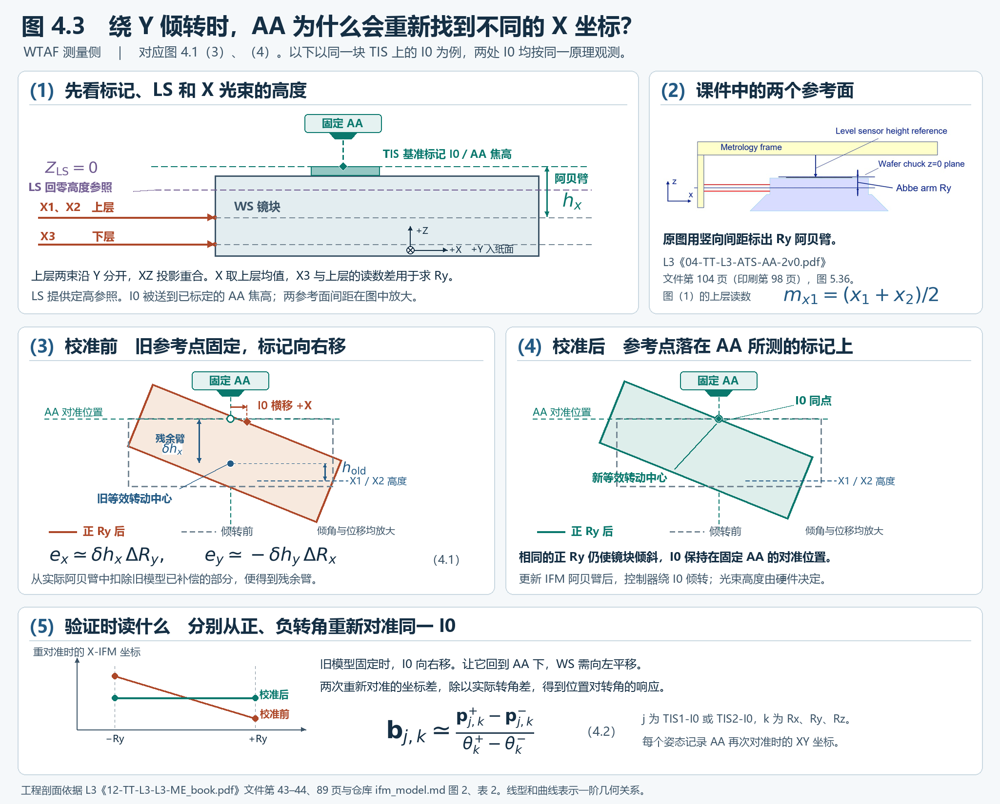
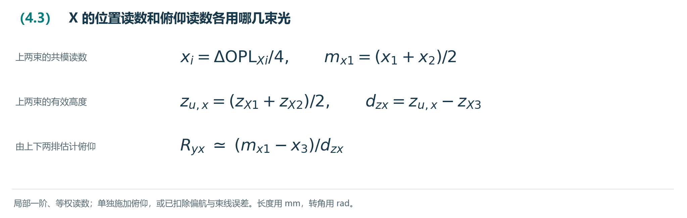
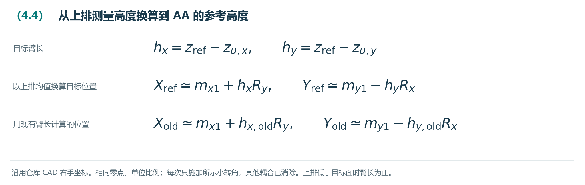
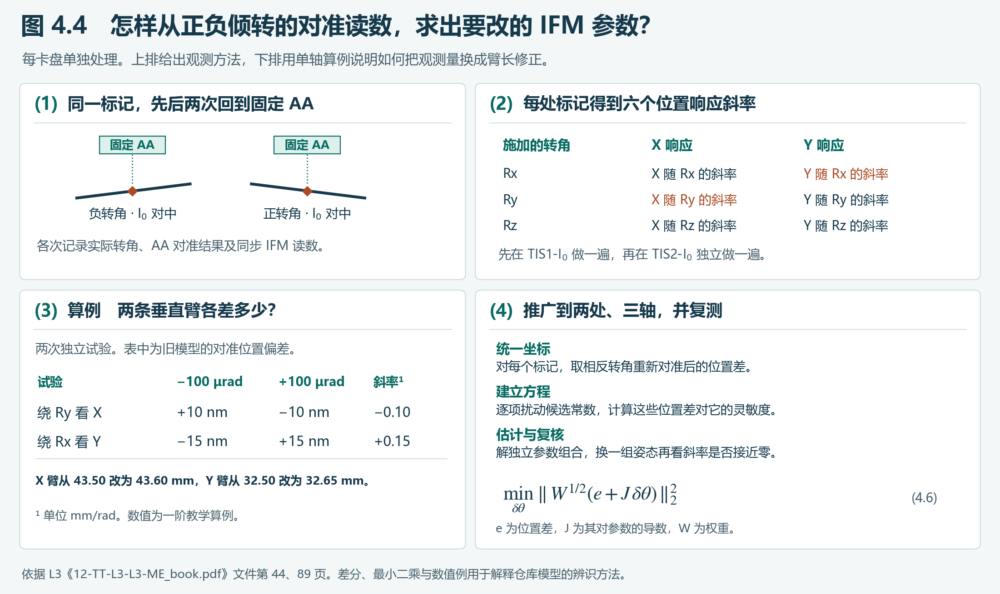
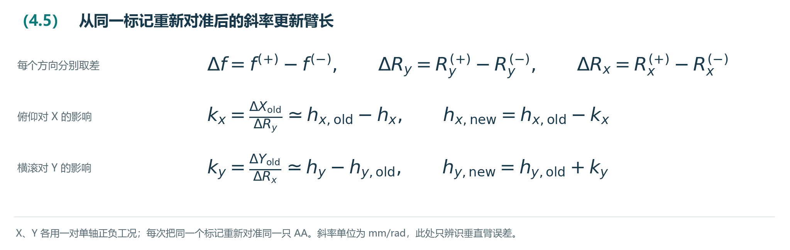

# 4. WTAF · 测量侧 XY 干涉仪倾转校准（审阅草稿 v1）

[总流程图](#wtaf-procedure-diagram) · [Purpose](#wtaf-purpose) · [How](#wtaf-procedure) · [图 4.3 剖面](#wtaf-principle) · [图 4.4 校准算法](#wtaf-algorithm) · [参数对应](#wtaf-model-constants) · [两枚 I₀ 能确定什么](MEtrology-BMAA整理草稿_v6.md#two-i0-stage-align) · [正式报告目录](MEtrology.md#calibration-index)

**图 4.1　WTAF 总流程。**（1）[准备 AA 参考](#wtaf-purpose)。（2）[找到两块板的 I₀](#wtaf-marks)。（3）[改变姿态，重新对准](#wtaf-tilt)。（4）[按位置响应更新模型](#wtaf-fit)。（5）[接入后续设定和复做](#wtaf-follow-up)。流程依据 L3-《12-TT-L3-L3-ME_book.pdf》文件第 43–45、89 页（印刷第 35–37、81 页）。

### Purpose（目的）

**解决什么。** 从固定的先进对准传感器（AA）看，WS 改变 Rx、Ry 或 Rz 后，同一个对准标记会在不同的 XY-IFM 坐标处被找到。WTAF 用 AA 作参考修正这部分倾转误差，使测量侧模型给出的标记位置与 AA 对准位置一致。同一个标记在两种转角下回到同一只 AA 后，换算到同一参考系的标记 XY 应保持一致。两卡盘分别校准。[图 4.3 为什么倾转会带来平移](#wtaf-principle)

**前置条件。** 非阿贝校准模组（ACM）路线先用 CABF 标定 AA 光束倾角和焦高。AA 的焦高至少已粗定，SBO（Shifts Between Orders，各衍射级次给出的对准位置偏移）已准到足以作参考，BMAA coarse 提供 TIS 板上标记的查找条件。[Level 1–3 前置证据](WTAF资料汇整_v1.md#wtaf-evidence-levels)

**表 4.1　每卡盘的测量侧模型参数**

| 证据 | 量 | 用法 |
| --- | --- | --- |
| L3 ME book 文件第 43、44 页 | XY 阿贝臂 ax、ay。更新会覆盖先前确定的 Ry 阿贝臂。 | 补偿 IFM 有效测量高度与对准标记目标高度分离形成的倾转误差。按轴看，Ry 倾转主要进入 X，Rx 倾转主要进入 Y。 |
| L3 ME book 文件第 44 页 | 测量侧 XY IFM 模型每卡盘共有 10 项，含阿贝臂。 | 修正 X、Y 对 Rx、Ry、Rz 的响应。完整字段、符号和保存值需用对应版本 WTAF 报表核对。 |

L3-《04-TT-L3-ATS-AA-2v0.pdf》文件第 109 页（印刷第 103 页）也列有 MI 字段 ifm-ax、ifm-ay，出现在 CABF 的版本说明中。[原页证据](WTAF资料汇整_v1.md#wtaf-evidence-constants) · [与仓库公式逐项对照](#wtaf-model-constants)

**后续。** 初次 WTAF 为 TIS1-I₀ 上的 AA 精调提供条件。XY 模型改动会影响基准板的坐标转换，随后 BMAA fine 更新板的平移、旋转、倍率（TRM）。第 7 设定块更新 BMAA fine 后，在第 8 块复做测量侧 WTAF。第 8 块流程图还列出曝光侧 WGTD 与镜面图标定，随后进入 WS 非正交与比例校准。见 L3-《12-TT-L3-L3-ME_book.pdf》文件第 43–45、89 页（印刷第 35–37、81 页），图 2.82。[后续关联项目](WS-IFM机器常数校准项目_v4.md#mc-wgtd)

### How（操作流程）

#### 原文操作译文

译自 L3-《12-TT-L3-L3-ME_book.pdf》文件第 44 页（印刷第 36 页）WTAF 的 Method 及其后续说明。

> 在每个 XY 位置，施加 Rx、Ry、Rz 转动不应影响对准位置。干涉仪模型中的 10 项参数随卡盘而定，参数见测试报告，由 TIS1-I₀ 和 TIS2-I₀ 的测量求得。
>
> 1. 用对准传感器测量 TIS1 和 TIS2 上的 I₀ 标记。
> 2. 施加正、负 Rx、Ry、Rz 转动，并调整 XY 干涉仪模型。
> 3. 更新机器常数后，对卡盘的所有 XY 位置，XY 对准位置均不随所施加的正、负 Rx、Ry、Rz 转动而改变。
>
> 本测试细调测量侧 XY 位置受 Rx、Ry、Rz 转动的影响。TIS1-I₀ 和 TIS2-I₀ 上的信息足以用于建立干涉仪参数模型。这两个标记在 X、Y 两方向相距较远。
>
> 后面可能重复此测试的原因有三个：AA 焦面尚未最终确定，衍射级次间偏移尚未最终确定，Z 模型尚未完成校准。预计这三者都不会严重影响当前测试的有效性。
>
> 现在执行此测试，是因为前置条件要求对准传感器的焦高至少已经粗定。本测试为在 TIS1-I₀ 上微调 AA 焦高提供前置条件。

非 ACM 路线的前后顺序见同书文件第 43 页（印刷第 35 页）的 Method，以及 L3-《TT-MA-ME_setupblock_1-5_1v3.ppt》第 42、44 张。

> 标定对准光束倾角和焦高（CABF）。标定包含阿贝臂在内的 XY 干涉仪模型（WTAF）。核查对准光束倾角和焦高校准（CABF）。

第 8 块复做说明译自同书文件第 89 页（印刷第 81 页）的 WS XY Interferometer Setup at Measure side。

> 测量侧 WS XY 干涉仪校准已在第 3 设定块、AA 光束倾角和焦高试验之后介绍过。本测试使测量侧的 WS XY 坐标不受施加的台体转动与倾斜影响，也就是使 WS 旋转中心与 AA 传感器位置一致。现在重复此测试，是因为第 7 设定块已更新 BMAA fine，并且要为整个 WS 范围标定阿贝臂。

#### 按总图操作

**图 4.1（1）、（2）先准备 AA，再找标记。** 让 AA 在已知的焦高附近工作，确认能找到当前卡盘的零号标记。将 TIS1-I₀ 和 TIS2-I₀ 分别移到同一只 AA 下。两处标记提供相距较远的两组 XY 测量位置。

**图 4.2　WTAF 的两块板与零号标记。** （1）是卡盘俯视图。（2）是 TIS2 板详图，蓝圈为 I₀。两幅均节选自 L3-《TT-MA-ME_setupblock_1-5_1v3.ppt》第 45 张。[Level 2 的对准读数关系与原图定位](WTAF资料汇整_v1.md#wtaf-evidence-figures)

**图 4.1（3）改变姿态，再找同一标记。** 施加正、负 Rx、Ry、Rz。每次改变姿态后，用 AA 重新找该标记，比较重新对准时的 XY-IFM 坐标。要与不同角度的坐标对应，还要保留转角。对两处标记分别取得这些数据，再换另一个卡盘做同类测量。课件未列加角量、每组轮次或转角施加顺序。AA 找标记、IFM 给出 XY 坐标的分工见 L2-《12-TT-L2-ME-module.pdf》文件第 18–19 页（印刷第 10–11 页）。

**图 4.1（4）、（5）更新模型，接入后续设定。** 用两处标记在多个姿态下的对准结果约束每卡盘的 XY 模型参数。校正目标是转角变化后，模型给同一个标记的 XY 不变。两处标记用于求参数，所得模型应覆盖卡盘 XY 范围。课件未列拟合矩阵和验收阈值。首次结果交给 AA 精调与 BMAA fine，后段复做按该设定块的参考状态执行。[复做依据](#wtaf-follow-up)

### Principle（校准原理）

**图 4.3　从上排光束的高度，读到 TIS 标记的高度。** 对应[图 4.1（3）、（4）](#wtaf-procedure-diagram)。图中（2）是 L3-《04-TT-L3-ATS-AA-2v0.pdf》文件第 104 页（印刷第 98 页）图 5.36 的原图，其余为右手 XZ 剖面及读数示意。位置和角度已放大。

**（1）哪一个高度代表 X 读数？** X1、X2 在同一上排，从两个不同的 Y 位置照向同一侧镜。沿 Y 看，两束投影重合。X 平移先取这两束等效位移的平均；X3 在下排，上下排读数之差用来求俯仰 Ryx，再把俯仰代回 X。仓库名义几何中，上排高度是 −43.5 mm，下排是 −98.5 mm，垂直束距 55 mm。三束等权平均会得到 −61.83 mm，与 X 平移公式采用的上排高度不同。这些高度均相对于仓库模型原点。实际转动中心还要看模型把上排的读数换算到了哪个高度。[仓库光束截面图](ifm_model.md#ifm-figure-2) · [图 4a 的三束坐标](ifm_model.md#ifm-figure-4)

**（1）、（2）以谁为零？** 让 TIS 板上的 I₀ 处于 LS 读零的高度，把该高度画为本图的零面。送到 AA 下测量时，要把标记放在 CABF 给出的 AA 工作焦高。两者的已知焦高差决定 I₀ 在图中的纵坐标。零面可以平移，上排到 I₀ 的高度差保持相同。L2 用 LS 定 TIS 高度，L3 在 WTAF 之前先定 AA 焦高，避免离焦引起的光学位置变化混入阿贝臂估计。[LS、AA 及原图出处](WTAF-两枚I0与IFM阿贝臂资料核查_v1.md#height)

**（3）、（4）哪个点在转？** 先让旧模型报告的 X 保持恒定，给 WS 一个正 Ry。如果旧模型的等效中心低于 I₀，标记会向图右侧走；离中心越高，横移越大。要让固定 AA 再次看到 I₀ 居中，WS 就要向左补移。调整模型中已有的臂长后，再给相同的 Ry，控制系统会在倾转的同时给出所需的平移，使该标记在 AA 高度保持原位。图中的“新中心”指**本次标记处，保持修正坐标不变时的等效中心**。两种试验的光束和镜块安装位置相同。[L3 实机目标](WTAF资料汇整_v1.md#wtaf-evidence-method)

式（4.4）采用当前 MATLAB v9 的 CAD 正方向，比较同一标记附近的一阶增量。式中的目标高度指 AA 对准此标记的高度；只靠束排坐标能算出几何名义臂，实机的有效臂要由独立 AA 观测确定。原始手稿 X 式将 ax 写在负号项中。仓库手稿表 3 给出了转到本 CAD 坐标后的符号说明，v9 的名义分支已含两条臂的补偿。[符号对照表](ifm_model.md#ifm-table-3) · [MATLAB 解算](../code/sim_ws_ifm_6dof_animation_v9.m)

**（5）实测时看哪一个量？** 图上的橙色斜线是“把同一 I₀ 再次送回 AA 后，旧 IFM 模型报告的位置”。它与（3）中标记在不补移时的横移方向相反。用正、负姿态下重新对准的位置差除以实际转角差，就得到残余阿贝臂的带符号估计。绿色水平线表示修正后该斜率趋于零。物理上，上排光束到 TIS 标记的高度差仍然存在。

### 从 AA 和 IFM 读数到常数更新

**图 4.4　WTAF 的观测与一套可在仓库模型实现的辨识方法。** （1）、（2）的取样动作来自 L3-《12-TT-L3-L3-ME_book.pdf》文件第 44 页（印刷第 36 页）。（3）的数值、（4）的最小二乘及以下复核办法是工程推导。课件将实机参数表指向对应版本的测试报告。对应[图 4.1（3）–（5）](#wtaf-procedure-diagram)。

1. **准备同一外部参考。** 每卡盘分别处理。准备可用的 AA 焦高、SBO 和两块 TIS 的当前标记坐标。先在近零转角找到 TIS1-I₀，再分别施加正负 Rx、Ry、Rz，每次都重新让该 I₀ 对准固定 AA。在 TIS2-I₀ 重复。记录卡盘、标记、各次实际转角、对准位置。若用仓库模型重算，额外保留同步八路 IFM 光程差、姿态及其零点。
2. **同一标记做差。** 在同一 AA 坐标系比较该标记正负两次的位置。若输入已经是经转换的对准位置，可直接配对；若输入是八路读数，先用现有 IFM 模型解算位姿，再把板上的局部 I₀ 变换到 AA 坐标。尤其绕 Rz 时，远离台原点的标记会有正常的几何横移，应先计入这段已知杠杆。把两块板之间的名义距离直接当作误差，会把基准板几何误算进 IFM。每个卡盘最终有两处标记、三个转角方向，每处每个方向有 X、Y 两个响应。[仓库坐标变换](ifm_corr.md#corr-input) · [板参数从何而来](MEtrology-BMAA整理草稿_v6.md#two-i0-stage-align)
3. **先单看两条垂直臂。** 固定其余已知影响，绕 Ry 看 X，绕 Rx 看 Y。式（4.5）用正、负两端的**实际角度差**求斜率，再按当前模型的正方向更新臂长。若同一方向在两处 I₀ 上给出的斜率明显不同，要保留位置依赖，单一常数难以同时解释两处。
4. **联合辨识。** 将两块板各自的成对位置差排成观测向量。在现有参数附近逐一小幅扰动候选常数，用同一组八路数据和标记坐标重算，记录每个位置差的变化，组成灵敏度矩阵。按图 4.4 的式（4.6）求参数增量。可用 QR 或奇异值分解检查可辨识性；缺少独立激励的方向只报告可辨识的参数组合。对有重复的数据可按重复性加权。此做法只更新有独立约束的系数。
5. **复测。** 用更新后的参数重放同一批，再另取倾角或查验位置，分别看两块板的六条响应斜率和重复对准散布。若残差随焦高、标记或位置而变，回查焦高、SBO、板变换和位置相关项。实机判限以对应版本报表为准。L3 还明确第 7 块更新 BMAA fine 后，在第 8 块复做 WTAF，覆盖全台工作范围。[后续设定顺序](#wtaf-follow-up)

**图 4.4（3）的读法。** 正、负 100 µrad 两端相差 200 µrad。X 的对准位置从 +10 nm 到 −10 nm，旧 X 臂短了 0.10 mm。Y 在另一次独立的 Rx 实验中从 −15 nm 到 +15 nm，旧 Y 臂短了 0.15 mm。代回一阶模型，两组姿态的对准位置差都归零。这组数只用来验证单位和更新方向。[复算图中两组读数](../code/wtaf_abbe_example_v1.py)

### WTAF 在当前 IFM 模型中校准哪些参数？

**表 4.2　课件已说明的写参与仓库模型中可用于解释的系数**

| 观测 | 仓库 IFM 中的对应项 | 可据此判定什么 |
| --- | --- | --- |
| 正负 Ry 后 I₀ 的 X 残差，正负 Rx 后 I₀ 的 Y 残差 | X 组、Y 组的有效垂直臂 ax、ay。v9 分别在 X 方程的 Ryx 列、Y 方程的负 Rx 列估计，报告有效臂时除以本轴位置尺度系数。 | 两项有直接的物理含义。L3 明确 WTAF 校准 XY 模型并覆盖既有 Ry 阿贝臂；相关 CABF 版本列出 ifm-ax、ifm-ay。 |
| 正负 Rz 后的 X、Y 残差 | 原模型有平面偏心 ee、dd，分别进入 X、Y 的偏航列。标记相对台原点的已知杠杆另行换算。 | 能观测剩余偏航耦合；若板内标记位置、尺度或其他误差也未知，一条斜率只能约束合成量。 |
| 两个相距较远的 I₀ 得到不同的倾转斜率 | v9 的 X 方程含 X 向光程基线分别乘 Ryx、Rzx 的两列，Y 方程含 Y 向光程基线分别乘 Rx、Rzx 的两列。原模型的上排平均光束偏角 Ryix0、Rzix0、Rxiy0、Rziy0 会产生相应的一阶位置依赖。 | 对比两处能拆开常量与随基线变化的量。具体写入哪个机器字段，仍需 WTAF 实机报表。 |
| 绕 Rx 时的 X 响应、绕 Ry 时的 Y 响应 | v9 在 X 方程有 Rx 交叉列，在 Y 方程有 Ryx 交叉列。 | 可检验交叉方向；其拟合系数是模型量，课件没有将它们逐一指认为实机字段。 |
| 每卡盘的正式写入 | L3 明确共 **10 项**测量侧 XY-IFM 参数，包含阿贝臂。 | 本机资料能按含义核对 ax、ay。其余八项的正式字段名、单位、符号、写入值和验收阈值待相应版本测试报告核对。TIS 的 Tx、Ty、Rot、Mag 由 BMAA 标定。 |

**为什么要选相距较远的两个 I₀？** 例如在同一位置绕 Ry，X 中的“常量臂误差”和“随 X 光程基线变化的角度项”都表现为一个斜率。一处数据只能给出两者之和。另一块板在不同的 X、Y 位置，改变了光程基线。把两个斜率并列，才有机会分别估计常量项和位置项。用 v9 做一个局部线性算例，只选上表的倾转列，固定尺度、标记几何和其余量。X 方程取第 2、3、5、6、8 列，Y 方程取第 2、3、6、7、8 列。在两个位置分别取 X 基线 120、300 mm 和 Y 基线 100、280 mm，独立施加三个小转角时，每轴设计矩阵的秩从一处的 3 增至两处的 5。这只验证该组选定列在示例几何中的可辨识性。实际能写入的十项以机台报表为据。[复算两位置的矩阵秩与独立位置残差](../code/wtaf_abbe_example_v1.py) · [MATLAB v9 求解与拟合](../code/sim_ws_ifm_6dof_animation_v9.m) · [L3 关于十项的原文与版本](WTAF资料汇整_v1.md#wtaf-evidence-constants)

**与 Stage Align 和 BMAA 的分工。** Stage Align 用已建立的板几何找回对准参考；BMAA 用板内多个标记建立、更新板坐标；WTAF 则跟踪**同一个已对准的标记在改变台体转角后，模型坐标是否还能复现**。这解释了为什么只测两枚 I₀ 不能同时求两块板的未知安装变换，而这两枚标记各自经历多种已知倾转后，却能为 WTAF 提供多组独立观测。[BMAA 图 5.5 两枚 I₀ 的反例](MEtrology-BMAA整理草稿_v6.md#two-i0-stage-align) · [专项资料核查](WTAF-两枚I0与IFM阿贝臂资料核查_v1.md) · [返回总流程图](#wtaf-procedure-diagram)
