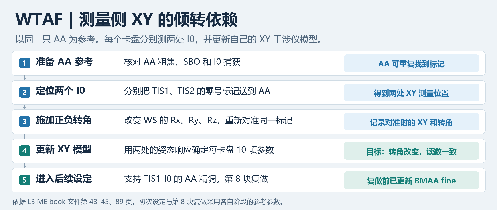
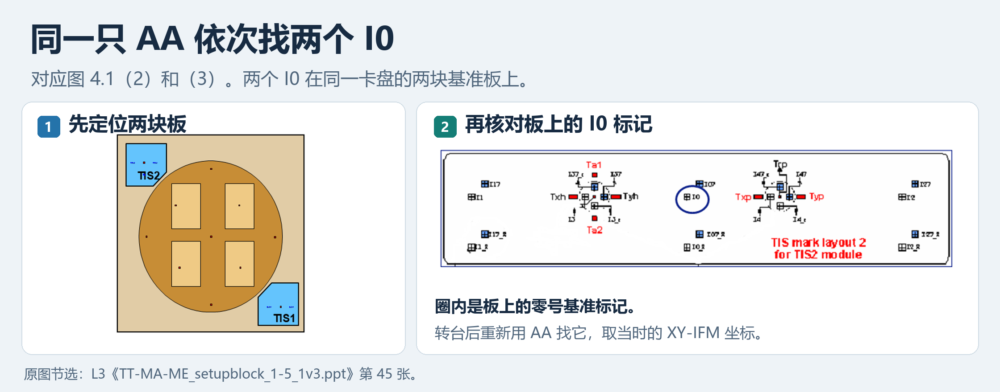
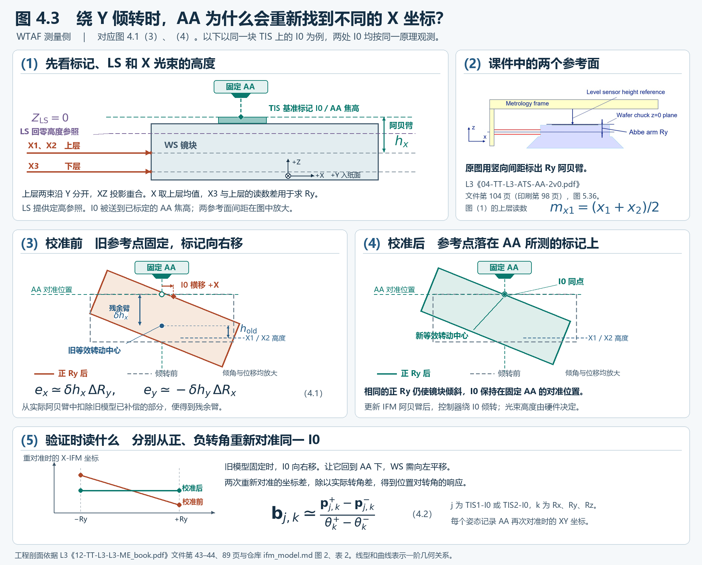
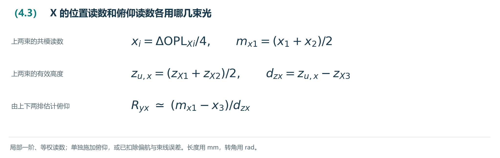
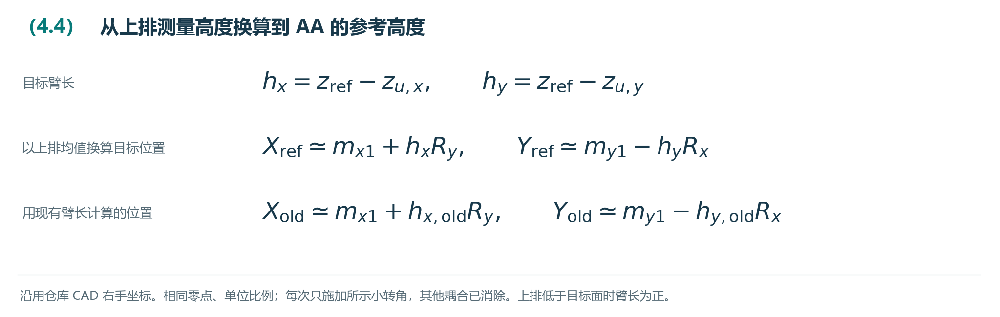
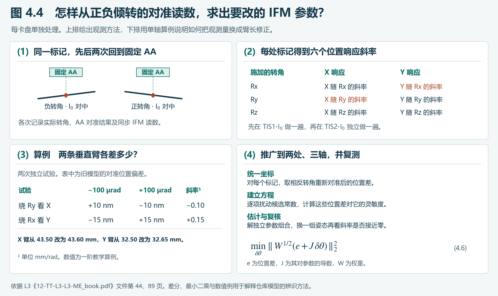
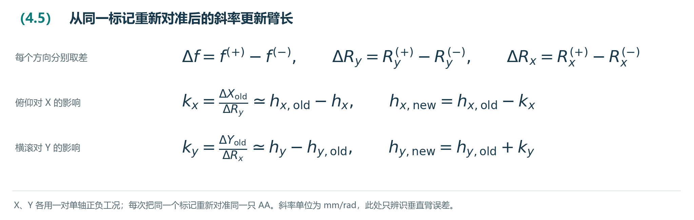
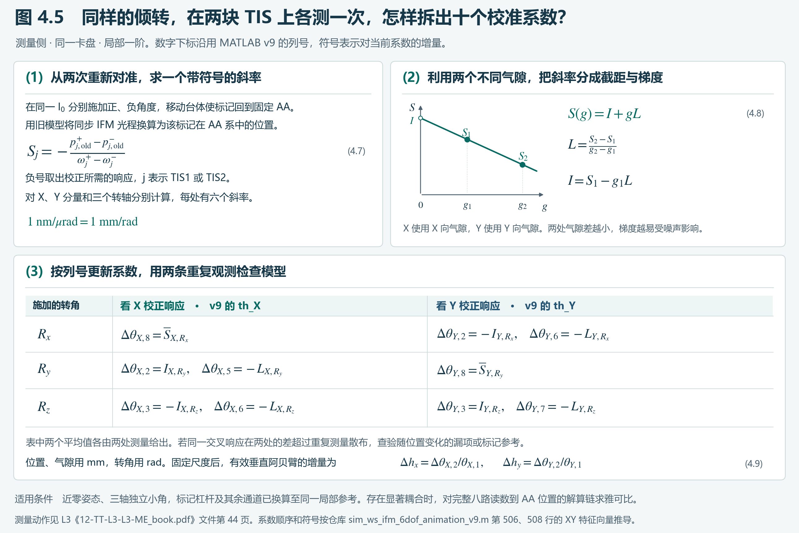

# 4. WTAF · 测量侧 XY 干涉仪倾转校准（审阅草稿 v2）

[总流程图](#wtaf-procedure-diagram) · [Purpose](#wtaf-purpose) · [How](#wtaf-procedure) · [图 4.3 剖面](#wtaf-principle) · [图 4.4 校准算法](#wtaf-algorithm) · [十项定参](#wtaf-model-constants) · [其他项目分工](#project-map) · [八项与十项复验](#full-replay) · [两枚 I₀ 能确定什么](MEtrology-BMAA整理草稿_v6.md#two-i0-stage-align) · [正式报告目录](MEtrology.md#calibration-index)

**图 4.1　WTAF 总流程。**（1）[准备 AA 参考](#wtaf-purpose)。（2）[找到两块板的 I₀](#wtaf-marks)。（3）[改变姿态，重新对准](#wtaf-tilt)。（4）[按位置响应更新模型](#wtaf-fit)。（5）[接入后续设定和复做](#wtaf-follow-up)。流程依据 L3-《12-TT-L3-L3-ME_book.pdf》文件第 43–45、89 页（印刷第 35–37、81 页）。

### Purpose（目的）

**解决什么。** 从固定的先进对准传感器（AA）看，WS 改变 Rx、Ry 或 Rz 后，同一个对准标记会在不同的 XY-IFM 坐标处被找到。WTAF 用 AA 作参考修正这部分倾转误差，使测量侧模型给出的标记位置与 AA 对准位置一致。同一个标记在两种转角下回到同一只 AA 后，换算到同一参考系的标记 XY 应保持一致。两卡盘分别校准。[图 4.3 为什么倾转会带来平移](#wtaf-principle)

**前置条件。** 非阿贝校准模组（ACM）路线先用 CABF 标定 AA 光束倾角和焦高。AA 的焦高至少已粗定，SBO（Shifts Between Orders，各衍射级次给出的对准位置偏移）已准到足以作参考，BMAA coarse 提供 TIS 板上标记的查找条件。[Level 1–3 前置证据](WTAF资料汇整_v1.md#wtaf-evidence-levels)

**表 4.1　每卡盘的测量侧模型参数**

| 证据 | 量 | 用法 |
| --- | --- | --- |
| L3 ME book 文件第 43、44 页 | XY 阿贝臂 ax、ay。更新会覆盖先前确定的 Ry 阿贝臂。 | 补偿 IFM 有效测量高度与对准标记目标高度分离形成的倾转误差。按轴看，Ry 倾转主要进入 X，Rx 倾转主要进入 Y。 |
| L3 ME book 文件第 44 页 | 测量侧 XY IFM 模型每卡盘共有 10 项，含阿贝臂。 | 修正 X、Y 对 Rx、Ry、Rz 的响应。本章按现行 IFM 模型选出十个系数，逐项给出解算列、符号及独立复验结果，见[表 4.2](#wtaf-model-constants)和[表 4.4](#full-replay)。 |

L3-《04-TT-L3-ATS-AA-2v0.pdf》文件第 109 页（印刷第 103 页）也列有 MI 字段 ifm-ax、ifm-ay，出现在 CABF 的版本说明中。[原页证据](WTAF资料汇整_v1.md#wtaf-evidence-constants) · [与仓库公式逐项对照](#wtaf-model-constants)

**后续。** 初次 WTAF 为 TIS1-I₀ 上的 AA 精调提供条件。XY 模型改动会影响基准板的坐标转换，随后 BMAA fine 更新板的平移、旋转、倍率（TRM）。第 7 设定块更新 BMAA fine 后，在第 8 块复做测量侧 WTAF。第 8 块流程图还列出曝光侧 WGTD 与镜面图标定，随后进入 WS 非正交与比例校准。见 L3-《12-TT-L3-L3-ME_book.pdf》文件第 43–45、89 页（印刷第 35–37、81 页），图 2.82。[后续关联项目](WS-IFM机器常数校准项目_v4.md#mc-wgtd)

### How（操作流程）

#### 原文操作译文

译自 L3-《12-TT-L3-L3-ME_book.pdf》文件第 44 页（印刷第 36 页）WTAF 的 Method 及其后续说明。

> 在每个 XY 位置，施加 Rx、Ry、Rz 转动不应影响对准位置。干涉仪模型中的 10 项参数随卡盘而定，参数见测试报告，由 TIS1-I₀ 和 TIS2-I₀ 的测量求得。
>
> 1. 用对准传感器测量 TIS1 和 TIS2 上的 I₀ 标记。
> 2. 施加正、负 Rx、Ry、Rz 转动，并调整 XY 干涉仪模型。
> 3. 更新机器常数后，对卡盘的所有 XY 位置，XY 对准位置均不随所施加的正、负 Rx、Ry、Rz 转动而改变。
>
> 本测试细调测量侧 XY 位置受 Rx、Ry、Rz 转动的影响。TIS1-I₀ 和 TIS2-I₀ 上的信息足以用于建立干涉仪参数模型。这两个标记在 X、Y 两方向相距较远。
>
> 后面可能重复此测试的原因有三个：AA 焦面尚未最终确定，衍射级次间偏移尚未最终确定，Z 模型尚未完成校准。预计这三者都不会严重影响当前测试的有效性。
>
> 现在执行此测试，是因为前置条件要求对准传感器的焦高至少已经粗定。本测试为在 TIS1-I₀ 上微调 AA 焦高提供前置条件。

非 ACM 路线的前后顺序见同书文件第 43 页（印刷第 35 页）的 Method，以及 L3-《TT-MA-ME_setupblock_1-5_1v3.ppt》第 42、44 张。

> 标定对准光束倾角和焦高（CABF）。标定包含阿贝臂在内的 XY 干涉仪模型（WTAF）。核查对准光束倾角和焦高校准（CABF）。

第 8 块复做说明译自同书文件第 89 页（印刷第 81 页）的 WS XY Interferometer Setup at Measure side。

> 测量侧 WS XY 干涉仪校准已在第 3 设定块、AA 光束倾角和焦高试验之后介绍过。本测试使测量侧的 WS XY 坐标不受施加的台体转动与倾斜影响，也就是使 WS 旋转中心与 AA 传感器位置一致。现在重复此测试，是因为第 7 设定块已更新 BMAA fine，并且要为整个 WS 范围标定阿贝臂。

#### 按总图操作

**图 4.1（1）、（2）先准备 AA，再找标记。** 让 AA 在已知的焦高附近工作，确认能找到当前卡盘的零号标记。将 TIS1-I₀ 和 TIS2-I₀ 分别移到同一只 AA 下。两处标记提供相距较远的两组 XY 测量位置。

**图 4.2　WTAF 的两块板与零号标记。** （1）是卡盘俯视图。（2）是 TIS2 板详图，蓝圈为 I₀。两幅均节选自 L3-《TT-MA-ME_setupblock_1-5_1v3.ppt》第 45 张。[Level 2 的对准读数关系与原图定位](WTAF资料汇整_v1.md#wtaf-evidence-figures)

**图 4.1（3）改变姿态，再找同一标记。** 施加正、负 Rx、Ry、Rz。每次改变姿态后，用 AA 重新找该标记，比较重新对准时的 XY-IFM 坐标。要与不同角度的坐标对应，还要保留转角。对两处标记分别取得这些数据，再换另一个卡盘做同类测量。课件未列加角量、每组轮次或转角施加顺序。AA 找标记、IFM 给出 XY 坐标的分工见 L2-《12-TT-L2-ME-module.pdf》文件第 18–19 页（印刷第 10–11 页）。

**图 4.1（4）、（5）更新模型，接入后续设定。** 用两处标记在多个姿态下的对准结果约束每卡盘的 XY 模型参数。校正目标是转角变化后，模型给同一个标记的 XY 不变。两处标记用于求参数，所得模型应覆盖卡盘 XY 范围。课件未列拟合矩阵和验收阈值。首次结果交给 AA 精调与 BMAA fine，后段复做按该设定块的参考状态执行。[复做依据](#wtaf-follow-up)

### Principle（校准原理）

**图 4.3　从上排光束的高度，读到 TIS 标记的高度。** 对应[图 4.1（3）、（4）](#wtaf-procedure-diagram)。图中（2）是 L3-《04-TT-L3-ATS-AA-2v0.pdf》文件第 104 页（印刷第 98 页）图 5.36 的原图，其余为右手 XZ 剖面及读数示意。位置和角度已放大。

**（1）哪一个高度代表 X 读数？** X1、X2 在同一上排，从两个不同的 Y 位置照向同一侧镜。沿 Y 看，两束投影重合。X 平移先取这两束等效位移的平均；X3 在下排，上下排读数之差用来求俯仰 Ryx，再把俯仰代回 X。仓库名义几何中，上排高度是 −43.5 mm，下排是 −98.5 mm，垂直束距 55 mm。三束等权平均会得到 −61.83 mm，与 X 平移公式采用的上排高度不同。这些高度均相对于仓库模型原点。实际转动中心还要看模型把上排的读数换算到了哪个高度。[仓库光束截面图](ifm_model.md#ifm-figure-2) · [图 4a 的三束坐标](ifm_model.md#ifm-figure-4)

**（1）、（2）以谁为零？** 让 TIS 板上的 I₀ 处于 LS 读零的高度，把该高度画为本图的零面。送到 AA 下测量时，要把标记放在 CABF 给出的 AA 工作焦高。两者的已知焦高差决定 I₀ 在图中的纵坐标。零面可以平移，上排到 I₀ 的高度差保持相同。L2 用 LS 定 TIS 高度，L3 在 WTAF 之前先定 AA 焦高，避免离焦引起的光学位置变化混入阿贝臂估计。[LS、AA 及原图出处](WTAF-两枚I0与IFM阿贝臂资料核查_v1.md#height)

**（3）、（4）哪个点在转？** 先让旧模型报告的 X 保持恒定，给 WS 一个正 Ry。如果旧模型的等效中心低于 I₀，标记会向图右侧走；离中心越高，横移越大。要让固定 AA 再次看到 I₀ 居中，WS 就要向左补移。调整模型中已有的臂长后，再给相同的 Ry，控制系统会在倾转的同时给出所需的平移，使该标记在 AA 高度保持原位。图中的“新中心”指**本次标记处，保持修正坐标不变时的等效中心**。两种试验的光束和镜块安装位置相同。[L3 实机目标](WTAF资料汇整_v1.md#wtaf-evidence-method)

式（4.4）采用当前 MATLAB v9 的 CAD 正方向，比较同一标记附近的一阶增量。式中的目标高度指 AA 对准此标记的高度；只靠束排坐标能算出几何名义臂，实机的有效臂要由独立 AA 观测确定。原始手稿 X 式将 ax 写在负号项中。仓库手稿表 3 给出了转到本 CAD 坐标后的符号说明，v9 的名义分支已含两条臂的补偿。[符号对照表](ifm_model.md#ifm-table-3) · [MATLAB 解算](../code/sim_ws_ifm_6dof_animation_v9.m)

**（5）实测时看哪一个量？** 图上的橙色斜线是“把同一 I₀ 再次送回 AA 后，旧 IFM 模型报告的位置”。它与（3）中标记在不补移时的横移方向相反。用正、负姿态下重新对准的位置差除以实际转角差，就得到残余阿贝臂的带符号估计。绿色水平线表示修正后该斜率趋于零。物理上，上排光束到 TIS 标记的高度差仍然存在。

### 从 AA 和 IFM 读数到常数更新

**图 4.4　WTAF 的观测与一套可在仓库模型实现的辨识方法。** （1）、（2）的取样动作来自 L3-《12-TT-L3-L3-ME_book.pdf》文件第 44 页（印刷第 36 页）。（3）的数值、（4）的最小二乘及以下复核办法是工程推导。图 4.5 给出当前仓库十个系数的解法，表 4.4 用独立位置检验其效果。对应[图 4.1（3）–（5）](#wtaf-procedure-diagram)。

1. **准备同一外部参考。** 每卡盘分别处理。准备可用的 AA 焦高、SBO 和两块 TIS 的当前标记坐标。先在近零转角找到 TIS1-I₀，再分别施加正负 Rx、Ry、Rz，每次都重新让该 I₀ 对准固定 AA。在 TIS2-I₀ 重复。记录卡盘、标记、各次实际转角、对准位置。若用仓库模型重算，额外保留同步八路 IFM 光程差、姿态及其零点。
2. **同一标记做差。** 在同一 AA 坐标系比较该标记正负两次的位置。若输入已经是经转换的对准位置，可直接配对；若输入是八路读数，先用现有 IFM 模型解算位姿，再把板上的局部 I₀ 变换到 AA 坐标。尤其绕 Rz 时，远离台原点的标记会有正常的几何横移，应先计入这段已知杠杆。把两块板之间的名义距离直接当作误差，会把基准板几何误算进 IFM。每个卡盘最终有两处标记、三个转角方向，每处每个方向有 X、Y 两个响应。[仓库坐标变换](ifm_corr.md#corr-input) · [板参数从何而来](MEtrology-BMAA整理草稿_v6.md#two-i0-stage-align)
3. **先单看两条垂直臂。** 固定其余已知影响，绕 Ry 看 X，绕 Rx 看 Y。式（4.5）用正、负两端的**实际角度差**求斜率，再按当前模型的正方向更新臂长。若同一方向在两处 I₀ 上给出的斜率明显不同，要保留位置依赖，单一常数难以同时解释两处。
4. **联合辨识。** 将两块板各自的成对位置差排成观测向量。在现有参数附近逐一小幅扰动候选常数，用同一组八路数据和标记坐标重算，记录每个位置差的变化，组成灵敏度矩阵。按图 4.4 的式（4.6）求参数增量。可用 QR 或奇异值分解检查可辨识性；缺少独立激励的方向只报告可辨识的参数组合。对有重复的数据可按重复性加权。此做法只更新有独立约束的系数。
5. **复测。** 用更新后的参数重放同一批，再另取倾角或查验位置，分别看两块板的六条响应斜率和重复对准散布。若残差随焦高、标记或位置而变，回查焦高、SBO、板变换和位置相关项。实机判限以对应版本报表为准。L3 还明确第 7 块更新 BMAA fine 后，在第 8 块复做 WTAF，覆盖全台工作范围。[后续设定顺序](#wtaf-follow-up)

**图 4.4（3）的读法。** 正、负 100 µrad 两端相差 200 µrad。X 的对准位置从 +10 nm 到 −10 nm，旧 X 臂短了 0.10 mm。Y 在另一次独立的 Rx 实验中从 −15 nm 到 +15 nm，旧 Y 臂短了 0.15 mm。代回一阶模型，两组姿态的对准位置差都归零。这组数只用来验证单位和更新方向。[复算图中两组读数](../code/wtaf_abbe_example_v1.py)

### 参数判定 · 当前 IFM 的 WTAF 解哪十项

**每个测量侧卡盘辨识十个一阶系数。** 八个有直接的光路几何对应，包括两条垂直阿贝臂、两条水平臂和四个上排光束相对于侧镜的有效方向偏差。另两个记录绕 Rx 时 X 的残余位移、绕 Ry 时 Y 的残余位移。多种安装误差叠加时，这两项能在独立标记上测出作用，故保留在解算模型中。L3 明确了两标记、三转轴和每卡盘十项；下表的列号、符号和归属是针对仓库 **ifm_corr / MATLAB v9** 的推导和验证。列号从 1 开始，单个读数头 X₂ 与系数向量的第 2 列含义不同。[现行 X/Y 方程](ifm_corr.md#corr-xy) · [L3 原页及曝光侧对照](WTAF-参数辨识与校准项目资料核查_v1.md#evidence)

**表 4.2　两枚 I₀ 在正负倾转下分别约束什么**

| 解算列 | 要校的有效量 | 给它提供信息的观测 | 光路单项变化时的符号¹ |
| --- | --- | --- | --- |
| th_X(2) | X 垂直阿贝臂 ax | 绕 Ry，看 X 校正响应在零气隙的截距 | 上排降低、正臂长增加，此列增大 |
| th_Y(2) | Y 垂直阿贝臂 ay | 绕 Rx，看 Y 校正响应在零气隙的截距；其特征带负号 | 上排降低、正臂长增加，此列增大 |
| th_X(3) | X 上排沿 Y 的水平偏心 ee 所对应的有效臂 | 绕 Rz，看 X 校正响应的截距 | 两条 X 上束向 +Y 平移，此列减小 |
| th_Y(3) | Y 上排沿 X 的水平偏心 dd 所对应的有效臂 | 绕 Rz，看 Y 校正响应的截距 | 两条 Y 上束向 +X 平移，此列减小 |
| th_X(5) | X 上排的有效俯仰入射偏角，对应 Ryix0 | 绕 Ry，看 X 校正响应随 X 气隙的斜率 | 单增 Ryix0，此列增大 |
| th_X(6) | X 上排的有效水平入射偏角，对应 Rzix0 | 绕 Rz，看 X 校正响应随 X 气隙的斜率 | 单增 Rzix0，此列增大 |
| th_Y(6) | Y 上排的有效垂直入射偏角，对应 Rxiy0 | 绕 Rx，看 Y 校正响应随 Y 气隙的斜率 | 单增 Rxiy0，此列增大 |
| th_Y(7) | Y 上排的有效水平入射偏角，对应 Rziy0 | 绕 Rz，看 Y 校正响应随 Y 气隙的斜率 | 单增 Rziy0，此列增大 |
| th_X(8) | 绕 Rx 引起的 X 串扰 | 两个标记各测一次 X 对 Rx 的校正斜率，取公共分量 | 正系数给正 Rx 增加正 X 修正 |
| th_Y(8) | 绕 Ry 引起的 Y 串扰 | 两个标记各测一次 Y 对 Ry 的校正斜率，取公共分量 | 正系数给正 Ry 增加正 Y 修正 |

¹ “校正响应”取旧模型标记位置正负差的相反数，再除以实际角差。前八项的机械符号按 v9 负 X、负 Y 侧读数、右手转角和镜面安装约定验证。给两条臂、两条偏心分别增加 0.1 mm，给四个入射方向分别增加 100 µrad，每次只改一项。由上排光线四段光程反算，四项长度变化与四项角度变化的对应比例绝对值均为 1（取六位小数），两项水平偏心换号。倾转试探幅度由 ±100 µrad 减半，八项符号均复现。[光路单因素复算](../code/wtaf_upper_beam_signs_v1.py) · [仓库 v9 的方向和镜面定义](../code/sim_ws_ifm_6dof_animation_v9.m)

**为什么称为“有效偏角”？** 在 v9 中，给 X 光束本身的 Ryix0 增加 100 µrad，X 方程第 5 列增加约 100 个百万分之一；只把 X 侧镜的 sxz 增加相同角度，该列减少约 100 个百万分之一，同时第 2 列的截距增加约 0.048 mm。两种安装原因共用同一条基线相关斜率，且截距又与真实垂直臂共用一列。因此 WTAF 可以校正它们的综合影响。若要分别给出束和镜的机械偏角，还需要[表 4.3 的独立观测](#project-map)。在六类误差同时存在的仓库算例中，Ryix0 输入 +150 µrad，sxz 输入 +100 µrad，而第 5 列的最终有效量约为 +50.0 个百万分之一，与这两个单因素响应一致。[误差注入与解算代码](../code/sim_ws_ifm_6dof_animation_v9.m) · [十列数值结果](#ten-values)

### 算法 · 两个位置怎样拆出十项

**图 4.5　从两处标记的倾转响应直接求参数。** 对应[图 4.1（3）、（4）](#wtaf-procedure-diagram)。式（4.7）–（4.9）源于仓库 v9 局部一阶化。X 气隙取当前 X 加上后端角锥至名义侧镜面的距离，Y 气隙依同法计算。截距是把斜率直线外推到零气隙得到的系数，实际取样在两处 TIS 的非零气隙完成。

1. **先取得十二个观测。** 每处标记给 WS 三种独立的正负倾转，每对读 X、Y 两个位置差。若实际每次有多个轴同时动，用三轴实测角度增量联合拟合该标记的两行、三列位置响应。将名义标记杠杆和 AA 焦高纳入同一坐标后再求差。
2. **用八个观测拆开四对参数。** 对 X 随 Ry、X 随 Rz、Y 随 Rx、Y 随 Rz 的四种响应，分别将两处标记的斜率按各自气隙排在一条直线上。每条直线的截距给一条有效臂，梯度给一个有效偏角。图 4.5（3）逐列给出符号。软件显示的有效垂直臂还需除以本轴已独立固定的位置尺度。
3. **用另四个观测解两项、留两项查错。** X 对 Rx 的系数在两个标记处共用，Y 对 Ry 也共用。分别取加权平均确定两项，再看每个方向两处的差是否超过重复测量波动。若差异能复现，先查标记几何、测角通道或漏掉的位置依赖，把一个平均值写得更精确无法消除这类差异。
4. **回到完整八路解算。** 用图 4.5 的结果作初值，固定其他已校通道，按图 4.4（4）在十个系数上做数值扰动。每次都从相同的八路读数重跑五轮位姿解算，再用板内 I₀ 坐标重算外部标记 XY。按各方向重复性给位置差加权，归一化雅可比列、检查秩并联合求增量。两标记在 X 和 Y 都需有足够的气隙差。若只改变 X 气隙，Y 侧两对截距与梯度仍会混合。
5. **决定采用哪次更新。** 保留模型的十个位置。对实测数据分别拟合“仅更新八个几何系数”和“十项同时更新”，八项方案把两个交叉系数固定在旧值。两处的交叉响应须在各自重复性内一致，再以未参与拟合的姿态比较两方案。独立残差的改善超过实测重复误差、且随角度和方向复现时，采用十项更新；否则沿用既有交叉系数。设计矩阵秩不足时，补另一位置或缺少的转轴；不确定度过大时，增加重复或在已验证线性范围内扩大角差。表 4.4 给出本次运行判定。[MATLAB 八项与十项复验](#full-replay)

**噪声会先限制哪四项？** 基线梯度要把两处标记各自的角度斜率再相减。举例，若每次对准位置的独立标准差为 1 nm，两个位置的气隙相差 180 mm，转角范围是 −100 至 +100 µrad，每一端各重复 25 次，则一个基线梯度的标准不确定度约为 11.1 个百万分之一。若想让三倍标准不确定度小于 20 个百万分之一，在相同条件下每端至少需 70 次。这里按四个独立位置均值传播方差；实测有漂移时应采用交错顺序和实际重复组的协方差。此例说明即使满秩，微小偏角的置信区间也可能很宽。

### 项目分工 · 哪些量要交给独立实验

**表 4.3　按误差出现在哪里选择校准项目。** “固定”指本轮 WTAF 求解取各自当前值。初设阶段尚会演进的基准，在相关项目完成后按设定顺序复做 WTAF。

| 现象或参数 | 本次处置 | 谁提供独立观测，怎样做 |
| --- | --- | --- |
| 归零姿态不重复、Z 或 Ry 初值有误、沿 XY 走位时 Z 漂移 | 先稳定参考，锁定高度与初始姿态 | SWZS 建六轴初归零；WZIM 用 LS 和转片定 Z、Ry 及随 X/Y 走位的高度斜率。[SWZS](MEtrology.md#swzs) · [WZIM](MEtrology.md#wzim) |
| Rzx、Rzy 不一致，或 Ryz 相对 Ryx 随走位漂移；束距 cx、cy 和垂直束距 | 锁定角通道及角度尺度后再解释阿贝臂 | WGIM 用两组冗余测角校正相对误差。共同的绝对角尺度需已知束距或独立测角参考；角尺与臂长同时放开时，二者可相互补偿。[WGIM](MEtrology.md#wgim) |
| 倾转时 AA 离焦、不同衍射级次给出不同位置，或每板 I₀ 坐标有偏 | 先取得可用焦高、SBO 和标记坐标，板坐标更新后复跑 | CABF 定焦高和 AA 束倾，SBO 提供级次偏移，BMAA 用板内 I₁/I₀/I₂ 定板变换。WTAF 用同一标记在不同姿态下的复现性。[L3 设定顺序](WTAF-参数辨识与校准项目资料核查_v1.md#evidence) · [BMAA](MEtrology-BMAA整理草稿_v6.md#two-i0-stage-align) |
| 纯 Z 平移串入 XY（sxz、syz），或束倾与镜倾需要分开 | 两列侧镜微倾在角扫描中取当前值；有独立 Z 观测时另估 | 工程试验用外部横向参考监视真 XY，控制角度，独立扫 Z，分离 X、Y 的高度响应，并校正 AA 离焦等影响。测量侧 WZTD 用 LS 测姿态变化导致的 **Z** 残差，是另一方向的实验。[WZTD 与相关项目](WS-IFM机器常数校准项目_v4.md#mc-wztd) |
| sxy 非正交、XY 尺度或随位置变化的镜面残差 | 保持本轮位置标尺和镜面修正独立 | GRMO 用转向观测定非正交及相对比例；绝对尺度需要独立长度参考。GIWS/WTAM 提供或细调镜面修正。在 Y 的水平入射角与侧镜面内偏转混合时，先约束非正交。[GRMO](WS-IFM机器常数校准项目_v4.md#mc-grmo) · [镜面图](WS-IFM机器常数校准项目_v4.md#mirror-maps) |
| 气隙常量 Kx、Ly 与曝光侧的参数 | 本轮固定几何死程；测量侧、曝光侧分开估计 | 在零角附近做正负差分会消掉主要角平方量，死程在奇部的影响又与截距混合。要另估 Kx、Ly，应保留零角、正负端的均值及多个角幅，并分离其他偶次项。曝光侧的高度初值由 BMWZ 等建立，WGTD 用 TIS 和像点拟合 XYZ 对转角的响应。[曝光侧 WGTD 表 2.2](WTAF-参数辨识与校准项目资料核查_v1.md#wgtd) |

单独定倾转时控制模型参考点的思路也见 ASML 专利。其方法在不同倾角测台面参考点的位置，估算相对旋转不变点的距离，再调整控制参数。该公开实施例可对照图 4.3 的阿贝臂原理；上表具体项目的名称、先后关系和测量侧十项的依据来自 Level 1–3 和仓库代码。[ASML 专利 US6730920B2](https://patents.google.com/patent/US6730920B2/en) · [资料逐页核查](WTAF-参数辨识与校准项目资料核查_v1.md#assignments)

### MATLAB 复验 · 八项与十项怎样选

直接调用仓库 v9 的光线追迹和五轮解算。每个样本保持同一块板上的标记在固定 AA 世界位置，反算应有的台体平移，生成八路 IFM 读数；拟合时从这八路读数重新解算标记位置。预设姿态用于生成工况，拟合目标只用 AA 正负两端对准同一点的条件。其他通道使用 v9 原有的 300 姿态仿真标定值。训练用两个标记、三对单轴 ±100 µrad，共 12 个 XY 分量差；外检另取两个标记，每处六对新倾转，其中三对是混合轴。表中 RMS 统计这 **24 个外检分量差**，单位 nm。[MATLAB 脚本](../code/wtaf_ifm_replay_v1.m) · [光程读数示例、工况和结果](../data/wtaf_ifm_replay_v1.json)

**表 4.4　留出的两处标记，比较相同原始读数的三种解算结果（nm RMS）**

| 光路与初始模型 | 更新前 | 只更新八项 | 更新十项 |
| --- | ---: | ---: | ---: |
| 理想光路，给十个系数均加入偏差 | 35.384753 | 9.031987 | 0.000296 |
| 六类装调误差，给十个系数均加入偏差 | 35.388207 | 9.032082 | 0.001175 |
| 六类装调误差，只给八个几何系数加入偏差，保留原交叉系数 | 34.809466 | 0.003246 | 0.001175 |
| 六类装调误差，从 v9 原标定模型出发，仅把两项交叉系数置零 | 0.634136 | 0.634121 | 0.001175 |

最后一行直接检验两项交叉是否必要。八个几何系数几乎无法降低这组 0.634 nm 残差。允许 X 对 Rx、Y 对 Ry 的独立修正后，残差降到 0.001175 nm。因此，对当前六类装调误差配置，**采用十项解**。第三行则说明，交叉系数已有可靠标定时，更新八项就能消除大部分新增误差。

两种光路的十列归一化雅可比均为满秩，条件数约 4.31。以原解的成对残差作为对照目标时，十个已知注入量也能恢复。原 v9 的 300 姿态标定优化全局位姿；WTAF 专门优化 AA 处正负倾转的成对差，故该指标可优于原解。六类误差原解在本外检集为 0.017359 nm RMS。以上数据来自无噪声 MATLAB 光路仿真，实机判定采用现场重复性与独立位置的改善幅度。

**表 4.5　六类装调误差算例的十项实际求解值。** 取表 4.4 第二行。臂长类列按 mm/rad 显示；在零角附近它与按 mm 表示的杠杆数值一致。四个基线斜率列按百万分之一显示，数值等于 v9 原始列系数乘一百万。这里列出写回仿真向量的系数，保留符号。量纲中 rad 作为弧度使用。

| v9 向量列 | 显示单位 | 原 300 姿态标定 | 注入偏差后的初值 | 两标记联合估计值 |
| --- | --- | ---: | ---: | ---: |
| th_X(2) | mm/rad | +43.647900 | +43.747900 | +43.647969 |
| th_X(3) | mm/rad | -0.299899 | -0.429899 | -0.299992 |
| th_X(5) | 10⁻⁶/rad | +49.812285 | +129.812285 | +50.004002 |
| th_X(6) | 10⁻⁶/rad | -100.517760 | -150.517760 | -100.022137 |
| th_X(8) | mm/rad | +0.000005 | +0.060005 | +0.000032 |
| th_Y(2) | mm/rad | +32.471066 | +32.561066 | +32.470985 |
| th_Y(3) | mm/rad | +0.313866 | +0.483866 | +0.313750 |
| th_Y(6) | 10⁻⁶/rad | -0.352460 | -65.352460 | -0.014815 |
| th_Y(7) | 10⁻⁶/rad | +30.480974 | +120.480974 | +30.016825 |
| th_Y(8) | mm/rad | -0.004836 | -0.049836 | -0.004834 |

本轮固定的 X、Y 位置尺度分别为 1.0000000231、1.0000000298。按 v9 的尺度归一化方式，联合估计的 X、Y 有效垂直臂分别为 **43.647968 mm、32.470984 mm**。例如 Y 方程第 6 列的联合结果接近零，与仿真中 Y 组平均束倾和对应侧镜倾同时为 −120 µrad、一阶相互抵消相符。这个接近零的拟合值与两项真实安装误差可以同时存在。[完整精度与交叉项对照](../data/wtaf_ifm_replay_v1.json)

[返回总流程](#wtaf-procedure-diagram) · [十项辨识图](#two-point-solution) · [机器常数及项目汇整](WTAF-参数辨识与校准项目资料核查_v1.md#evidence) · [上一版推导](MEtrology-WTAF整理草稿_v1.md#wtaf-model-constants) · [已审章节目录](MEtrology.md#calibration-index)
