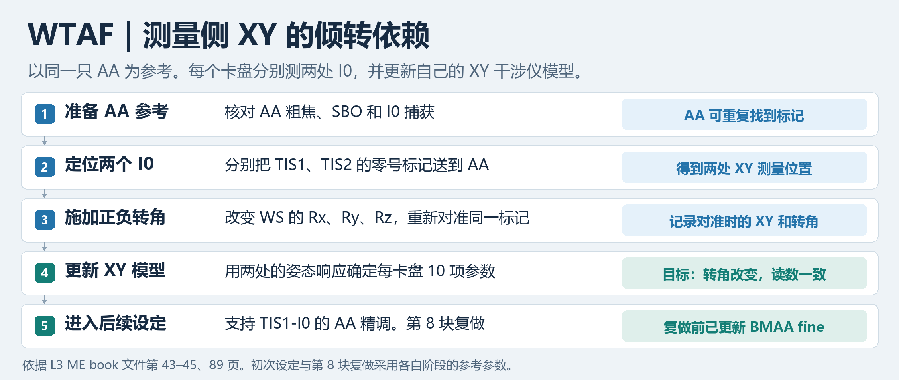
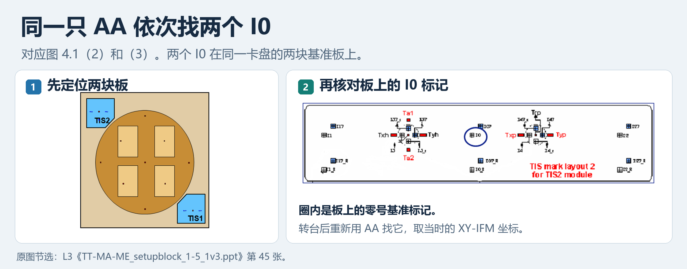
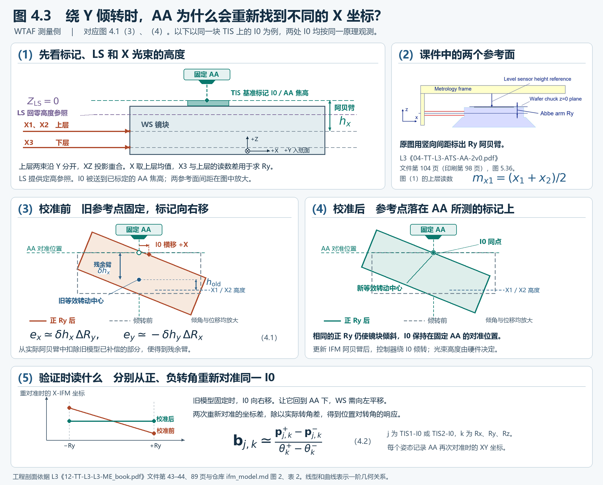
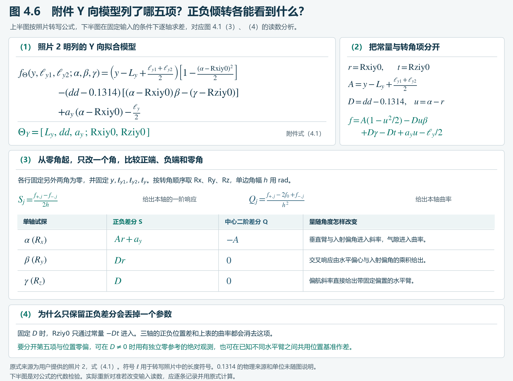

# 4. WTAF · 测量侧 XY 干涉仪倾转校准（附件公式校核 · 审阅草稿 v3）

[总流程图](#wtaf-procedure-diagram) · [与上一版并排核对](#photo-verdict) · [图 4.6 附件 Y 公式](#photo-y) · [五个参数如何辨识](#identifiability) · [修正后的取数方法](#updated-method) · [Level 1–3 及附件出处](WTAF-附件照片与Level123参数出处核查_v1.md#sources)

**图 4.1　WTAF 总流程。**（1）[准备 AA 参考](#wtaf-purpose)。（2）[找到两块板的 I₀](#wtaf-marks)。（3）[改变姿态，重新对准](#wtaf-tilt)。（4）[按位置响应更新模型](#wtaf-fit)。（5）[接入后续设定和复做](#wtaf-follow-up)。流程依据 L3-《12-TT-L3-L3-ME_book.pdf》文件第 43–45、89 页（印刷第 35–37、81 页）。

**本次校核结论。** 上一版与附件在八个几何量的名称和主要作用上吻合。上一版将 Kx、Ly 固定，并另拟合两项跨轴响应；附件将 Kx、Ly 列在机器常数中，且在 Y 向拟合向量中明确列入 Ly。本稿按附件修正参数清单，保留上一版仿真作为工程模型的对照。[直接看差别](#photo-verdict)

### Purpose（目的）

**解决什么。** 从固定的先进对准传感器（AA）看，WS 改变 Rx、Ry 或 Rz 后，同一个对准标记会在不同的 XY-IFM 坐标处被找到。WTAF 用 AA 作参考修正这部分倾转误差，使测量侧模型给出的标记位置与 AA 对准位置一致。同一个标记在两种转角下回到同一只 AA 后，换算到同一参考系的标记 XY 应保持一致。两卡盘分别校准。[图 4.3 为什么倾转会带来平移](#wtaf-principle)

**前置条件。** 非阿贝校准模组（ACM）路线先用 CABF 标定 AA 光束倾角和焦高。AA 的焦高至少已粗定，SBO（Shifts Between Orders，各衍射级次给出的对准位置偏移）已准到足以作参考，BMAA coarse 提供 TIS 板上标记的查找条件。[Level 1–3 前置证据](WTAF资料汇整_v1.md#wtaf-evidence-levels)

**表 4.1　每卡盘的测量侧模型参数**

| 证据 | 量 | 用法 |
| --- | --- | --- |
| L3 ME book 文件第 43、44 页 | XY 阿贝臂 ax、ay。更新会覆盖先前确定的 Ry 阿贝臂。 | 补偿 IFM 有效测量高度与对准标记目标高度分离形成的倾转误差。按轴看，Ry 倾转主要进入 X，Rx 倾转主要进入 Y。 |
| L3 ME book 文件第 44 页 | 测量侧 XY IFM 模型每卡盘共有 10 项，含阿贝臂。 | 修正 X、Y 对 Rx、Ry、Rz 的响应。附件照片 1 列出十个黑字物理量；照片 2 明列其中五个 Y 向待拟合量。与 v9 工程系数的对应见[表 4.6](#photo-verdict)。 |

L3-《04-TT-L3-ATS-AA-2v0.pdf》文件第 109 页（印刷第 103 页）也列有 MI 字段 ifm-ax、ifm-ay，出现在 CABF 的版本说明中。[原页证据](WTAF资料汇整_v1.md#wtaf-evidence-constants) · [两版口径的逐项对照](#photo-verdict)

**后续。** 初次 WTAF 为 TIS1-I₀ 上的 AA 精调提供条件。XY 模型改动会影响基准板的坐标转换，随后 BMAA fine 更新板的平移、旋转、倍率（TRM）。第 7 设定块更新 BMAA fine 后，在第 8 块复做测量侧 WTAF。第 8 块流程图还列出曝光侧 WGTD 与镜面图标定，随后进入 WS 非正交与比例校准。见 L3-《12-TT-L3-L3-ME_book.pdf》文件第 43–45、89 页（印刷第 35–37、81 页），图 2.82。[后续关联项目](WS-IFM机器常数校准项目_v4.md#mc-wgtd)

### How（操作流程）

#### 原文操作译文

译自 L3-《12-TT-L3-L3-ME_book.pdf》文件第 44 页（印刷第 36 页）WTAF 的 Method 及其后续说明。

> 在每个 XY 位置，施加 Rx、Ry、Rz 转动不应影响对准位置。干涉仪模型中的 10 项参数随卡盘而定，参数见测试报告，由 TIS1-I₀ 和 TIS2-I₀ 的测量求得。
>
> 1. 用对准传感器测量 TIS1 和 TIS2 上的 I₀ 标记。
> 2. 施加正、负 Rx、Ry、Rz 转动，并调整 XY 干涉仪模型。
> 3. 更新机器常数后，对卡盘的所有 XY 位置，XY 对准位置均不随所施加的正、负 Rx、Ry、Rz 转动而改变。
>
> 本测试细调测量侧 XY 位置受 Rx、Ry、Rz 转动的影响。TIS1-I₀ 和 TIS2-I₀ 上的信息足以用于建立干涉仪参数模型。这两个标记在 X、Y 两方向相距较远。
>
> 后面可能重复此测试的原因有三个：AA 焦面尚未最终确定，衍射级次间偏移尚未最终确定，Z 模型尚未完成校准。预计这三者都不会严重影响当前测试的有效性。
>
> 现在执行此测试，是因为前置条件要求对准传感器的焦高至少已经粗定。本测试为在 TIS1-I₀ 上微调 AA 焦高提供前置条件。

非 ACM 路线的前后顺序见同书文件第 43 页（印刷第 35 页）的 Method，以及 L3-《TT-MA-ME_setupblock_1-5_1v3.ppt》第 42、44 张。

> 标定对准光束倾角和焦高（CABF）。标定包含阿贝臂在内的 XY 干涉仪模型（WTAF）。核查对准光束倾角和焦高校准（CABF）。

第 8 块复做说明译自同书文件第 89 页（印刷第 81 页）的 WS XY Interferometer Setup at Measure side。

> 测量侧 WS XY 干涉仪校准已在第 3 设定块、AA 光束倾角和焦高试验之后介绍过。本测试使测量侧的 WS XY 坐标不受施加的台体转动与倾斜影响，也就是使 WS 旋转中心与 AA 传感器位置一致。现在重复此测试，是因为第 7 设定块已更新 BMAA fine，并且要为整个 WS 范围标定阿贝臂。

#### 按总图操作

**图 4.1（1）、（2）先准备 AA，再找标记。** 让 AA 在已知的焦高附近工作，确认能找到当前卡盘的零号标记。将 TIS1-I₀ 和 TIS2-I₀ 分别移到同一只 AA 下。两处标记提供相距较远的两组 XY 测量位置。

**图 4.2　WTAF 的两块板与零号标记。** （1）是卡盘俯视图。（2）是 TIS2 板详图，蓝圈为 I₀。两幅均节选自 L3-《TT-MA-ME_setupblock_1-5_1v3.ppt》第 45 张。[Level 2 的对准读数关系与原图定位](WTAF资料汇整_v1.md#wtaf-evidence-figures)

**图 4.1（3）改变姿态，再找同一标记。** 施加正、负 Rx、Ry、Rz。每次改变姿态后，用 AA 重新找该标记，比较重新对准时的 XY-IFM 坐标。要与不同角度的坐标对应，还要保留转角。对两处标记分别取得这些数据，再换另一个卡盘做同类测量。课件未列加角量、每组轮次或转角施加顺序。AA 找标记、IFM 给出 XY 坐标的分工见 L2-《12-TT-L2-ME-module.pdf》文件第 18–19 页（印刷第 10–11 页）。

**图 4.1（4）、（5）更新模型，接入后续设定。** 用两处标记在多个姿态下的对准结果约束每卡盘的 XY 模型参数。校正目标是转角变化后，模型给同一个标记的 XY 不变。两处标记用于求参数，所得模型应覆盖卡盘 XY 范围。课件未列拟合矩阵和验收阈值。首次结果交给 AA 精调与 BMAA fine，后段复做按该设定块的参考状态执行。[复做依据](#wtaf-follow-up)

### Principle（校准原理）

**图 4.3　垂直阿贝臂的几何解释仍然成立。** 照片 1 直接把 ax、ay 定义为相应上排 IFM 到 AA 焦面的垂直距离。仓库模型的 X 平移主要取上排 X1/X2 的均值，X3 参与求俯仰角。图中选 LS 读零面作绘图高度基准，AA 实际对准标记的焦高由定焦给出。[原图出处与 XZ 推导](MEtrology-WTAF整理草稿_v2.md#wtaf-principle)

### 附件逐项核对

**表 4.6　照片 1 的物理量，对照上一版选取的 v9 补偿量**

| 物理作用 | 照片 1、2 | 草稿 v2 | 本次判定 |
| --- | --- | --- | --- |
| AA 到读数系统的水平距离 | X 向 Kx、Y 向 Ly，照片 1 黑字。照片 2 将 Ly 列为待拟合参数。 | 固定 v9 的 Kx、Ly，只在另一组实验中考虑辨识。 | **改正。** 附件的物理模型应列入 Kx、Ly。移植需核对 AA 位置和 v9 坐标原点；两个定义中的数值不自动相等。 |
| 上排至 AA 焦面的垂直臂 | ax、ay，单位 mm | 两条有效垂直臂 | **吻合。** 读数正方向、角度正方向仍须按各自模型换算。 |
| 上排的水平位置误差 | ee 对应 X 组沿 Y 的偏心，dd 对应 Y 组沿 X 的偏心，单位 mm | 两条水平有效臂 | **方向和物理来源吻合。** 照片 2 中实际乘上转角的是含固定偏置的水平臂，见图 4.6（2）。 |
| 两组 IFM 的角度误差 | X 组 Ryix0、Rzix0；Y 组 Rxiy0、Rziy0，表中单位 µrad | 四个随工作位置变化的有效偏角 | **名称与测量轴吻合，方程不能逐列替换。** 照片 2 中 Rxiy0 进入角差、平方项与乘积项；Rziy0 在展示的 Y 式中只形成与姿态无关的偏置。 |
| 两个额外的一阶跨轴补偿 | 照片 1 黑字清单及照片 2 的 Y 参数向量均未列出独立跨轴系数 | X 方程直接乘 Rx、Y 方程直接乘 Ryx，各自有一个自由系数 | **改正。** 两项只保留为 v9 的工程补偿。上一版观察到的误差下降可以复现，但不能据此用两项补偿替代 Kx、Ly。 |
| 照片 1 的两行红字 | Rzixy0 是 X、Y 两组 Rz 角误差的差异；ux 是顶部两束 X-IFM 测量光的角度误差 | v2 另列的系数属于 X、Y 平移解算 | **物理量不同。** 仓库把 ux 用于由 X 组测得的偏航 Rzx 随 Ry 的修正。照片没有给 Rzixy0 的作差正方向，也没有说明两项如何写入。ux 的单位栏印作 mard，疑为 mrad，保留待核。 |

按附件整理，**X 组为 Kx、ee、ax、Ryix0、Rzix0；Y 组为 Ly、dd、ay、Rxiy0、Rziy0。** Y 组的五项直接见式（4.1）的参数向量；X 组按照片 1 的量名和轴向归类，附件没有显示 X 方程。黑字十项与 L3 每卡盘十项的数量吻合。两张照片均无可见书名、页码或实机保存状态，红字的用途按其文字说明单列。[两图转录及 L3 对照](WTAF-附件照片与Level123参数出处核查_v1.md#sources)

### 照片 2 的 Y 公式说明了什么

**图 4.6　由附件式（4.1）直接检查 Y 向响应。** 对应[图 4.1（3）、（4）](#wtaf-procedure-diagram)。上半图按照片转写，下半图为控制其他输入后的代数检验。角符号依照片 1、2 的对应关系取 α 为 Rx、β 为 Ry、γ 为 Rz，计算时用 rad。照片 2 首段将 Y 光的两个方向写成 Rx、Ry，与同段符号 Rziy0、式中 γ 以及照片 1 的 Rz 说明冲突，本稿采用 Rx、Rz。图中用 ℓ 排印照片里的长度符号。数值 0.1314 需与 dd 处于同一长度单位，附件未交代所使用的单位制及该数值对应的几何距离。

- **只转 Rx。** 在两处位置分别测正端、负端和零角。正负差的斜率由垂直臂 ay 和乘以当前基线的 Rxiy0 共同决定。正负两端的平均相对零角还含一个与角度平方成正比的量，Ly 就在这个曲率系数里。照片 1 说一般模型涉及 Ly、ay、dd；在照片 2 的纯 Rx 特例下，dd 对同标记正负差的贡献会消掉。
- **只转 Ry。** 在 Rx 为零时，Y 仍可响应。其斜率由带固定偏置的水平臂乘 Rxiy0 给出；在这个特例下，两因子任一为零，响应也随之为零。这是原有参数产生跨轴响应的具体例子。
- **只转 Rz。** 同标记的正负斜率给出含 0.1314 偏置的有效水平臂，因而可约束 dd。Rziy0 改变时，两端的模型值会同量平移，差值保持相同。v9 把一个有效量放进 Y 基线乘 Rz 的一阶列，照片 2 的 Y 式没有这一乘积。两式的符号或系数也需要通过输出定义、几何基准和坐标换算后才能比较。[v9 实现](ifm_corr.md#corr-xy)

### 五个待拟合量需要哪些读数

**表 4.7　用同一照片公式逐级增加信息。** 这里固定每对正负试探的非角输入，取两个不同的 Y 工作基线和三个独立转轴。秩是对照片五个待拟合参数的局部雅可比秩。下表所列为非退化教学工况，不代表实机验收精度。

| 取用的数据 | 算例的秩 | 从数据中能区分什么 |
| --- | ---: | --- |
| 两处、三轴，仅保留同一标记的正负差 | 3 / 5 | Rz 响应定有效水平臂；两位置的 Rx 响应差定 Rxiy0。剩下的 Rx 截距只给出 ay 与 Ly 的组合。Ry 交叉响应由已得的量决定。 |
| 加入正负两端的平均相对零角的变化 | 4 / 5 | Rx 的曲率额外约束含 Ly 的基线。非角输入已知时，可继续分开 Ly 与 ay。Rziy0 仍随取差消失。 |
| 零点与其余输入均有独立约束，保留绝对模型观测 | 5 / 5 | 当有效水平臂非零时，Rziy0 可从常量部分辨识。若再放开未知的公共位置零偏，Rziy0 与零偏混合；若有效水平臂为零，该 Y 式对 Rziy0 没有灵敏度。 |

**数值校验。** 在同一长度单位下，取两个基线为 75、265，转角幅值均为 500 µrad。若以 mm 表示本例长度，Rx 正负斜率分别是 32.51125、32.53975 mm/rad；两处正负端平均相对零角分别是 −9.375、−33.125 nm。按转写的原式直接计算，与图 4.6 的解析结果一致。这个例子检验公式和保留哪些数据；照片没有提供现场重复性或实测结果。[可运行的原式、雅可比及秩校验](../code/wtaf_photo_y_check_v1.py)

### 据此修订取数与拟合方法

1. 每卡盘分别对准两块板的 I₀，保留零角、每个正负端的实测转角、对应的原始 IFM 读数、AA 对准记录和各自的位置参考。原始光程、位置或焦高随重对准变化时，逐样本代入式（4.1）。图 4.6 的简化斜率适用于其列明的固定输入条件。
2. 先用两位置、正负差估计有效水平臂与入射偏角，再用保留下来的 Rx 偶响应约束 Ly，分开它与 ay。有绝对位置参考或独立的角误差约束时，才把 Rziy0 与其余量联合估计。若只有差分记录，就报告四个或三个可辨识方向，并保留已独立标定的偏航误差。红字 Rzixy0 即使另有测量，也须先明确差的方向和共同偏航零点。
3. 把每组实测输入及其协方差送入非线性拟合，复查参数灵敏度、重复性和独立标记的误差。对于照片仅给清单的 X 组，先保留所列五个字段；Y 公式的验证不能代替 X 方程的符号、项数和拟合验证。这三步是依据照片公式设计的辨识方法，课件明确的实机动作已逐条列于[How 原文译文](#wtaf-procedure)。

**上一版仿真仍回答哪个问题？** 在 MATLAB v9 的无噪声八路光程仿真中，允许两个额外跨轴系数更新，确实改善了留出位置上的对准复现性。该试验检验 v9 平移方程选取哪些补偿列。附件式（4.1）列出的是另一套五个 Y 向物理参数，尚未用带绝对参考的机台观测做数值标定。[v2 八项与十项的对照结果](MEtrology-WTAF整理草稿_v2.md#full-replay) · [v2 图 4.4–4.5 工程算法](MEtrology-WTAF整理草稿_v2.md#wtaf-algorithm) · [附件出处与红字字段](WTAF-附件照片与Level123参数出处核查_v1.md#sources) · [返回总流程](#wtaf-procedure-diagram)
