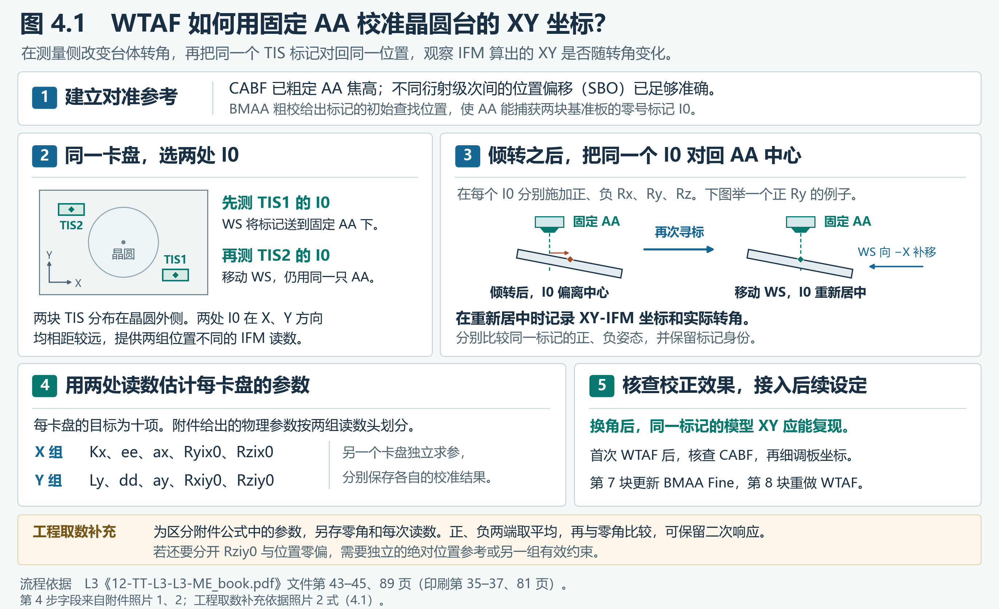
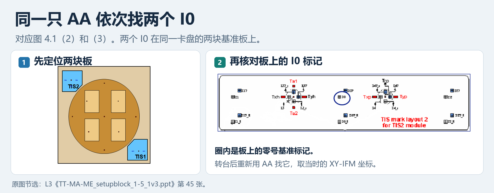
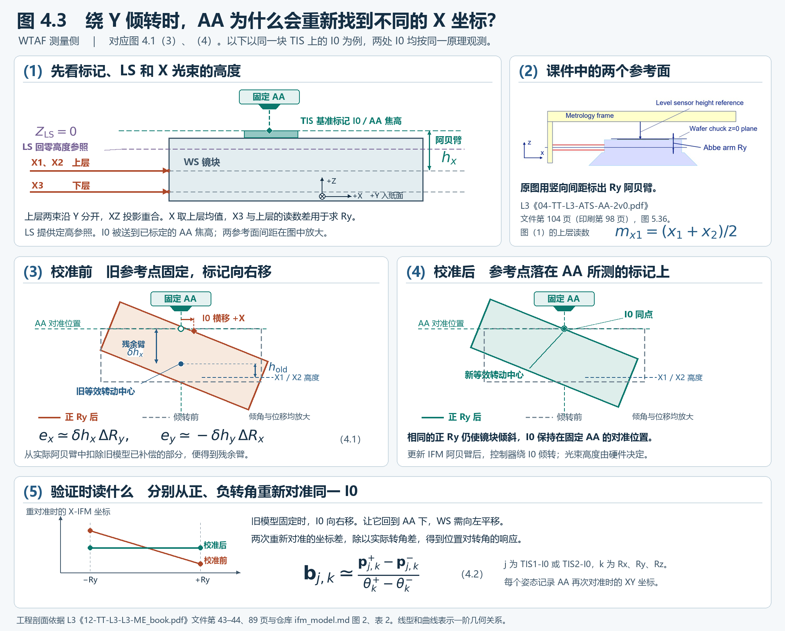
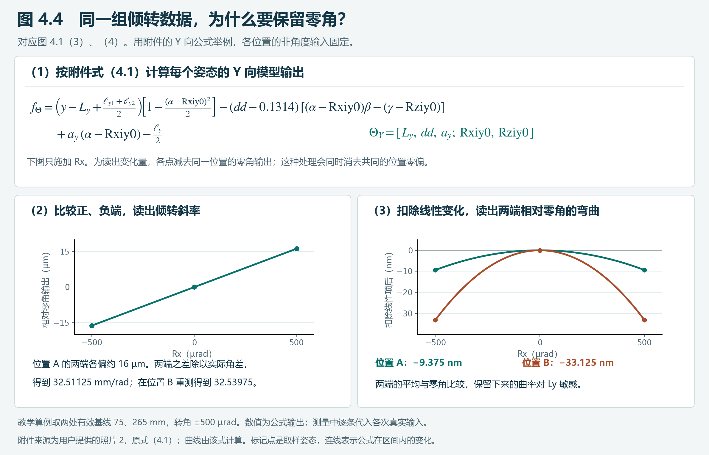

# 4. WTAF · 测量侧晶圆台 XY 干涉仪倾转校准

[总流程](#wtaf-procedure-diagram) · [Purpose：目的与机器常数](#wtaf-purpose) · [How：怎么测](#wtaf-procedure) · [Principle：为什么测得出来](#wtaf-principle) · [Y 向解算](#wtaf-y-model) · [资料与原图](WTAF-流程与物理参数资料汇整_v1.md#reference)

**图 4.1　WTAF 总流程。** [（1）准备对准参考](#wtaf-purpose) · [（2）选两处标记](#wtaf-marks) · [（3）转台并重新对准](#wtaf-pair) · [（4）估计参数并验证](#wtaf-estimate) · [（5）后续设定与复做](#wtaf-repeat)。依据 L3-《12-TT-L3-L3-ME_book.pdf》文件第 43–45、89 页（印刷第 35–37、81 页）。图中单列的取数建议来自附件公式分析。

## Purpose（目的）

把晶圆台（WS）上的一个标记送到固定的对准传感器（AA）下，AA 可以找到标记中心；台的位置由干涉仪（IFM）报告。如果 IFM 用错了测量高度或光束方向，台一倾转，即使同一标记重新回到 AA 的中心，模型也可能报出另一个 XY 位置。**WTAF 用 AA 作外部参考，校准测量侧 XY 对 Rx、Ry、Rz 的响应，使同一标记在不同倾角下得到一致的对准坐标。** 每个卡盘分别求一套参数，更新会覆盖此前标定的 Ry 阿贝臂。[L3 项目目的及原文定位](WTAF-流程与物理参数资料汇整_v1.md#method)

**开始条件与后续用途。** 两块 TIS 基准板的零号对准标记 I₀ 都能被找到。AA 焦高至少已粗定，各衍射级次给出的对准位置偏移（SBO）已知到足够精度，否则 AA 自身的变化也会进入结果。无阿贝校准模组的路线先用 CABF 校准 AA 束倾与焦高；首次 WTAF 使后续能在 TIS1-I₀ 上精调 AA 焦高，再用 BMAA Fine 更新两块基准板的坐标变换。[L3 设定顺序](WTAF-流程与物理参数资料汇整_v1.md#sequence) · [BMAA 怎样定板坐标](MEtrology-BMAA整理草稿_v6.md#two-i0-stage-align)

**表 4.1　按附件归类的十个测量侧物理参数**

| 几何量 | X-IFM | Y-IFM | 物理含义 |
| --- | --- | --- | --- |
| 水平距离（mm） | Kx | Ly | AA 位置与对应 IFM 之间的距离差，进入该方向的光路几何。 |
| 垂直阿贝臂（mm） | ax | ay | 对应上排 IFM 光束到 AA 焦面的垂直距离。 |
| 水平偏心（mm） | ee | dd | X 组沿 Y 的位置误差；Y 组沿 X 的位置误差。绕 Z 转动时可产生水平读数变化。 |
| 对台体俯仰或横滚的角度误差（µrad） | Ryix0 | Rxiy0 | X 组对应 Ry，Y 组对应 Rx。 |
| 对台体偏航的角度误差（µrad） | Rzix0 | Rziy0 | X、Y 两组分别对应 Rz。 |

L3 明确每卡盘十项，并点名 ax、ay；表中字段来自外部资料《照片 1.jpg》的十行黑字。《照片 2.jpg》式（4.1）直接列出 Y 向五项，X 向五项按表中轴向归类。照片另有两行红字：Rzixy0 表示两组 Rz 角误差之差，ux 描述顶部两束 X 光的角度误差。两张照片均未给出红字字段的写入方式。[附件与课件逐项核对](WTAF-附件照片与Level123参数出处核查_v1.md#sources)

## How（操作流程）

**L3 原文流程译文。** 据 L3-《12-TT-L3-L3-ME_book.pdf》文件第 44 页（印刷第 36 页）Method 及其后续说明。

> 在每个 XY 位置，施加 Rx、Ry、Rz 转动不应影响对准位置。干涉仪模型的十个参数因卡盘而异（参见测试报告），由 TIS1-I₀ 和 TIS2-I₀ 上的测量确定。
>
> 1. 用对准传感器测量 TIS1 和 TIS2 上的 I₀ 标记。
> 2. 施加正、负 Rx、Ry、Rz 转动，调整 XY 干涉仪模型。
> 3. 更新机器常数后，在卡盘的所有 XY 位置，XY 对准位置均应对正、负 Rx、Ry、Rz 转动保持不变。
>
> 本测试精调 Rx、Ry、Rz 对测量侧 XY 位置的影响。TIS1-I₀ 与 TIS2-I₀ 在 X 和 Y 两个方向均相距较远，两处测量提供的信息足以建立干涉仪参数模型。
>
> 以后可能重复本测试，因为 AA 焦面、各衍射级次之间的偏移以及 Z 模型的校准均尚未最终确定。预计这些因素对本次测试有效性的影响有限。此时执行本项目，须满足对准传感器焦高至少已粗定的前提；本项目又为在 TIS1-I₀ 上精调 AA 焦高提供前提。

**（1）–（2）先准备参考，再选两个工作位置。** 将当前卡盘的 TIS1-I₀ 移到 AA 下，在工作焦高附近扫描标记，找到中心并记录此时的 IFM 位置。TIS2-I₀ 也用同一只 AA 找中心。换板后，台沿 X、Y 移到了另一个位置，两组水平 IFM 从读数系统到侧镜的工作距离也随之改变。每块板各自建立比较基准。[L2-《12-TT-L2-ME-module.pdf》文件第 17–19 页的读数关系](WTAF-流程与物理参数资料汇整_v1.md#reference)

**图 4.2　AA 实际找哪两个标记。** 对应图 4.1（2）、（3）。（1）为卡盘俯视图，（2）为 TIS2 板上 I₀ 的位置。原图节选自 L3-《TT-MA-ME_setupblock_1-5_1v3.ppt》第 45 张。

**（3）改变转角，每次把同一个 I₀ 再送回 AA。** 以 TIS1 的 Ry 为例：给正 Ry，沿 XY 重找该标记，AA 确认中心时读取 IFM；给负 Ry，重新对准同一标记再读一次。对 Rx、Rz 也取得正、负姿态的结果，另一块板做同类测量。AA 提供“标记已经回到同一外部位置”的判据。比较的是模型换算到该标记处的 XY 对准坐标；为重对准而产生的台体平移、台原点坐标和各束光程都允许变化。

**（4）每卡盘拟合，按同一标记验证。** 用两个位置的倾转观测更新该卡盘的 XY-IFM 参数，重新比较各个角度的标记坐标。两处 I₀ 是原书指定的取数位置，整个卡盘 XY 工作范围是参数要达到的校准目标。工程上可另取未参与拟合的姿态复验，把位置差与 AA 重复对准的散布比较。课件未公开角度幅值、重复次数及验收阈值。[L3 实机动作与判据](WTAF-流程与物理参数资料汇整_v1.md#method)

**（5）为什么还要再做。** 第 3 设定块先做 CABF、WTAF，再核查 CABF。后续 AA 焦高、SBO、Z 模型可能继续改变。到第 7 块，BMAA Fine 已经更新了板相对 WS 的坐标变换。第 8 块据此复做 WTAF，使阿贝臂校准覆盖全台行程。曝光侧由 WGTD 用像点校准 XYZ，有独立的参考与参数。[L3-《12-TT-L3-L3-ME_book.pdf》文件第 43–45、89 页的前后关系](WTAF-流程与物理参数资料汇整_v1.md#sequence)

## Principle（校准原理）

**图 4.3　为什么标记会横移。** 对应图 4.1（3）、（4）。子图（2）取自 L3-《04-TT-L3-ATS-AA-2v0.pdf》文件第 104 页（印刷第 98 页）图 5.36。其余为工程剖面和读数示意。

在 XZ 剖面中，X1、X2 位于同一上排，二者读数的均值是 X 平移的主读数。下排 X3 与上排的读数差用于求 Ry。模型靠垂直臂 ax 把上排的位移换算到 AA 测 I₀ 的高度。若旧模型把等效转动中心放低了，保持旧模型的 X 不变并给一个正 Ry，I₀ 就向 +X 偏离光轴；要回到 AA 中心，WS 必须向 −X 补移。**这个补移给出了剩余臂长误差的观测。** 修正后，模型能把倾转所伴随的平移计入标记坐标。图中 LS 读零面只是绘图的高度基准，实际对准在 AA 的工作焦高进行。[仓库 IFM 的 XZ 光路](ifm_model.md#ifm-figure-2) · [焦高和阿贝臂原图](WTAF-流程与物理参数资料汇整_v1.md#reference)

**为什么要用两块板，又要保留零角？** 以 Y 向为例，同一处标记绕 Rx 时，Y 输出的一阶斜率同时含垂直臂 ay 和随光路工作距离变化的角误差 Rxiy0。换到另一块板，工作距离改变，同样的倾转给出另一个斜率；两处的斜率差能帮助分开这两种影响。再保留零角，就能看出两端共同向同一侧偏了多少。

**图 4.4　同一组读数的两种用法。** 对应图 4.1（3）、（4）。子图（1）转写外部资料《照片 2.jpg》式（4.1）；（2）、（3）是该式在两处工作距离下的无噪声算例。按附件符号将 α、β、γ 分别对应 Rx、Ry、Rz。式中常量 0.1314 要与 dd 使用同一长度单位，照片未给出它所指的几何段或式内单位。[原式与输入约定](WTAF-附件照片与Level123参数出处核查_v1.md#sources)

**表 4.2　用附件 Y 式估计五个物理参数时，应保留什么信息（工程推导）**

| 保留的信息 | 能从中确定什么 |
| --- | --- |
| 两处标记的正、负倾转结果 | 绕 Rz 的 Y 斜率约束含固定偏置的水平臂 dd；两处绕 Rx 的斜率差约束 Rxiy0。单凭正负差，ay 与 Ly 仍混在同一个组合中。绕 Ry 时的 Y 响应可由此水平臂和 Rxiy0 的乘积产生。 |
| 每处另保留零角，比较正负端平均与零角 | Rx 引起的一阶变化在两端平均时抵消，留下的曲率含 Ly。已知其他长度输入后，可继续分开 Ly 与 ay。图 4.4 采用相同的角度幅值，位置 A、B 的这一分量分别为 −9.375、−33.125 nm。 |
| 独立的位置零位或其他能分离公共偏移的观测 | 在附件所示 Y 式中，若有效水平臂固定，Rziy0 对各姿态只加同一个位置偏移，作差即消失。有效水平臂非零、零点和其他输入受独立约束时，才可能用这条方程将 Rziy0 单独求出。 |

用于工程复算时，逐条保留卡盘、标记、零角及正负端、实际姿态、同步 IFM 读数和 AA 对准参考，用一组候选参数逐样本计算标记位置，在同一参考系与 AA 对准位置比较。以重复测量的波动给残差加权，联合调整有独立约束的参数，使两块板各自在各姿态的残差减小；另取一组姿态复验。表 4.2 说明的是在各对试探的其他输入固定时，数据中含有哪些独立信息；重新对准若改变了这些输入，就应使用它们当时的实测值。附件为 Y 向给出了完整式；X 向按表 4.1 登记物理量。仓库 MATLAB v9 的两项直接跨轴补偿及其外检结果留作工程模型的对照。[Y 式可辨识性与复算](MEtrology-WTAF整理草稿_v3.md#identifiability) · [v9 独立姿态复验](MEtrology-WTAF整理草稿_v2.md#full-replay) · [返回总流程](#wtaf-procedure-diagram)
