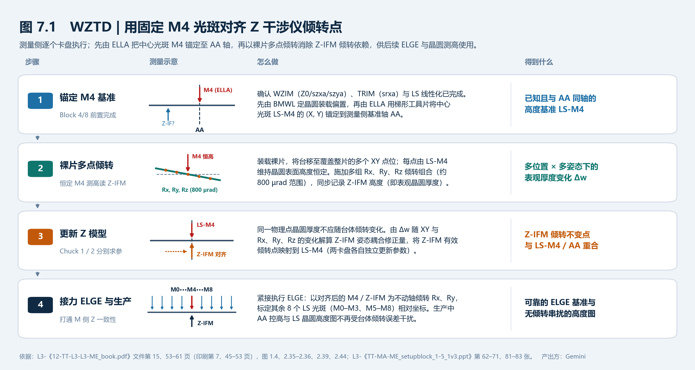
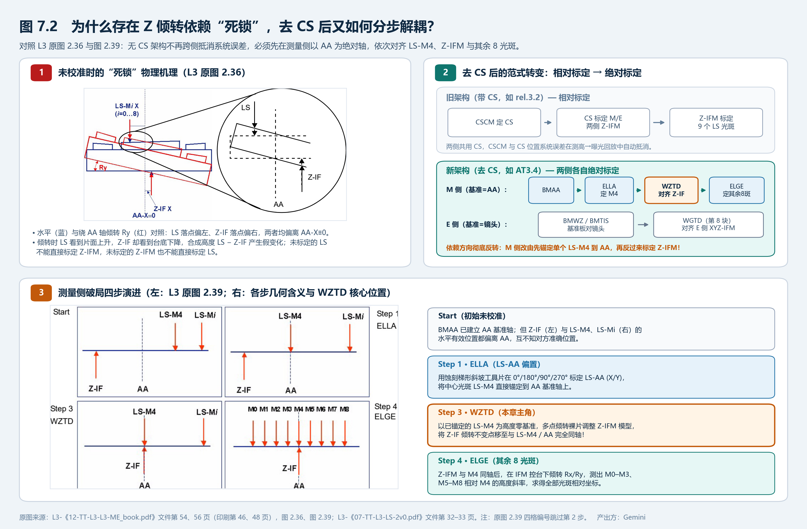
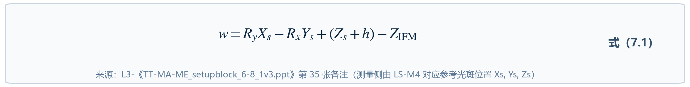
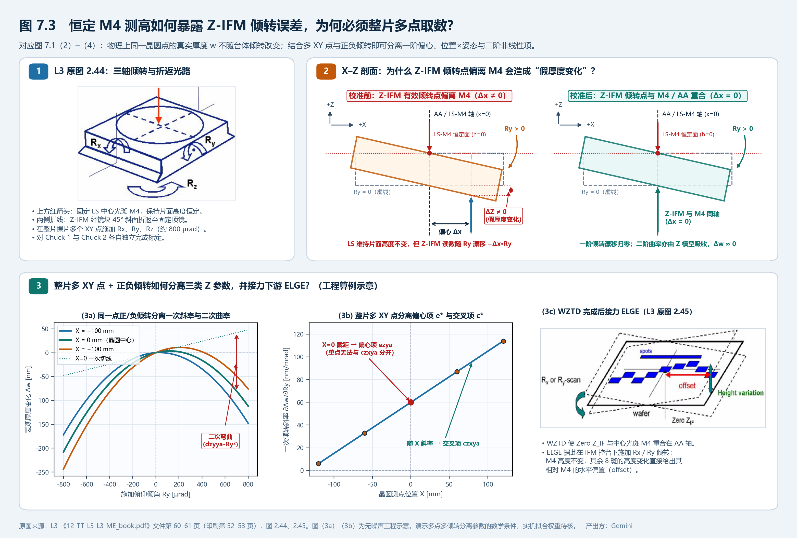
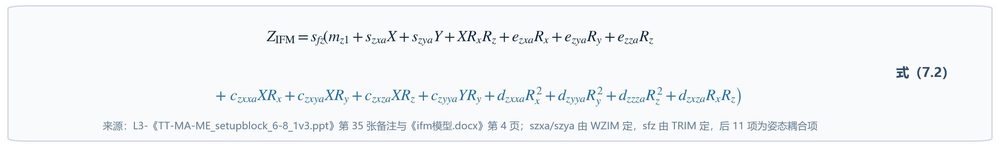

# 7. WZTD · 测量侧晶圆台 Z 干涉仪倾转依赖校准

> 产出方：Gemini ｜ 日期：2026-11-28 ｜ 版本：v1

[总流程](#wztd-flow) · [Purpose｜目的与机器常数](#wztd-purpose) · [How｜操作流程](#wztd-how) · [Principle｜死锁解耦与多点辨识](#wztd-principle) · [下游衔接与版本边界](#wztd-boundary) · [Level 1–3 资料汇整](WZTD资料汇整_Gemini_v1.md#scope) · [成果索引](../README.md)

**图 7.1　WZTD 总流程。** [（1）锚定 M4 基准](#wztd-purpose) · [（2）裸片多点倾转取数](#wztd-how) · [（3）两卡盘分别更新 Z 模型](#wztd-constants) · [（4）接力 ELGE 与生产测高](#wztd-boundary)。依据 L3-《12-TT-L3-L3-ME_book.pdf》文件第 15、53–61 页（印刷第 7、45–53 页），图 1.4、2.35–2.36、2.39、2.44；L3-《TT-MA-ME_setupblock_1-5_1v3.ppt》第 62–71、81–83 张。[流程与跨文档核对](WZTD资料汇整_Gemini_v1.md#sequence)

## Purpose（目的）

在测量侧（M），晶圆表面相对晶圆台（WS）卡盘的局部高度由水平传感器（LS）与垂向干涉仪（Z-IFM）联合给出：LS 测量晶圆上表面相对计量框架的高度，Z-IFM 报告卡盘相对计量框架的高度，两者之差反映晶圆相对卡盘的厚度与形貌。如果 Z-IFM 的有效倾转不变点（tilt point）与 LS 中心光斑 M4 不重合，或 Z-IFM 模型中的姿态耦合参数未校准，那么晶圆台只要绕 Rx、Ry 倾转或绕 Rz 旋转，即使 M4 下方的同一片面点保持恒定高度，Z-IFM 也会报出虚假的高度变化。**WZTD（WS Z Tilt Dependency, measure side）以已锚定到对准轴 AA 的中心光斑 LS-M4 为外部高度参考，校准测量侧 Z-IFM 的有效倾转点及姿态耦合参数，使 LS 与 Z-IFM 在各种倾转姿态下对恒定高度保持一致。** 两个卡盘（Chuck 1、Chuck 2）各自独立执行并保存。[L3 项目目的与原文](WZTD资料汇整_Gemini_v1.md#method)

**执行前提与后续用途。** 在无置信传感器（CS）的 AT3.4 设定流程中，WZTD 位于中段设定块 4/8（Sequence 4/8）中段，要求前序已完成：

- **前期基础（设定块 1–3）：** [SWZS](MEtrology.md#swzs) 初步归零、[WZIM](MEtrology.md#wzim)（已标定测量侧 Z0、Ry0 及行走倾斜 szxa、szya）、[WGIM / WS TRIM](MEtrology.md#wgim)（已消除 Rz 耦合与 Z 镜不平行并确定 Z 尺度 sfz）、[CLPL](MEtrology-CLPL整理草稿_v1.md#clpl)、[BMAA](MEtrology-BMAA整理草稿_v6.md#bmaa)（建立 AA 为测量侧 XY 原点）及粗版 [WTAF](MEtrology-WTAF整理草稿_v4.md#wtaf)。
- **设定块 4/8 直接前置：** 复测 WS TRIM（核查 srxa，确认框架 Z 镜支承无漂移）→ LS 线性化（线性化 9 个测量光斑及捕获光斑）→ BMWL 粗校与精校（使系统可自动对准晶圆标记）→ **ELLA（LS-AA 偏置校准）**。ELLA 用刻有梯形斜坡与正交标记的工具片在 0°/180°、90°/270° 标定 `LS-AA (X)` 与 `LS-AA (Y)`，先把中心光斑 **LS-M4** 的水平坐标锚定到测量侧基准轴 AA。
- **完成后可开展的项目与生产价值：** ① 紧接执行 **ELGE（LS XY 光斑位置校准）**，以已与 Z-IFM 对齐的 M4 为不动轴倾转台体，标定其余 8 个 LS 光斑（M0–M3、M5–M8）相对 M4 的位置；② 保证生产中 AA 扫描时由 Z-IFM 控制的标记高度准确；③ 消除测量侧晶圆高度图（wafer map）中的倾转串扰，避免曝光侧回放时出现离焦。曝光侧（E）的 Z 倾转依赖由设定块 8/8 的 **WGTD** 与 XY 倾转依赖合并校准。[设定块 4/8 完整顺序](WZTD资料汇整_Gemini_v1.md#sequence)

**表 7.1　WZTD 涉及的 Z-IFM 物理参数与证据边界（两卡盘各自独立）**

| 参数组别 | 代表字段（交叉引用 Z 模型） | 耦合项 | 作用与校准归属 | 证据口径 |
| --- | --- | --- | --- | --- |
| **一阶姿态与倾转点偏心（3 项）** | `ezxa`、`ezya`、`ezza` | Rx、Ry、Rz | 直接修正 Z-IFM 有效倾转不变点相对参考轴（M 侧为 LS-M4 / AA）的水平偏心及 Rz 串扰。 | 字段名及物理释义引自 L3-《12-TT-L3-L3-ME_book.pdf》文件第 92 页表 2.2 与 L3-《TT-MA-ME_setupblock_6-8_1v3.ppt》第 35 张备注；M 侧 WZTD 实机报表字段子集与参数组名**待核对**。 |
| **位置 × 姿态交叉项（4 项）** | `czxxa`、`czxya`、`czxza`、`czyya` | X·Rx、X·Ry、X·Rz、Y·Ry | 吸收随卡盘 XY 行程变化的倾转高度耦合（含 45° 折返光路随 X 行程的几何杠杆、顶镜扭曲与光束偏斜）。 | 同上。实机曝光侧 WGTD 样张单位为 mrad，复测参考容差见备注 0–0.05 mrad；M 侧正式验收限值**待查 Coach**。 |
| **二阶纯姿态非线性项（4 项）** | `dzxxa`、`dzyya`、`dzzza`、`dzxza` | Rx²、Ry²、Rz²、Rx·Rz | 吸收 45° 折返光路余弦误差与刚体欧拉角二阶耦合引起的高度弯曲。 | 同上。曝光侧样张单位为 mm，复测参考容差 0–10 mm；M 侧正式验收限值**待查 Coach**。 |
| **前序已定基准项（非 WZTD 新求）** | `szxa`、`szya`、`sfz` | X、Y 与 Z 总比例 | `szxa`、`szya`（X/Y 行走倾斜）由 WZIM 标定；`sfz`（Z 比例因子）在课件备注中归于 WS TRIM（WGIM）。 | L3-《TT-MA-ME_setupblock_6-8_1v3.ppt》第 35 张备注明确区分。[WZIM](MEtrology.md#wzim) · [WGIM](MEtrology.md#wgim) |

> **证据边界说明：** L3 专节明确指出测量侧 WZTD 更新两卡盘的“Z 干涉仪倾转点及其他 Z-IFM 模型参数”，但未刊出测量侧 WZTD 的实机测试报表或数据库键名清单。表 7.1 中的 11 项姿态耦合字段出自同套 L3 课件的 Z-IFM 通用方程与曝光侧 WGTD 报表（与仓库 [ifm_raw](ifm_raw.md#z-ifm-原式) / [ifm_corr](ifm_corr.md#corr-z) Z 方程同构）；测量侧 WZTD 实际写入的参数组名（如是否对应 `wsm_chuck1/2_if_model_parameters`）与实机放行阈值须以对应软件版本的 WZTD 报表和 Coach 为准。[机器常数与证据边界](WZTD资料汇整_Gemini_v1.md#constants)

## How（操作流程）

**L3 原文流程译文。** 据 L3-《12-TT-L3-L3-ME_book.pdf》文件第 60 页（印刷第 52 页）与 L3-《TT-MA-ME_setupblock_1-5_1v3.ppt》第 81–82 张正文及讲义备注综合直译：

> **测量侧 Z 干涉仪倾转依赖（WZTD）：** 使用中心 LS 光斑（M4）测量 Z，并将 LS 倾转点映射到 Z-IFM 倾转点。由于 LS 是测量侧的 Z 基准，必须确定其倾转不变位置。具体方法为：装载一片裸片，在分布于整片晶圆的多个 XY 点位上，由水平传感器（M4）维持晶圆高度固定，同时施加多种晶圆台倾转组合（Rx、Ry、Rz，范围约 800 µrad，注：原 PDF 缺字印作 `800□rad`，经原页核查与同书第 91 页量级确证为 800 µrad），读取各姿态下的 Z-IFM 高度（即测得的表观晶圆厚度）。物理上，晶圆厚度应与施加的倾转无关；在施加倾转不引起 Z-IFM 高度变化的等效 XY 位置，即找到倾转不变点。依据不同倾转下测得的表观厚度差值，计算当前 Z 干涉仪模型参数所需的修正量，并调整模型直至 LS 测高不再随倾转变化。对两个卡盘分别执行。

**按图 7.1 拆解四步动作与观测衔接：**

1. **确认前置基准与裸片就位（对应图 7.1（1））。** 确认测量侧 WZIM、WS TRIM、LS 线性化、BMWL 及 ELLA 均已通过；此时 LS 中心光斑 M4 的水平坐标已通过 `LS-AA (X)`、`LS-AA (Y)` 锚定到测量侧基准轴 AA。选定待测卡盘，装载一片裸片作为光学反射面（无需晶圆对准标记）。[前置项目与 ELLA](WZTD资料汇整_Gemini_v1.md#sequence)
2. **整片多点固定 M4 高度并施加三轴倾转（对应图 7.1（2））。** 驱动 WS 依次将裸片上的多个 XY 测点送到固定光斑 LS-M4 下方。在每个 XY 测点上，施加若干组 Rx、Ry、Rz 倾转组合（范围约 800 µrad），同时由 LS-M4 维持晶圆表面高度恒定，同步读取并记录该姿态下的 Z-IFM 高度与台体姿态读数。LS-M4 在此处充当外部恒高判据，Z-IFM 读数与 LS 读数之差给出该测点在不同姿态下的表观晶圆厚度。
3. **按表观厚度不变约束解算并保存 Z 模型参数（对应图 7.1（3））。** 同一晶圆物理点的真实厚度不随台体倾转而改变。测试软件汇总全片所有 XY 测点与多组姿态组合下的表观厚度差异，反算该卡盘测量侧 Z-IFM 模型参数的修正量并更新机器常数，使 Z-IFM 的有效倾转不变点与 LS-M4（即 AA 轴）重合。随后对另一卡盘重复第 1–3 步。
4. **交接下游 ELGE 与复验（对应图 7.1（4））。** WZTD 完成后，紧接执行 ELGE 校准其余 8 个 LS 光斑（M0–M3、M5–M8）相对 M4 的位置，并由 ELGE 的倾转验证表间接检验测量侧残余倾转高度差（L3 LS 报表示例限值为 ±200 µrad 下最大 `|dZ| < 25 nm`）。注：L3 未公开 WZTD 自身的具体 XY 测点数、角度步长、软件输入界面及独立放行阈值，实机操作与验收以对应 Coach 程序为准。[待核对细节清单](WZTD资料汇整_Gemini_v1.md#constants)

## Principle（校准原理）

### 为什么存在“死锁”，去 CS 后又如何破局？

**图 7.2　死锁机理与测量侧四步绝对标定链。** 对应图 7.1（1）、（3）、（4）。子图（1）与子图（3）左侧分别嵌入 L3-《12-TT-L3-L3-ME_book.pdf》文件第 54 页（印刷第 46 页）图 2.36 与文件第 56 页（印刷第 48 页）图 2.39；子图（2）综合 L3-《07-TT-L3-LS-2v0.pdf》文件第 32–33 页整理。[原图出处与跨页说明](WZTD资料汇整_Gemini_v1.md#figures)

**死锁从哪里来？** 在测量侧，系统用 LS 测得片面相对计量框架的高度、用 Z-IFM 测得卡盘相对计量框架的高度，按式（7.1）合成晶圆相对卡盘的表观厚度 w。

式（7.1）摘自 L3-《TT-MA-ME_setupblock_6-8_1v3.ppt》第 35 张备注（原注沿用 CS 时代符号，在无 CS 测量侧由中心光斑 LS-M4 对应参考光斑坐标 Xs、Ys、Zs，其中 Zs 按 WS 零位定义取 0）。h 为测高传感器的原始高度读数；Rx、Ry 与 Z_IFM 为干涉仪报告的台体姿态与垂向位置。从右手坐标系几何来看，当台体绕 Y 轴正转 Ry 时，+X 侧向下沉降、−X 侧向上抬升；图 7.2（1）的放大圆直观展示了当 LS 落点偏在 AA 轴左侧、Z-IFM 有效测点偏在 AA 轴右侧时，同一次 Ry 倾转会让 LS 看到片面上升、Z-IFM 却看到台底下降，两项偏差叠加进入表观厚度 w。如果不先知道 LS 落点在哪里，就无法分辨厚度变化来自 LS 还是 Z-IFM；反之，如果不先消除 Z-IFM 的倾转依赖，也无法靠倾转晶圆台来标定 LS 光斑的位置——这就是 L3 教材所称的“死锁”。

**去 CS 后的破局思路（图 7.2（2）–（3））。** 早期带置信传感器（CS）的机型在测量侧和曝光侧都装有 CS，允许先用 CS 统一标定两侧 Z-IFM、再用 Z-IFM 标定 LS；即使 CSCM 与 CS 位置存在系统偏差，两侧相减时也能自动抵消（**相对标定**）。去除 CS 后，测量侧（LS + AA）与曝光侧（TIS + 投影镜头）不再共用高度传感器，系统误差无法跨侧抵消，因此两侧都必须执行**绝对标定**——把各自的 Z-IFM 锚定到本侧的绝对 XY 参考轴上。在测量侧，该参考轴是 AA；破局步骤正是图 7.2（3）所示的四步递进：先由 BMAA 建立 AA 基准，再由 **ELLA** 用梯形工具片独立测出中心光斑 LS-M4 相对 AA 的水平坐标（从而打破循环依赖），随后 **WZTD** 把 Z-IFM 倾转不变点对齐到已锚定的 LS-M4，最后 **ELGE** 才能放心倾转晶圆台去标定其余 8 个 LS 光斑。[有/无 CS 路线详表](WZTD资料汇整_Gemini_v1.md#deadlock)

### 恒定 M4 测高如何暴露倾转误差，为何必须整片多点取数？

**图 7.3　物理机理与参数分离条件。** 对应图 7.1（2）–（4）。子图（1）与子图（3c）分别嵌入 L3-《12-TT-L3-L3-ME_book.pdf》文件第 60 页（印刷第 52 页）图 2.44 与文件第 61 页（印刷第 53 页）图 2.45；子图（2）、（3a）、（3b）为工程几何剖面与无噪声算例示意。[原图解读与参数表](WZTD资料汇整_Gemini_v1.md#figures)

**为什么偏心 Δx 会变成假厚度变化（图 7.3（2））？** 在 X–Z 剖面中，假设经过 ELLA 后 LS-M4 已对准参考轴 x = 0，并由高度伺服维持该处晶圆上表面高度不变（h = 0）。若当前 Z-IFM 模型的有效倾转不变点仍偏离 M4 一段水平距离 Δx，当台体绕该参考点施加正俯仰角 Ry 时，+X 侧的台体下沉约 Δx·Ry；尽管晶圆本身厚度丝毫未变，未校准的 Z-IFM 却报出高度下降了 Δx·Ry，代入式（7.1）就表现为表观厚度 w 随 Ry 呈线性漂移。同理，Y 向偏心 Δy 会在横滚 Rx 下产生线性厚度漂移。调整 Z-IFM 模型使有效倾转点与 M4 同轴（Δx = 0、Δy = 0）后，这一阶线性漂移消失。

**为什么不能只在一个点倾转，而必须覆盖整片多个 XY 点与多种正负倾转组合？** 考察式（7.2）给出的完整 Z-IFM 参数化模型与式（7.3）的倾转不变目标（式（7.2）出自 L3-《TT-MA-ME_setupblock_6-8_1v3.ppt》第 35 张备注，与 [ifm_raw 原始模型](ifm_raw.md#z-ifm-原式) 及 [ifm_corr 修正模型](ifm_corr.md#corr-z) Z 方程结构一致；式（7.3）为对应的工程残差表达）：

式（7.2）中，mz1 为左右两路 Z 干涉仪（经镜块 45° 斜面折返至固定顶镜）扣去参考光后的均值；sfz 为 Z 比例因子（TRIM 标定）；szxa、szya 为沿 X、Y 的行走倾斜（WZIM 标定）；其余 11 项姿态耦合系数按物理阶次分为三类：一阶纯姿态项（ezxa、ezya、ezza）、位置与姿态交叉项（czxxa、czxya、czxza、czyya）以及二阶纯姿态项（dzxxa、dzyya、dzzza、dzxza）。其中由于 Z 光束入射到镜块 45° 斜面并折返至固定顶镜，台体平移 X 时的纯几何杠杆使 czxya 名义量级接近 −1000 mrad（参见 L3-《12-TT-L3-L3-ME_book.pdf》文件第 92 页曝光侧 WGTD 样张 `czxya ≈ −1001.56 mrad`）。式（7.3）表明，在固定测点 (X, Y) 上把倾转姿态下的表观厚度 w 与零倾转 w(0,0,0) 作差，可消去晶圆在该点的真实厚度与局部面形，直接暴露未校准 Z 模型残差 −ΔZ_IFM。

**表 7.2　多点多姿态取数如何分离三类 Z 姿态参数（工程可辨识性说明）**

| 观测维度 | 对应图 7.3 子图 | 可分离的参数关系 |
| --- | --- | --- |
| **同一 XY 点施加正、负与零倾转** | 图 7.3（3a） | 绕单轴（如 ±Ry）的正负反对称部分给出一阶总斜率；正负均值相对零倾转的对称弯曲给出二阶项（如 dzyya·Ry²）；结合 Rx 与 Rz 同时激励可分离交叉二次项 dzxza·Rx·Rz。 |
| **在整片裸片上变换多个 XY 位置** | 图 7.3（3b） | 若仅在单一点测量，一阶总斜率把偏心项 ezya 与位置交叉项 czxya·X + czyya·Y 混为同一个常数而无法拆分。沿 X、Y 分布多个测点后，总斜率随 X、Y 的线性变化分离出 czxxa、czxya、czxza、czyya，而 X = 0、Y = 0 处的截距独立给出倾转点偏心项 ezxa、ezya、ezza。 |
| **零倾转与有倾转同点作差** | 式（7.3） | 裸片本身的局部厚度起伏在同一点作差时相互抵消，因此 WZTD 只需普通裸片作稳定光学反射面，无需像 ELLA 那样使用刻有标记与斜坡的专用工具片。 |

> **工程解释边界：** 上述可辨识性分解与图 7.3（3a）、（3b）的无噪声算例（以残余 ezya = −60 µm、Δczxya = −0.45 mrad、Δdzyya = +250 mm 为例）用于直观说明为什么 L3 明确要求“分布于整片晶圆的多个 XY 点 + Rx、Ry、Rz 多组倾转组合”。实机软件内部是否一步联合最小二乘求解全部 11 项、各采样点的权重与迭代次序，Level 1–3 未公开，标为待核对。

## 下游衔接、版本对照与待核对边界

| 关联环节 / 对照项 | 关系与要点 | 资料出处 |
| --- | --- | --- |
| **紧邻下游：ELGE（LS 其余 8 光斑校准）** | WZTD 把 Zero Z_IF 与 LS-M4 对齐在 AA 轴后，ELGE 在 IFM 闭环控台下对超平裸片施加 ±200 µrad 的 Rx、Ry 倾转（图 7.3（3c））。中心光斑 M4 保持不动，其余 8 斑（M0–M3、M5–M8）的高度斜率直接给出其相对 M4 的 X、Y 坐标；L3 报表示例的倾转验证规格为最大 `|dZ| < 25 nm`。 | L3-《12-TT-L3-L3-ME_book.pdf》文件第 61 页（印刷第 53 页）图 2.45；L3-《07-TT-L3-LS-2v0.pdf》文件第 46–49 页（印刷第 40–43 页）。 |
| **曝光侧对应：WGTD（设定块 8/8）** | 曝光侧没有 LS，由 WGTD 用 WS 的 TIS1/TIS2 扫描 RS 的 T1/T2 空间像，在投影镜头下一次性消除曝光侧 X、Y、Z 的倾转依赖（23 项参数中后 11 项即 E 侧 Z 姿态模型）。 | L3-《12-TT-L3-L3-ME_book.pdf》文件第 89–92 页（印刷第 81–84 页），图 2.83–2.86、表 2.2。 |
| **旧版带 CS 对照（如 rel.3.2）** | 旧版 `WS Z tilt dependency calibration` 使用 CS 中心光斑在 M、E 两侧同时定高并标定 Z-IFM（图 4.1 所示），再由 Z-IFM 标定全部 9 个 LS 光斑，无需 ELLA。 | L3-《07-TT-L3-LS-2v0.pdf》文件第 32–33 页（印刷第 26–27 页），图 4.1；L1-《13_AP-L1-ME_rel_3.2.pdf》文件第 17、24 页。 |
| **实机待核对清单** | ① 测量侧 WZTD 实机测试报告与数据库字段名（确认是否完整更新 11 项 `ezxa`–`dzxza` 及单位符号）；② 整片 XY 网格点数、倾转组合档位与软件输入屏；③ 对应软件版本的 Coach 程序号及正式验收阈值；④ 另记 L3 原书第 16 页正文列表误印作 `measure side (E)`，实为 `(M)`。 | [完整证据边界与原页核查](WZTD资料汇整_Gemini_v1.md#constants) |

[返回总流程](#wztd-flow) · [Level 1–3 资料汇整](WZTD资料汇整_Gemini_v1.md#scope) · [WS-IFM 机器常数总表](WS-IFM机器常数校准项目_v4.md#mc-wztd) · [成果索引](../README.md)
