# MEtrology 校准项目报告 · 全文整合草稿 v2

本稿供审阅，包含 SWZS 和 WZIM。WZIM 沿用已有图号，移除的图号留空。[正式报告](MEtrology.md#calibration-index)

[项目目录](#calibration-index) · [闭环与校准基准](#ws-ifm-calibration-reference) · [整理范式](#report-format) · [先画总流程再讲细节](#overview-first) · [步骤说明](#step-description) · [WS-IFM 校准清单](WS-IFM机器常数校准项目_v4.md#initial-zero) · [成果索引](../README.md)

## 本报告的整理范式

以下范式仅适用于 `MEtrology.md` 收录的校准项目。

**先画总流程，再解释技术细节。**

先画带编号的总流程图，串起准备条件、操作、观测和结果。正文开篇放总图，按图中的先后顺序解释各阶段。每个概念第一次出现时说明它是什么、怎么得到、下一步怎么用。上一环的结果进入下一环前，写清中间的测量、转换或判断。例如从 PSD 光斑讲到 WS 位姿，中间要说明光斑如何变成电压，电压又如何经增益矩阵换算成位姿偏差。需要展开的技术细节另配图，并标明对应总图的步骤。

1. **Purpose（目的）**。说明项目要解决什么问题、为什么要做、执行前需满足哪些条件，以及完成后可以开展哪些校准项目。列出本项目涉及校准的机器常数及其用途。
2. **How（操作流程）**。沿总图说明各阶段如何衔接。按源文完整翻译具体操作流程，保留步骤顺序、条件、注意事项和判据，并注明来源及页码。
3. **Principle（校准原理）**。具体说明测量基准和物理原理，解释校准如何由观测量得到机器常数。资料中有相关物理原图时，将原图附在本节正文并注明来源层级、原文件名、页码和图号。

### 步骤说明

- 在原文译文之后，用短句说明每一步从什么状态或输入开始、操作什么、读取或检查什么，以及得到什么结果。资料给出判据时，写清怎样判断完成。结果有明确的后续用途时，指出交给哪一步。
- 优先写清动作和信号怎样衔接。公式仅在有助于理解量之间的关系时补充，详细推导可链接到原理或资料汇整。
- 资料只给输入和输出时，按已确认的信息写。为解释原理而补充的操作或算法标为工程示意，并注明实机细节待查。

### 章节、图表与公式编号

- **章节**。每个校准项目独立成节，按目录顺序编号。
- **图、表与公式**。在每节内分别按「章节号.序号」编号，各自从 1 开始。例如第 1 节的第一张图、第一张表和第一条公式分别记为图 1.1、表 1.1 和式（1.1）。正文与图中重复出现的同一公式共用编号。引用资料中的图、表或公式时保留来源编号。
- **图内编号**。原理图和示意图中的关键模块、模组和子图应标注编号，如 `（1）`、`（2）`。正文或图注可按「图 1.2（1）」直接指向具体对象。
- **公式排版**。正文和图内公式应正常显示分式、上下标和矩阵。阅读器对数学语法的支持不一致时，正文可嵌入已排版的公式图并附替代文字。

### 图件布局

- **总流程图**。紧凑布局要求仅适用于[图 1.1](#swzs-procedure-diagram)这类展示项目完整流程的总览图。按各阶段的内容分配版面，收紧边距和模块间距，减少无用途的留白，同时保持步骤编号和文字清晰。
- **原理图与分析图**。沿用[图 1.2–1.5](#swzs-figure-168)的风格，按光路、公式、坐标轴及标注的阅读需要安排空间。

### 来源标注

引用 Level 1–3 的文档或原图时，在文件名前标注所属层级，例如 `L1-《文件名.pdf》`、`L2-《文件名.pdf》`、`L3-《文件名.ppt》`。非 Level 1–3 的来源标为「外部资料」。

## WS–IFM 闭环与校准基准

WS–IFM 闭环比较运动指令和 IFM 解算的位姿。若高度反馈带有随 X 改变的误差，控制器会升降台体来维持读数。反馈仍可跟上指令，但台体在固定机架坐标下已经改变了高度。

判定轨迹要先选一个独立的物理基准。WZIM 用固定水平传感器（LS）的中心光斑 M4 定义零高度。逐点把晶圆表面调到这个高度并记录 Z-IFM，再用两轮数据分离晶圆楔角，得到 Z 模型的线性修正依据。[图 2.9 校正前后的轨迹](#wzim-xtz-ifm-section) · [图 2.2 定高取样](#wzim-grid)

## 项目目录

| 项目 | 定位 | 快速跳转 |
| --- | --- | --- |
| [1. SWZS — WS 初步归零](#swzs) | 建立晶圆台干涉仪启用时的六自由度参考 | [Purpose](#swzs-constants) · [How](#swzs-procedure) · [Principle](#swzs-principle) · [初始零位测量原理](#swzs-voltage-to-zero) · [资料汇整](SWZS资料汇整_v1.md) |
| [2. WZIM — 测量侧初始高度与倾角](#wzim) | 用 LS 定初始高度和倾角，校正 Z-IFM 的线性行走倾斜 | [总流程图](#wzim-procedure-diagram) · [Purpose](#wzim-purpose) · [How](#wzim-procedure) · [Principle](#wzim-principle) · [资料汇整](WZIM资料汇整_v1.md) |

## 1. SWZS — WS 初步归零

[总流程图](#swzs-procedure-diagram) · [Purpose](#swzs-constants) · [How](#swzs-procedure) · [Principle](#swzs-principle) · [初找中心](#swzs-how-find-psd-center) · [步骤 12](#swzs-step12) · [原图出处](#swzs-source-figures) · [Level 1–3 资料汇整](SWZS资料汇整_v1.md)

晶圆台（WS）从干涉仪（IFM）获得精密位姿。装片或换台后，安装在计量框架上的零传感器用位置敏感器件（PSD）检测返回光斑，帮助台体重新找回 IFM 的起读位置。

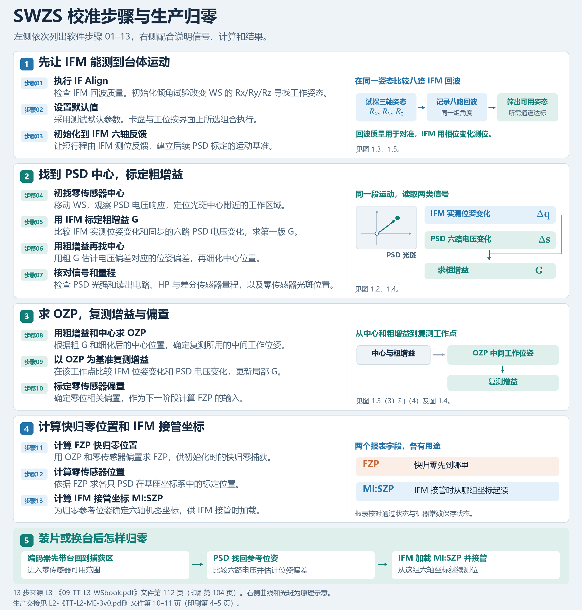

**图 1.1　SWZS 总流程。** （1）[先让 IFM 测到实际运动](#swzs-how-establish-ifm)。（2）[先找 PSD 中心，再用实测运动和电压标定粗增益](#swzs-how-find-psd-center)。（3）[由中心和粗增益算复测工作位姿，再标定增益与偏置](#swzs-how-ozp-and-gain)。（4）[算快归零位姿、PSD 基座位姿及 IFM 起读坐标](#swzs-how-fzp-and-szp)。用这些结果完成（5）[生产归零](#swzs-psd-reference-recovery)。见 L3-《09-TT-L3-WSbook.pdf》文件第 112 页（印刷第 104 页）。[原文译文](#swzs-how-translation)

### Purpose（目的）

SWZS 校准零传感器，使晶圆台装片或换台后能重复找回同一个六轴参考位姿。编码器先将台体带回零传感器能测到光斑的捕获区，PSD 再定位参考，IFM 加载对应的机器坐标后接管。见 L1-《09_AP-L1-Production_Metrology_in-line.pdf》第 13、24 页及 L2-《TT-L2-ME-3v0.pdf》文件第 10–11 页（印刷第 4–5 页）。[图 1.3](#swzs-voltage-to-zero)

**何时做。** TWINSCAN 初始设定或更换零传感器部件后做完整校准，覆盖两卡盘 × 测量侧和曝光侧四种组合。初始化无法快归零时，可独立运行 Update FZP。下列流程适用 WS Type-2、rel.3.4。见 L3-《09-TT-L3-WSbook.pdf》文件第 73、111–115 页（印刷第 65、103–107 页）。

#### 前置条件

完成基座校准（BF）、卡盘交换校准（SWSW）、干涉仪调整与诊断（SWHP）及差分传感器校准（SWDC），空气支承（AM）开启并稳定。见 L3-《09-TT-L3-WSbook.pdf》文件第 111 页（印刷第 103 页）、L3-《TT-MA-WS-Calibrations-3v1.ppt》第 100–101 张。

#### 完成后可以开展的项目

计量设定进入 BMAA 支路及 [WZIM](#wzim) → [WGIM／WS TRIM](WS-IFM机器常数校准项目_v4.md#mc-wgim) → CLPL 支路。SWZS 也是 SWCR 范围检查和 SWSM 短行程电机校准的前提之一。见 L3-《12-TT-L3-L3-ME_book.pdf》文件第 14–15 页（印刷第 6–7 页），图 1.3；L3-《TT-MA-WS-Calibrations-3v1.ppt》第 79、144、211 张。[完整的上下游项目](SWZS资料汇整_v1.md#dependencies)

#### 机器常数及用途

**表 1.1　SWZS 机器常数与中间量**

| 量 | 作用 |
| --- | --- |
| 零传感器增益矩阵 `G` | 将 WS 六轴位姿变化关联到六路 PSD 电压变化。每组合为 6×6，平移列用 V/m，转角列用 V/rad。 |
| `ZSO` | 六轴零传感器偏置，单位 m、rad，用于计算 `FZP`。 |
| `FZP` | 快归零捕获使用的六轴位姿。 |
| `MI:SZP`（`MISZP`） | IFM 接管时加载的六轴机器坐标，可以是非零值。 |
| PSD 基座位姿及 `u0/v0` | 报表逐只列出基座坐标下的六轴位姿和两路电压零偏。 |
| `OZP` | 用粗增益和中心结果算出的中间工作位姿，用于复测增益和求 `FZP`。 |

L3-《09-TT-L3-WSbook.pdf》文件第 111 页明确列出前四项校准常数，文件第 114–115 页（印刷第 106–107 页）图 2.34–2.35 展示示例报表。`Rx0/Ry0/Rz0` 属于相关的初始化倾角设定，见[资料汇整](SWZS资料汇整_v1.md#constants)。

### How（操作流程）

#### 原文流程译文

下列为 L3-《09-TT-L3-WSbook.pdf》文件第 112–115 页（印刷第 104–107 页）中测试软件顺序、注意事项、输入界面和结果说明的译文。前一页列出的五项[前置条件](#swzs-prerequisites)已在 Purpose 完整列出。软件顺序与 L3-《TT-MA-WS-Calibrations-3v1.ppt》第 104 张互证。

**测试软件顺序**

1. 执行干涉仪对准（IF Align）。
2. 设置默认值。
3. 初始化设备，直至短行程（SS）进入由 IFM 反馈控制的六自由度状态。
4. 寻找零传感器的中心位置。
5. 以干涉仪为参照，校准零传感器增益。
6. 用已标定的粗增益重新寻找零传感器中心。
7. 检查以下项目。
   - 零传感器光强及电子学。
   - HP 干涉仪和差分传感器的量程。
   - 零传感器的光束位置。
8. 用零传感器增益和零传感器中心计算 `OZP`。
9. 利用 `OZP` 再次校准零传感器增益。
10. 校准零传感器偏置。
11. 用 `OZP` 和零传感器偏置计算 `FZP`。
12. 用 `FZP` 计算零传感器位置。
13. 计算 `MISZP`。

**注意事项**

- 运行 PSD Calibration 时，更新机器常数后需复做部分计量设定。
- 运行 Update FZP 时，更新机器常数后需复做基座和晶圆搬运系统校准。

**输入界面**

原图 2.33 展示输入界面。从图中可见，测试由用户可选的三个部分组成。

**表 1.2　SWZS 输入模式（译文）**

| 模式 | 原文说明译文 |
| --- | --- |
| **IFM-align** | 单独执行时，只做检查。 |
| **PSD Calibration** | 执行完整校准。它包含 IFM-align，因此选中 PSD Calibration 时无法取消选中 IFM-align。完整校准会重新确定 FZP，因此此时不能选中 Update FZP。 |
| **Update FZP（Fast Zero Position）** | 按基座偏置修正 FZP。此模式下 IFM-align 和 PSD Calibration 都不能选中。 |

**结果说明**

原图 2.34 和印刷第 107 页的图 2.35 给出一份示例报告。报告中可看到上述机器常数。报告末尾还列出许多中间结果，示例中未展示。

#### 按总图读流程

##### 图 1.1（1）步骤 01–03，建立 IFM 六轴反馈

先做 IF Align，确认回波可用。再载入默认值，让短行程进入 IFM 六轴闭环。下一阶段用 IFM 的相位变化测出实际运动，用它标定 PSD。[图 1.5 回波与姿态](#swzs-if-align)

##### 图 1.1（2）步骤 04–07，找中心并标定粗增益

步骤 04 先找 PSD 中心。步骤 05 让 WS 做小幅运动，同时记录 IFM 位姿变化和 PSD 电压变化，求出粗增益 `G_c`，即台体运动引起电压变化的比例关系。步骤 06 用 `G_c` 重新确定中心，得到计算 `OZP` 的输入。步骤 07 检查光强、电子学、光束位置及 HP 干涉仪和差分传感器量程。L3 未给出落点轨迹或中心判据。[图 1.2 光斑如何变成电压](#swzs-psd-readout) · [图 1.4 怎样测增益](#swzs-gain-calibration-figure) · [步骤 04–08 证据](SWZS步骤04至08-PSD中心定位核查_v1.md#step-evidence)

##### 图 1.1（3）步骤 08–10，算 OZP、复测增益、标偏置

用粗增益和中心结果算中间工作位姿 `OZP`，在该工作点复测增益，再标定六轴零传感器偏置 `ZSO`，供下一阶段计算快归零位姿。课件未说明步骤 08 是否驱动台体。[图 1.4 增益怎么测](#swzs-gain-calibration-figure)

##### 图 1.1（4）步骤 11–13，算快归零与 IFM 接管所需的量

用 `OZP` 和 `ZSO` 算快归零位姿 `FZP`，再算三只 PSD 的基座位姿，最后算 IFM 接管用的 `MI:SZP`。

**步骤 12。** 输入是 `FZP`，报表逐只给出 PSD 的基座六轴位姿和检测状态。L3 未公开这一步的采样与解算方法。[步骤 12 证据](SWZS步骤12-PSD基座位姿核查_v1.md#source-evidence)

**核对报表。** 按卡盘和工位核对成功标志、机器常数是否保存及 `old/new` 字段。见 L3-《09-TT-L3-WSbook.pdf》文件第 112、114–115 页（印刷第 104、106–107 页），图 2.34–2.35。

### Principle（校准原理）

先看[图 1.2](#swzs-psd-readout)，弄清三只 PSD 怎样从光斑位置输出六路电压。再看[图 1.3](#swzs-voltage-to-zero)和[图 1.4](#swzs-gain-calibration-figure)，了解如何用 IFM 标定这些电压与位姿的关系。标定之前的八路回波检查见[图 1.5](#swzs-if-align)。

#### PSD 光路与位置电压

每工位有三只固定在计量框架（MF）上的零传感器，与镜块上的三个角锥配对。台体运动会改变返回光斑的位置。每只零传感器的 PSD（位置敏感器件）给出两个方向的电压 `u/v`，三只合计六路。

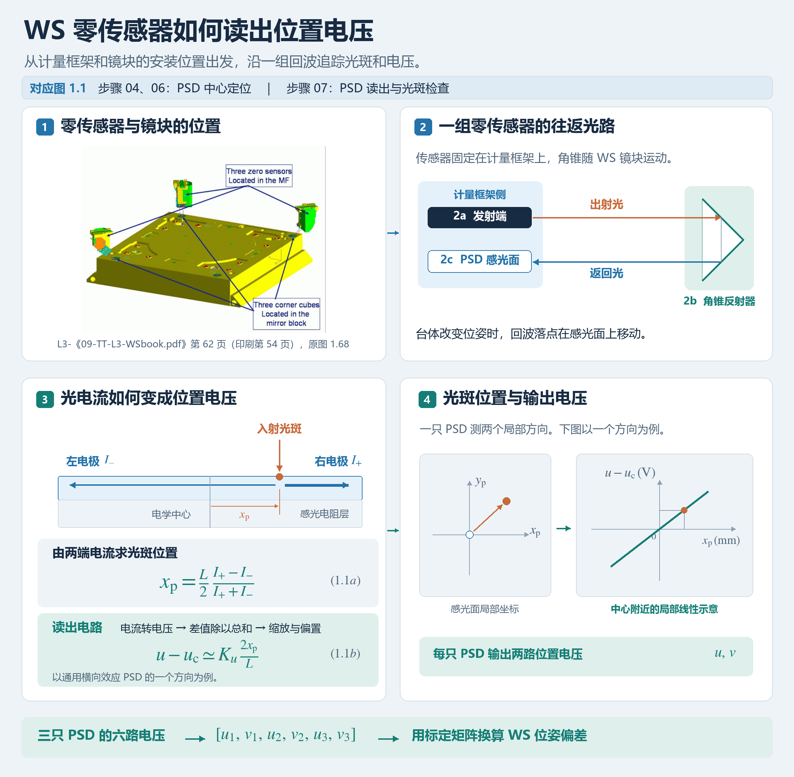

**图 1.2　零传感器光路与位置电压。** 对应[步骤 04、06、07](#swzs-how-find-psd-center)。（1）采用 L3-《09-TT-L3-WSbook.pdf》文件第 62 页（印刷第 54 页）原图 1.68。（2）追踪一组角锥回波，（3）和（4）示意通用 PSD 的电流读出和电压响应。

在通用 PSD 的线性区，光斑位置 `x_p` 由两端电流的归一化差值求出，`L` 是感光有效长度。读出电路用比例系数 `K_u` 将位置变成电压。光斑到电学中心时，电压差趋近零，中心电压 `u_c` 可以非零。[Hamamatsu PSD 技术说明，第 2 页](https://www.hamamatsu.com/content/dam/hamamatsu-photonics/sites/documents/99_SALES_LIBRARY/ssd/psd_kpsd9001e.pdf#page=2) · [PSD 读出电路说明，图 1-1](https://www.hamamatsu.com/content/dam/hamamatsu-photonics/sites/documents/99_SALES_LIBRARY/ssd/psd_singal_kacc9014e.pdf)

图 1.2（4）的电压响应参考外部资料《Hamamatsu C4674-01》文件第 3 页，图 KACCC0648EA。L3 未给出实机 PSD 的电路。[供应商位置—电压原图](https://www.hamamatsu.com/content/dam/hamamatsu-photonics/sites/documents/99_SALES_LIBRARY/ssd/c4674-01_kpsd1005e.pdf#page=3)

#### 用 IFM 标定 PSD，再用 PSD 找回参考

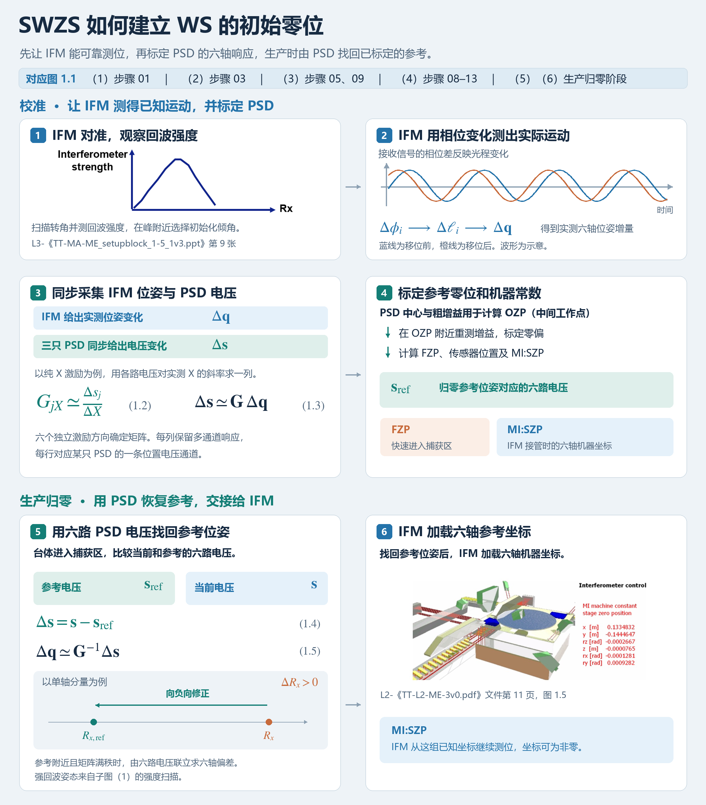

**图 1.3　SWZS 初始零位的测量原理。** （1）和（2）对应[步骤 01、03](#swzs-how-establish-ifm)，回波强度用来确认信号，IFM 相位变化用来测位。（3）对应[步骤 05、09](#swzs-gain-calibration-figure)，（4）对应[步骤 08–13](#swzs-how-ozp-and-gain)，（5）和（6）对应[生产归零](#swzs-psd-reference-recovery)。

（1）的回波曲线取自 L3-《TT-MA-ME_setupblock_1-5_1v3.ppt》第 9 张。（6）的机器坐标示例取自 L2-《TT-L2-ME-3v0.pdf》文件第 11 页（印刷第 5 页），图 1.5。

##### 标定增益矩阵

让 WS 做小幅运动，同时记录 IFM 实测位姿增量和 PSD 六路电压变化。若只动 X，用第 j 路电压变化除以实测 X 位移，估计该路对 X 的灵敏度。用六个独立运动方向确定完整的 `G`。这是对 L3 校准原理的局部线性解释。见 L3-《09-TT-L3-WSbook.pdf》文件第 111–112、115 页（印刷第 103–104、107 页）。

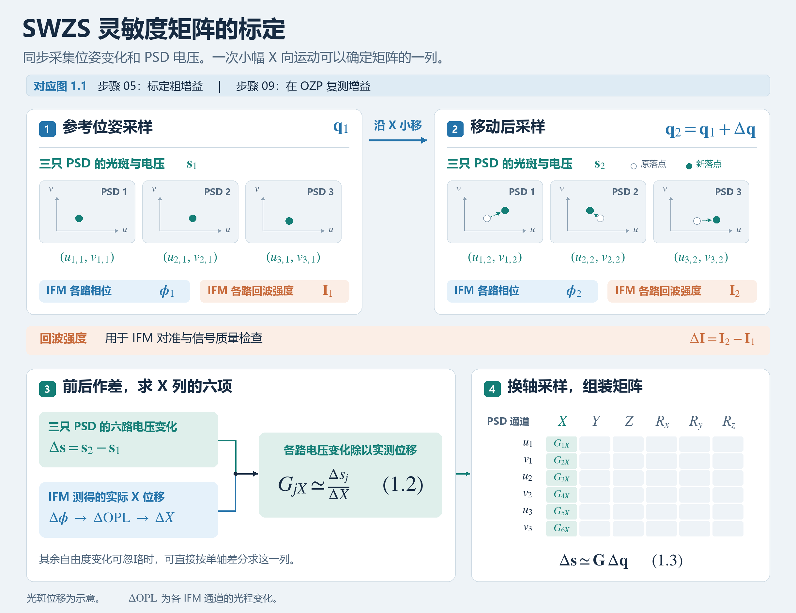

**图 1.4　PSD 灵敏度矩阵的标定示意。** 对应[步骤 05](#swzs-how-find-psd-center)和[步骤 09](#swzs-how-ozp-and-gain)。前者标粗增益，后者用 `OZP` 复测。同样的局部关系也可解释如何用粗增益估计向 PSD 中心调节的增量。

##### 生产归零

生产时编码器先把台体带回 PSD 能测到光斑的捕获区，再读取当前六路电压 `s`，减去同一卡盘、同一工位的参考电压 `s_ref`。在参考点附近且 `G` 满秩时，可以用下式估计**当前位姿相对参考的偏差**，再沿相反方向调节。找回参考后，IFM 加载 `MI:SZP` 接管。见 L2-《TT-L2-ME-3v0.pdf》文件第 10–11 页（印刷第 4–5 页）。

#### IF Align 三轴姿态采样与八路回波选点

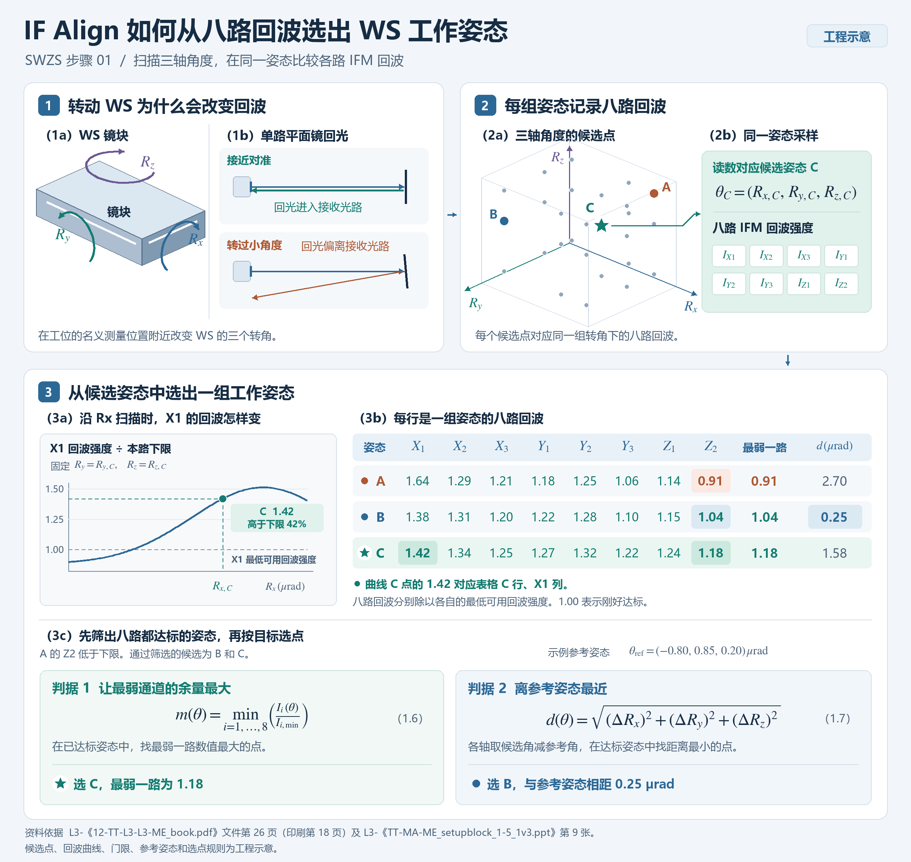

**图 1.5　IF Align 三轴姿态采样与八路回波选点。** 对应[步骤 01](#swzs-how-establish-ifm)。（1）转动镜面改变回波，（2）每组 `Rx/Ry/Rz` 记录八路强度。（3a）X1 曲线上 1.00 是本路最低可用回波，C 点 1.42 表示高出 42%。（3b）八路分别用各自下限归一化。

**（3c）工程示意。** 取八路归一化强度的最小值 `m(θ)`。最小值达到 1.00 时，八路均达到各自下限。合格点中，可以选回波余量最大的 C，也可按角度距离 `d(θ)` 选最接近参考姿态的 B。L3 证实初始化倾角试验会转动 WS 并观测 IFM 信号，图中的候选点、门限和联合选点规则为示意。见 L3-《12-TT-L3-L3-ME_book.pdf》文件第 26 页（印刷第 18 页）及 L3-《TT-MA-ME_setupblock_1-5_1v3.ppt》第 9 张。

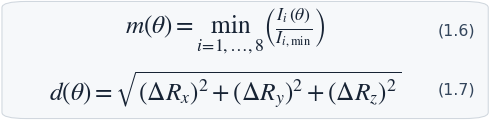

**多路回波不足时。** 在允许的姿态范围内，若找不到八路回波同时达到各自下限的姿态，就回查前置项目 [SWHP](#swzs-prerequisites)。见 L3-《09-TT-L3-WSbook.pdf》文件第 111–113 页（印刷第 103–105 页）。

#### 原图与出处

本机原图路径相对 `D:\work\ME2\参考文献\Markdown_v1\`。计量框架原图见[图 1.2（1）](#swzs-figure-168)。[资料引用规则](../../AGENTS.md#read-only-references)

**表 1.3　SWZS 原图与出处**

| 原始资料 | 图中可核实的信息 | 本机原图位置 |
| --- | --- | --- |
| L3-《09-TT-L3-WSbook.pdf》第 62 页（印刷第 54 页），**图 1.68 Zero Sensors** | 三只传感器固定在 MF，三个对应角锥位于镜块。 | `assets/b4514b4ae5eb86cb/images/page_61_image_8_v1.jpg` |
| L3-《09-TT-L3-WSbook.pdf》文件第 63 页（印刷第 55 页），**图 1.69** | 从计量框架底面看，M/E 各圈出三个零传感器。 | `assets/b4514b4ae5eb86cb/images/page_62_image_5_v1.jpg` |
| L3-《TT-MA-ME_setupblock_1-5_1v3.ppt》第 9 张，**Interferometer strength–Rx 曲线** | 扫描初始化倾角时，回波强度在中间出现峰。 | 见原 PPT 第 9 张及 [正文图 1.3（1）](#swzs-ifm-signal)。 |
| L2-《TT-L2-ME-3v0.pdf》第 11 页（印刷第 5 页），**图 1.4、1.5** | 两图中的台体处于同一归零位置。图 1.5 在 IFM 控制下列出六轴 MI:SZP 参考值。 | `assets/e9dff352e800b276/images/page_10_image_4_v1.jpg`、`assets/e9dff352e800b276/images/page_10_image_9_v1.jpg` |
| L3-《TT-MA-WS-Calibrations-3v1.ppt》第 102 张 | 全 PSD 模式包含 IFM-align。两卡盘 M/E 共四组合可选择，图示进度为 0%。 | `assets/56ea2737208dfc3a/images/page_101_image_4_v1.jpg` |
| L3-《09-TT-L3-WSbook.pdf》第 115 页（印刷第 107 页），**图 2.35** | FZP、MI:SZP、`u0/v0` 和 PSD 增益分别列项，可核对单位和报表字段。 | `assets/b4514b4ae5eb86cb/images/page_114_image_4_v1.jpg` |

[返回项目目录](#calibration-index) · [WS-IFM 清单的初步归零条目](WS-IFM机器常数校准项目_v4.md#initial-zero)

## 2. WZIM — 测量侧初始高度与倾角

[总流程图](#wzim-procedure-diagram) · [Purpose](#wzim-purpose) · [How](#wzim-procedure) · [Principle](#wzim-principle) · [M4 定高](#wzim-grid) · [转片消楔](#wzim-wedge) · [XTZ 闭环](#wzim-xtz-ifm-section) · [单 M4 取样](#wzim-xtz-closed-loop) · [三光斑找平](#wzim-three-spot-ifm-ry) · [单 M4 测 YTZ](#wzim-ytz-single-m4) · [Level 1–3 资料汇整](WZIM资料汇整_v1.md)

完成[初步归零](#swzs)后，IFM 已有起读坐标。WZIM 用固定 LS 建立测量侧（M）的高度和倾角基准。LS 检查光斑下的晶圆表面是否到达参考高度。到达后，记录 Z-IFM 显示的台体高度。比较不同 XY 位置的记录，得到供 Z 模型校准的斜率。

**图 2.1　WZIM 总流程。** （01）[准备基准](#wzim-purpose)，（02）[网格定高和取样](#wzim-grid)，（03）[同卡盘转片消楔](#wzim-wedge)，（04）[确定常数与查看结果](#wzim-zero-refs)。图中四段按 L3-《12-TT-L3-L3-ME_book.pdf》文件第 23–29 页（印刷第 15–21 页）归纳。

### Purpose（目的）

**为什么做。** 沿 X 或 Y 走位时，Z-IFM 的测高误差可以随位置变化。闭环维持定高读数时，这会造成实际 Z 随走位变化，分别称为 XTZ、YTZ。WZIM 修正其中的线性项，并用 LS 给两卡盘各自建立高度和绕 Y 倾角零点。它为后续 [WGIM／WS TRIM](WS-IFM机器常数校准项目_v4.md#mc-wgim) 提供合适的测量高度与倾角。完成 TRIM 后再做 CLPL 基准板高度与倾角标定。见 L3-《12-TT-L3-L3-ME_book.pdf》文件第 14、23–28 页（印刷第 6、15–20 页）。

**前置条件。** 已建立 WS 初步归零及 IFM 初始化倾角。确认设备洁净度和温度状态，初始化 LS 并检查测高重复性，确认两卡盘都能正常装载裸片。LS 完整线性化在后续进行，WZIM 用中心光斑 M4 的零输出作高度参考。见 L3-《12-TT-L3-L3-ME_book.pdf》文件第 14、23、26–27 页，L1-《13_AP-L1-ME_rel_3.2.pdf》第 23–24 页。

**表 2.1　WZIM 校准的机器常数**

| 每卡盘的常数 | 从什么测量得到 | 用途 |
| --- | --- | --- |
| `Z0` | 用裸片建立高度零点，以名义厚度晶圆表面位于 M4 零高度定义参考。 | M 侧初始高度零偏，课件列名为 `z0_chuck1_measure_side`、`z0_chuck2_measure_side`。 |
| [`Ry0`](#wzim-ry0) | 以 LS 光斑 M0、M4、M8 在测试晶圆上的观测为参照。 | 更新每卡盘的 M 侧 IFM 归零角，使两卡盘采用同一 LS 倾角基准。 |
| `szxa` | 两轮测得的 X 向 Z 斜率中，分离出对转片不变的部分。 | 修正 M 侧 Z 模型的线性 XTZ。 |
| `szya` | 两轮测得的 Y 向 Z 斜率中，分离出对转片不变的部分。 | 修正线性 YTZ。同一卡盘的曝光侧（E）沿用 M 侧结果。 |

曝光侧的 BMWZ 用两只透射像传感器（TIS）的高度建立参考，仅由这两点无法同时分离 X/Y 行走倾斜。WZIM 的 `szya` 按卡盘共用。见 L3-《12-TT-L3-L3-ME_book.pdf》文件第 27–29、63 页（印刷第 19–21、55 页），L3-《TT-MA-ME_setupblock_1-5_1v3.ppt》第 8、10、15–17 张。[机器常数证据](WZIM资料汇整_v1.md#constants)

### How（操作流程）

#### 原文操作译文

译自 L3-《12-TT-L3-L3-ME_book.pdf》文件第 27–29 页（印刷第 19–21 页）的 Method、Z0 设置和测试界面。原文按段落说明，图 2.1 按动作归纳。

> 台体沿 X 和 Y 移动时也会在 Z 方向移动，分别简称 XTZ 和 YTZ。校准通过调整干涉仪模型的参数去除这种不需要的 Z 运动。干涉仪归零时使用 Ry0 归零角，使镜块相对于计量框架处在名义姿态。此角度最初由晶圆台初始化倾角试验确定，其值在本测试中被覆盖。
>
> 每个卡盘用一片裸片。在每片晶圆的 XY 网格上，用 Z 干涉仪测量高度。每一点都先使晶圆处于 `LS_M4 = 0`，再记录 Z 干涉仪读数。两个卡盘都只在测量侧测量。
>
> 裸片只测一次时，可能存在的晶圆楔角会叠加到测得的 XTZ 和 YTZ。为避免楔角影响机器常数，两片晶圆绕 Z 旋转 180°，仍装回各自原来的卡盘，在测量侧重复测量。晶圆楔角转向后，测得的 XTZ 和 YTZ 会变化，因此可以从结果中去除楔角。更新测量侧每个卡盘的 Z 干涉仪模型。X 和 Y 干涉仪值分别乘以 `szx0` 和 `szy0`，得到线性 XTZ 和 YTZ 修正项。`szya` 与卡盘有关，与工位无关，测量侧确定的值也用于曝光侧。
>
> 对每个卡盘，测试用的晶圆也设定该卡盘的 Z 等于零的平面。结果暂存为 Z0 归零偏置。后续晶圆台基准板标定通过确定参考高度和光栅高度，精确定义这一平面。以卡盘 1 的测量侧为例，设定偏置，使 Z 干涉仪建立参考并读零时，名义厚度晶圆的表面恰在 `LS_M4 = 0` 高度。除 IFM 参数外，标定 `z0_chuck1_measure_side` 和 `z0_chuck2_measure_side`。本测试还重定 Ry0，使 LS 各光斑的高度偏置与卡盘无关。
>
> 原图 2.7 是测试输入界面的示例。界面显示卡盘、晶圆来源、测量网格的 X/Y 范围及点数等输入。

**按总图操作。** 两个卡盘各用一片裸片、各做两轮。[每点先调 Z 使 M4 读零，再记录 Z-IFM](#wzim-grid)。第二轮将同一裸片转 180° 并装回原卡盘，[比较两轮斜率](#wzim-wedge)。分别依照 LS 的高度和倾角基准设定零偏。课件未列出软件内部更新各机器常数的先后顺序或验收阈值。

**侧别核对。** L3 专节和 L3-《TT-MA-ME_setupblock_1-5_1v3.ppt》第 15 张正文都写两卡盘在 M 侧测量。该张讲义备注有“两侧”的不同表述，本章按专节流程和 BMWZ 的曝光侧分工整理。[版本差异](WZIM资料汇整_v1.md#source-differences)

### Principle（校准原理）

#### 步骤 02　固定 M4 定高，记录 Z-IFM

LS 固定在测量侧，M4 的光斑位置和零高度固定。先移动 WS，把晶圆上的 XY 测点送到 M4 光斑下。再升降 WS，直到 **M4 读数为零**。此刻记录该点的 XY 位置和 **Z-IFM 高度**，随后测下一点。

如果晶圆有楔角，不同点到达同一 M4 高度所需的台体 Z 会不同。镜块或 Zmirror 的几何误差也会使 Z-IFM 的读数随 XY 位置变化。一轮网格测量会同时量到两种贡献。见 L3-《12-TT-L3-L3-ME_book.pdf》文件第 24–27 页（印刷第 16–19 页），L2-《TT-L2-ME-3v0.pdf》文件第 36 页（印刷第 30 页）图 1.39。[两轮取样算例](#wzim-xtz-closed-loop)

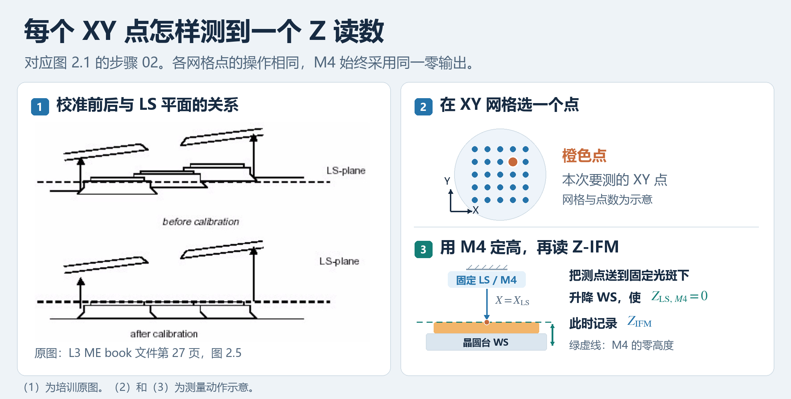

**图 2.2　一个 XY 测点怎样得到一个 Z-IFM 读数。** 对应[总图步骤 02](#wzim-procedure-diagram)。（1）为 L3-《12-TT-L3-L3-ME_book.pdf》文件第 27 页（印刷第 19 页）原图 2.5，虚线表示 LS 平面。（2）选测点。（3）升降 WS，直至测点到达 M4 零高度，再取样。

#### 步骤 03　转片后分离晶圆楔角

每轮用 XY 网格上的 Z-IFM 记录求 X 向、Y 向斜率。第二轮只将裸片绕 Z 转 180°，装回原卡盘并重测同一组 XY 位置。晶圆楔角反向，台体和计量系统的固定贡献保留。两轮斜率的**平均**给出共同项，**半差**给出楔角项。要把共同项再分解为台体坡度与 IFM 测高误差，需要额外的观测或几何约束。见 L3-《12-TT-L3-L3-ME_book.pdf》文件第 24–27 页（印刷第 16–19 页）。[X 向算例](#wzim-xtz-closed-loop) · [Y 向算例](#wzim-ytz-single-m4)

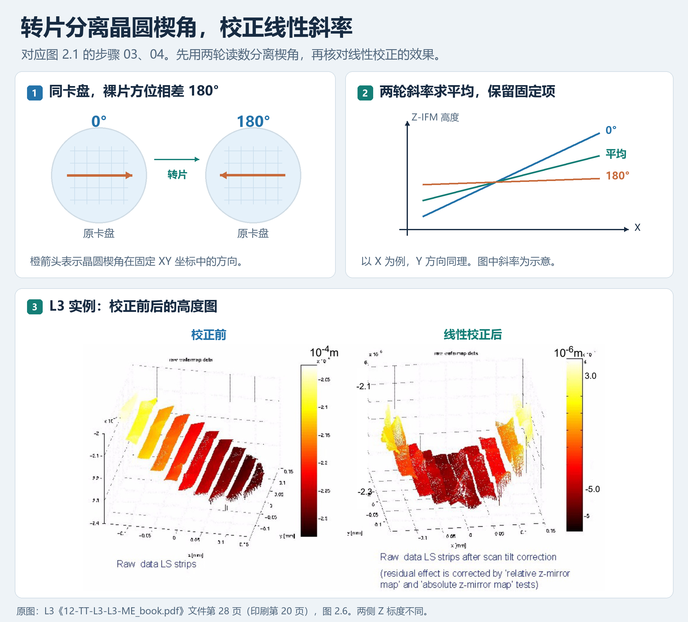

**图 2.3　转片消楔与线性校正结果。** （1）、（2）对应[总图步骤 03](#wzim-procedure-diagram)，以 X 向斜率示意两轮取样。（3）对应总图步骤 04，取自 L3-《12-TT-L3-L3-ME_book.pdf》文件第 28 页（印刷第 20 页）原图 2.6。校正后整体斜率降低，仍可看到弯曲。两幅高度图的 Z 标度不同，比较量级时须分别读标尺。

式（2.1）用两轮斜率求共同项 **b** 和楔角项 **w**，每项含 X、Y 两个分量。式（2.2）示意更新后的 Z 模型。Z_other 汇总其余项，szxa、szya 分别乘 X、Y 的 IFM 读数。课件未列出实机拟合权重和常数写入的完整符号约定。[公式与证据](WZIM资料汇整_v1.md#source-differences)

#### 步骤 04　设定零点并更新 Z 模型

- **高度零点 Z0。** 给每个卡盘设偏置，使 Z-IFM 建立参考并读零时，名义厚度的晶圆表面位于 M4 的零高度。
- **线性修正 szxa、szya。** 将两轮网格的共同斜率用于更新 Z 模型中随 X、Y 变化的项。[图 2.3（3）校正结果](#wzim-results)

**倾角零点 Ry0。** 给每个卡盘设定相对于 LS 倾角基准的 IFM 初始化绕 Y 姿态。M0、M4、M8 测的是晶圆上表面，片面坡度同时包含台体倾斜和晶圆楔角。L3 说明用三光斑建立 Ry0，并明确规定 XTZ、YTZ 的网格测量转片复测。课件未说明 Ry0 的三光斑算法是否也用同一片的两个方位。见 L3-《12-TT-L3-L3-ME_book.pdf》文件第 27–29 页（印刷第 19–21 页），L3-《TT-MA-ME_setupblock_1-5_1v3.ppt》第 17 张。

#### 三光斑在一个位置测到的是片面坡度

式（2.3a）中，hᵢ 是第 i 只光斑的高度读数，xᵢ 是该光斑的 X 坐标。H 是中心光斑 M4 的高度，a_WS 是台体支承面沿 +X 的坡度，wₓ 是晶圆的 X 向楔角。

- **同一 XY 点读三个高度。** 用 M0 与 M8 的高度差除以两光斑的 X 间距，得到片面坡度，见式（2.3a）、（2.3b）。WS 整体升降会使三个高度同时改变，做差后抵消。若两轮台体倾角相同，按式（2.4）对两次片面坡度取平均，晶圆楔角相消。
- **不同 XY 点比较 Z-IFM 高度。** 每点先把 M4 调到零，再记录 Z-IFM，沿走位方向求斜率。固定姿态下的单 M4 取样见[图 2.10](#wzim-xtz-closed-loop)，同时调 Z 和 Ry 使三路读零的算例见[图 2.11](#wzim-three-spot-ifm-ry)。

##### 三光斑读零的条件

M0–M8 沿 X 排列。各通道已校到同一高度基准时，平直片面若与基准平行，这一排读数相同，共同高度可以非零。要使 M0、M4、M8 同时为零，用 Ry 让 M0 和 M8 等高，再用 Z 把 M4 调到零。这个条件要求片面在该排光斑覆盖范围内可视为平面。Z 是当下调节的台体高度，Z0 是写入的起读偏置。见 L3-《07-TT-L3-LS-2v0.pdf》文件第 12、39、46、48–49 页（印刷第 6、33、40、42–43 页）。[原页和读数核查](WZIM三点归零与LS读数核查_v1.md#finding)

##### 两轮找平角怎样分离台体倾斜

式（2.5）–（2.7）以沿 +X 升高的坡度角为正。aᵢ 为第 i 点找平时台体施加的坡度角变化，b 为 IFM 角度读零时台体相对 LS 的初始坡度，w 为晶圆楔角，eᵢ 为该点的角度或片面坡度残差。片面找平时四项之和约为零。只平均一轮，固定的晶圆楔角仍在结果里。裸片转 180° 后，用相同的 IFM 角度基准和测点再找平，两轮平均消去一阶楔角。

上面是工程推导。[图 2.11](#wzim-three-spot-ifm-ry)采用 IFM 的右手 Ry，正 Ry 会使 +X 一端下降。因此正 Ry 增量对应几何坡度角减小。

#### XTZ 算例：同一条等高指令在校正前后怎样执行

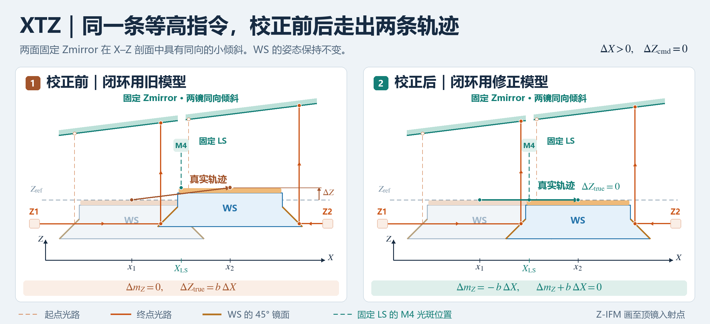

**图 2.9　固定 Zmirror 小倾斜时的闭环轨迹。** 解释[总图步骤 02](#wzim-grid)为何需要固定 LS 定高，以及[步骤 04](#wzim-zero-refs)修正什么。两幅均为 X–Z 剖面。Z1、Z2 从固定位置入射，经 WS 两侧的 45° 镜折向上方固定 Zmirror。浅色虚线是起点光路，橙色实线是终点光路。固定 LS 的 M4 标出独立测量的位置。算例取小角度，WS 姿态固定，Z 比例归一。[IFM 折返光路](ifm_model.md#ifm-figure-2) · [原图定位](WZIM资料汇整_v1.md#source-figures)

式（2.8）中，m_Z 是两路 Z 净读数的均值，b 是顶镜同倾引入的 X 向斜率。若台体等高向右移动，光点在顶镜上扫到更高的位置。扣除参考光后，净光程仍会增加。按照 IFM 读数的符号，未补偿的高度读数会下降。[IFM 的光程符号](ifm_model.md#ifm-readout)

1. **校正前。** 闭环把未补偿的净高度读数变化压到零。向右走时台体因此升高，实际台高变化约为 b 乘 X 位移。
2. **校正后。** Z 模型加回位置补偿，闭环维持修正后的高度。在图示的一阶模型中，台体相对机架等高行走，未补偿读数仍随 X 改变。

[图 2.10](#wzim-xtz-closed-loop)接着用固定 LS 定高，展示怎样从两轮 Z-IFM 读数测出斜率。顶镜误差的物理来源见 L3-《12-TT-L3-L3-ME_book.pdf》文件第 24–25、27 页（印刷第 16–17、19 页），原图 2.2、2.3、2.5。

#### 单 M4 算例：每次 M4 读零后记录什么

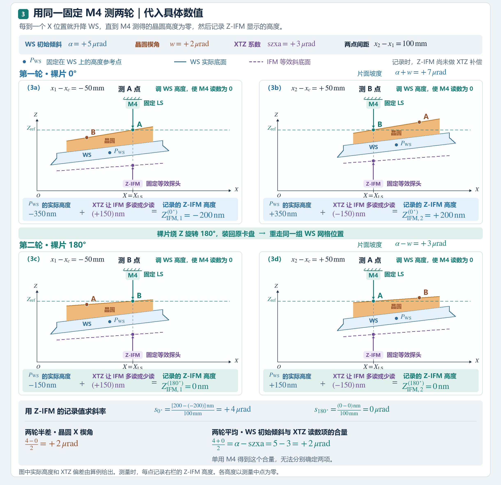

**图 2.10　用同一固定 M4 做两轮 X 向取样。** 对应[总图步骤 02、03](#wzim-procedure-diagram)。（3a）、（3b）是裸片 0°，M4 依次测晶圆上的 A、B。（3c）、（3d）是转片 180° 后，WS 仍走相同的 x₁、x₂，M4 依次测 B、A。每次先调 Z 使 M4 读数为零，再记录**尚未补偿 XTZ 的 Z-IFM 高度**。点 A、B 固定在晶圆上，蓝点 P_WS 固定在台体上。

**怎样从实际高度得到 IFM 读数。** P_WS 的 Z 是台体实际高度。紫色虚线是表示 Z-IFM 线性测量误差的等效斜面。上方 M4 与下方的等效 Z-IFM 探头都画在固定的 X_LS 处。台体沿 X 移动后，固定探头对到虚线上的另一处，Z-IFM 因此多读或少读。实际折返光路见[图 2.9](#wzim-xtz-ifm-section)。

**代入算例。** 台体初始几何坡度 α 为 +5 µrad，裸片 0° 的 X 向楔角 w 为 +2 µrad，XTZ 补偿系数 szxa 为 +3 µrad。x₁、x₂ 相距 100 mm，以中点 x_c 的台高为零。式（2.9）中，σφ 在 0° 轮取 +1，在 180° 轮取 −1。补偿前的读数偏差是 szxa 乘测点相对中点的 X 位移，再取反号。[Z 模型中的 XTZ 项](ifm_model.md#ifm-table-3)

| 裸片方位 | x₁ 记录的 Z-IFM | x₂ 记录的 Z-IFM | 高度差除以 100 mm |
| --- | ---: | ---: | ---: |
| 0° | −200 nm | +200 nm | +4 µrad |
| 180° | 0 nm | 0 nm | 0 µrad |

以第一笔为例，M4 读零时 P_WS 的算例台高为 −350 nm，IFM 多读 150 nm，故记录 −200 nm。两轮斜率的**半差是 +2 µrad**，得到晶圆楔角。**平均也是 +2 µrad**，这次得到的是台体初始几何坡度 α 减去 szxa 的结果。四笔 Z-IFM 记录只能确定楔角和这个共同项。下一图增加了 Ry 观测，用于分离两个固定贡献。

#### 三光斑算例：找平后分别用 Ry 和 Z 计算

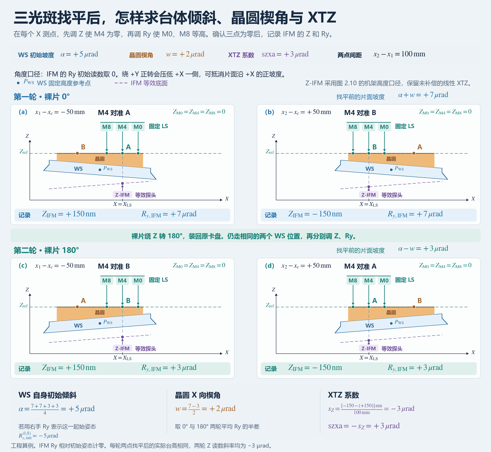

**图 2.11　三光斑找平后的两轮 Z、Ry 记录。** 沿用[图 2.10](#wzim-xtz-closed-loop)的台体位置、初始坡度、楔角和 XTZ 系数。四次测量都用 M4 对准当次测点。先用 Z 把 M4 调到零，再调 Ry 使 M0 与 M8 等高，同时复核 M4。片面在这一排光斑范围内可视为平面时，三个读数均可达到零。此时记录 IFM 的 **Z 和 Ry**。

**用 Ry 求初始坡度和楔角。** 按右手 Ry，正转使 +X 一端下降。0° 轮两点都需要 +7 µrad 找平，180° 轮两点都需要 +3 µrad。式（2.10）的 R_y,base 为开始时的 IFM Ry 读数，横线表示一轮的均值。[MATLAB v9 坐标约定](../code/sim_ws_ifm_6dof_animation_v9.m)

本例初始 IFM Ry 读零。两轮平均求得初始**几何坡度 +5 µrad**，用右手 Ry 表示同一初始姿态则为 **−5 µrad**。两轮半差求得 **X 向晶圆楔角 +2 µrad**。

**用 Z 高度差求 XTZ。** 找平后，同一轮两点的 P_WS 实际高度相同。未补偿的 Z-IFM 从 +150 nm 变为 −150 nm，斜率为 −3 µrad。模型写入相反符号的补偿斜率，得到 **szxa = +3 µrad**。算例忽略二阶台高变化。仓库模型的旋转前平移量 T 先按 RT 换算到机架坐标，再与图中的台体高度比较。[IFM 坐标定义](ifm_corr.md#corr-input)

图 2.11 的逐点三光斑找平、转片和 Ry 取平均是工程算例。L3 的实机 XTZ、YTZ 网格用单 M4 定高，另用三光斑建立 Ry0。见 L3-《12-TT-L3-L3-ME_book.pdf》文件第 25、27–29 页（印刷第 17、19–21 页）和 L3-《TT-MA-ME_setupblock_1-5_1v3.ppt》第 17 张。[三光斑原页核查](WZIM三点归零与LS读数核查_v1.md#three-spots)

#### YTZ 算例：单 M4 在什么条件下能求出 szya

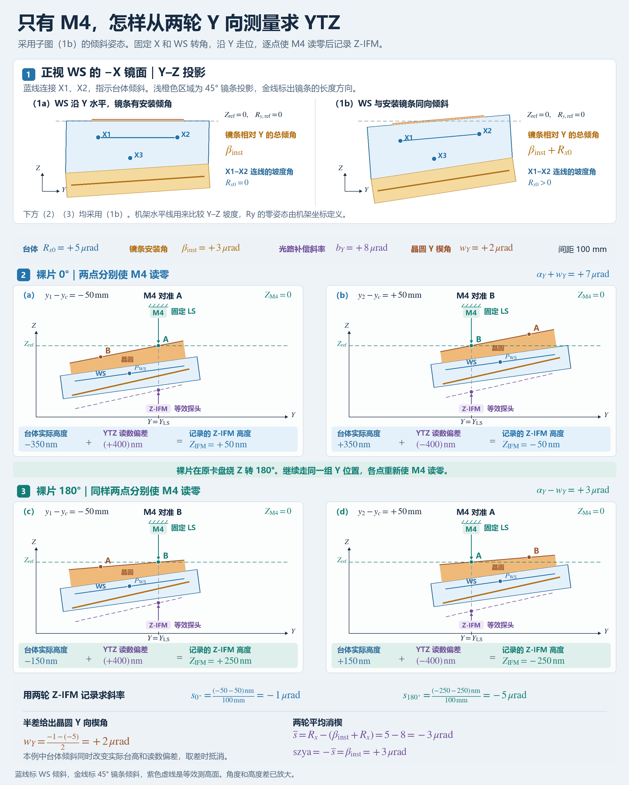

**图 2.12　固定台体 Rx 后的两轮 Y 向定高。** （1）正视 WS 的 −X 镜面。灰虚线是机架的参考高度和 Ry 零姿态。蓝线连接随台体转动的 X1、X2 名义入射点，金线表示 45° 长条镜沿 Y 的倾斜。（2）、（3）分别在裸片 0°、180° 时走相同的两个 Y 位置。矩形是 Y–Z 台体剖面，P_WS 是台体高度参考点。固定 M4 与等效 Z-IFM 探头采用同一 Y_LS。逐点调 Z，使 M4 读零后记录 Z-IFM。[IFM 图 4(a)](ifm_model.md#ifm-figure-4)

**先区分 Ry、Rx 和安装倾角。** 纯绕 Y 转动只改变理想镜面法向的 X、Z 分量。沿 Y 移动时，这项理想几何不会产生光程斜率，晶圆也不会因纯 Ry 获得 Y 向坡度。因此这组单 M4 的 Y 扫描无法估计 Ry0。[Y–Z 光路图](ifm_model.md#ifm-figure-3) · [俯视与 45° 镜](ifm_model.md#ifm-figure-5)

45° 是折返镜横向斜面的名义角度。算例设长条镜沿 Y 的安装坡度 β_inst 为 +3 µrad。台体绕 X 转过 +5 µrad 后，镜条和台体刚性同转，镜条沿 Y 的总坡度在一阶近似下为 +8 µrad。两条镜的 Y 向安装坡度取相同值，固定 Zmirror 取水平。等高沿 +Y 平移时，固定入射光在镜条上打到不同位置，折返光程随 Y 位移增大。名义 45° 几何下，归一后的光程增量等于镜条总坡度乘 Y 位移。采用参考光减折返光的读数符号，未补偿 Z-IFM 比机架实际高度少读这部分。这就是式（2.13）的光路斜率 b_Y，本例为 +8 µrad。镜块装调引起 YTZ 的例子见 L3-《12-TT-L3-L3-ME_book.pdf》文件第 26 页（印刷第 18 页）原图 2.4。[IFM 读数的符号](ifm_model.md#ifm-readout)

**用两轮定高求斜率。** 固定 X、Ry 和 Rx。台体的 Y 向坡度 α_Y 为 +5 µrad，晶圆 0° 方位的楔角 w_Y 为 +2 µrad。令 dᵢ 为第 i 点相对测量中点的 Y 距离，σφ 在 0° 和 180° 分别取 +1、−1。式（2.13）先给出使 M4 读零所需的实际台高，再计入 Y 走位造成的有符号读数偏差。代入光路斜率 b_Y = +8 µrad，得到下表。

| 晶圆方位 | 两点实际台高 | Z-IFM 读数偏差 | 两点 Z-IFM 记录 | Z-IFM 沿 Y 斜率 |
| --- | ---: | ---: | ---: | ---: |
| 0° | −350、+350 nm | +400、−400 nm | +50、−50 nm | −1 µrad |
| 180° | −150、+150 nm | +400、−400 nm | +250、−250 nm | −5 µrad |

两轮斜率的半差为 **+2 µrad**，是 Y 向晶圆楔角。平均为 **−3 µrad**。在本例中，台体 Rx 同时进入片面坡度和光路斜率，两处贡献在做差时相消，只剩安装坡度的负值。

**写回模型。** 仓库 Z 方程用旋转前的 T_z。固定姿态时，机架高度变化由 T_z 的变化加上 Rx 乘 Y 位移得到。代入式（2.14）后，模型的 **szya 为 +3 µrad**。图中的 **+8 µrad** 对应相对机架实际高度的光路补偿斜率。[IFM 坐标定义](ifm_corr.md#corr-input) · [Z 方程](ifm_model.md#ifm-table-3)

结论依赖两条镜同向安装倾斜、水平 Zmirror、姿态固定及一阶近似。如果还有未标定的顶镜坡度、Y–Ry 耦合或其他固定 Y 向误差，两轮平均只能给出合量。课件确认实机 WZIM 用单 M4 定高和原卡盘转片复测。图 2.12 对各项的分解是工程推导。见 L3-《12-TT-L3-L3-ME_book.pdf》文件第 25–27 页（印刷第 17–19 页），L3-《TT-MA-ME_setupblock_1-5_1v3.ppt》第 17 张。[WZIM 原文依据](WZIM资料汇整_v1.md#procedure-evidence)

[回到总图](#wzim-procedure-diagram) · [Level 1–3 原图定位](WZIM资料汇整_v1.md#source-figures) · [返回项目目录](#calibration-index)
