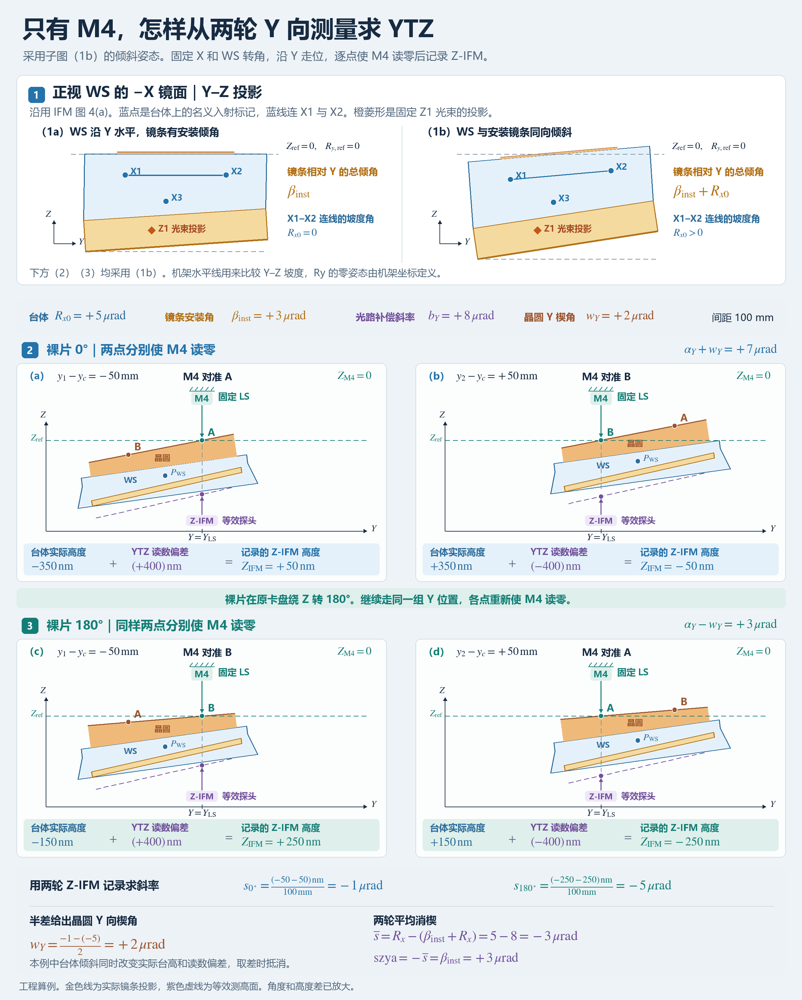

# 图 2.12 修订草稿：Y–Z 基准、台体旋转与两轮 YTZ 取样

[待审图件](#ytz-draft-figure) · [基准与刚体旋转](#ytz-draft-geometry) · [两轮数值计算](#ytz-draft-results) · [现行图 2.12](MEtrology.md#wzim-ytz-single-m4)

本页供审阅。同意后再将图件和对应文字并入 MEtrology 正文。

## 拟修订的图 2.12

## 子图（1）固定基准和随台体转动的元素

- 灰色水平虚线是机架基准，标为 $Z_{\mathrm{ref}}=0$ 和 $R_{y,\mathrm{ref}}=0$。在 Y–Z 剖面中，相对这条水平线的坡度角对应绕 X 的角度。$R_{y,\mathrm{ref}}=0$ 标注的是机架的 Ry 零姿态约定。
- 蓝色 X1、X2、X3 是 **WS 上的名义入射位置标记**。蓝线连接 X1 和 X2，作为台体自身倾斜的几何指示。由（1a）进入（1b）时，三点、蓝线、台体和装在台体上的 45° 镜条使用同一个绕 X 的刚体变换。橙色菱形表示固定 Z1 入射光束在 Y–Z 面上的投影。
- （1a）中 WS 沿 Y 水平，镜条已有安装倾角 $\beta_{\mathrm{inst}}$。（1b）中蓝线随台体转过 $R_{x0}$，镜条相对机架 Y 轴的总倾角为 $\beta_{\mathrm{inst}}+R_{x0}$。沿用 [IFM 图 4(a) 的 −X 正视投影](ifm_model.md#ifm-figure-4)。

## 子图（2）、（3）固定 M4 定高并计算 YTZ

沿用[图 2.11（a）–（d）的剖面画法](MEtrology.md#wzim-three-spot-ifm-ry)，在图中标出固定 LS、晶圆 A/B 点、台体参考点 $P_{\mathrm{WS}}$、等效 Z-IFM 探头及记录栏。这里沿 Y 移动，每点调 Z 使 **M4 读零**，等效 Z-IFM 与 M4 共用固定横坐标 $Y=Y_{\mathrm{LS}}$。两轮都采用（1b）的固定 $R_{x0}$，裸片绕 Z 转 180° 后回到同一组 WS 位置。

算例假设两条折返镜有相同 Y 向安装倾角，顶镜水平，只保留一阶项。取台体 $R_{x0}=+5\,\mu\mathrm{rad}$、镜条安装倾角 $\beta_{\mathrm{inst}}=+3\,\mu\mathrm{rad}$、晶圆 Y 向楔角 $w_Y=+2\,\mu\mathrm{rad}$。相对于机架高度，光路补偿斜率为 $b_Y=\beta_{\mathrm{inst}}+R_{x0}=+8\,\mu\mathrm{rad}$。两测点相对于中点分别为 $-50$、$+50\,\mathrm{mm}$。

$$
 Z_{\mathrm{true},i}^{(\phi)}=(R_{x0}+\sigma_\phi w_Y)(y_i-y_c),\qquad
 Z_{\mathrm{IFM},i}^{(\phi)}=Z_{\mathrm{true},i}^{(\phi)}-b_Y(y_i-y_c).
$$

式中 $\sigma_\phi$ 在 0° 轮取 $+1$，在 180° 轮取 $-1$。实际台高为台体参考点 $P_{\mathrm{WS}}$ 相对测量中点的 Z 高度。记录值是 M4 读零后、尚未补偿 YTZ 的 Z-IFM 高度。

| 子图 | 方位 | M4 对准 | 实际台高，nm | YTZ 读数偏差，nm | 记录的 Z-IFM，nm |
| --- | --- | --- | ---: | ---: | ---: |
| （2a） | 0° | $y_1$ 的 A | −350 | +400 | +50 |
| （2b） | 0° | $y_2$ 的 B | +350 | −400 | −50 |
| （3c） | 180° | $y_1$ 的 B | −150 | +400 | +250 |
| （3d） | 180° | $y_2$ 的 A | +150 | −400 | −250 |

两轮 Z-IFM 的沿 Y 斜率是 $-1$ 和 $-5\,\mu\mathrm{rad}$。半差给出晶圆沿 Y 的楔角 $+2\,\mu\mathrm{rad}$。平均为 $-3\,\mu\mathrm{rad}$。在这套一阶光路模型中，$R_{x0}$ 同时进入实际台高坡度和镜面总倾角，取差时抵消：

$$
 \overline{s}=R_{x0}-(\beta_{\mathrm{inst}}+R_{x0})=-3\,\mu\mathrm{rad},\qquad
 \mathrm{szya}=-\overline{s}=+3\,\mu\mathrm{rad}.
$$

$+8\,\mu\mathrm{rad}$ 是机架高度口径下的光路补偿斜率。$+3\,\mu\mathrm{rad}$ 是换回 IFM 模型旋转前平移坐标后的 YTZ 系数。其他未知 Y 向误差也会进入实测平均值。相关依据见 [IFM 坐标约定](ifm_corr.md#corr-input)、[IFM Z 公式](ifm_model.md#ifm-table-3)及 [WZIM 资料汇整](WZIM资料汇整_v1.md#procedure-evidence)。
