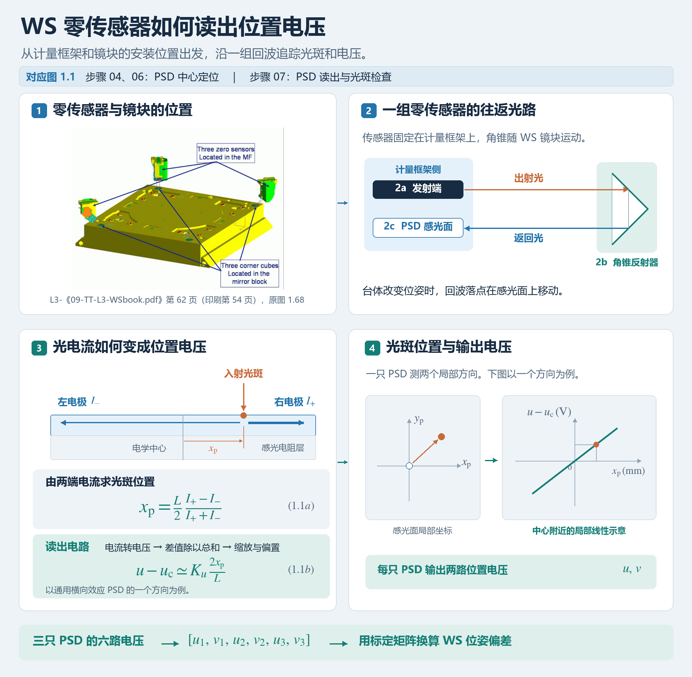
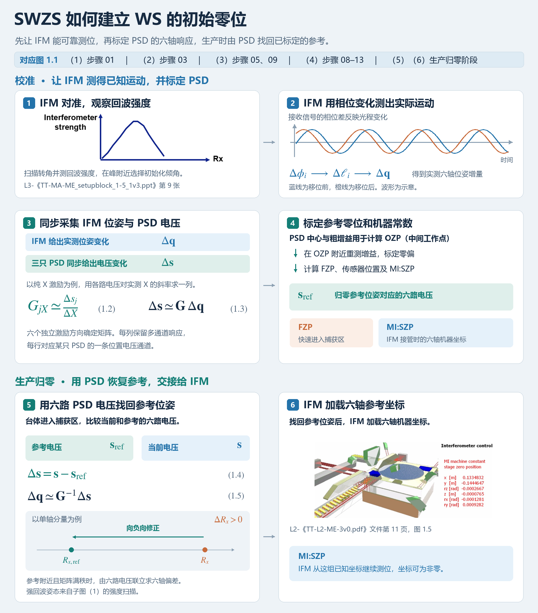
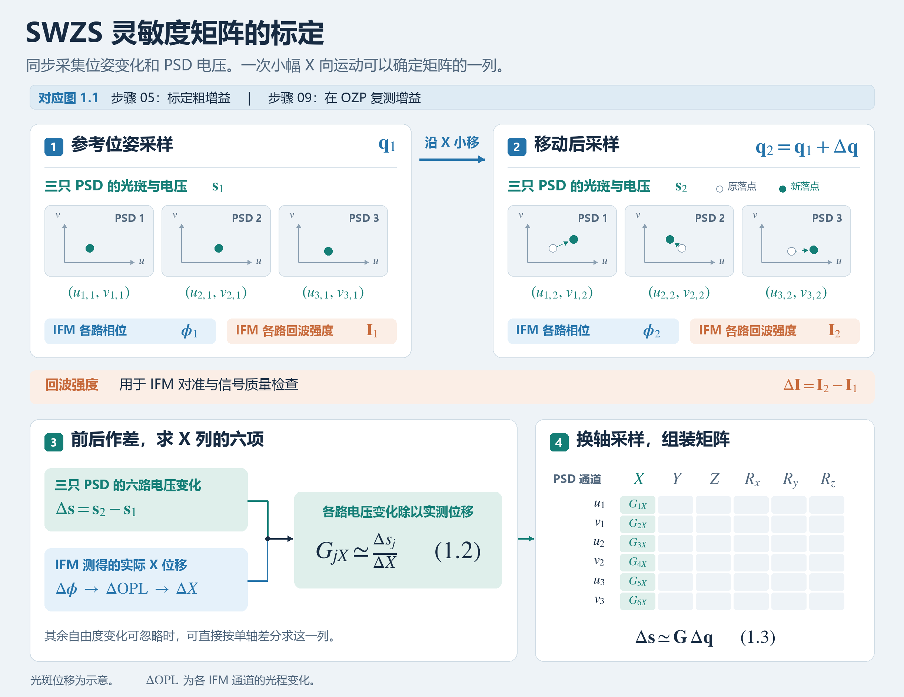
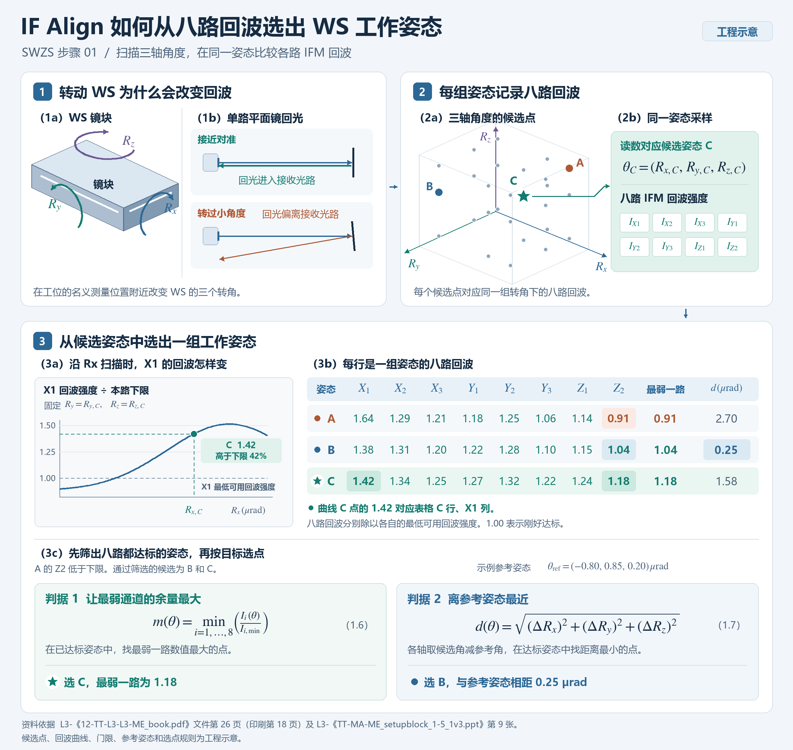
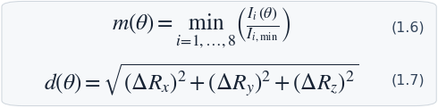

# MEtrology 校准项目报告

[项目目录](#calibration-index) · [整理范式](#report-format) · [先画总流程再讲细节](#overview-first) · [步骤说明](#step-description) · [WS-IFM 校准清单](WS-IFM机器常数校准项目_v4.md#initial-zero) · [成果索引](../README.md)

## 本报告的整理范式

以下范式仅适用于 `MEtrology.md` 收录的校准项目。

**先画总流程，再解释技术细节。**

先画带编号的总流程图，串起准备条件、操作、观测和结果。正文开篇放总图，按图中的先后顺序解释各阶段。每个概念第一次出现时说明它是什么、怎么得到、下一步怎么用。上一环的结果进入下一环前，写清中间的测量、转换或判断。例如从 PSD 光斑讲到 WS 位姿，中间要说明光斑如何变成电压，电压又如何经增益矩阵换算成位姿偏差。需要展开的技术细节另配图，并标明对应总图的步骤。

1. **Purpose（目的）**。说明项目要解决什么问题、为什么要做、执行前需满足哪些条件，以及完成后可以开展哪些校准项目。列出本项目涉及校准的机器常数及其用途。
2. **How（操作流程）**。沿总图说明各阶段如何衔接。按源文完整翻译具体操作流程，保留步骤顺序、条件、注意事项和判据，并注明来源及页码。
3. **Principle（校准原理）**。具体说明测量基准和物理原理，解释校准如何由观测量得到机器常数。资料中有相关物理原图时，将原图附在本节正文并注明来源层级、原文件名、页码和图号。

### 步骤说明

- 在原文译文之后，用短句说明每一步从什么状态或输入开始、操作什么、读取或检查什么，以及得到什么结果。资料给出判据时，写清怎样判断完成。结果有明确的后续用途时，指出交给哪一步。
- 优先写清动作和信号怎样衔接。公式仅在有助于理解量之间的关系时补充，详细推导可链接到原理或资料汇整。
- 资料只给输入和输出时，按已确认的信息写。为解释原理而补充的操作或算法标为工程示意，并注明实机细节待查。

### 章节、图表与公式编号

- **章节**。每个校准项目独立成节，按目录顺序编号。
- **图、表与公式**。在每节内分别按「章节号.序号」编号，各自从 1 开始。例如第 1 节的第一张图、第一张表和第一条公式分别记为图 1.1、表 1.1 和式（1.1）。正文与图中重复出现的同一公式共用编号。引用资料中的图、表或公式时保留来源编号。
- **图内编号**。原理图和示意图中的关键模块、模组和子图应标注编号，如 `（1）`、`（2）`。正文或图注可按「图 1.2（1）」直接指向具体对象。
- **公式排版**。正文和图内公式应正常显示分式、上下标和矩阵。阅读器对数学语法的支持不一致时，正文可嵌入已排版的公式图并附替代文字。

### 图件布局

- **总流程图**。紧凑布局要求仅适用于[图 1.1](#swzs-procedure-diagram)这类展示项目完整流程的总览图。按各阶段的内容分配版面，收紧边距和模块间距，减少无用途的留白，同时保持步骤编号和文字清晰。
- **原理图与分析图**。沿用[图 1.2–1.5](#swzs-figure-168)的风格，按光路、公式、坐标轴及标注的阅读需要安排空间。

### 来源标注

引用 Level 1–3 的文档或原图时，在文件名前标注所属层级，例如 `L1-《文件名.pdf》`、`L2-《文件名.pdf》`、`L3-《文件名.ppt》`。非 Level 1–3 的来源标为「外部资料」。

## 项目目录

| 项目 | 定位 | 快速跳转 |
| --- | --- | --- |
| [1. SWZS — WS 初步归零](#swzs) | 建立晶圆台干涉仪启用时的六自由度参考 | [Purpose](#swzs-constants) · [How](#swzs-procedure) · [Principle](#swzs-principle) · [初始零位测量原理](#swzs-voltage-to-zero) · [资料汇整](SWZS资料汇整_v1.md) |

## 1. SWZS — WS 初步归零

[总流程图](#swzs-procedure-diagram) · [Purpose](#swzs-constants) · [How](#swzs-procedure) · [Principle](#swzs-principle) · [初找中心](#swzs-how-find-psd-center) · [步骤 12](#swzs-step12) · [原图出处](#swzs-source-figures) · [Level 1–3 资料汇整](SWZS资料汇整_v1.md)

晶圆台（WS）从干涉仪（IFM）获得精密位姿。装片或换台后，安装在计量框架上的零传感器用位置敏感器件（PSD）检测返回光斑，帮助台体重新找回 IFM 的起读位置。

**图 1.1　SWZS 总流程。** （1）[先让 IFM 测到实际运动](#swzs-how-establish-ifm)。（2）[用实测运动与 PSD 电压求粗增益，定位光斑中心](#swzs-how-find-psd-center)。（3）[由中心和粗增益算复测工作位姿，再标定增益与偏置](#swzs-how-ozp-and-gain)。（4）[算快归零位姿、PSD 基座位姿及 IFM 起读坐标](#swzs-how-fzp-and-szp)。用这些结果完成（5）[生产归零](#swzs-psd-reference-recovery)。见 L3-《09-TT-L3-WSbook.pdf》文件第 112 页（印刷第 104 页）。[原文译文](#swzs-how-translation)

### Purpose（目的）

SWZS 校准零传感器，使晶圆台装片或换台后能重复找回同一个六轴参考位姿。编码器先将台体带回零传感器能测到光斑的捕获区，PSD 再定位参考，IFM 加载对应的机器坐标后接管。见 L1-《09_AP-L1-Production_Metrology_in-line.pdf》第 13、24 页及 L2-《TT-L2-ME-3v0.pdf》文件第 10–11 页（印刷第 4–5 页）。[图 1.3](#swzs-voltage-to-zero)

**何时做。** TWINSCAN 初始设定或更换零传感器部件后做完整校准，覆盖两卡盘 × 测量侧和曝光侧四种组合。初始化无法快归零时，可独立运行 Update FZP。下列流程适用 WS Type-2、rel.3.4。见 L3-《09-TT-L3-WSbook.pdf》文件第 73、111–115 页（印刷第 65、103–107 页）。

#### 前置条件

完成基座校准（BF）、卡盘交换校准（SWSW）、干涉仪调整与诊断（SWHP）及差分传感器校准（SWDC），空气支承（AM）开启并稳定。见 L3-《09-TT-L3-WSbook.pdf》文件第 111 页（印刷第 103 页）、L3-《TT-MA-WS-Calibrations-3v1.ppt》第 100–101 张。

#### 完成后可以开展的项目

计量设定进入 BMAA 支路及 [WZIM](WS-IFM机器常数校准项目_v4.md#mc-wzim) → [WGIM／WS TRIM](WS-IFM机器常数校准项目_v4.md#mc-wgim) → CLPL 支路。SWZS 也是 SWCR 范围检查和 SWSM 短行程电机校准的前提之一。见 L3-《12-TT-L3-L3-ME_book.pdf》文件第 14–15 页（印刷第 6–7 页），图 1.3；L3-《TT-MA-WS-Calibrations-3v1.ppt》第 79、144、211 张。[完整的上下游项目](SWZS资料汇整_v1.md#dependencies)

#### 机器常数及用途

**表 1.1　SWZS 机器常数与中间量**

| 量 | 作用 |
| --- | --- |
| 零传感器增益矩阵 `G` | 将 WS 六轴位姿变化关联到六路 PSD 电压变化。每组合为 6×6，平移列用 V/m，转角列用 V/rad。 |
| `ZSO` | 六轴零传感器偏置，单位 m、rad，用于计算 `FZP`。 |
| `FZP` | 快归零捕获使用的六轴位姿。 |
| `MI:SZP`（`MISZP`） | IFM 接管时加载的六轴机器坐标，可以是非零值。 |
| PSD 基座位姿及 `u0/v0` | 报表逐只列出基座坐标下的六轴位姿和两路电压零偏。 |
| `OZP` | 用粗增益和中心结果算出的中间工作位姿，用于复测增益和求 `FZP`。 |

L3-《09-TT-L3-WSbook.pdf》文件第 111 页明确列出前四项校准常数，文件第 114–115 页（印刷第 106–107 页）图 2.34–2.35 展示示例报表。`Rx0/Ry0/Rz0` 属于相关的初始化倾角设定，见[资料汇整](SWZS资料汇整_v1.md#constants)。

### How（操作流程）

#### 原文流程译文

下列为 L3-《09-TT-L3-WSbook.pdf》文件第 112–115 页（印刷第 104–107 页）中测试软件顺序、注意事项、输入界面和结果说明的译文。前一页列出的五项[前置条件](#swzs-prerequisites)已在 Purpose 完整列出。软件顺序与 L3-《TT-MA-WS-Calibrations-3v1.ppt》第 104 张互证。

**测试软件顺序**

1. 执行干涉仪对准（IF Align）。
2. 设置默认值。
3. 初始化设备，直至短行程（SS）进入由 IFM 反馈控制的六自由度状态。
4. 寻找零传感器的中心位置。
5. 以干涉仪为参照，校准零传感器增益。
6. 用已标定的粗增益重新寻找零传感器中心。
7. 检查以下项目。
   - 零传感器光强及电子学。
   - HP 干涉仪和差分传感器的量程。
   - 零传感器的光束位置。
8. 用零传感器增益和零传感器中心计算 `OZP`。
9. 利用 `OZP` 再次校准零传感器增益。
10. 校准零传感器偏置。
11. 用 `OZP` 和零传感器偏置计算 `FZP`。
12. 用 `FZP` 计算零传感器位置。
13. 计算 `MISZP`。

**注意事项**

- 运行 PSD Calibration 时，更新机器常数后需复做部分计量设定。
- 运行 Update FZP 时，更新机器常数后需复做基座和晶圆搬运系统校准。

**输入界面**

原图 2.33 展示输入界面。从图中可见，测试由用户可选的三个部分组成。

**表 1.2　SWZS 输入模式（译文）**

| 模式 | 原文说明译文 |
| --- | --- |
| **IFM-align** | 单独执行时，只做检查。 |
| **PSD Calibration** | 执行完整校准。它包含 IFM-align，因此选中 PSD Calibration 时无法取消选中 IFM-align。完整校准会重新确定 FZP，因此此时不能选中 Update FZP。 |
| **Update FZP（Fast Zero Position）** | 按基座偏置修正 FZP。此模式下 IFM-align 和 PSD Calibration 都不能选中。 |

**结果说明**

原图 2.34 和印刷第 107 页的图 2.35 给出一份示例报告。报告中可看到上述机器常数。报告末尾还列出许多中间结果，示例中未展示。

#### 按总图读流程

##### 图 1.1（1）步骤 01–03，建立 IFM 六轴反馈

做 IF Align 检查回波，载入默认值，初始化短行程至 IFM 六轴反馈。回波可用时，IFM 从相位变化测出台体的实际运动，作为下一阶段标定 PSD 的参照。[图 1.5 回波与姿态](#swzs-if-align)

##### 图 1.1（2）步骤 04–07，找中心并标定粗增益

步骤 04 初找 PSD 中心。步骤 05 把 IFM 测到的运动和同时测到的 PSD 电压变化配对，标出粗增益 `G_c`，即台体运动引起电压变化的比例关系。步骤 06 用 `G_c` 重新确定中心，得到计算 `OZP` 的输入。步骤 07 检查光强、电子学、光束位置及 HP 干涉仪和差分传感器量程。L3 未给出落点轨迹或中心判据。[图 1.2 光斑如何变成电压](#swzs-psd-readout) · [图 1.4 怎样测增益](#swzs-gain-calibration-figure) · [步骤 04–08 证据](SWZS步骤04至08-PSD中心定位核查_v1.md#step-evidence)

##### 图 1.1（3）步骤 08–10，算 OZP、复测增益、标偏置

用粗增益和中心结果算中间工作位姿 `OZP`，在该工作点复测增益，再标定六轴零传感器偏置 `ZSO`，供下一阶段计算快归零位姿。课件未说明步骤 08 是否驱动台体。[图 1.4 增益怎么测](#swzs-gain-calibration-figure)

##### 图 1.1（4）步骤 11–13，算快归零与 IFM 接管所需的量

用 `OZP` 和 `ZSO` 算快归零位姿 `FZP`，再算三只 PSD 的基座位姿，最后算 IFM 接管用的 `MI:SZP`。

**步骤 12。** 输入是 `FZP`，报表逐只给出 PSD 的基座六轴位姿和检测状态。L3 未公开这一步的采样与解算方法。[步骤 12 证据](SWZS步骤12-PSD基座位姿核查_v1.md#source-evidence)

**核对报表。** 按卡盘和工位核对成功标志、机器常数是否保存及 `old/new` 字段。见 L3-《09-TT-L3-WSbook.pdf》文件第 112、114–115 页（印刷第 104、106–107 页），图 2.34–2.35。

### Principle（校准原理）

[图 1.2](#swzs-psd-readout)先说明光斑怎样变成六路位置电压。[图 1.3](#swzs-voltage-to-zero)把这六路电压接入归零流程，[图 1.4](#swzs-gain-calibration-figure)展开电压与位姿的标定关系。最后可回看[图 1.5](#swzs-if-align)，了解流程开始时怎样检查 IFM 回波。

#### PSD 光路与位置电压

每工位有三只固定在计量框架（MF）上的零传感器，与镜块上的三个角锥配对。台体运动会改变返回光斑的位置。每只零传感器的 PSD（位置敏感器件）给出两个方向的电压 `u/v`，三只合计六路。

**图 1.2　零传感器光路与位置电压。** 对应[步骤 04、06、07](#swzs-how-find-psd-center)。（1）采用 L3-《09-TT-L3-WSbook.pdf》文件第 62 页（印刷第 54 页）原图 1.68。（2）追踪一组角锥回波，（3）和（4）示意通用 PSD 的电流读出和电压响应。

在通用 PSD 的线性区，光斑位置 `x_p` 由两端电流的归一化差值求出，`L` 是感光有效长度。读出电路用比例系数 `K_u` 将位置变成电压。光斑到电学中心时，电压差趋近零，中心电压 `u_c` 可以非零。[Hamamatsu PSD 技术说明，第 2 页](https://www.hamamatsu.com/content/dam/hamamatsu-photonics/sites/documents/99_SALES_LIBRARY/ssd/psd_kpsd9001e.pdf#page=2) · [PSD 读出电路说明，图 1-1](https://www.hamamatsu.com/content/dam/hamamatsu-photonics/sites/documents/99_SALES_LIBRARY/ssd/psd_singal_kacc9014e.pdf)

图 1.2（4）的电压响应参考外部资料《Hamamatsu C4674-01》文件第 3 页，图 KACCC0648EA。L3 未给出实机 PSD 的电路。[供应商位置—电压原图](https://www.hamamatsu.com/content/dam/hamamatsu-photonics/sites/documents/99_SALES_LIBRARY/ssd/c4674-01_kpsd1005e.pdf#page=3)

#### 用 IFM 标定 PSD，再用 PSD 找回参考

**图 1.3　SWZS 初始零位的测量原理。** （1）和（2）对应[步骤 01、03](#swzs-how-establish-ifm)，回波强度用来确认信号，IFM 相位变化用来测位。（3）对应[步骤 05、09](#swzs-gain-calibration-figure)，（4）对应[步骤 08–13](#swzs-how-ozp-and-gain)，（5）和（6）对应[生产归零](#swzs-psd-reference-recovery)。

（1）的回波曲线取自 L3-《TT-MA-ME_setupblock_1-5_1v3.ppt》第 9 张。（6）的机器坐标示例取自 L2-《TT-L2-ME-3v0.pdf》文件第 11 页（印刷第 5 页），图 1.5。

##### 标定增益矩阵

让 WS 做小幅运动，同时记录 IFM 实测位姿增量和 PSD 六路电压变化。若只动 X，用第 j 路电压变化除以实测 X 位移，估计该路对 X 的灵敏度。用六个独立运动方向确定完整的 `G`。这是对 L3 校准原理的局部线性解释。见 L3-《09-TT-L3-WSbook.pdf》文件第 111–112、115 页（印刷第 103–104、107 页）。

**图 1.4　PSD 灵敏度矩阵的标定示意。** 对应[步骤 05](#swzs-how-find-psd-center)和[步骤 09](#swzs-how-ozp-and-gain)。前者标粗增益，后者用 `OZP` 复测。同样的局部关系也可解释如何用粗增益估计向 PSD 中心调节的增量。

##### 生产归零

生产时编码器先把台体带回 PSD 能测到光斑的捕获区，再读取当前六路电压 `s`，减去同一卡盘、同一工位的参考电压 `s_ref`。在参考点附近且 `G` 满秩时，可以用下式估计**当前位姿相对参考的偏差**，再沿相反方向调节。找回参考后，IFM 加载 `MI:SZP` 接管。见 L2-《TT-L2-ME-3v0.pdf》文件第 10–11 页（印刷第 4–5 页）。

#### IF Align 三轴姿态采样与八路回波选点

**图 1.5　IF Align 三轴姿态采样与八路回波选点。** 对应[步骤 01](#swzs-how-establish-ifm)。（1）转动镜面改变回波，（2）每组 `Rx/Ry/Rz` 记录八路强度。（3a）X1 曲线上 1.00 是本路最低可用回波，C 点 1.42 表示高出 42%。（3b）八路分别用各自下限归一化。

**（3c）工程示意。** 取八路归一化强度的最小值 `m(θ)`。最小值达到 1.00 时，八路均达到各自下限。合格点中，可以选回波余量最大的 C，也可按角度距离 `d(θ)` 选最接近参考姿态的 B。L3 证实初始化倾角试验会转动 WS 并观测 IFM 信号，图中的候选点、门限和联合选点规则为示意。见 L3-《12-TT-L3-L3-ME_book.pdf》文件第 26 页（印刷第 18 页）及 L3-《TT-MA-ME_setupblock_1-5_1v3.ppt》第 9 张。

**多路回波不足时。** 在允许的姿态范围内找不到各路共同可用的点，回查前置项目 [SWHP](#swzs-prerequisites)。见 L3-《09-TT-L3-WSbook.pdf》文件第 111–113 页（印刷第 103–105 页）。

#### 原图与出处

本机原图路径相对 `D:\work\ME2\参考文献\Markdown_v1\`。计量框架原图见[图 1.2（1）](#swzs-figure-168)。[资料引用规则](../../AGENTS.md#read-only-references)

**表 1.3　SWZS 原图与出处**

| 原始资料 | 图中可核实的信息 | 本机原图位置 |
| --- | --- | --- |
| L3-《09-TT-L3-WSbook.pdf》第 62 页（印刷第 54 页），**图 1.68 Zero Sensors** | 三只传感器固定在 MF，三个对应角锥位于镜块。 | `assets/b4514b4ae5eb86cb/images/page_61_image_8_v1.jpg` |
| L3-《09-TT-L3-WSbook.pdf》文件第 63 页（印刷第 55 页），**图 1.69** | 从计量框架底面看，M/E 各圈出三个零传感器。 | `assets/b4514b4ae5eb86cb/images/page_62_image_5_v1.jpg` |
| L3-《TT-MA-ME_setupblock_1-5_1v3.ppt》第 9 张，**Interferometer strength–Rx 曲线** | 扫描初始化倾角时，回波强度在中间出现峰。 | 见原 PPT 第 9 张及 [正文图 1.3（1）](#swzs-ifm-signal)。 |
| L2-《TT-L2-ME-3v0.pdf》第 11 页（印刷第 5 页），**图 1.4、1.5** | 两图中的台体处于同一归零位置。图 1.5 在 IFM 控制下列出六轴 MI:SZP 参考值。 | `assets/e9dff352e800b276/images/page_10_image_4_v1.jpg`、`assets/e9dff352e800b276/images/page_10_image_9_v1.jpg` |
| L3-《TT-MA-WS-Calibrations-3v1.ppt》第 102 张 | 全 PSD 模式包含 IFM-align。两卡盘 M/E 共四组合可选择，图示进度为 0%。 | `assets/56ea2737208dfc3a/images/page_101_image_4_v1.jpg` |
| L3-《09-TT-L3-WSbook.pdf》第 115 页（印刷第 107 页），**图 2.35** | FZP、MI:SZP、`u0/v0` 和 PSD 增益分别列项，可核对单位和报表字段。 | `assets/b4514b4ae5eb86cb/images/page_114_image_4_v1.jpg` |

[返回项目目录](#calibration-index) · [WS-IFM 清单的初步归零条目](WS-IFM机器常数校准项目_v4.md#initial-zero)
