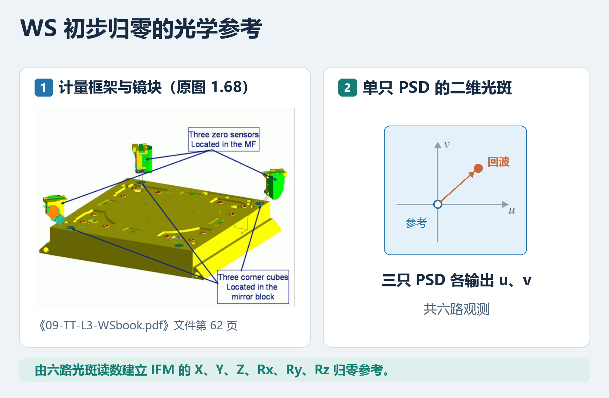
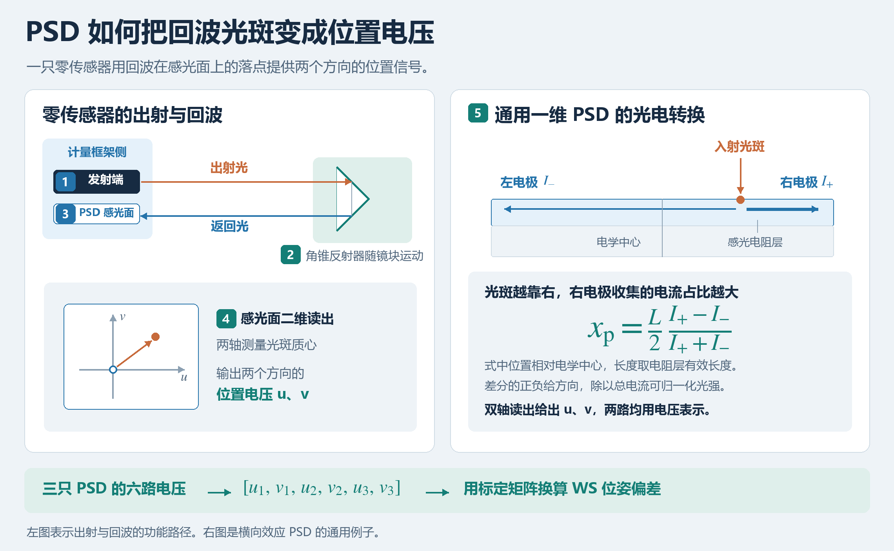
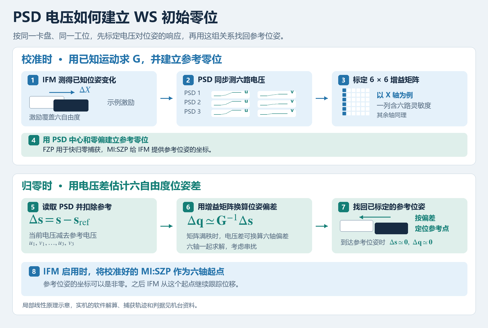
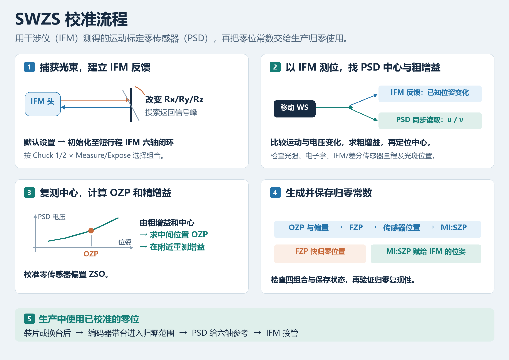

# MEtrology 校准项目报告

[项目目录](#calibration-index) · [本报告的整理范式](#report-format) · [WS-IFM 校准清单](WS-IFM机器常数校准项目_v4.md#initial-zero) · [成果索引](../README.md)

<a name="report-format"></a>

## 本报告的整理范式

以下范式仅适用于 `MEtrology.md` 收录的校准项目。

1. **目的与机器常数**。说明校准目的、适用工位和涉及的机器常数。
2. **校准原理**。说明物理原理和测量关系。资料中有相关物理原图时，将原图附在原理正文，并注明原文件名、页码和图号。
3. **操作流程**。按执行顺序说明具体步骤，配抽象物理示意图，解释台体运动、测量信号和基准建立过程。

### 图示编号与公式排版

- **编号**。原理图和示意图中的关键模块、模组和子图应标注编号，如 `（1）`、`（2）`。正文或图注可按「图 2（1）」直接指向具体对象。
- **公式**。图内公式使用 LaTeX 或等效数学排版渲染，分式、上下标、矩阵等按数学格式呈现。

<a name="calibration-index"></a>

## 项目目录

| 项目 | 定位 | 快速跳转 |
| --- | --- | --- |
| [SWZS — WS 初步归零](#swzs) | 建立晶圆台干涉仪启用时的六自由度参考 | [目的与机器常数](#swzs-constants) · [校准原理](#swzs-principle) · [PSD 工作原理](#swzs-psd-readout) · [电压到零位](#swzs-voltage-to-zero) · [操作流程](#swzs-procedure) · [图 1（1） Level 3 原图](#swzs-figure-168) |

<a name="szws"></a>
<a name="swzs"></a>

## SWZS — WS 初步归零

Level 3 培训资料将零传感器校准编号写为 **SWZS（Calibrate Zero Sensor）**。实机查测试项时可用 `SWZS` 或 **Zero Sensor Calibration** 检索。出处为《09-TT-L3-WSbook.pdf》文件第 111–115 页（印刷第 103–107 页）、《TT-MA-WS-Calibrations-3v1.ppt》第 97–108 张。

<a name="szws-constants"></a>
<a name="swzs-constants"></a>

### 目的与机器常数

装片或换台时，晶圆台（WS）会离开干涉仪（IFM）控制范围。台体返回后，IFM 测得的是光程变化，需要一个相对计量框架（MF）的已知位姿才能恢复连续位置测量。SWZS 校准这个参考，使零传感器能为 IFM 提供 **X、Y、Z、Rx、Ry、Rz** 的初始位姿。测量侧（M）和曝光侧（E）各有一套零传感器，分别与两个 Chuck 配对，形成 **四组独立标定**。资料中的典型归零复现性为平移约 1 µm、转动约 ±2.5 µrad，属于捕获阶段的说明值。出处为《09_AP-L1-Production_Metrology_in-line.pdf》第 13、24 页、《TT-L2-ME-3v0.pdf》第 10–11、19 页（印刷第 4–5、13 页）、《09-TT-L3-WSbook.pdf》第 62–63、111 页（印刷第 54–55、103 页）。

| 机器常数或中间量 | 物理含义 | 归属和报表核对 |
| --- | --- | --- |
| **Zero Sensor Gain Matrix** | 三只位置敏感器件（PSD）各有 `u`、`v` 电压。记下每路对六自由度的局部灵敏度和串扰。 | 每组合 6×6。示例报表按 PSD 列 `du/dX`、`dv/dRy` 等，单位为 V/m 或 V/rad。 |
| **零传感器电压零偏** | 三只 PSD 各自的 `u0/v0`。单位 V。 | 示例报表分列 `MI:zero sensor offset voltages` 与六轴 `Zero Sensor Offset`。 |
| **ZSO** | 零传感器偏置（Zero Sensor Offset），用六自由度位姿量表示。 | 直线轴用 m，角度轴用 rad。作为计算快归零位置的一组输入。 |
| **FZP** | 快归零位置（Fast Zero Position），用于初始化时的快归零捕获。 | 完整 PSD 校准会重新确定。独立 `Update FZP` 模式按基座（BF）偏置修正。 |
| **MI:SZP** | 台体零位（MI:Stage Zero Position，步骤中写作 `MISZP`）。对应切换到 IFM 控制时赋给台体的六自由度参考值。 | 报表字段为 `X/Y/Z/Rx/Ry/Rz`。Level 2 图 1.5 给出的参考值可以是非零。 |
| **PSD positions in baseframe coordinates** | 三只 PSD 对应的基座坐标位姿。 | 示例逐只 PSD 列出六轴、`found`、`intens.ok`、`electr.ok`。 |
| **Rx0、Ry0、Rz0** | 初始化倾角。用 IFM 回波质量峰确定合适的镜块姿态。 | WS Initialization Tilts 资料列出 M/E × Chuck 1/2 四套。单选 `IFM-align` 在 SWZS 界面只作检查。M 侧 `Ry0` 后续会由 WZIM 重定。 |
| **OZP** | 用粗增益和实测中心算出的中间位置。 | 用于第二轮增益标定，再参与 FZP 计算。 |

机器常数名称与单位见《09-TT-L3-WSbook.pdf》第 111–115 页（印刷第 103–107 页），图 2.34–2.35。初始化倾角与 WZIM 更新关系见《12-TT-L3-L3-ME_book.pdf》第 26–29 页（印刷第 18–21 页）及《TT-MA-ME_setupblock_1-5_1v3.ppt》第 9–10 张。

<a name="szws-principle"></a>
<a name="swzs-principle"></a>

### 校准原理

固定计量框架上每侧装三只零传感器，镜块上装三个对应的角锥反射器。每只传感器发出光束并测回波光斑在 PSD 上的两个方向。台体移动或转动时，三个光斑以不同的组合偏离中心。用标定得到的六轴灵敏度，把六路光斑电压换算成参考位置附近的位姿。原件图 1.68 直接标注了三只框架传感器和三个镜块角锥，图 1.69 从框架底面给出了 M/E 两侧布置。[原图位置与解读](#swzs-source-figures)

<a name="swzs-figure-168"></a>



**图 1　零传感器测量关系。** 图 1（1）为 Level 3《09-TT-L3-WSbook.pdf》文件第 62 页（印刷第 54 页）的图 1.68，标出计量框架上的三只零传感器和镜块上的三个角锥反射器。图 1（2）示意单只 PSD 如何在 `u`、`v` 两个方向读取回波光斑位置。

<a name="swzs-psd-readout"></a>

#### PSD 工作原理与信号含义

计量框架侧的零传感器发出光束，镜块上的角锥把光束反向送回，PSD（Position Sensitive Device，位置敏感器件）测量回波光斑落在感光面上的位置。镜块随 WS 改变位姿时，回波落点会在感光面的两个局部方向移动。Level 3 确认每束回波测两个方向，三只零传感器共提供六路观测。出处为《09-TT-L3-WSbook.pdf》文件第 62–63 页（印刷第 54–55 页），图 1.68–1.69。



**图 2　回波光斑的位置读出。** 光束从发射端（1）出射，经角锥反射器（2）返回 PSD 感光面（3），读出二维光斑位置（4）。图 2（5）以通用横向效应 PSD 的一个方向为例说明光电转换。Level 3 未给出该零传感器内部的光学元件、PSD 型号或电子电路。

以通用一维横向效应 PSD 为例，光斑在连续感光电阻层上产生光电流，由左右电极分别收集为 `I−`、`I+`。光斑位于电学中心时两路电流相等，向右移动时 `I+` 占总光电流的比例增大。理想线性区内，`x_p = (L/2) × (I+ − I−)/(I+ + I−)`，其中 `x_p` 是光斑质心相对电学中心的位置，`L` 是电阻层有效长度。用总电流归一化，可以减小整体光强变化对位置读数的影响。通用器件原理见 [Hamamatsu PSD 技术说明](https://www.hamamatsu.com/content/dam/hamamatsu-photonics/sites/documents/99_SALES_LIBRARY/ssd/psd_kpsd9001e.pdf#page=2) 第 2 页图 1-1、式 (1-3)。

在 SWZS 报表中，每只传感器的 `u`、`v` 是代表两个局部方向光斑位置的电压信号，单位为 V。`u0/v0` 是对应通道的电压零偏。`du/dX`、`dv/dRy` 等增益记录 WS 平移或转动引起的电压响应，单位分别为 V/m、V/rad。感光面两轴与 WS 坐标的对应关系由标定确定，三只 PSD 的六路电压再一起[换算为位姿偏差](#swzs-voltage-to-zero)。出处为《09-TT-L3-WSbook.pdf》文件第 115 页（印刷第 107 页），图 2.35。

<a name="swzs-voltage-to-zero"></a>

#### 从 PSD 电压到 WS 初始零位

校准时，以 IFM 测得的台体运动为基准，同步记录三只 PSD 的六路电压。在参考位置附近，只激励 X 时，六路电压响应分别除以 IFM 测得的 X 位移，得到 `G` 的 X 列。六轴运动的标定共同确定 6×6 矩阵 `G`，包括一个轴运动对多路电压的影响。下式描述参考位置附近的局部关系。

```text
Δq = [ΔX, ΔY, ΔZ, ΔRx, ΔRy, ΔRz]        台体位姿变化
Δs = [Δu1, Δv1, Δu2, Δv2, Δu3, Δv3]    三只 PSD 的电压变化
Δs ≈ G · Δq                               零位附近局部近似
```



**图 3　从 PSD 电压变化到 WS 初始零位。** 图 3（1）至（4）为增益与参考零位标定，图 3（5）至（8）为生产归零。零传感器中心及偏置、增益和零位常数的流程依据《09-TT-L3-WSbook.pdf》文件第 111–115 页（印刷第 103–107 页）和《TT-MA-WS-Calibrations-3v1.ppt》第 97–98、104 张。

按图 3（5），进入归零范围后，记当前六路电压为 `s`，校准参考位姿对应的六路电压为 `s_ref`。两者相减得到 `Δs = s − s_ref`。图 3（6）为局部换算。若 `G` 满秩，可用 `Δq ≈ G⁻¹ · (s − s_ref)` 理解电压差如何换算成六轴位姿偏差。这里的 `s_ref` 是示意符号，表示参考位姿下的电压，允许各路有非零参考值。

`FZP` 用于快归零捕获。按图 3（8），PSD 找回参考位姿后，IFM 用校准的 `MI:SZP` 作为六轴起点，随后跟踪相对位移。图中的 `Δs ≈ 0` 表示电压接近其参考值，此时赋给 IFM 的六轴坐标可以是非零。这个关系用于解释局部灵敏度和零位如何找回。实机的完整解算、动作轨迹和判据未在课件中给出。Level 2 图 1.4–1.5 对照同一台体位置在编码器和 IFM 控制下的状态。来源为《TT-L2-ME-3v0.pdf》文件第 10–11 页（印刷第 4–5 页）。

<a name="szws-procedure"></a>
<a name="swzs-procedure"></a>

### 操作流程

**准备。** 培训资料要求 BF 标定已完成，空气支承（AM）已启动且稳定，换台校准 `SWSW`、IFM 调整和诊断 `SWHP`、差分传感器校准 `SWDC` 已完成。在 Zero Sensor Calibration 界面选择需标定的卡盘和工位。全量标定选 `PSD Calibration`，界面会自动选中 `IFM-align`，并禁用独立的 `Update FZP`。出处为《09-TT-L3-WSbook.pdf》第 111–113 页（印刷第 103–105 页）、《TT-MA-WS-Calibrations-3v1.ppt》第 99–104 张。



**图 4　归零校准与生产使用。** 图 4（1）至（4）对应下文四个校准步骤，图 4（5）说明生产中的归零使用。依据《09-TT-L3-WSbook.pdf》第 112 页（印刷第 104 页）和《TT-MA-WS-Calibrations-3v1.ppt》第 104 张。

1. **捕获 IFM 光束。** 执行 IFM 对准，装载默认设置，初始化短行程至 IFM 六自由度闭环。初始化倾角测试的物理方法是改变 `Rx/Ry/Rz` 并跟踪 IFM 信号质量，利用接近镜面法向入射时的信号峰定位姿态。出处为《12-TT-L3-L3-ME_book.pdf》第 26 页（印刷第 18 页）。
2. **找 PSD 中心并标定粗增益。** 初找各传感器光斑中心。以 IFM 测得的台体运动为基准，同步读取 PSD 电压，求粗增益。用粗增益重找中心，检查零传感器光强、电子学、IFM 及差分传感器量程、光斑位置。
3. **在工作点求精增益与偏置。** 由中心与粗增益计算 `OZP`，在该工作点附近再次激励和采集，求精增益并校准 ZSO。多个自由度的响应共同确定电压到位姿的映射。
4. **计算零位并核对保存结果。** 用 OZP 和偏置求 FZP，再求传感器位置和 MI:SZP。按选定组合检查是否成功、光强和电子学是否合格，以及报表的 `old/new` 和 MC 保存状态。完整 PSD 校准保存后，资料要求复做相关 Metrology setup。实机复现性和通过条件按对应版本的 Coach 流程核对。出处为《09-TT-L3-WSbook.pdf》第 112–115 页（印刷第 104–107 页）、《TT-MA-WS-Calibrations-3v1.ppt》第 104–108 张。

| 运行模式 | 适用场景 | 保存后的影响 |
| --- | --- | --- |
| **IFM-align 单独运行** | 检查干涉仪对准情况。 | Level 3 将单跑列为检查。 |
| **PSD Calibration** | 完整标定，包括新机设定或更换零传感器部件后。包含 IFM-align，并重新计算 FZP。 | 写入新 MC 后需要复做部分 Metrology setup。 |
| **Update FZP** | 快归零失败且需补偿 BF 偏置时，按维修流程运行。 | 单独修正 FZP。写入后复核并重做资料要求的基座和晶圆搬运校准。 |

模式及其影响见《09-TT-L3-WSbook.pdf》第 111–113 页（印刷第 103–105 页）、《TT-MA-WS-Calibrations-3v1.ppt》第 99–105 张。后接高度基准时参见 [WZIM](WS-IFM机器常数校准项目_v4.md#mc-wzim) 和 [BMWZ](WS-IFM机器常数校准项目_v4.md#mc-bmwz)。

<a name="szws-source-figures"></a>
<a name="swzs-source-figures"></a>

### 原图与出处

原图 1.68 见 [正文图 1（1）](#swzs-figure-168)。以下列出相应的本机原图位置，最后一列相对 `D:\work\ME2\参考文献\Markdown_v1\`。图像与页码的查询方式见 [Level 1–3 资料规则](../../AGENTS.md#read-only-references)。

| 原始资料 | 图中可核实的信息 | 本机原图位置 |
| --- | --- | --- |
| 《09-TT-L3-WSbook.pdf》第 62 页（印刷第 54 页），**图 1.68 Zero Sensors** | 三只传感器固定在 MF，三个对应角锥位于镜块。 | `assets/b4514b4ae5eb86cb/images/page_61_image_8_v1.jpg` |
| 同书第 63 页（印刷第 55 页），**图 1.69** | 从计量框架底面看，M/E 各圈出三个零传感器。 | `assets/b4514b4ae5eb86cb/images/page_62_image_5_v1.jpg` |
| 《TT-L2-ME-3v0.pdf》第 11 页（印刷第 5 页），**图 1.4、1.5** | 两图中的台体处于同一归零位置。图 1.5 在 IFM 控制下列出六轴 MI:SZP 参考值。 | `assets/e9dff352e800b276/images/page_10_image_4_v1.jpg`、`assets/e9dff352e800b276/images/page_10_image_9_v1.jpg` |
| 《TT-MA-WS-Calibrations-3v1.ppt》第 102 张 | 全 PSD 模式包含 IFM-align。两卡盘 M/E 共四组合可选择，图示进度为 0%。 | `assets/56ea2737208dfc3a/images/page_101_image_4_v1.jpg` |
| 《09-TT-L3-WSbook.pdf》第 115 页（印刷第 107 页），**图 2.35** | FZP、MI:SZP、`u0/v0` 和 PSD 增益分别列项，可核对单位和报表字段。 | `assets/b4514b4ae5eb86cb/images/page_114_image_4_v1.jpg` |

[返回项目目录](#calibration-index) · [WS-IFM 清单的初步归零条目](WS-IFM机器常数校准项目_v4.md#initial-zero)
