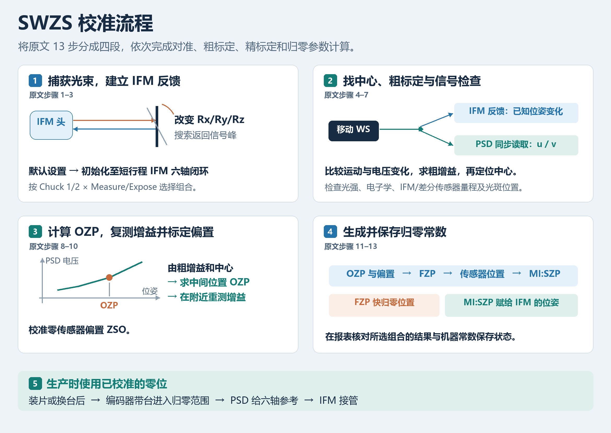
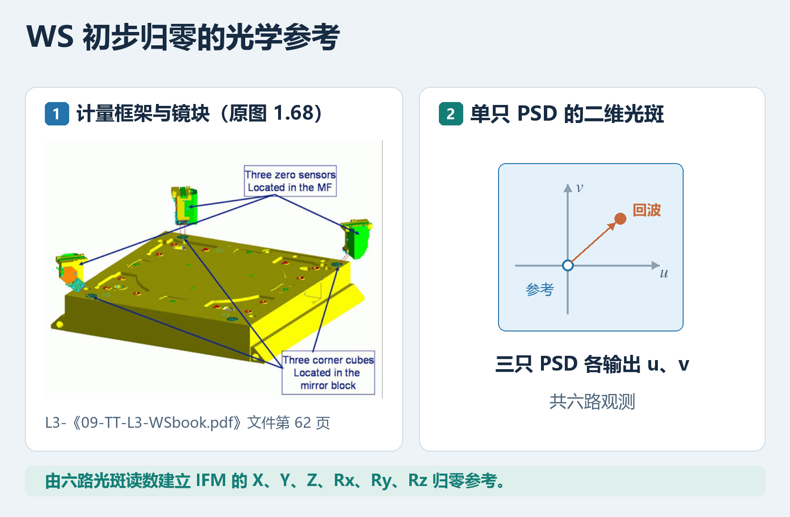
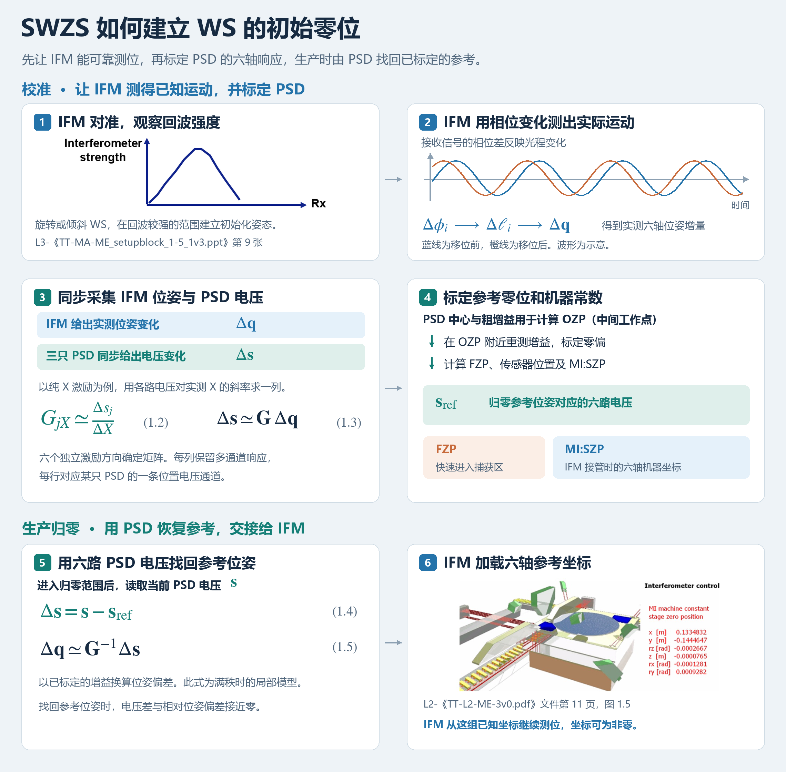

# MEtrology 校准项目报告

[项目目录](#calibration-index) · [本报告的整理范式](#report-format) · [WS-IFM 校准清单](WS-IFM机器常数校准项目_v4.md#initial-zero) · [成果索引](../README.md)

## 本报告的整理范式

以下范式仅适用于 `MEtrology.md` 收录的校准项目。

1. **Purpose（目的）**。说明项目要解决什么问题、为什么要做、执行前需满足哪些条件，以及完成后可以开展哪些校准项目。列出本项目涉及校准的机器常数及其用途。
2. **How（操作流程）**。先按源文完整翻译具体操作流程，保留原有步骤顺序、操作条件和原文列出的注意事项及判据，并注明来源及页码。译文之后，根据对流程的理解绘制带编号的示意图，解释各步骤如何衔接。
3. **Principle（校准原理）**。具体说明测量基准和物理原理，解释校准如何由观测量得到机器常数。资料中有相关物理原图时，将原图附在本节正文并注明来源层级、原文件名、页码和图号。

### 章节、图表与公式编号

- **章节**。每个校准项目独立成节，按目录顺序编号。
- **图、表与公式**。在每节内分别按「章节号.序号」编号，各自从 1 开始。例如第 1 节的第一张图、第一张表和第一条公式分别记为图 1.1、表 1.1 和式（1.1）。正文与图中重复出现的同一公式共用编号。引用资料中的图、表或公式时保留来源编号。
- **图内编号**。原理图和示意图中的关键模块、模组和子图应标注编号，如 `（1）`、`（2）`。正文或图注可按「图 1.2（1）」直接指向具体对象。
- **公式排版**。图内公式使用 LaTeX 或等效数学排版渲染，分式、上下标、矩阵等按数学格式呈现。

### 来源标注

引用 Level 1–3 的文档或原图时，在文件名前标注所属层级，例如 `L1-《文件名.pdf》`、`L2-《文件名.pdf》`、`L3-《文件名.ppt》`。非 Level 1–3 的来源标为「外部资料」。

## 项目目录

| 项目 | 定位 | 快速跳转 |
| --- | --- | --- |
| [1. SWZS — WS 初步归零](#swzs) | 建立晶圆台干涉仪启用时的六自由度参考 | [Purpose](#swzs-constants) · [How](#swzs-procedure) · [Principle](#swzs-principle) · [初始零位测量原理](#swzs-voltage-to-zero) · [资料汇整](SWZS资料汇整_v1.md) |

## 1. SWZS — WS 初步归零

[Purpose](#swzs-constants) · [How](#swzs-procedure) · [Principle](#swzs-principle) · [灵敏度矩阵标定图](#swzs-gain-calibration-figure) · [Level 1–3 资料汇整](SWZS资料汇整_v1.md)

### Purpose（目的）

**要解决的问题。** SWZS（Calibrate Zero Sensor）校准晶圆台（WS）的零传感器，让干涉仪（IFM）在启用时有一个可重复找回的六自由度参考。装片或换台时，卡盘会离开 IFM 控制范围。回到量程时，编码器先把台带到捕获区，固定在计量框架（MF）上的零传感器找回参考位姿。IFM 加载这组坐标后，从该位置继续跟踪位移。原理见[图 1.4](#swzs-voltage-to-zero)。出处为 L1-《09_AP-L1-Production_Metrology_in-line.pdf》第 13、24 页及 L2-《TT-L2-ME-3v0.pdf》文件第 10–11、19 页（印刷第 4–5、13 页）。

**何时做。** TWINSCAN 初始设定或更换零传感器系统部件后进行完整校准。测量侧（M）和曝光侧（E）各有一套零传感器，分别对两个卡盘的镜块校准，共四种组合。设备初始化时出现快归零问题，可按适用流程独立运行 Update FZP。下述软件流程来自 WS Type-2、rel.3.4 培训教材。出处为 L3-《09-TT-L3-WSbook.pdf》文件第 73、111–115 页（印刷第 65、103–107 页）。

#### 前置条件

L3-《09-TT-L3-WSbook.pdf》文件第 111 页（印刷第 103 页）列五项条件。

1. 已完成基座（BF）校准。
2. 空气支承（AM）已开启并处于稳定状态。
3. 已完成卡盘交换校准 SWSW。
4. 已完成干涉仪调整与诊断试验 SWHP。
5. 已完成差分传感器校准 SWDC。

L3-《TT-MA-WS-Calibrations-3v1.ppt》第 100–101 张给出相同条件。课件列无需额外工具，预计 30 分钟。

#### 完成后可以开展的项目

- **计量设定。** 获得初始化参考后，计量设定图列出两条支路。对准支路做 BMAA 粗校、精校。晶圆台支路按 [WZIM 测量侧初始高度与倾角](WS-IFM机器常数校准项目_v4.md#mc-wzim) → [WGIM／WS TRIM](WS-IFM机器常数校准项目_v4.md#mc-wgim) → CLPL 基准板调平依次进行。两支路满足条件后再做 AA 光束倾角与焦点，继而做 M 侧 WS XY 干涉仪校准和 BMAA 精校。见 L3-《12-TT-L3-L3-ME_book.pdf》文件第 14–15 页（印刷第 6–7 页），图 1.3。
- **晶圆台服务测试。** 课件把已完成零传感器校准列为 SWCR 范围检查和 SWSM 短行程电机校准的前提之一。见 L3-《TT-MA-WS-Calibrations-3v1.ppt》第 79、144、211 张。
- **生产中的使用。** M 侧装片归零后可进入 Stage Align，由 LS 和 AA 读取 TIS 基准。E 侧换台归零后进入掩模对准或条件性的批次校正。这里常见的平移约 1 µm、转角约 ±2.5 µrad 是生产归零的参考量级。见 L1-《09_AP-L1-Production_Metrology_in-line.pdf》第 13–14、23–26、49 页及 L2-《TT-L2-ME-3v0.pdf》文件第 10–14、19 页（印刷第 4–8、13 页）。

#### 机器常数及用途

**表 1.1　SWZS 机器常数与中间量**

| 机器常数或中间量 | 物理含义 | 归属和报表核对 |
| --- | --- | --- |
| **Zero Sensor Gain Matrix** | 三只位置敏感器件（PSD）各有 `u`、`v` 电压。记下每路对六自由度的局部灵敏度和串扰。 | 每组合 6×6。示例报表按 PSD 列 `du/dX`、`dv/dRy` 等，单位为 V/m 或 V/rad。 |
| **零传感器电压零偏** | 三只 PSD 各自的 `u0/v0`。单位 V。 | 示例报表分列 `MI:zero sensor offset voltages` 与六轴 `Zero Sensor Offset`。 |
| **ZSO** | 零传感器偏置（Zero Sensor Offset），用六自由度位姿量表示。 | 直线轴用 m，角度轴用 rad。作为计算快归零位置的一组输入。 |
| **FZP** | 快归零位置（Fast Zero Position），用于初始化时的快归零捕获。 | 完整 PSD 校准会重新确定。独立 `Update FZP` 模式按基座（BF）偏置修正。 |
| **MI:SZP** | 台体零位（MI:Stage Zero Position，步骤中写作 `MISZP`）。对应切换到 IFM 控制时赋给台体的六自由度参考值。 | 报表字段为 `X/Y/Z/Rx/Ry/Rz`。L2-《TT-L2-ME-3v0.pdf》图 1.5 给出的参考值可以是非零。 |
| **PSD positions in baseframe coordinates** | 三只 PSD 对应的基座坐标位姿。 | 示例逐只 PSD 列出六轴、`found`、`intens.ok`、`electr.ok`。 |
| **Rx0、Ry0、Rz0** | 相关的初始化倾角，用 IFM 回波强度选取合适的镜块姿态。 | WS Initialization Tilts 资料按两卡盘 × 两工位分组。M 侧 `Ry0` 可由后续 WZIM 重定。 |
| **OZP** | 用粗增益和实测中心算出的中间位置。 | 用于第二轮增益标定，再参与 FZP 计算。 |

机器常数名称与单位见L3-《09-TT-L3-WSbook.pdf》第 111–115 页（印刷第 103–107 页），图 2.34–2.35。初始化倾角与 WZIM 更新关系见L3-《12-TT-L3-L3-ME_book.pdf》第 26–29 页（印刷第 18–21 页）及L3-《TT-MA-ME_setupblock_1-5_1v3.ppt》第 9–10 张。

### How（操作流程）

#### 原文流程译文

下列为 L3-《09-TT-L3-WSbook.pdf》文件第 112–115 页（印刷第 104–107 页）中测试软件顺序、注意事项、输入界面和结果说明的译文。前一页列出的五项[前置条件](#swzs-prerequisites)已在 Purpose 完整列出。软件顺序与 L3-《TT-MA-WS-Calibrations-3v1.ppt》第 104 张互证。

**测试软件顺序**

1. 执行干涉仪对准（IF Align）。
2. 设置默认值。
3. 初始化设备，直至短行程（SS）进入由 IFM 反馈控制的六自由度状态。
4. 寻找零传感器的中心位置。
5. 以干涉仪为参照，校准零传感器增益。
6. 用已标定的粗增益重新寻找零传感器中心。
7. 检查以下项目。
   - 零传感器光强及电子学。
   - HP 干涉仪和差分传感器的量程。
   - 零传感器的光束位置。
8. 用零传感器增益和零传感器中心计算 `OZP`。
9. 利用 `OZP` 再次校准零传感器增益。
10. 校准零传感器偏置。
11. 用 `OZP` 和零传感器偏置计算 `FZP`。
12. 用 `FZP` 计算零传感器位置。
13. 计算 `MISZP`。

**注意事项**

- 运行 PSD Calibration 时，更新机器常数后需复做部分计量设定。
- 运行 Update FZP 时，更新机器常数后需复做基座和晶圆搬运系统校准。

**输入界面**

原图 2.33 展示输入界面。从图中可见，测试由用户可选的三个部分组成。

**表 1.2　SWZS 输入模式（译文）**

| 模式 | 原文说明译文 |
| --- | --- |
| **IFM-align** | 单独执行时，只做检查。 |
| **PSD Calibration** | 执行完整校准。它包含 IFM-align，因此选中 PSD Calibration 时无法取消选中 IFM-align。完整校准会重新确定 FZP，因此此时不能选中 Update FZP。 |
| **Update FZP（Fast Zero Position）** | 按基座偏置修正 FZP。此模式下 IFM-align 和 PSD Calibration 都不能选中。 |

**结果说明**

原图 2.34 和印刷第 107 页的图 2.35 给出一份示例报告。报告中可看到上述机器常数。报告末尾还列出许多中间结果，示例中未展示。

#### 流程图与报告核对

**图 1.1　SWZS 操作流程与生产使用。** 图 1.1（1）对应原文步骤 1–3，建立 IFM 测量。图 1.1（2）对应步骤 4–7，找中心、标定粗增益并检查信号和量程。图 1.1（3）对应步骤 8–10，求 `OZP`、复测增益与标定偏置。图 1.1（4）对应步骤 11–13，计算 `FZP`、传感器位置及 `MI:SZP`。图 1.1（5）说明标定结果在生产时的用途。按 L3-《09-TT-L3-WSbook.pdf》文件第 112 页（印刷第 104 页）绘制。

**报表核对。** 对照选择的卡盘和工位，分别查看 IFM-align、PSD 或 FZP 的结果、所选组合的成功标志，以及 `New Machine Constants Saved for successful calibrations`。增益、偏置和坐标用对应的 `old/new` 字段核对。课件列出了检查项目与示例结果，实际放行数值按机型对应的 Coach 流程核对。见 L3-《09-TT-L3-WSbook.pdf》文件第 114–115 页（印刷第 106–107 页），图 2.34–2.35。

### Principle（校准原理）

IFM 能测出两次位姿之间的变化，校准 PSD 的增益时用的就是这个变化量。生产归零还需要知道哪一组 PSD 读数对应参考位姿，以及 IFM 应加载哪一组机器坐标。图 1.4 将这两次使用串起来。

固定计量框架上每侧装三只零传感器，镜块上装三个对应的角锥反射器。每只传感器发出光束并测回波光斑在 PSD 上的两个方向。台体移动或转动时，三个光斑以不同的组合偏离中心。用标定得到的六轴灵敏度，把六路光斑电压换算成参考位置附近的位姿。原件图 1.68 直接标注了三只框架传感器和三个镜块角锥，图 1.69 从框架底面给出了 M/E 两侧布置。[原图位置与解读](#swzs-source-figures)

**图 1.2　零传感器测量关系。** 图 1.2（1）为 L3-《09-TT-L3-WSbook.pdf》文件第 62 页（印刷第 54 页）的图 1.68，标出计量框架上的三只零传感器和镜块上的三个角锥反射器。图 1.2（2）示意单只 PSD 如何在 `u`、`v` 两个方向读取回波光斑位置。

#### PSD 工作原理与信号含义

计量框架侧的零传感器发出光束，镜块上的角锥把光束反向送回，PSD（Position Sensitive Device，位置敏感器件）测量回波光斑落在感光面上的位置。镜块随 WS 改变位姿时，回波落点会在感光面的两个局部方向移动。Level 3 确认每束回波测两个方向，三只零传感器共提供六路观测。出处为L3-《09-TT-L3-WSbook.pdf》文件第 62–63 页（印刷第 54–55 页），图 1.68–1.69。

**图 1.3　回波光斑的位置读出。** 光束从发射端（1）出射，经角锥反射器（2）返回 PSD 感光面（3），读出二维光斑位置（4）。图 1.3（5）以通用横向效应 PSD 的一个方向为例说明光电转换。Level 3 未给出该零传感器内部的光学元件、PSD 型号或电子电路。

以通用一维横向效应 PSD 为例，光斑在连续感光电阻层上产生光电流，由左右电极分别收集为 `I−`、`I+`。光斑位于电学中心时两路电流相等，向右移动时 `I+` 占总光电流的比例增大。理想线性区内，光斑位置由[式（1.1）](#swzs-eq-psd-position)给出。

$$
x_{\mathrm{p}} = \frac{L}{2}\,\frac{I_{+}-I_{-}}{I_{+}+I_{-}} \qquad (1.1)
$$

其中 `x_p` 是光斑质心相对电学中心的位置，`L` 是电阻层有效长度。用总电流归一化，可以减小整体光强变化对位置读数的影响。外部资料见 [Hamamatsu PSD 技术说明](https://www.hamamatsu.com/content/dam/hamamatsu-photonics/sites/documents/99_SALES_LIBRARY/ssd/psd_kpsd9001e.pdf#page=2) 第 2 页图 1-1、式 (1-3)。

在 SWZS 报表中，每只传感器的 `u`、`v` 是代表两个局部方向光斑位置的电压信号，单位为 V。`u0/v0` 是对应通道的电压零偏。`du/dX`、`dv/dRy` 等增益记录 WS 平移或转动引起的电压响应，单位分别为 V/m、V/rad。感光面两轴与 WS 坐标的对应关系由标定确定，三只 PSD 的六路电压再一起[换算为位姿偏差](#swzs-voltage-to-zero)。出处为L3-《09-TT-L3-WSbook.pdf》文件第 115 页（印刷第 107 页），图 2.35。

#### 从 PSD 电压到 WS 初始零位

**校准时**，先建立有效的 IFM 回波，再用 IFM 测得的位姿变化标定 PSD。**生产归零时**，用已标定的 PSD 信号恢复 WS 的参考位姿，随后由 IFM 接管。

**图 1.4　SWZS 初始零位的测量原理。** 图 1.4（1）和（2）解释 IFM 对准及如何给出实际运动，图 1.4（3）和（4）对应 PSD 增益与参考零位标定，图 1.4（5）和（6）对应生产归零和 IFM 接管。图 1.4（1）的寻峰曲线截自L3-《TT-MA-ME_setupblock_1-5_1v3.ppt》第 9 张。图 1.4（6）的机器坐标示例取自L2-《TT-L2-ME-3v0.pdf》文件第 11 页（印刷第 5 页），图 1.5。

**（1）IFM 回波强度和相位各有用途，见图 1.4（1）与（2）。** 扫描 `Rx/Ry/Rz`，搜索回波较强的初始化姿态并得到 `Rx0/Ry0/Rz0`。参与测量的通道需要有效的回波，各通道峰位可能不同。课件未给出多通道联合寻峰和通过门限。建立有效回波后，IFM 跟踪测量信号相对参考的相位变化，从各路光程增量解算台体实际六轴位姿增量 `Δq = [ΔX, ΔY, ΔZ, ΔRx, ΔRy, ΔRz]`。出处为L3-《12-TT-L3-L3-ME_book.pdf》文件第 26–29 页（印刷第 18–21 页）、L3-《09-TT-L3-WSbook.pdf》文件第 60–61 页（印刷第 52–53 页），图 1.66。

**（2）用同一次运动的 IFM 位姿和 PSD 电压求增益矩阵，见图 1.4（3）与（4）。** 以 IFM 测得的运动为基准，同步记录三只 PSD 的六路电压。参考位置附近，单独改变 X 时，第 `j` 路电压变化对实测 X 位移的斜率是 `G` 的 X 列中的一项，见[式（1.2）](#swzs-eq-gain-element)。

$$
G_{jX} \simeq \frac{\Delta s_j}{\Delta X} \qquad (1.2)
$$

六个独立激励方向可以确定 6×6 的 `G`。六路电压变化与六轴位姿变化满足[式（1.3）](#swzs-eq-gain-matrix)的局部关系。

$$
\Delta\mathbf{s} \simeq \mathbf{G}\,\Delta\mathbf{q} \qquad (1.3)
$$

**图 1.5　PSD 灵敏度矩阵的标定示意。** （1）和（2）比较两次采样的光斑和电压，下标依次表示 PSD 编号与采样编号。（3）用 IFM 相位变化得到的实测位移和六路电压差计算 X 列，适用于参考点附近且其余自由度变化可忽略的情形。（4）对其余方向做同类采样，得到矩阵的其他列。回波强度可用于对准和检查信号质量。图按 L3-《09-TT-L3-WSbook.pdf》文件第 112 页（印刷第 104 页）的以 IFM 为参照标定增益步骤绘制。光斑变化和单轴差分用来说明测量原理，该页未给出实机的采样与拟合算法。

每行对应一条 PSD 电压通道，每列对应一个台体自由度。平移列单位为 V/m，角度列单位为 V/rad，非主通道的斜率也保留在矩阵中。完整流程还用 PSD 中心与粗增益求 `OZP`，在该工作点复测增益和校准偏置，然后求 `FZP`、传感器位置及 `MI:SZP`。`G` 描述局部灵敏度，参考零位及其坐标由中心、偏置与位置标定确定。出处为L3-《09-TT-L3-WSbook.pdf》文件第 111–115 页（印刷第 103–107 页）、L3-《TT-MA-WS-Calibrations-3v1.ppt》第 97–98、104 张。

**（3）生产归零用 PSD 找回参考，见图 1.4（5）与（6）。** 进入捕获区以后，按[式（1.4）](#swzs-eq-voltage-difference)求当前六路电压 `s` 与归零参考电压 `s_ref` 的差值。

$$
\Delta\mathbf{s} = \mathbf{s} - \mathbf{s}_{\mathrm{ref}} \qquad (1.4)
$$

在参考点附近，若 `G` 满秩，可用[式（1.5）](#swzs-eq-pose-difference)解释如何由电压差得到六轴位姿偏差。

$$
\Delta\mathbf{q} \simeq \mathbf{G}^{-1}\Delta\mathbf{s} \qquad (1.5)
$$

`s_ref` 是这里用来说明参考电压的符号。找回参考位姿后，IFM 加载 `MI:SZP` 作为六轴测量起点。这个点的相对位姿增量为零，赋给 IFM 的机器坐标可以是非零值。图中公式说明局部测量关系，培训资料未公布控制软件的完整求解及验收判据。出处为L1-《09_AP-L1-Production_Metrology_in-line.pdf》第 13、24 页及L2-《TT-L2-ME-3v0.pdf》文件第 10–11 页（印刷第 4–5 页）。

#### 原图与出处

原图 1.68 见 [正文图 1.2（1）](#swzs-figure-168)。以下列出相应的本机原图位置，最后一列相对 `D:\work\ME2\参考文献\Markdown_v1\`。图像与页码的查询方式见 [Level 1–3 资料规则](../../AGENTS.md#read-only-references)。

**表 1.3　SWZS 原图与出处**

| 原始资料 | 图中可核实的信息 | 本机原图位置 |
| --- | --- | --- |
| L3-《09-TT-L3-WSbook.pdf》第 62 页（印刷第 54 页），**图 1.68 Zero Sensors** | 三只传感器固定在 MF，三个对应角锥位于镜块。 | `assets/b4514b4ae5eb86cb/images/page_61_image_8_v1.jpg` |
| L3-《09-TT-L3-WSbook.pdf》文件第 63 页（印刷第 55 页），**图 1.69** | 从计量框架底面看，M/E 各圈出三个零传感器。 | `assets/b4514b4ae5eb86cb/images/page_62_image_5_v1.jpg` |
| L3-《TT-MA-ME_setupblock_1-5_1v3.ppt》第 9 张，**Interferometer strength–Rx 曲线** | 扫描初始化倾角时，回波强度在中间出现峰。 | 见原 PPT 第 9 张及 [正文图 1.4（1）](#swzs-ifm-signal)。 |
| L2-《TT-L2-ME-3v0.pdf》第 11 页（印刷第 5 页），**图 1.4、1.5** | 两图中的台体处于同一归零位置。图 1.5 在 IFM 控制下列出六轴 MI:SZP 参考值。 | `assets/e9dff352e800b276/images/page_10_image_4_v1.jpg`、`assets/e9dff352e800b276/images/page_10_image_9_v1.jpg` |
| L3-《TT-MA-WS-Calibrations-3v1.ppt》第 102 张 | 全 PSD 模式包含 IFM-align。两卡盘 M/E 共四组合可选择，图示进度为 0%。 | `assets/56ea2737208dfc3a/images/page_101_image_4_v1.jpg` |
| L3-《09-TT-L3-WSbook.pdf》第 115 页（印刷第 107 页），**图 2.35** | FZP、MI:SZP、`u0/v0` 和 PSD 增益分别列项，可核对单位和报表字段。 | `assets/b4514b4ae5eb86cb/images/page_114_image_4_v1.jpg` |

[返回项目目录](#calibration-index) · [WS-IFM 清单的初步归零条目](WS-IFM机器常数校准项目_v4.md#initial-zero)
