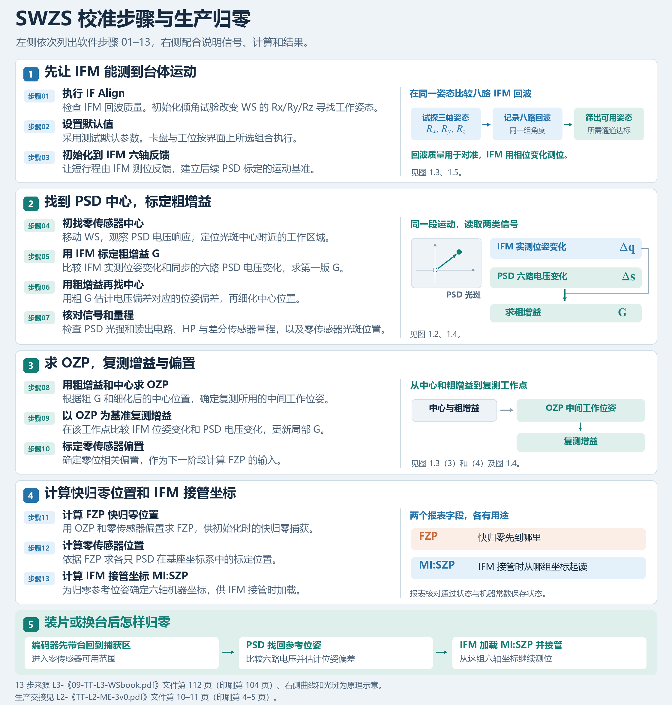

# MEtrology 校准项目报告

[项目目录](#calibration-index) · [本报告的整理范式](#report-format) · [步骤说明怎么写](#step-description) · [WS-IFM 校准清单](WS-IFM机器常数校准项目_v4.md#initial-zero) · [成果索引](../README.md)

## 本报告的整理范式

以下范式仅适用于 `MEtrology.md` 收录的校准项目。

1. **Purpose（目的）**。说明项目要解决什么问题、为什么要做、执行前需满足哪些条件，以及完成后可以开展哪些校准项目。列出本项目涉及校准的机器常数及其用途。
2. **How（操作流程）**。先按源文完整翻译具体操作流程，保留原有步骤顺序、操作条件和原文列出的注意事项及判据，并注明来源及页码。译文之后，根据对流程的理解绘制带编号的示意图，解释各步骤如何衔接。
3. **Principle（校准原理）**。具体说明测量基准和物理原理，解释校准如何由观测量得到机器常数。资料中有相关物理原图时，将原图附在本节正文并注明来源层级、原文件名、页码和图号。

### 步骤说明

- 在原文译文之后，用短句说明每一步从什么状态或输入开始、操作什么、读取或检查什么，以及得到什么结果。资料给出判据时，写清怎样判断完成。结果有明确的后续用途时，指出交给哪一步。
- 优先写清动作和信号怎样衔接。公式仅在有助于理解量之间的关系时补充，详细推导可链接到原理或资料汇整。
- 资料只给输入和输出时，按已确认的信息写。为解释原理而补充的操作或算法标为工程示意，并注明实机细节待查。

### 章节、图表与公式编号

- **章节**。每个校准项目独立成节，按目录顺序编号。
- **图、表与公式**。在每节内分别按「章节号.序号」编号，各自从 1 开始。例如第 1 节的第一张图、第一张表和第一条公式分别记为图 1.1、表 1.1 和式（1.1）。正文与图中重复出现的同一公式共用编号。引用资料中的图、表或公式时保留来源编号。
- **图内编号**。原理图和示意图中的关键模块、模组和子图应标注编号，如 `（1）`、`（2）`。正文或图注可按「图 1.2（1）」直接指向具体对象。
- **公式排版**。图内公式使用 LaTeX 或等效数学排版渲染，分式、上下标、矩阵等按数学格式呈现。

### 图件布局

- **总流程图**。紧凑布局要求仅适用于[图 1.1](#swzs-procedure-diagram)这类展示项目完整流程的总览图。按各阶段的内容分配版面，收紧边距和模块间距，减少无用途的留白，同时保持步骤编号和文字清晰。
- **原理图与分析图**。沿用[图 1.2–1.5](#swzs-figure-168)的风格，按光路、公式、坐标轴及标注的阅读需要安排空间。

### 来源标注

引用 Level 1–3 的文档或原图时，在文件名前标注所属层级，例如 `L1-《文件名.pdf》`、`L2-《文件名.pdf》`、`L3-《文件名.ppt》`。非 Level 1–3 的来源标为「外部资料」。

## 项目目录

| 项目 | 定位 | 快速跳转 |
| --- | --- | --- |
| [1. SWZS — WS 初步归零](#swzs) | 建立晶圆台干涉仪启用时的六自由度参考 | [Purpose](#swzs-constants) · [How](#swzs-procedure) · [Principle](#swzs-principle) · [初始零位测量原理](#swzs-voltage-to-zero) · [资料汇整](SWZS资料汇整_v1.md) |

## 1. SWZS — WS 初步归零

[Purpose](#swzs-constants) · [How](#swzs-procedure) · [Principle](#swzs-principle) · [灵敏度矩阵标定图](#swzs-gain-calibration-figure) · [怎样用 PSD 找回参考位姿](#swzs-psd-reference-recovery) · [IF Align 三轴姿态与八路回波](#swzs-if-align) · [步骤 12 的 PSD 位姿](#swzs-step12) · [Level 1–3 资料汇整](SWZS资料汇整_v1.md)

### Purpose（目的）

**要解决的问题。** SWZS（Calibrate Zero Sensor）校准晶圆台（WS）的零传感器，让干涉仪（IFM）在启用时有一个可重复找回的六自由度参考。装片或换台时，卡盘会离开 IFM 控制范围。回到量程时，编码器先把台带到捕获区，固定在计量框架（MF）上的零传感器找回参考位姿。IFM 加载这组坐标后，从该位置继续跟踪位移。原理见[图 1.3](#swzs-voltage-to-zero)。出处为 L1-《09_AP-L1-Production_Metrology_in-line.pdf》第 13、24 页及 L2-《TT-L2-ME-3v0.pdf》文件第 10–11、19 页（印刷第 4–5、13 页）。

**何时做。** TWINSCAN 初始设定或更换零传感器系统部件后进行完整校准。测量侧（M）和曝光侧（E）各有一套零传感器，分别对两个卡盘的镜块校准，共四种组合。设备初始化时出现快归零问题，可按适用流程独立运行 Update FZP。下述软件流程来自 WS Type-2、rel.3.4 培训教材。出处为 L3-《09-TT-L3-WSbook.pdf》文件第 73、111–115 页（印刷第 65、103–107 页）。

#### 前置条件

L3-《09-TT-L3-WSbook.pdf》文件第 111 页（印刷第 103 页）列五项条件。

1. 已完成基座（BF）校准。
2. 空气支承（AM）已开启并处于稳定状态。
3. 已完成卡盘交换校准 SWSW。
4. 已完成干涉仪调整与诊断试验 SWHP。多路回波不足时的处理见 [IF Align 信号诊断](#swzs-if-align-diagnostics)。
5. 已完成差分传感器校准 SWDC。

L3-《TT-MA-WS-Calibrations-3v1.ppt》第 100–101 张给出相同条件。课件列无需额外工具，预计 30 分钟。

#### 完成后可以开展的项目

- **计量设定。** 获得初始化参考后，计量设定图列出两条支路。对准支路做 BMAA 粗校、精校。晶圆台支路按 [WZIM 测量侧初始高度与倾角](WS-IFM机器常数校准项目_v4.md#mc-wzim) → [WGIM／WS TRIM](WS-IFM机器常数校准项目_v4.md#mc-wgim) → CLPL 基准板调平依次进行。两支路满足条件后再做 AA 光束倾角与焦点，继而做 M 侧 WS XY 干涉仪校准和 BMAA 精校。见 L3-《12-TT-L3-L3-ME_book.pdf》文件第 14–15 页（印刷第 6–7 页），图 1.3。
- **晶圆台服务测试。** 课件把已完成零传感器校准列为 SWCR 范围检查和 SWSM 短行程电机校准的前提之一。见 L3-《TT-MA-WS-Calibrations-3v1.ppt》第 79、144、211 张。
- **生产中的使用。** M 侧装片归零后可进入 Stage Align，由 LS 和 AA 读取 TIS 基准。E 侧换台归零后进入掩模对准或条件性的批次校正。这里常见的平移约 1 µm、转角约 ±2.5 µrad 是生产归零的参考量级。见 L1-《09_AP-L1-Production_Metrology_in-line.pdf》第 13–14、23–26、49 页及 L2-《TT-L2-ME-3v0.pdf》文件第 10–14、19 页（印刷第 4–8、13 页）。

#### 机器常数及用途

**表 1.1　SWZS 机器常数与中间量**

| 机器常数或中间量 | 物理含义 | 归属和报表核对 |
| --- | --- | --- |
| **Zero Sensor Gain Matrix** | 三只位置敏感器件（PSD）各有 `u`、`v` 电压。记下每路对六自由度的局部灵敏度和串扰。 | 每组合 6×6。示例报表按 PSD 列 `du/dX`、`dv/dRy` 等，单位为 V/m 或 V/rad。 |
| **零传感器电压零偏** | 三只 PSD 各自的 `u0/v0`。单位 V。 | 示例报表分列 `MI:zero sensor offset voltages` 与六轴 `Zero Sensor Offset`。 |
| **ZSO** | 零传感器偏置（Zero Sensor Offset），用六自由度位姿量表示。 | 直线轴用 m，角度轴用 rad。作为计算快归零位置的一组输入。 |
| **FZP** | 快归零位置（Fast Zero Position），用于初始化时的快归零捕获。 | 完整 PSD 校准会重新确定。独立 `Update FZP` 模式按基座（BF）偏置修正。 |
| **MI:SZP** | 台体零位（MI:Stage Zero Position，步骤中写作 `MISZP`）。对应切换到 IFM 控制时赋给台体的六自由度参考值。 | 报表字段为 `X/Y/Z/Rx/Ry/Rz`。L2-《TT-L2-ME-3v0.pdf》图 1.5 给出的参考值可以是非零。 |
| **PSD positions in baseframe coordinates** | 三只 PSD 对应的基座坐标位姿。 | 示例逐只 PSD 列出六轴、`found`、`intens.ok`、`electr.ok`。 |
| **Rx0、Ry0、Rz0** | 相关的初始化倾角，用 IFM 回波强度选取合适的镜块姿态。 | WS Initialization Tilts 资料按两卡盘 × 两工位分组。M 侧 `Ry0` 可由后续 WZIM 重定。 |
| **OZP** | 用粗增益和实测中心算出的中间位置。 | 用于第二轮增益标定，再参与 FZP 计算。 |

机器常数名称与单位见L3-《09-TT-L3-WSbook.pdf》第 111–115 页（印刷第 103–107 页），图 2.34–2.35。初始化倾角与 WZIM 更新关系见L3-《12-TT-L3-L3-ME_book.pdf》第 26–29 页（印刷第 18–21 页）及L3-《TT-MA-ME_setupblock_1-5_1v3.ppt》第 9–10 张。

### How（操作流程）

#### 原文流程译文

下列为 L3-《09-TT-L3-WSbook.pdf》文件第 112–115 页（印刷第 104–107 页）中测试软件顺序、注意事项、输入界面和结果说明的译文。前一页列出的五项[前置条件](#swzs-prerequisites)已在 Purpose 完整列出。软件顺序与 L3-《TT-MA-WS-Calibrations-3v1.ppt》第 104 张互证。

**测试软件顺序**

1. 执行干涉仪对准（IF Align）。
2. 设置默认值。
3. 初始化设备，直至短行程（SS）进入由 IFM 反馈控制的六自由度状态。
4. 寻找零传感器的中心位置。
5. 以干涉仪为参照，校准零传感器增益。
6. 用已标定的粗增益重新寻找零传感器中心。
7. 检查以下项目。
   - 零传感器光强及电子学。
   - HP 干涉仪和差分传感器的量程。
   - 零传感器的光束位置。
8. 用零传感器增益和零传感器中心计算 `OZP`。
9. 利用 `OZP` 再次校准零传感器增益。
10. 校准零传感器偏置。
11. 用 `OZP` 和零传感器偏置计算 `FZP`。
12. 用 `FZP` 计算零传感器位置。
13. 计算 `MISZP`。

**注意事项**

- 运行 PSD Calibration 时，更新机器常数后需复做部分计量设定。
- 运行 Update FZP 时，更新机器常数后需复做基座和晶圆搬运系统校准。

**输入界面**

原图 2.33 展示输入界面。从图中可见，测试由用户可选的三个部分组成。

**表 1.2　SWZS 输入模式（译文）**

| 模式 | 原文说明译文 |
| --- | --- |
| **IFM-align** | 单独执行时，只做检查。 |
| **PSD Calibration** | 执行完整校准。它包含 IFM-align，因此选中 PSD Calibration 时无法取消选中 IFM-align。完整校准会重新确定 FZP，因此此时不能选中 Update FZP。 |
| **Update FZP（Fast Zero Position）** | 按基座偏置修正 FZP。此模式下 IFM-align 和 PSD Calibration 都不能选中。 |

**结果说明**

原图 2.34 和印刷第 107 页的图 2.35 给出一份示例报告。报告中可看到上述机器常数。报告末尾还列出许多中间结果，示例中未展示。

#### 流程图与报告核对

**图 1.1　SWZS 的 13 个软件步骤及生产使用。** 图中步骤 01–13 与[原文译文](#swzs-how-translation)逐条对应。阶段（1）[建立 IFM 测量基准](#swzs-how-establish-ifm)，阶段（2）[找中心并标定粗增益](#swzs-how-find-psd-center)，阶段（3）[确定 OZP、复测增益并标定偏置](#swzs-how-ozp-and-gain)，阶段（4）[计算快归零和 IFM 接管常数](#swzs-how-fzp-and-szp)。阶段（5）展示装片或换台后[怎样用这些结果归零](#swzs-psd-reference-recovery)。可按步骤跳转到 [图 1.2 的 PSD 读出](#swzs-figure-168)、[图 1.3 的归零测量链](#swzs-voltage-to-zero)、[图 1.4 的增益标定](#swzs-gain-calibration-figure)、[图 1.5 的 IF Align 三轴姿态选点](#swzs-if-align)。流程顺序见 L3-《09-TT-L3-WSbook.pdf》文件第 112 页（印刷第 104 页）。

##### 图 1.1（1）先建立 IFM 六轴测量基准

第 1 步做 `IF Align`。转动 WS 看回波的原理来自初始化倾角试验。[图 1.5](#swzs-if-align)示意如何比较不同三轴姿态下的八路回波，筛出所需通道同时可用的姿态。软件单独运行 `IFM-align` 时只做检查。第 2 步载入默认参数，第 3 步初始化到短行程由 IFM 提供六轴反馈。完成后，IFM 的相位变化可用来测出下一阶段标定所需的实际位姿变化。见 L3-《TT-MA-ME_setupblock_1-5_1v3.ppt》第 9 张及 L3-《09-TT-L3-WSbook.pdf》文件第 112–113 页（印刷第 104–105 页）。[回波与相位测位](#swzs-ifm-signal)

##### 图 1.1（2）找 PSD 中心并标定粗增益

- **步骤 04，初找中心。** 短行程进入 IFM 六轴反馈后，开始寻找零传感器中心位置。课件未列出如何试探移动、用哪项读数判断已经找到中心。
- **步骤 05，标定粗增益。** 以 IFM 为参照标定零传感器增益，得到步骤 06 使用的粗增益 `G_c`。如何把 IFM 实测位姿变化和 PSD 电压变化配对来理解该标定，见[图 1.4](#swzs-gain-calibration-figure)。
- **步骤 06，用粗增益确定中心。** 将 `G_c` 用于第二次中心定位，把得到的中心结果交给步骤 08。
- **步骤 07，检查测量状态。** 核对零传感器光强及电子学、HP 和差分传感器的量程、零传感器的光束位置。课件没有列出逐只 PSD 的落点合格范围。

**工程理解。** 有了粗增益，就能用当前[六路位置电压](#swzs-psd-readout)与中心参考电压的差，估计把光斑向中心调节需要的 WS 位姿增量。这个局部模型解释了步骤 06 怎样利用步骤 05 的结果。L3 确认两次定位中心的顺序，未公开实机的运动轨迹、解算方法和结束判据，因此无法确认三只 PSD 的光斑在各次运动中逐个向中心靠近。见 L3-《09-TT-L3-WSbook.pdf》文件第 112 页（印刷第 104 页）及 L3-《TT-MA-WS-Calibrations-3v1.ppt》第 104 张。[步骤 04–08 的逐步核查](SWZS%E6%AD%A5%E9%AA%A404%E8%87%B308-PSD%E4%B8%AD%E5%BF%83%E5%AE%9A%E4%BD%8D%E6%A0%B8%E6%9F%A5_v1.md#step-evidence)

##### 图 1.1（3）用 OZP 复测增益并标定偏置

这一步接收第 5 步得到的粗增益和第 6 步重新定位的零传感器中心。目标是确定第二轮增益标定所用的位置，并得到下一段计算快归零位置所需的偏置。

- **原文第 8 步，求 `OZP`。** 用步骤 05 的粗增益和步骤 06 得到的中心结果计算中间工作位姿 `OZP`，作为步骤 09 复测增益的基准。原文在这一步写的是计算，未说明第 08 步是否驱动台体，也未说明 `OZP` 是否等于步骤 06 结束时的实测位姿。[中心定位与 OZP 的证据](SWZS%E6%AD%A5%E9%AA%A404%E8%87%B308-PSD%E4%B8%AD%E5%BF%83%E5%AE%9A%E4%BD%8D%E6%A0%B8%E6%9F%A5_v1.md#step-evidence)
- **原文第 9 步，用 `OZP` 复测增益。** 以这个工作位姿为基准，比较 IFM 测得的小幅位姿变化和同步采集的 PSD 电压变化，更新该工作点附近的六轴灵敏度。两次采样如何得到 `G` 的一列，见[图 1.4](#swzs-gain-calibration-figure)。
- **原文第 10 步，标定偏置。** 辨识零传感器对参考位置的零偏。示例报表分列六轴 `Zero Sensor Offset`（`ZSO`，平移用 m、转角用 rad）和三只 PSD 的 `u0/v0`（单位 V）。第 11 步将零传感器偏置和 `OZP` 一起用于计算 `FZP`。

原文顺序和报表字段见 L3-《09-TT-L3-WSbook.pdf》文件第 112、114–115 页（印刷第 104、106–107 页）及 L3-《TT-MA-WS-Calibrations-3v1.ppt》第 104 张。[机器常数与报告字段](SWZS资料汇整_v1.md#constants)

##### 图 1.1（4）把标定结果用于快归零和 IFM 接管

- **原文第 11 步，求 `FZP`。** 用中间工作位姿 `OZP` 和零传感器偏置求出快归零位置，供初始化时的快归零捕获使用。
- **原文第 12 步，计算零传感器位置。** 软件用第 11 步算出的 `FZP`，计算三只 PSD 在基座坐标系里的位置和姿态。报表按卡盘、工位和 PSD 编号列六轴结果，可同时查看找到传感器、光强和电子学的检查标志。零传感器固定在计量框架上，位姿结果以基座坐标表示。L3 列出了 `FZP` 这一输入，未说明第 12 步的取样运动、所用轨迹和解算方法。见 L3-《09-TT-L3-WSbook.pdf》文件第 62–63、112、114 页（印刷第 54–55、104、106 页）。[Level 1–3 步骤 12 核查](SWZS步骤12-PSD基座位姿核查_v1.md#source-evidence)
- **原文第 13 步，求 `MI:SZP`。** 为实际找回的归零参考位姿确定 IFM 使用的 `X/Y/Z/Rx/Ry/Rz` 机器坐标。生产归零时，PSD 帮助台体找回参考，IFM 接管时载入 `MI:SZP`，再从这组坐标继续测量位姿变化。示例里的坐标可为非零，见[图 1.3（6）](#swzs-voltage-to-zero)。

`FZP` 回答“快归零先到哪里”，`MI:SZP` 回答“到达参考后，IFM 从哪组坐标开始读数”。两者在示例报告中各有独立的六轴字段。Level 3 只给出这些量的计算依赖，具体的偏置符号和坐标变换未在课件中给出。见 L3-《09-TT-L3-WSbook.pdf》文件第 111–115 页（印刷第 103–107 页，图 2.34–2.35）及 L2-《TT-L2-ME-3v0.pdf》文件第 10–11 页（印刷第 4–5 页，图 1.4–1.5）。

**报表核对。** 对照选择的卡盘和工位，分别查看 IFM-align、PSD 或 FZP 的结果、所选组合的成功标志，以及 `New Machine Constants Saved for successful calibrations`。增益、偏置和坐标用对应的 `old/new` 字段核对。课件列出了检查项目与示例结果，实际放行数值按机型对应的 Coach 流程核对。见 L3-《09-TT-L3-WSbook.pdf》文件第 114–115 页（印刷第 106–107 页），图 2.34–2.35。

### Principle（校准原理）

[图 1.2](#swzs-figure-168) 从零传感器的安装位置解释六路 PSD 电压如何形成。[图 1.3](#swzs-voltage-to-zero) 接着说明校准时如何用 IFM 测位标定这些电压，以及生产时如何用电压找回零位。

#### PSD 工作原理与信号含义

计量框架每侧有三只零传感器，分别照射镜块上的三个角锥反射器。WS 改变位姿时，三个回波光斑在各自 PSD（Position Sensitive Device，位置敏感器件）的感光面上移动。每只 PSD 给出两个方向的位置电压，共六路。布置和测量方向见 L3-《09-TT-L3-WSbook.pdf》文件第 62–63 页（印刷第 54–55 页），图 1.68–1.69。[原图位置与解读](#swzs-source-figures)

**图 1.2　SWZS 零传感器的光路与位置电压读出。**

**对应[图 1.1（2）](#swzs-how-find-psd-center)步骤 04、06 和 07 的 PSD 部分。** 光斑位置如何变成六路位置电压，是初找和重新找中心（04、06）时观察信号的基础，也帮助理解步骤 07 为什么检查 PSD 光束位置与读出。

（1）为 L3-《09-TT-L3-WSbook.pdf》文件第 62 页（印刷第 54 页）的原图 1.68，标出三只零传感器与三个对应的角锥。（2）沿其中一组光路，从发射端 2a 到角锥 2b，再返回 PSD 感光面 2c。（3）用通用横向效应 PSD 解释电流分配与位置电压读出。（4）用一个方向的[局部线性示意](#swzs-eq-psd-voltage)说明光斑位移如何改变输出电压。Level 3 未给出实机 PSD 型号及电子电路。

以通用一维横向效应 PSD 为例，光斑在连续感光电阻层上产生光电流，由左右电极分别收集为 `I−`、`I+`。光斑位于电学中心时两路电流相等，向右移动时 `I+` 占总光电流的比例增大。理想线性区内，光斑位置由[式（1.1a）](#swzs-eq-psd-position)给出。

$$
x_{\mathrm{p}} = \frac{L}{2}\,\frac{I_{+}-I_{-}}{I_{+}+I_{-}} \qquad (1.1a)
$$

其中 `x_p` 是光斑质心相对电学中心的位置，`L` 是电阻层有效长度。用总电流归一化，可以减小整体光强变化对位置读数的影响。外部资料见 [Hamamatsu PSD 技术说明](https://www.hamamatsu.com/content/dam/hamamatsu-photonics/sites/documents/99_SALES_LIBRARY/ssd/psd_kpsd9001e.pdf#page=2) 第 2 页图 1-1、式 (1-3)。

**读出电路如何给出电压。** 以一个方向的输出 `u` 为例，跨阻放大器先把两端光电流转换成电压。后级取两路等比例电压的差值除以总和，再按输出比例与零点偏置生成位置电压。归一化比值按式（1.1a）等于光斑位置 `x_p` 除以半有效长度 `L/2`。因此，在该方向的线性工作区，可以用[式（1.1b）](#swzs-eq-psd-voltage)描述位置到电压的关系。外部资料见 [Hamamatsu《PSD signal processing circuits, PSD modules》§1.2 图 1-1](https://www.hamamatsu.com/content/dam/hamamatsu-photonics/sites/documents/99_SALES_LIBRARY/ssd/psd_singal_kacc9014e.pdf)。

$$
u-u_{\mathrm{c}} \simeq K_u\,\frac{2x_{\mathrm{p}}}{L} \qquad (1.1b)
$$

`u_c` 是示意通道在光斑位于电学中心时的输出电压，`K_u` 是把无量纲比值变成电压的比例系数，单位为 V。该通道的光斑位置灵敏度是 `2K_u/L`，单位可用 V/mm 表示。二维读出的另一方向也有各自的比例和偏置。

**供应商的输出特性图。** Hamamatsu 二维 PSD 读出电路手册《c4674-01_kpsd1005e.pdf》文件第 3 页右上图 KACCC0648EA，横轴是光斑在感光面上的局部位置（mm），纵轴是位置输出电压（V）。中心附近近似线性，名义区间两端之外可看到弯折。图 1.2（4）按式（1.1b）绘出中心附近的关系，供应商曲线及标尺见原页。[外部资料《Hamamatsu C4674-01 位置—输出电压原图》](https://www.hamamatsu.com/content/dam/hamamatsu-photonics/sites/documents/99_SALES_LIBRARY/ssd/c4674-01_kpsd1005e.pdf#page=3)

在 SWZS 报表中，每只传感器的 `u`、`v` 是代表两个局部方向光斑位置的电压信号，单位为 V。`u0/v0` 是对应通道的电压零偏。`du/dX`、`dv/dRy` 等增益记录 WS 平移或转动引起的电压响应，单位分别为 V/m、V/rad。SWZS 直接用六路 `u/v` 电压与 IFM 实测位姿变化标定 `G`，其中同时包含光斑相对 WS 位姿的几何响应及读出电路的比例。标定后用六路电压一起[换算为位姿偏差](#swzs-voltage-to-zero)。出处为L3-《09-TT-L3-WSbook.pdf》文件第 115 页（印刷第 107 页），图 2.35。

#### 从 PSD 电压到 WS 初始零位

**校准时**，先建立有效的 IFM 回波，再用 IFM 测得的位姿变化标定 PSD。**生产归零时**，用已标定的 PSD 信号恢复 WS 的参考位姿，随后由 IFM 接管。

**图 1.3　SWZS 初始零位的测量原理。**

**对应[图 1.1](#swzs-procedure-diagram)的以下步骤。**

- （1）对应步骤 01 的回波对准，（2）对应步骤 03 的 IFM 六轴测位与反馈。见[建立 IFM 测量基准](#swzs-how-establish-ifm)。
- （3）对应步骤 05、09 的共同测量原理，将 IFM 实测位姿变化与 PSD 电压变化配对。见[粗增益标定](#swzs-how-find-psd-center)和[增益复测](#swzs-how-ozp-and-gain)。
- （4）对应步骤 08–13，从 [OZP、增益复测和偏置](#swzs-how-ozp-and-gain)到 [FZP、传感器位置和 MI:SZP](#swzs-how-fzp-and-szp)，展示各结果的先后依赖。
- （5）与（6）对应图 1.1 的生产归零阶段。前者用六路电压找回参考位姿，后者加载步骤 13 得到的坐标并由 IFM 接管。见[生产归零原理](#swzs-psd-reference-recovery)。

图 1.3（1）的寻峰曲线截自 L3-《TT-MA-ME_setupblock_1-5_1v3.ppt》第 9 张。图 1.3（6）的机器坐标示例取自 L2-《TT-L2-ME-3v0.pdf》文件第 11 页（印刷第 5 页），图 1.5。

**（1）IFM 回波强度和相位各有用途，见图 1.3（1）与（2）。** 扫描 `Rx/Ry/Rz` 并记录 IFM 的回波强度，从峰附近选取初始化倾角 `Rx0/Ry0/Rz0`。以图 1.3（1）的 Rx 曲线为例，峰的横坐标给出对应的 Rx 姿态。各通道的回波峰位可能不同。[图 1.5](#swzs-if-align)用八路回波说明怎样在同一姿态核对信号条件。建立有效回波后，IFM 跟踪测量信号相对参考的相位变化，从各路光程增量解算台体实际六轴位姿增量 `Δq = [ΔX, ΔY, ΔZ, ΔRx, ΔRy, ΔRz]`。出处为L3-《12-TT-L3-L3-ME_book.pdf》文件第 26–29 页（印刷第 18–21 页）、L3-《09-TT-L3-WSbook.pdf》文件第 60–61 页（印刷第 52–53 页），图 1.66。

**（2）用同一次运动的 IFM 位姿和 PSD 电压求增益矩阵，见图 1.3（3）与（4）。** 以 IFM 测得的运动为基准，同步记录三只 PSD 的六路电压。参考位置附近，单独改变 X 时，第 `j` 路电压变化对实测 X 位移的斜率是 `G` 的 X 列中的一项，见[式（1.2）](#swzs-eq-gain-element)。

$$
G_{jX} \simeq \frac{\Delta s_j}{\Delta X} \qquad (1.2)
$$

六个独立激励方向可以确定 6×6 的 `G`。六路电压变化与六轴位姿变化满足[式（1.3）](#swzs-eq-gain-matrix)的局部关系。

$$
\Delta\mathbf{s} \simeq \mathbf{G}\,\Delta\mathbf{q} \qquad (1.3)
$$

**图 1.4　PSD 灵敏度矩阵的标定示意。**

**对应图 1.1 的[步骤 05](#swzs-how-find-psd-center)和[步骤 09](#swzs-how-ozp-and-gain)。** 两步都用实测位姿变化和对应的六路 PSD 电压变化求矩阵 `G`。步骤 05 得到粗增益，步骤 09 改在 `OZP` 附近复测。

（1）和（2）比较两次采样的光斑和电压，下标依次表示 PSD 编号与采样编号。（3）用 IFM 相位变化得到的实测位移和六路电压差计算 X 列，适用于参考点附近且其余自由度变化可忽略的情形。（4）对其余方向做同类采样，得到矩阵的其他列。回波强度可用于对准和检查信号质量。图按 L3-《09-TT-L3-WSbook.pdf》文件第 112 页（印刷第 104 页）的以 IFM 为参照标定增益步骤绘制。光斑变化和单轴差分用来说明测量原理，该页未给出实机的采样与拟合算法。

每行对应一条 PSD 电压通道，每列对应一个台体自由度。平移列单位为 V/m，角度列单位为 V/rad，非主通道的斜率也保留在矩阵中。完整流程还用 PSD 中心与粗增益求 `OZP`，在该工作点复测增益和校准偏置，然后求 `FZP`、传感器位置及 `MI:SZP`。`G` 描述局部灵敏度，参考零位及其坐标由中心、偏置与位置标定确定。出处为L3-《09-TT-L3-WSbook.pdf》文件第 111–115 页（印刷第 103–107 页）、L3-《TT-MA-WS-Calibrations-3v1.ppt》第 97–98、104 张。

**（3）生产归零用 PSD 找回参考，见图 1.3（5）与（6）。** 台体进入捕获区以后，读取三只 PSD 的六路电压 `s`。`s_ref` 表示同一卡盘、同一工位的归零参考位姿对应的六路电压。用[式（1.4）](#swzs-eq-voltage-difference)逐通道作差。

$$
\Delta\mathbf{s} = \mathbf{s} - \mathbf{s}_{\mathrm{ref}} \qquad (1.4)
$$

在参考点附近，若 `G` 满秩，可用[式（1.5）](#swzs-eq-pose-difference)解释如何由电压差得到六轴位姿偏差。

$$
\Delta\mathbf{q} \simeq \mathbf{G}^{-1}\Delta\mathbf{s} \qquad (1.5)
$$

这里的偏差是**当前位姿减去参考位姿**。若算出的 `ΔRx` 大于零，就应向负 Rx 方向修正。图 1.3（5）只画 Rx 这一分量，实际含义是将六路电压差一起代入，得到六轴偏差。靠近参考位姿时，电压差与位姿偏差一起趋近于零。找回参考后，IFM 加载 `MI:SZP` 继续测位，所加载的机器坐标可以为非零值。出处为 L1-《09_AP-L1-Production_Metrology_in-line.pdf》第 13、24 页及 L2-《TT-L2-ME-3v0.pdf》文件第 10–11 页（印刷第 4–5 页）。

#### IF Align 三轴姿态采样与八路回波选点

**图 1.5　IF Align 三轴姿态采样与八路回波选点。** 对应[图 1.1 的步骤 01](#swzs-how-establish-ifm)，说明回波如何随姿态变化，以及怎样用同一姿态下的八路回波筛选工作姿态。

- **（1）改变镜面角度。** 以一路平面镜光路为例，镜面倾斜会改变回光方向，进而改变接收信号强度。
- **（2）按候选姿态记录信号。** 每个候选点是一组 `Rx、Ry、Rz`，记录该姿态下的八路回波。
- **（3a）把曲线上的读数对应到表格。** 固定 `Ry、Rz` 为 C 姿态的值，沿 `Rx` 画 X1 的回波曲线。归一化纵轴的 **1.00 虚线**表示 X1 的最低可用回波强度。C 点 **1.42** 表示 X1 回波高于本路下限 **42%**，对应（3b）的 **C 行、X1 列**。
- **（3b）逐路采用各自的下限。** 表格每一行对应一个 WS 姿态。八路回波分别除以该路的最低可用回波强度，各列都以 1.00 表示刚好达标。

**（3c）先筛信号，再按目标选点。** 在这个八路示例中，候选姿态 $\theta$ 的最弱通道比值为 $m(\theta)$。当 $m(\theta)\geq1$ 时，八路都达到各自的示意下限。

$$
m(\theta)=\min_{i=1,\ldots,8}\left(\frac{I_i(\theta)}{I_{i,\min}}\right)\qquad (1.6)
$$

- **按回波余量选。** 在达标姿态中取 $m(\theta)$ 最大的点。示例 C 的最弱通道比值为 1.18，高于 B 的 1.04。
- **按离参考姿态的距离选。** 先指定一组参考角，再在达标姿态中取 $d(\theta)$ 最小的点。式中三个角度差分别为候选角减参考角。图中的参考角取示意值，B 离它最近，角度距离为 0.25 µrad。

$$
d(\theta)=\sqrt{(\Delta R_x)^2+(\Delta R_y)^2+(\Delta R_z)^2}\qquad (1.7)
$$

L3 课件记载了转动、倾斜 WS 并记录 IFM 信号质量，以及把合适的 `Rx0、Ry0、Rz0` 存为机器常数。图 1.5 的候选点、回波、门限、参考角和联合选点规则均为工程示意。资料出处为 L3-《12-TT-L3-L3-ME_book.pdf》文件第 26 页（印刷第 18 页）、L3-《TT-MA-ME_setupblock_1-5_1v3.ppt》第 9 张。八路通道标记参考 L3-《09-TT-L3-WSbook.pdf》文件第 57–58 页（印刷第 49–50 页），图 1.60–1.61。

**多路回波不足时。** 先核对候选姿态是否覆盖机型允许的 `Rx、Ry、Rz` 及相应量程。确认所需通道仍没有共同可用姿态时，回查前置项目 [SWHP](#swzs-prerequisites) 及相应维护流程。有效信号为[步骤 03 建立 IFM 六轴反馈](#swzs-how-establish-ifm)提供测量条件。SWHP 前置要求与 IF Align 的顺序见 L3-《09-TT-L3-WSbook.pdf》文件第 111–113 页（印刷第 103–105 页）及 L3-《TT-MA-WS-Calibrations-3v1.ppt》第 100–104 张。[前置项目资料汇整](SWZS资料汇整_v1.md#dependencies)

#### 原图与出处

原图 1.68 见 [正文图 1.2（1）](#swzs-figure-168)。以下列出相应的本机原图位置，最后一列相对 `D:\work\ME2\参考文献\Markdown_v1\`。图像与页码的查询方式见 [Level 1–3 资料规则](../../AGENTS.md#read-only-references)。

**表 1.3　SWZS 原图与出处**

| 原始资料 | 图中可核实的信息 | 本机原图位置 |
| --- | --- | --- |
| L3-《09-TT-L3-WSbook.pdf》第 62 页（印刷第 54 页），**图 1.68 Zero Sensors** | 三只传感器固定在 MF，三个对应角锥位于镜块。 | `assets/b4514b4ae5eb86cb/images/page_61_image_8_v1.jpg` |
| L3-《09-TT-L3-WSbook.pdf》文件第 63 页（印刷第 55 页），**图 1.69** | 从计量框架底面看，M/E 各圈出三个零传感器。 | `assets/b4514b4ae5eb86cb/images/page_62_image_5_v1.jpg` |
| L3-《TT-MA-ME_setupblock_1-5_1v3.ppt》第 9 张，**Interferometer strength–Rx 曲线** | 扫描初始化倾角时，回波强度在中间出现峰。 | 见原 PPT 第 9 张及 [正文图 1.3（1）](#swzs-ifm-signal)。 |
| L2-《TT-L2-ME-3v0.pdf》第 11 页（印刷第 5 页），**图 1.4、1.5** | 两图中的台体处于同一归零位置。图 1.5 在 IFM 控制下列出六轴 MI:SZP 参考值。 | `assets/e9dff352e800b276/images/page_10_image_4_v1.jpg`、`assets/e9dff352e800b276/images/page_10_image_9_v1.jpg` |
| L3-《TT-MA-WS-Calibrations-3v1.ppt》第 102 张 | 全 PSD 模式包含 IFM-align。两卡盘 M/E 共四组合可选择，图示进度为 0%。 | `assets/56ea2737208dfc3a/images/page_101_image_4_v1.jpg` |
| L3-《09-TT-L3-WSbook.pdf》第 115 页（印刷第 107 页），**图 2.35** | FZP、MI:SZP、`u0/v0` 和 PSD 增益分别列项，可核对单位和报表字段。 | `assets/b4514b4ae5eb86cb/images/page_114_image_4_v1.jpg` |

[返回项目目录](#calibration-index) · [WS-IFM 清单的初步归零条目](WS-IFM机器常数校准项目_v4.md#initial-zero)
