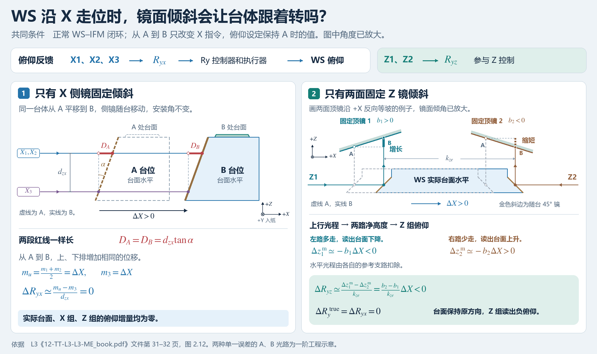

# WGIM 答疑草稿　两种镜面安装误差对 WS 俯仰的影响

[谁控制 Ry](#pitch-loop) · [只有 X 侧镜倾斜](#side-only) · [只有两面 Z 顶镜有安装误差](#top-only) · [WGIM 图 3.6](MEtrology-WGIM-WTAF整理草稿_v10.md#wgim-z-mirror-coupling)

## 1　WS 沿 X 运动时，哪个 IFM 控制 Ry？

在本题的 **WS–IFM 运动闭环**中，控制器用 **X1、X2、X3 解算的 $R_{yx}$** 作为 WS 绕 Y 轴的俯仰反馈。上排 X1、X2 的平均位移与下排 X3 的位移之差反映俯仰。Z1、Z2 也能从左右测高之差给出同一转角的估计 $R_{yz}$。WGIM 用 $R_{yx}$ 校准 $R_{yz}$；后者参与 Z 控制。控制模式要随操作区分，例如记录晶圆高度图时，L3 明确写明 LS 接管 Z 和 Ry。见 L3-《12-TT-L3-L3-ME_book.pdf》文件第 29、31–32 页（印刷第 21、23–24 页），L2-《12-TT-L2-ME-module.pdf》文件第 39–40 页（印刷第 31–32 页）。[WGIM 两组读数的用途](WGIM资料汇整_v1.md#method) · [IFM 模型表 3](ifm_model.md#ifm-table-3)

以下均从起点 A 向 +X 走到 B，Ry 指令保持起点值，理想跟踪。图中 A 的实际台面取水平，光程与角度读数以 A 为零。比较的是未经位置补偿的增量。

**图 1　同一条纯 X 指令下，实际台面和两组 IFM 分别怎样变化？** 左图比较同一台位的上下束；右图比较同一路光在不同台位的竖直段。两图均按机架右手坐标，从 −Y 看，+X 向右、+Z 向上，正 Ry 使台面右端下降。右图取两面顶镜沿 X 的坡度大小相等、方向相反，放大角度以显示光程增减。[打开原图](../images/WGIM-两种镜面安装误差与Ry反馈_v1.png)

| 走位中唯一的误差 | WS 实际 Ry 增量 | 俯仰反馈 $\Delta R_{yx}$ | Z 组的 $\Delta R_{yz}$（一阶） |
| --- | --- | --- | --- |
| 随台 X 平面侧镜与 Z 轴有固定夹角 | 0 | 0 | 0 |
| 两面固定 Z 顶镜沿 X 的坡度不同 | 0 | 0 | 随 X 改变。图示左镜上坡、右镜下坡，读数为负 |
| 两面固定 Z 顶镜沿 X 的坡度相同，或只有恒定高度差 | 0 | 0 | 0。共同坡度可影响 Z 高度读数，恒定高度差可影响角度零点 |

## 2　只有 X 侧镜与 Z 轴有固定夹角

**WS 实际 Ry 保持不变。** X1、X2、X3 是平行的水平光束，照在同一块随台平移的平面侧镜上。看图 1 左侧，在 A 从下束落点向上投影，再沿上束量到镜面，得到红段 $D_A$。走到 B，整块镜面平移了 $\Delta X$，两排落点都向右移了 $\Delta X$，再量得到等长的 $D_B$。设上下束距为 $d_{zx}$、安装角为 $\alpha$，则

$$
D_A=D_B=d_{zx}\tan\alpha,\qquad
m_u=\frac{m_1+m_2}{2}=m_3=\Delta X,\qquad
\Delta R_{yx}\simeq\frac{m_u-m_3}{d_{zx}}=0 .
$$

红段记录**同一台位上下两排的几何程差**，$m_i$ 记录**同一路从 A 到 B 的等效镜面位移**。固定的程差可以造成角度零点偏置。以 A 为零以后，俯仰反馈没有随 X 累积的偏差，控制器无须让台体越走越斜。[上下排光程对照表](WGIM-X侧镜固定倾角与Ryx走位斜率说明草稿_v1.md#translation)

## 3　只有 Zmirror1、Zmirror2 有安装误差

**WS 实际 Ry 仍保持不变。** X 侧镜与 X 组三束均理想，控制器仍锁定 $R_{yx}$。这时要看安装误差对**两束 Z 光**各造成了什么变化。顶镜固定在计量框架上，两块 45° 折转镜随 WS 向右平移。每束光在其顶镜上的采样点也向右移动。右图左镜沿 +X 升高，Z1 从折转镜到顶镜的上行段增长；右镜沿 +X 降低，Z2 上行段缩短。扣除同侧水平参考光程后，Z1 将间隙增长解释成左侧降低，Z2 将间隙缩短解释成右侧升高。因此 Z 组报告负俯仰，实际台面仍水平。[图 3.6（3）的两条 Z 光路](MEtrology-WGIM-WTAF整理草稿_v10.md#wgim-z-path-difference)

设 $b_1,b_2$ 是两面固定顶镜各自沿 +X 的高度坡度，$k_{ze}>0$ 是两路 Z 等效测点的 X 向间距。图中使用一阶等效高度模型，按“左高度减右高度”读角。若另有公共台高增量 $\Delta Z$，两路都会测到它，求差时抵消：

$$
\Delta z_1^{\rm m}\simeq \Delta Z-b_1\Delta X,\qquad
\Delta z_2^{\rm m}\simeq \Delta Z-b_2\Delta X,
$$

$$
\Delta R_{yz}\simeq\frac{\Delta z_1^{\rm m}-\Delta z_2^{\rm m}}{k_{ze}}
=\frac{b_2-b_1}{k_{ze}}\,\Delta X,\qquad \Delta R_{yx}=\Delta R_y^{\rm true}=0 .
$$

所以，应当比较**两镜在扫描方向上的坡度差**。若两镜同坡，左右测高偏差作差后为零；若两镜仅安装高度不同，产生的是固定偏置。两种情况都不会产生俯仰随 X 的斜率。L3 原图 2.12 底部的五条短线表示不同 X 位置上 **Z 组读到的 $R_{yz}$**。WGIM 校正它相对 X 组参考的一阶位置依赖。上述公式给出图示的几何关系，工程模型另有测角比例和位置补偿项。[L3 原图 2.12 的出处](WGIM资料汇整_v1.md#source-figures) · [工程模型与机器常数](ifm_model.md#ifm-constants)
