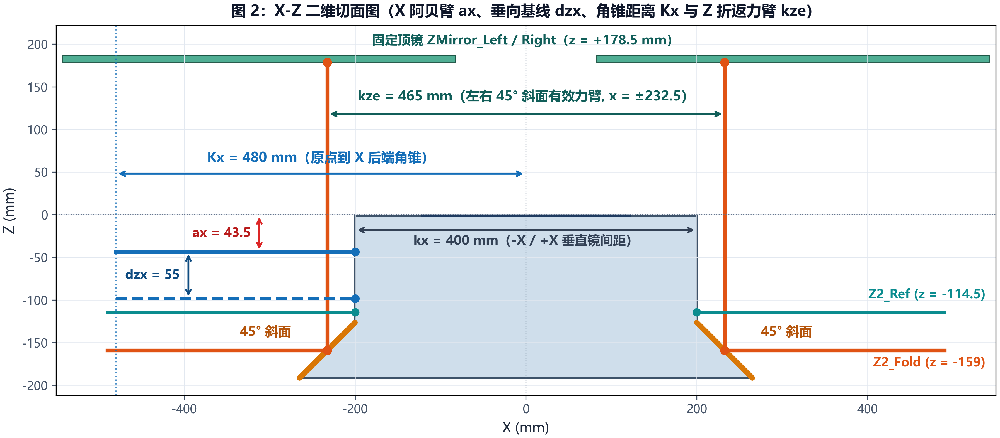
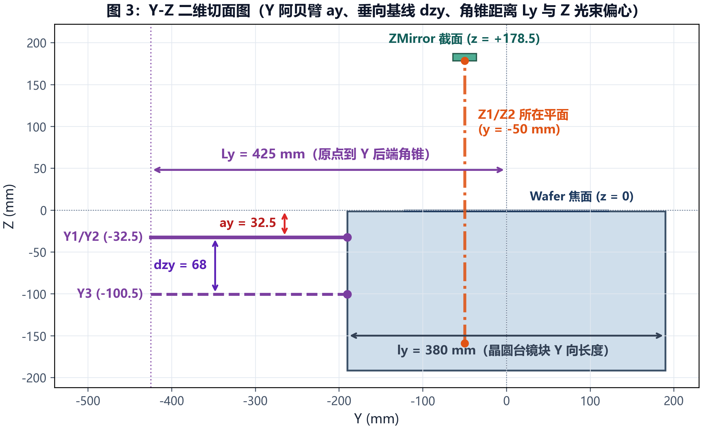
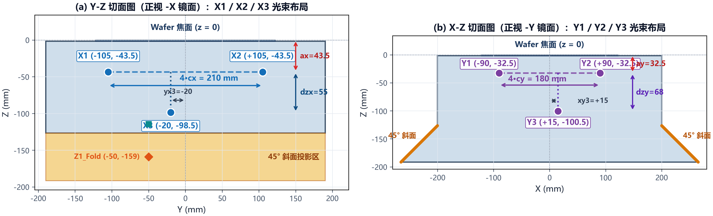
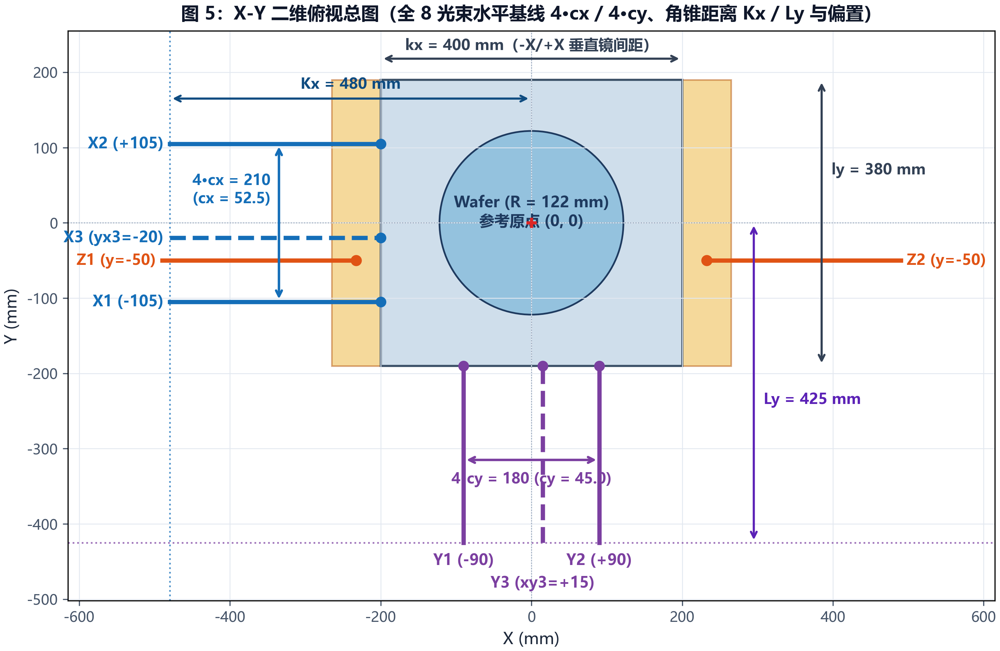
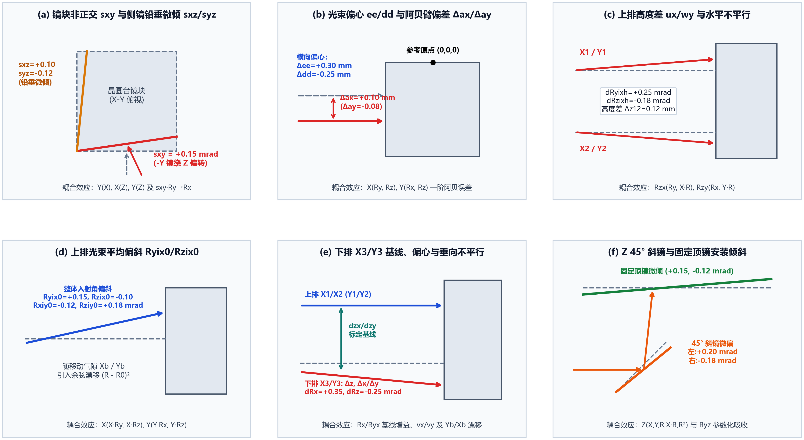
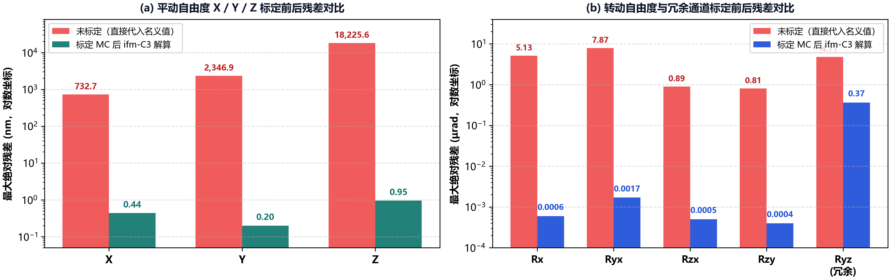

晶圆台干涉仪标准技术手稿 · WS-IFM MANUSCRIPT (ifm-C3 · v10)

# 晶圆台干涉仪（WS-IFM）光路布局、ifm-C3 公式与常数手册

参照原始手稿 <code>ifm-C0</code>（<code>ifm模型.docx</code>）体例整理，采用同源旋转顺序 <strong>R = Rz·Rx·Ry</strong> 与 M-side CAD 精确几何坐标

- **3X + 3Y + 2Z** 8 路测量光 + 2 路 Z 参考光
- **R = Rz · Rx · Ry** 与 C0 同源的刚体旋转顺序
- **≤ 0.70 nm / 0.0014 μrad** ±1 mrad 扫描下全 6-DOF 实测精度
- **49 核心 MC + 扩展项** 含折返系数 czxrz 与下排垂向项

[光路布局](#ifm-geometry) · [八路读数](#ifm-readout) · [公式对照](#ifm-differences) · [工程扩展](#ifm-extensions) · [Rx/Ryx 标定](#ifm-solver) · [机器常数](#ifm-constants) · [原稿勘误](#ifm-errata) · [装调验证](#ifm-validation) · [原稿参考文献](#ifm-sources) · [PDF 原稿](ifm_model_v10.pdf)

**仓库命名与代码。** 原始 C0 统一称为 [ifm_raw](ifm_raw.md)，C3 工程扩展版统一称为 [ifm_corr](ifm_corr.md)。当前仿真采用 [MATLAB v9 扩展式](../code/sim_ws_ifm_6dof_animation_v9.m)。以下 v10 技术手稿保留附件原有术语和版本标识。

## 一、IFM 光路布局与核心几何常数标注

晶圆台干涉仪（WS-IFM）通过 8 路主测量光束（上排 <code>X1/X2</code>、下排 <code>X3</code>；上排 <code>Y1/Y2</code>、下排 <code>Y3</code>；左右 45° 折返 <code>Z1/Z2</code>）及 2 路垂直参考光（<code>Z1&#95;Ref/Z2&#95;Ref</code>）实现晶圆台 6 自由度闭环测量与 2 路冗余监测（参见 [US6020964A](https://patents.google.com/patent/US6020964A/de)、[US6674510B1](https://patents.google.com/patent/US6674510B1/en)）。本节先在三维视图中直接标注核心几何常数，再用 X-Z、Y-Z、X-Y 三张独立二维切面/俯视图逐项展示全部尺寸关系。

<strong>图 1：WS-IFM 三维正交等轴测光路总图（300 DPI，主体紧裁切放大）。</strong>直接标出上排水平间距 <code>4·cx = 210 mm</code>、<code>4·cy = 180 mm</code>，上下排高度差 <code>dzx = 55 mm</code>、<code>dzy = 68 mm</code>，45° 折返有效力臂 <code>kze = 465 mm</code> 及镜块尺寸 <code>kx = 400 mm</code>、<code>ly = 380 mm</code>。

<strong>图 2：X-Z 二维切面独立大图（300 DPI）。</strong>展示参考原点到 X 后端角锥的距离 <code>Kx = 480 mm</code>、上排垂直阿贝臂 <code>ax = 43.5 mm</code>、上下排高度差 <code>dzx = 55 mm</code>、45° 斜面与固定顶镜（<code>z = +178.5 mm</code>）及 Z 折返有效力臂 <code>kze = 465 mm</code>。

<strong>图 3：Y-Z 二维切面独立大图（300 DPI）。</strong>展示参考原点到 Y 后端角锥的距离 <code>Ly = 425 mm</code>、上排垂直阿贝臂 <code>ay = 32.5 mm</code>、上下排高度差 <code>dzy = 68 mm</code>、镜块 Y 向长度 <code>ly = 380 mm</code> 及 Z1/Z2 光束所在偏心平面 <code>y = -50 mm</code>。

<strong>图 4：X / Y 光束组空间排布专项详解图（300 DPI）。</strong>(a) Y-Z 切面图（正视 <code>-X</code> 反射镜面）：直观展示 <code>X1 (-105, -43.5)</code>、<code>X2 (+105, -43.5)</code> 与下排 <code>X3 (-20, -98.5)</code> 构成的三角形测量基线（<code>4·cx = 210</code>、<code>ax = 43.5</code>、<code>dzx = 55</code>、<code>yx3 = -20</code>）；(b) X-Z 切面图（正视 <code>-Y</code> 反射镜面）：直观展示 <code>Y1 (-90, -32.5)</code>、<code>Y2 (+90, -32.5)</code> 与下排 <code>Y3 (+15, -100.5)</code> 构成的三角形测量基线（<code>4·cy = 180</code>、<code>ay = 32.5</code>、<code>dzy = 68</code>、<code>xy3 = +15</code>）。

<strong>图 5：X-Y 二维俯视总图（300 DPI）。</strong>统筹展示全部 8 路主光束（<code>3X + 3Y + 2Z</code>）的水平间距、角锥参考面距离 <code>Kx / Ly</code>、下排横向偏置 <code>yx3 / xy3</code> 与镜块轮廓 <code>kx / ly</code>。

**表 1：光路布局核心几何常数速查（对应图 1–图 5 标注）**

| 几何常数 | CAD 名义值 | 可见视图 | 空间几何定义与在解算中的物理作用 |
| --- | --- | --- | --- |
| <code>4·cx</code> (<code>cx</code>) | <code>210 mm</code> (<code>52.5</code>) | 图 1、图 4、图 5 | 上排 <code>X1</code>（<code>y=-105</code>）与 <code>X2</code>（<code>y=+105</code>）水平间距，决定 <code>Rzx</code> 偏航灵敏度。 |
| <code>4·cy</code> (<code>cy</code>) | <code>180 mm</code> (<code>45.0</code>) | 图 1、图 4、图 5 | 上排 <code>Y1</code>（<code>x=-90</code>）与 <code>Y2</code>（<code>x=+90</code>）水平间距，决定冗余偏航 <code>Rzy</code> 灵敏度。 |
| <code>dzx</code> | <code>55.0 mm</code> | 图 1、图 2、图 4(a) | 上排 <code>X1/X2</code>（<code>z=-43.5</code>）与下排 <code>X3</code>（<code>z=-98.5</code>）的高度差，用于解算主控俯仰角 <code>Ryx</code>。 |
| <code>dzy</code> | <code>68.0 mm</code> | 图 1、图 3、图 4(b) | 上排 <code>Y1/Y2</code>（<code>z=-32.5</code>）与下排 <code>Y3</code>（<code>z=-100.5</code>）的高度差，用于解算主控横滚角 <code>Rx</code>。 |
| <code>ax, ay</code> | <code>43.5 / 32.5 mm</code> | 图 2、图 3、图 5、图 4 | 上排 X/Y 光束到硅片焦面（<code>z=0</code>）的垂直阿贝臂，决定倾角耦合入 X/Y 的阿贝误差。 |
| <code>Kx, Ly</code> | <code>480 / 425 mm</code> | 图 2、图 3、图 5 | 参考原点到 X/Y 后端角锥棱镜的水平距离，决定双程光路死程与气隙余弦误差。 |
| <code>kx, ly</code> | <code>400 / 380 mm</code> | 图 1–图 5 | 晶圆台镜块 X 向宽度（<code>±200</code>）与 Y 向长度（<code>±190</code>），与 <code>Kx/Ly</code> 共同确定移动气隙。 |
| <code>kze</code> | <code>465.0 mm</code> | 图 1、图 2、图 4(a) | 左右 <code>Z1/Z2</code> 在 45° 斜面名义入射点（<code>x=±232.5</code>）间的水平有效力臂，决定 <code>Ryz</code> 灵敏度。 |
| <code>yx3, xy3</code> | <code>-20 / +15 mm</code> | 图 4、图 5 | 下排 <code>X3</code> 在 Y 向、<code>Y3</code> 在 X 向相对上排中心的横向偏置，解算 <code>Ryx/Rx</code> 时需扣除 <code>Rz</code> 串扰。 |

## 二、各自由度解算公式（ifm-C3）与 ifm-C0 逐项对比

**ifm-C3 建模约定与 Z 折返系数说明**

<code>ifm-C3</code> 采用与原手稿 <code>ifm-C0</code> 同源的刚体旋转顺序 <strong>R = Rz·Rx·Ry</strong>（先调平 <code>Ry, Rx</code> 后偏航 <code>Rz</code>），因此 <code>X</code>、<code>Rzx</code>、<code>Rzy</code>、<code>Z</code> 四个主方程均无需额外引入 <code>Rx·Rz</code> / <code>Ry·Rz</code> 交叉项。同时在 <code>Z</code> 方程中将 <code>X·Rx·Rz</code> 的系数放开为可标定折返常数 <strong>czxrz</strong>（理想双程角锥光路理论值为 <code>+1</code>，单程折返仿真光路为 <code>+3</code>），标定后在 <code>±1.0 mrad</code> 大倾角下全 6 自由度最大残差均控制在 <strong>≤ 0.70 nm / ≤ 0.0014 μrad</strong>。

### 2.1 原始 8 路读数头到中间测量量（mx1–mz2）的前端映射

在以下 8 个自由度解算公式中，除下排 <code>x3</code>、<code>y3</code> 直接以原始读数头变量出现外，其余 6 个主方程中的 <code>mx1, mx2, my1, my2, mz1, mz2</code> 均为对原始 8 路干涉仪读数 <code>(x1, x2, x3, y1, y2, y3, z1, z2)</code> 做前端线性组合（共模均值 / 差模差值）后的中间测量量。其中 <code>z1, z2</code> 已各自扣除垂直参考光 <code>Z1&#95;Ref / Z2&#95;Ref</code> 的水平位移分量（对应 <code>sim&#95;ws&#95;ifm&#95;6dof&#95;animation&#95;v7.m</code> 实现）：

**表 2：原始 8 路 IFM 读数头到解算公式输入量（mx1–mz2, x3, y3）映射表**

| 公式输入符号 | 原始读数映射公式 | 物理意义与信号预处理说明 | 代入的自由度方程 |
| --- | --- | --- | --- |
| <code>mx1</code> | <code>(x1 + x2) / 2</code> | 上排 X 两束光共模均值，反映 <code>-X</code> 镜面中心平动位移 | <code>X</code>、<code>Ryx</code> |
| <code>mx2</code> | <code>x1 - x2</code> | 上排 X 两束光差模，反映水平间距 <code>4·cx</code> 上的偏航差 | <code>Rzx</code> |
| <code>x3</code> | <code>x3</code>（直接原始读数） | 下排 X 光束原始位移读数，与 <code>mx1</code> 联合构成垂向基线 <code>dzx</code> | <code>Ryx</code> |
| <code>my1</code> | <code>(y1 + y2) / 2</code> | 上排 Y 两束光共模均值，反映 <code>-Y</code> 镜面中心平动位移 | <code>Y</code>、<code>Rx</code> |
| <code>my2</code> | <code>y2 - y1</code> | 上排 Y 两束光差模，反映水平间距 <code>4·cy</code> 上的冗余偏航差 | <code>Rzy</code> |
| <code>y3</code> | <code>y3</code>（直接原始读数） | 下排 Y 光束原始位移读数，与 <code>my1</code> 联合构成垂向基线 <code>dzy</code> | <code>Rx</code> |
| <code>mz1</code> | <code>(z1 + z2) / 2</code> | 左右 Z 净读数均值（<code>z1, z2</code> 已各自扣去 <code>Z1&#95;Ref / Z2&#95;Ref</code> 水平光程） | <code>Z</code> |
| <code>mz2</code> | <code>z1 - z2</code> | 左右 Z 净读数差值，反映 <code>kze</code> 有效力臂上的冗余俯仰倾角差 | <code>Ryz</code> |

### 2.2 纯净版 ifm-C3（与 C0 最小差异）逐行对照

在 <strong>R = Rz·Rx·Ry</strong> 与标准双程角锥光路假设下，表 3 给出 <code>ifm-C3</code> 标准完备版公式：对原手稿 <code>ifm-C0</code> 已有的 6 个方程仅修正 <code>C1–C7</code> 笔误（<code>X</code>、<code>Rzx</code>、<code>Rzy</code>、<code>Z</code> 保持零改动）；对原手稿缺失的下排 <code>Ryx / Rx</code> 方程，直接按与 <code>Rzx / Rzy</code> 同等完备度的 4 项标定结构补全（含归零气隙不平行、横向失准角 <code>vx/vy</code> 与零倾角余弦差 <code>c&#95;X/c&#95;Y</code>）。

**表 3：纯净版 ifm-C3（与 C0 最小差异）逐行对齐对照表**

| 自由度 | ifm-C0（原始手稿公式） | ifm-C3 纯净版（R = Rz·Rx·Ry） | 最小修改说明 |
| --- | --- | --- | --- |
| <strong>X</strong> （主控） | <code>X = sfx &#42; ( mx1</code> <code>+ &#91;(X+Kx-kx/2)/2&#93;&#42;&#91;(Ry-Ryix0)²+(Rz-Rzix0)²&#93;</code> <code>+ (Kx/2)&#42;(Ry² + Rz²)</code> <code>- ee&#42;(Rz + Rx&#42;Ry)</code> <code>- ax&#42;Ry )</code> | <code>X = sfx &#42; ( mx1</code> <code>+ &#91;(X+Kx-kx/2)/2&#93;&#42;&#91;(Ry-Ryix0)²+(Rz-Rzix0)²&#93;</code> <code>+ (Kx/2)&#42;(Ry² + Rz²)</code> <code>- ee&#42;(Rz + Rx&#42;Ry)</code> <code>- ax&#42;Ry )</code> | <strong>零改动</strong> （CAD <code>-X</code> 侧正 <code>ax</code> 取 <code>+ax&#42;Ry</code>） |
| <strong>Y</strong> （主控） | <code>Y = sfy &#42; ( my1</code> <code>+ &#91;(Y-Ly+ly/2)/2&#93;&#42;&#91;(Rx-Rxiy0)²+(Rz-Rziy0)²&#93;</code> <code>- (Ly/2)&#42;(Ry² + Rz²)</code> <code>+ dd&#42;(Rz + Rx&#42;Ry)</code> <code>+ ay&#42;Ry</code> <code>- sxy&#42;X )</code> | <code>Y = sfy &#42; ( my1</code> <code>+ &#91;(Y-Ly+ly/2)/2&#93;&#42;&#91;(Rx-Rxiy0)²+(Rz-Rziy0)²&#93;</code> <code>- (Ly/2)&#42;(</code><strong><code>Rx²</code></strong><code> + Rz²)</code> <code>+ dd&#42;(Rz + Rx&#42;Ry)</code> <strong><code>+ ay&#42;Rx</code></strong> <code>- sxy&#42;X )</code> | 仅修正 C2（<code>Rx²</code>）与 C1（<code>+ay&#42;Rx</code>）（CAD <code>-Y</code> 侧符号反转） |
| <strong>Rzx</strong> （主控） | <code>Rzx = mx2/(4&#42;cx) - Rx&#42;Ry</code> <code>- (Xb/(4&#42;cx))&#42;&#91;(Ry-Ryix0)&#42;dRyixh</code> <code> + (Rz-Rzix0)&#42;dRzixh&#93;</code> <code>+ ux&#42;Ry</code> | <code>Rzx = mx2/(4&#42;cx) - Rx&#42;Ry</code> <code>- (Xb/(4&#42;cx))&#42;&#91;(Ry-Ryix0)&#42;</code><strong><code>dRyixh</code></strong> <code> + (Rz-</code><strong><code>Rzix0</code></strong><code>)&#42;</code><strong><code>dRzixh</code></strong><code>&#93;</code> <code>+ ux&#42;Ry</code> | <strong>方程零改动</strong> 仅修原表 C4/C5 拼写与 <code>X1/X2</code> 归属 |
| <strong>Rzy</strong> （冗余） | <code>Rzy = my2/(4&#42;cy)</code> <code>- (Yb/(4&#42;cy))&#42;&#91;(Rx-Rxiy0)&#42;dRxiyh</code> <code> + (Rz-Rziy0)&#42;dRziyh&#93;</code> <code>+ wy&#42;Rx</code> | <code>Rzy = my2/(4&#42;cy)</code> <code>- (Yb/(4&#42;cy))&#42;&#91;(Rx-Rxiy0)&#42;</code><strong><code>dRxiyh</code></strong> <code> + (Rz-Rziy0)&#42;</code><strong><code>dRziyh</code></strong><code>&#93;</code> <code>+ wy&#42;Rx</code> | <strong>方程零改动</strong> 仅修原表 C4/C5 效应与 <code>Y1/Y2</code> 归属 |
| <strong>Ryx</strong> （主控） | <code>（原始手稿未给出显式方程，</code> <code>仅说明由 X 干涉仪控制 Ry）</code> | <strong><code>Ryx = (mx1-x3)/dzx</code></strong> <strong><code>- &#91;(Xb&#42;Ry-X&#42;Ryix0)&#42;dRyixv</code></strong> <strong><code> + (Xb&#42;Rz-X&#42;Rzix0)&#42;dRzixv&#93;/dzx</code></strong> <strong><code>+ (-yx3/dzx + vx)&#42;(Rz+Rx&#42;Ry)</code></strong> <strong><code>- (X/dzx)&#42;c&#95;X</code></strong> | 按与 <code>Rzx</code> 同等完备度补全（理想无误差时退化为基础式） |
| <strong>Rx</strong> （主控） | <code>（原始手稿未给出显式方程）</code> | <strong><code>Rx = -(my1-y3)/dzy</code></strong> <strong><code>- &#91;(Yb&#42;Rx-Y&#42;Rxiy0)&#42;dRxiyv</code></strong> <strong><code> + (Yb&#42;Rz-Y&#42;Rziy0)&#42;dRziyv&#93;/dzy</code></strong> <strong><code>+ (-xy3/dzy + vy)&#42;Rz</code></strong> <strong><code>- (Y/dzy)&#42;c&#95;Y</code></strong> | 按与 <code>Rzy</code> 同等完备度补全（理想无误差时退化为基础式） |
| <strong>Z</strong> （主控） | <code>Z = sfz &#42; ( mz1 + X&#42;Rx&#42;Rz</code> <code>+ szya&#42;Y + szxa&#42;X</code> <code>+ ezxa&#42;Rx + ezya&#42;Ry + ezza&#42;Rz</code> <code>+ czxya&#42;X&#42;Ry + czxza&#42;X&#42;Rz</code> <code>+ czyya&#42;Y&#42;Ry + czxxa&#42;X&#42;Rx</code> <code>+ dzyya&#42;Ry² + dzzza&#42;Rz²</code> <code>+ dzxxa&#42;Rx² + dzxza&#42;Rx&#42;Rz )</code> | <code>Z = sfz &#42; ( mz1 + X&#42;Rx&#42;Rz</code> <code>+ szya&#42;Y + szxa&#42;X</code> <code>+ ezxa&#42;Rx + ezya&#42;Ry + ezza&#42;Rz</code> <code>+ czxya&#42;X&#42;Ry + czxza&#42;X&#42;Rz</code> <code>+ czyya&#42;Y&#42;Ry + czxxa&#42;X&#42;Rx</code> <code>+ dzyya&#42;Ry² + dzzza&#42;Rz²</code> <code>+ dzxxa&#42;Rx² + dzxza&#42;Rx&#42;Rz )</code> | <strong>零改动</strong> （标准双程角锥 Z 理论系数为 1） |
| <strong>Ryz</strong> （冗余） | <code>Ryz = sfryz &#42; (</code> <code> mz2&#42;((1-2Z/kze)/kze)²</code> <code>+ (2/kze)&#42;X&#42;Rx² + (4/kze)&#42;X&#42;Ry²</code> <code>+ srxa&#42;X + srya&#42;Y + srza&#42;Z</code> <code>+ erxa&#42;Rx + erza&#42;Rz</code> <code>+ crxxa&#42;X&#42;Rx + crxya&#42;X&#42;Ry + crxza&#42;X&#42;Rz</code> <code>+ drxxa&#42;Rx² + drxza&#42;Rx&#42;Rz</code> <code>+ dryya&#42;Ry )</code> | <code>Ryz = sfryz &#42; (</code>  <strong><code>(mz2/kze)&#42;(1-2Z/kze)</code></strong> <code>+ (2/kze)&#42;X&#42;Rx² + (4/kze)&#42;X&#42;Ry²</code> <code>+ srxa&#42;X + srya&#42;Y + srza&#42;Z</code> <code>+ erxa&#42;Rx + erza&#42;Rz</code> <code>+ crxxa&#42;X&#42;Rx + crxya&#42;X&#42;Ry + crxza&#42;X&#42;Rz</code> <code>+ drxxa&#42;Rx² + drxza&#42;Rx&#42;Rz</code> <strong><code>+ dryya&#42;Ry²</code></strong><code> )</code> | 仅修正 C6（首项量纲）与 C7（末项改二次方） |

### 2.3 工程扩展版 ifm-C3（面向实际装调误差与通用光路折返）

表 3 已包含全 8 通道（含与 <code>Rzx / Rzy</code> 同等完备度的 <code>Ryx / Rx</code>）的标准装调标定项；若进一步面对侧镜铅垂倾斜或非双程 Z 折返仿真，可在表 3 基础上启用以下 <strong>2 类可选工程扩展项</strong>（理想光路下扩展项数值为 <code>0</code> 或退化为 <code>1</code>）：

- <strong>新增 <code>-sxz&#42;Z</code> 与 <code>-syz&#42;Z</code>（X / Y 方程）：</strong>当 X 或 Y 垂直侧镜存在绕 Y/X 轴的静态安装倾斜时，晶圆台在 Z 向升降会直接耦合出 <code>Z·Δθ</code> 的横向位移漂移，原 <code>C0</code> 未包含 Z 对 X/Y 的直接耦合项，增补此二项即可吸收。
- <strong>将 <code>X&#42;Rx&#42;Rz</code> 放开为可标定系数 <code>czxrz</code>（Z 方程）：</strong>该项系数取决于 Z 干涉仪实际折返结构（双程角锥光路为 <code>+1</code>，单程折返仿真为 <code>+3</code>）。放开为可标定常数后，单程仿真中 Z 残差可从 <code>21.6 nm</code> 降至 <code>0.70 nm</code>。

**表 4：工程扩展版 ifm-C3（相对表 3 额外新增的 2 类扩展项：侧镜铅垂倾斜与 Z 折返倍率）**

| 自由度 | ifm-C3 纯净版（表 3 基准） | ifm-C3 工程扩展版（红框为新增扩展项） | 新增扩展原因 |
| --- | --- | --- | --- |
| <strong>X</strong> （主控） | <code>X = sfx &#42; ( mx1 + ... - ax&#42;Ry )</code> | <code>X = sfx &#42; ( mx1 + ... - ax&#42;Ry </code><strong><code>- sxz&#42;Z</code></strong><code> )</code> | 吸收 X 垂直镜绕 Y 轴安装微倾 |
| <strong>Y</strong> （主控） | <code>Y = sfy &#42; ( my1 + ... + ay&#42;Rx - sxy&#42;X )</code> | <code>Y = sfy &#42; ( my1 + ... + ay&#42;Rx - sxy&#42;X </code><strong><code>- syz&#42;Z</code></strong><code> )</code> | 吸收 Y 垂直镜绕 X 轴安装微倾 |
| <strong>Z</strong> （主控） | <code>Z = sfz &#42; ( mz1 + X&#42;Rx&#42;Rz + ... )</code> | <code>Z = sfz &#42; ( mz1 + </code><strong><code>czxrz&#42;X&#42;Rx&#42;Rz</code></strong><code> + ... )</code> | 自动适配实际折返倍率（双程=1 / 单程=3） |

### 2.4 与 Rzx / Rzy 同等完备度的 Rx / Ryx 完整标定式与对偶验证

对照原手稿 <code>Rzx / Rzy</code> 的 4 项完备结构（<strong>一阶差分主项 + 欧拉二阶项 + 随行程气隙不平行漂移项 + 正交安装失准角项</strong>），在 <strong>R = Rz·Rx·Ry</strong> 与 M-side <code>-X / -Y</code> 镜面坐标系下（气隙 <code>Xb = X + Kx - kx/2</code>、<code>Yb = Y + Ly - ly/2</code>），给出与 <code>Rzx / Rzy</code> 严格对偶的 <code>Ryx / Rx</code> 完整标定式：

**Ryx / Rx 完整标定方程（含零位归零与零倾角余弦差项，对应 sim&#95;ws&#95;ifm&#95;6dof&#95;animation&#95;v7.m）**

~~~text
Ryx = (mx1 - x3)/dzx + (-yx3/dzx + vx)*(Rz + Rx*Ry)
- [(Xb*Ry - X*Ryix0)*dRyixv + (Xb*Rz - X*Rzix0)*dRzixv]/dzx - (X/dzx)*c_X
Rx = -(my1 - y3)/dzy + (-xy3/dzy + vy)*Rz
- [(Yb*Rx - Y*Rxiy0)*dRxiyv + (Yb*Rz - Y*Rziy0)*dRziyv]/dzy - (Y/dzy)*c_Y
~~~

注：① 式中 <code>Xb&#42;Ry - X&#42;Ryix0</code> 为气隙不平行项扣除零位参考 <code>(0,0,0)</code> 后的归零形式；② 末项 <code>c&#95;X ≈ +(dRyixv²+dRzixv²)/2</code>、<code>c&#95;Y ≈ -(dRxiyv²+dRziyv²)/2</code> 为上下排不平行在零倾角大行程下的余弦差项；③ 实际标定时可将名义偏心与安装失准合并为 <code>vx&#95;tot = -yx3/dzx + vx</code>、<code>vy&#95;tot = -xy3/dzy + vy</code>；④ <code>±1 mrad</code> 极端扫描下若需消除最后 &#126;0.5 nrad 理想三阶残差，可追加 <code>+0.5&#42;Ry&#42;(Rx²-Rz²)-Ry³/3</code> 与 <code>-Rx³/3-0.5&#42;Rx&#42;Rz²</code>。

**表 5：Rzx / Ryx / Rzy / Rx 四通道完备度逐项对偶对照表**

| 物理项 | Rzx（水平 X1/X2） | Ryx（垂向 X12/X3） | Rzy（水平 Y1/Y2） | Rx（垂向 Y12/Y3） |
| --- | --- | --- | --- | --- |
| <strong>一阶差分主项</strong> | <code>mx2 / (4·cx)</code> | <code>(mx1 - x3) / dzx</code> | <code>my2 / (4·cy)</code> | <code>-(my1 - y3) / dzy</code> |
| <strong>欧拉二阶项</strong> | <code>- Rx·Ry</code> | 偏心项含 <code>Rz + Rx·Ry</code> | 无（<code>Ry</code> 不变 <code>-Y</code> 法向） | 无（<code>Ry</code> 不变 <code>-Y</code> 法向） |
| <strong>气隙不平行漂移</strong> | <code>-(Xb/4cx)&#91;...dRyixh, dRzixh&#93;</code> | <code>-(Xb/dzx)&#91;...dRyixv, dRzixv&#93;</code> | <code>-(Yb/4cy)&#91;...dRxiyh, dRziyh&#93;</code> | <code>-(Yb/dzy)&#91;...dRxiyv, dRziyv&#93;</code> |
| <strong>正交失准角</strong> | <code>+ ux·Ry</code>（高度差） | <code>+ (-yx3/dzx+vx)(Rz+RxRy)</code> | <code>+ wy·Rx</code>（高度差） | <code>+ (-xy3/dzy+vy)·Rz</code> |

**表 6：Rx / Ryx 完整标定式三维刚性读数头光线追迹验证（±1.0 mrad 扫描，对应 v7 MATLAB）**

| 通道 | 注入的真实下排装调误差 | 未标定基础式残差 | 完整标定式残差 | 关键标定参数辨识结果（真值） |
| --- | --- | --- | --- | --- |
| <strong>Rx</strong> | <code>Δz&#95;y3=+0.08 mm</code>，<code>Δx&#95;y3=+0.15 mm</code>， 不平行 <code>(+0.35, -0.25) mrad</code> | <code>1.3152 μrad</code> | <strong><code>0.0004 μrad</code></strong> （0.4 nrad） | <code>dzy=67.9200</code> (<code>67.9200</code>) <code>dRxiyv=+0.3504</code> (<code>+0.3500</code>) |
| <strong>Ryx</strong> | <code>Δz&#95;x3=-0.06 mm</code>，<code>Δy&#95;x3=-0.12 mm</code>， 不平行 <code>(-0.30, +0.20) mrad</code> | <code>4.9652 μrad</code> | <strong><code>0.0006 μrad</code></strong> （0.6 nrad） | <code>dzx=55.0600</code> (<code>55.0600</code>) <code>&#124;dRyixv&#124;=0.2997</code> (<code>0.3000</code>) |

## 三、机台常数（Machine Constants）物理含义总表

参照原始手稿 <code>Table 1</code> 体例，下表完整列出 <code>ifm-C3</code> 模型中全部机台常数及光程输入量的物理含义与主要耦合效应（例如 <code>X(Rz)</code> 表示 <code>Rz</code> 对 <code>X</code> 的耦合依赖）。

**表 7：XY / Rz 及下排姿态模型机台常数物理含义表（23 核心 MC + 扩展项）**

| 常数 / 符号 | 物理含义（已修正原手稿 C3–C5 拼写与归属错误） | 耦合效应 | CAD 名义值 |
| --- | --- | --- | --- |
| <code>Kx</code> | 参考点（曝光侧=物镜中心，测量侧=Athena 焦点）到 X 后端角锥棱镜的水平距离 | <code>X(Ry², Rz², X·R)</code> | <code>480 mm</code> |
| <code>Ly</code> | 参考点到 Y 后端角锥棱镜的水平距离 | <code>Y(Rx², Rz², Y·R)</code> | <code>425 mm</code> |
| <code>kx</code> | 晶圆台镜块在 X 方向的宽度（-X 与 +X 垂直反射镜间距） | <code>X(Ry², Rz²)</code> | <code>400 mm</code> |
| <code>ly</code> | Y 反射镜到 WS 原点水平距离的 2 倍（原点居中时即 Y 向镜块长度） | <code>Y(Rx², Rz²)</code> | <code>380 mm</code> |
| <code>ax</code> | 上排 X 干涉仪（X1/X2）光束到对准/曝光焦面的 Z 向垂直距离（垂直阿贝臂） | <code>X(Ry)</code> | <code>43.5 mm</code> |
| <code>ay</code> | 上排 Y 干涉仪（Y1/Y2）光束到对准/曝光焦面的 Z 向垂直距离（垂直阿贝臂） | <code>Y(Rx)</code> | <code>32.5 mm</code> |
| <code>cx</code> | 上排 <code>X1</code> 与 <code>X2</code> 干涉仪水平间距的 1/4（水平总间距为 <code>4·cx</code>） | <code>Rzx(Rz)</code> | <code>52.5 mm</code> |
| <code>cy</code> | 上排 <code>Y1</code> 与 <code>Y2</code> 干涉仪水平间距的 1/4（水平总间距为 <code>4·cy</code>） | <code>Rzy(Rz)</code> | <code>45.0 mm</code> |
| <code>dzx, dzy</code> | 上排与下排干涉仪的垂向高度基线（<code>X1/X2–X3</code> 与 <code>Y1/Y2–Y3</code>） | <code>Ryx(Ry), Rx(Rx)</code> | <code>55 / 68 mm</code> |
| <code>yx3, xy3</code> | 下排 <code>X3</code> 相对 Y=0、<code>Y3</code> 相对 X=0 的横向偏心坐标 | <code>Ryx(Rz), Rx(Rz)</code> | <code>-20 / +15 mm</code> |
| <code>ee</code> | 参考中心（物镜/Athena）与 X 干涉仪光束中心的水平偏心（已修正 C3 效应列） | <code>X(Rz)</code> | <code>0 mm</code> |
| <code>dd</code> | 参考中心（物镜/Athena）与 Y 干涉仪光束中心的水平偏心（已修正 C3 效应列） | <code>Y(Rz)</code> | <code>0 mm</code> |
| <code>ux</code> | <code>X1</code> 与 <code>X2</code> 干涉仪之间的垂直安装失准角（补偿 X1/X2 高度不一致） | <code>Rzx(Ry)</code> | <code>0 rad</code> |
| <code>wy</code> | <code>Y1</code> 与 <code>Y2</code> 干涉仪之间的垂直安装失准角（补偿 Y1/Y2 高度不一致） | <code>Rzy(Rx)</code> | <code>0 rad</code> |
| <code>vx, vy</code> | 扩展 MC：下排 <code>X3/Y3</code> 相对上排中心名义偏置之外的残余横向安装失准角（与 <code>ux/wy</code> 对偶） | <code>Ryx(Rz), Rx(Rz)</code> | <code>0 rad</code> |
| <code>Ryix0, Rzix0</code> | X 干涉仪光束方向误差的平均 <code>Ry</code>、<code>Rz</code> 分量（已修正原表 <code>Rzxix0</code> 拼写） | <code>X(X·Ry, X·Rz)</code> | <code>0 rad</code> |
| <code>Rxiy0, Rziy0</code> | Y 干涉仪光束方向误差的平均 <code>Rx</code>、<code>Rz</code> 分量 | <code>Y(Y·Rx, Y·Rz)</code> | <code>0 rad</code> |
| <code>dRyixh, dRzixh</code> | 上排 <code>X1</code> 与 <code>X2</code> 间水平光束方向误差的 <code>Ry</code>、<code>Rz</code> 差值（已修正原表 C5 归属） | <code>Rzx(X·Ry, X·Rz)</code> | <code>0 rad</code> |
| <code>dRxiyh, dRziyh</code> | 上排 <code>Y1</code> 与 <code>Y2</code> 间水平光束方向误差的 <code>Rx</code>、<code>Rz</code> 差值（已修正原表 C4/C5） | <code>Rzy(Y·Rx, Y·Rz)</code> | <code>0 rad</code> |
| <code>dRyixv, dRzixv</code> | 扩展 MC：上排均值与下排 <code>X3</code> 间垂向光束方向误差的 <code>Ry</code>、<code>Rz</code> 差值 | <code>Ryx(X·Ry, X·Rz)</code> | <code>0 rad</code> |
| <code>dRxiyv, dRziyv</code> | 扩展 MC：上排均值与下排 <code>Y3</code> 间垂向光束方向误差的 <code>Rx</code>、<code>Rz</code> 差值 | <code>Rx(Y·Rx, Y·Rz)</code> | <code>0 rad</code> |
| <code>c&#95;X, c&#95;Y</code> | 扩展 MC：上下排不平行在零倾角大行程下的余弦差项（理论 ≈ <code>±(dR1²+dR2²)/2</code>） | <code>Ryx(X), Rx(Y)</code> | <code>0</code> |
| <code>sfx, sfy</code> | WS X、Y 干涉仪光程总比例缩放因子 | <code>Scaling X / Y</code> | <code>1.0</code> |
| <code>sxy</code> | 晶圆台 X/Y 反射镜非正交度（补偿 X 与 Y 镜面不垂直） | <code>Y(X)</code> | <code>0 rad</code> |
| <code>sxz, syz</code> | 扩展 MC：X、Y 垂直反射镜绕 Y/X 轴的静态安装微倾角 | <code>X(Z), Y(Z)</code> | <code>0 rad</code> |

**表 8：Z &#38; Ryz 参数化模型机台常数物理含义表（26 核心 MC + 折返系数 czxrz）**

| 机台常数 | 所属方程 | 物理含义与综合吸收的误差来源 | 耦合项 |
| --- | --- | --- | --- |
| <code>sfz</code> | Z 方程 | Z 高度总比例缩放因子 | 总缩放 |
| <code>czxrz</code> | Z 方程（C3） | 45° 折返光路 <code>X·Rx·Rz</code> 实际折返倍率（双程角锥=1，单程=3） | <code>Z(X·Rx·Rz)</code> |
| <code>szxa, szya</code> | Z 方程 | 一阶位置斜率常数（吸收固定顶镜与 45° 斜面沿 X/Y 的整体安装倾斜） | <code>Z(X), Z(Y)</code> |
| <code>ezxa, ezya, ezza</code> | Z 方程 | 一阶姿态阿贝/偏心耦合（如 Z 光束 <code>y=-50 mm</code> 对应 <code>ezxa ≈ +50 mm</code>） | <code>Z(Rx, Ry, Rz)</code> |
| <code>czxxa, czxya</code> <code>czxza, czyya</code> | Z 方程 | 位置 × 姿态二阶交叉项（吸收顶镜面形扭曲、45° 镜误差与光束偏斜） | <code>X·Rx, X·Ry</code> <code>X·Rz, Y·Ry</code> |
| <code>dzxxa, dzyya</code> <code>dzzza, dzxza</code> | Z 方程 | 二阶纯姿态非线性项（吸收 45° 折返光路余弦误差与欧拉二阶耦合） | <code>Rx², Ry²</code> <code>Rz², Rx·Rz</code> |
| <code>sfryz</code> | Ryz 方程 | Ryz 总比例缩放因子（吸收 45° 斜面与 <code>Z&#95;Ref</code> 高度差，CAD 理论 ≈ <code>0.84</code>） | 总缩放 |
| <code>kze</code> | Ryz 方程 | 左右 <code>Z1</code> 与 <code>Z2</code> 45° 斜面反射点间的有效力臂（CAD 中 <code>465.0 mm</code>） | <code>Ryz(mz2, Z)</code> |
| <code>srxa, srya, srza</code> | Ryz 方程 | 一阶位置耦合常数（吸收左右顶镜相对倾斜与 45° 镜安装高度差） | <code>Ryz(X, Y, Z)</code> |
| <code>erxa, erza</code> | Ryz 方程 | 一阶姿态交叉耦合常数（<code>Rx</code>、<code>Rz</code> 串扰入 <code>Ryz</code>） | <code>Ryz(Rx, Rz)</code> |
| <code>crxxa, crxya, crxza</code> | Ryz 方程 | 位置 × 姿态二阶交叉耦合常数（吸收左右顶镜面形差异与光束不平行） | <code>X·Rx, X·Ry, X·Rz</code> |
| <code>drxxa, drxza, dryya</code> | Ryz 方程 | 二阶纯姿态非线性项（已修正 C7：<code>dryya</code> 对应 <code>Ry²</code>） | <code>Rx², Rx·Rz, Ry²</code> |

## 四、原手稿 ifm-C0 勘误明细表（C1–C7）

下表逐项说明本文在核对原始手稿 <code>ifm模型.docx</code>（<code>ifm-C0</code>）时发现并修正的 7 处笔误与表文不自洽项（4 处位于公式中，3 处位于原手稿 <code>Table 1</code> 中）：

**表 9：原手稿 ifm-C0 7 处笔误（C1–C7）修正对照与物理依据**

| 编号 | 所在位置 | 原手稿 ifm-C0 写法 | 修正后写法 | 为什么是笔误（修正依据） |
| --- | --- | --- | --- | --- |
| <strong>C1</strong> | <code>Y</code> 方程阿贝项 | <code>+ ay&#42;Ry</code> | <strong>+ ay&#42;Rx</strong> | 右手系下绕 X 轴横滚 <code>Rx</code> 乘 Z 向阿贝臂 <code>ay</code> 才产生 Y 向位移误差，原表 Effect 列亦为 <code>Y (Rx)</code>。 |
| <strong>C2</strong> | <code>Y</code> 方程死程余弦 | <code>- Ly&#42;(Ry²+Rz²)/2</code> | <strong>- Ly&#42;(Rx²+Rz²)/2</strong> | <code>-Y</code> 镜面法向余弦误差只取决于 <code>Rx</code> 与 <code>Rz</code>，与相邻移动气隙项及原表一致。 |
| <strong>C3</strong> | <code>Table 1</code> 中 <code>dd/ee</code> | <code>dd→X(Rz)</code>、<code>ee→Y(Rz)</code> | <strong>ee→X(Rz)</strong>、<strong>dd→Y(Rz)</strong> | 原公式中 <code>X</code> 含 <code>ee</code>、<code>Y</code> 含 <code>dd</code>，原表 Effect 列将二者互换。 |
| <strong>C4</strong> | <code>Table 1</code> 拼写与效应 | <code>Rzxix0/dRzxixh</code>；<code>dRxiyh→Rzx</code> | <strong>Rzix0/dRzixh</strong>；效应 <strong>Rzy</strong> | 原表变量名多打一个 <code>x</code>，且将 Y 干涉仪 <code>dRxiyh/dRziyh</code> 误标为 <code>Rzx</code>。 |
| <strong>C5</strong> | <code>Table 1</code> 物理归属 | 将 <code>dRyixh/dRxiyh</code> 归为 <code>X3/Y3</code> | 归为上排 <strong>X1/X2</strong>、<strong>Y1/Y2</strong> | 偏航角仅由上排水平间距 <code>4·cx/4·cy</code> 两束光求差得到，后缀 <code>h</code> 即 horizontal，不含下排 <code>X3/Y3</code>。 |
| <strong>C6</strong> | <code>Ryz</code> 首项量纲 | <code>mz2&#42;((1-2Z/kze)/kze)²</code> | <strong>(mz2/kze)&#42;(1-2Z/kze)</strong> | 原式平方后量纲为 <code>1/长度</code>（与弧度矛盾）；按有效臂长 <code>kze+2Z</code> 一阶展开应为一次方。 |
| <strong>C7</strong> | <code>Ryz</code> 末项次方 | <code>+ dryya&#42;Ry</code> | <strong>+ dryya&#42;Ry²</strong> | 前缀 <code>d&#42;</code> 与双下标 <code>yy</code> 代表二阶平方项（对照 Z 方程 <code>dzyya&#42;Ry²</code>），原式漏写平方。 |

## 五、全光路 6 类装调误差图示与实验标定闭环验证

为验证 <code>ifm-C3</code> 模型在真实装调偏差下的工程有效性，在三维光线追迹仿真（<code>sim&#95;ws&#95;ifm&#95;6dof&#95;animation&#95;v8.m</code>）中同步注入以下 <strong>6 类典型光路与镜面误差</strong>，直观几何示意如图 6 所示：

<strong>图 6：WS-IFM 全光路 6 类真实装调误差几何示意图（300 DPI）。</strong>涵盖 (a) 镜块非正交 <code>sxy</code> 与侧镜铅垂微倾 <code>sxz/syz</code>；(b) 上排光束中心偏心 <code>ee/dd</code> 与阿贝臂偏差 <code>Δax/Δay</code>；(c) 上排高度差 <code>ux/wy</code> 与水平不平行；(d) 上排平均偏斜 <code>Ryix0/Rzix0</code>；(e) 下排 <code>X3/Y3</code> 垂向基线、偏心与不平行；(f) 45° 斜镜与固定顶镜安装倾斜。

**工程核心问题：引入误差后，是直接代入原公式还是必须先做实验标定？**

<strong>答案：公式结构保持 <code>ifm-C3</code> 不变，但绝不能用 CAD 名义值/零值直接代入，必须执行“先离线实验标定 MC → 后在线实时代入解算”的两阶段闭环。</strong>  ① <strong>开机/装调标定阶段（Set-up Calibration）</strong>：利用光刻机外部基准（对准传感器 Athena、调平传感器 Level Sensor 或标准光栅晶圆，参见 [US6730920B2](https://patents.google.com/patent/US6730920B2/en)），驱动晶圆台走完覆盖全行程与大倾角的标定轨迹，通过最小二乘或分步解耦辨识出全部 <code>MC</code>（<code>sfx, sfy, sxy, sxz, syz, ee, dd, ax, ay, ux, wy, vx, vy, Ryix0..dRziyv, szxa..dryya</code> 等）并写入机台常量表。  ② <strong>在线生产阶段（Real-time Solving）</strong>：将标定好的 <code>MC</code> 作为固定常数固化进实时控制器，扫描时直接把 8 路读数头实时读数代入 <code>ifm-C3</code> 方程迭代 4–5 次，即可在微秒级内实时抵消全部 6 类装调误差（仅当引入原方程未建模的新物理项，如侧镜铅垂微倾 <code>sxz/syz</code> 及其转动交叉项 <code>sxy·Ry→Rx</code> 时，才需先增补对应项再标定）。

<strong>图 7：施加 6 类光路误差后，未标定直接解算 vs 标定 MC 后 <code>ifm-C3</code> 解算残差对比（300 DPI，±1.0 mrad、121 帧扫描，对应 <code>sim&#95;ws&#95;ifm&#95;6dof&#95;animation&#95;v8.m</code>）。</strong>6 个主控自由度残差整体压缩 3–4 个数量级，全部压回 <strong>&#60; 1.0 nm</strong> 与 <strong>&#60; 0.0017 μrad</strong>。

**表 10：全光路 6 类误差注入下，未标定 vs. ifm-C3 标定解算全 8 通道残差汇总**

| 通道 | 未标定 Max 残差 | ifm-C3 标定 Max 残差 | 标定后 RMS | 残差抑制倍率 |
| --- | --- | --- | --- | --- |
| <strong>X</strong>（主控） | <code>732.72 nm</code> | <strong><code>0.44 nm</code></strong> | <code>0.19 nm</code> | <code>1,663×</code> |
| <strong>Y</strong>（主控） | <code>2,346.88 nm</code> | <strong><code>0.20 nm</code></strong> | <code>0.10 nm</code> | <code>11,925×</code> |
| <strong>Z</strong>（主控） | <code>18,225.61 nm</code> | <strong><code>0.95 nm</code></strong> | <code>0.45 nm</code> | <code>19,211×</code> |
| <strong>Rx</strong>（主控） | <code>5.130 μrad</code> | <strong><code>0.0006 μrad</code></strong> | <code>0.0003 μrad</code> | <code>8,550×</code> |
| <strong>Ryx</strong>（主控） | <code>7.868 μrad</code> | <strong><code>0.0017 μrad</code></strong> | <code>0.0006 μrad</code> | <code>4,628×</code> |
| <strong>Rzx</strong>（主控） | <code>0.893 μrad</code> | <strong><code>0.0005 μrad</code></strong> | <code>0.0003 μrad</code> | <code>1,786×</code> |
| <strong>Rzy</strong>（冗余） | <code>0.809 μrad</code> | <strong><code>0.0004 μrad</code></strong> | <code>0.0002 μrad</code> | <code>2,023×</code> |
| <strong>Ryz</strong>（冗余） | <code>4.768 μrad</code> | <strong><code>0.3651 μrad</code></strong> | <code>0.1504 μrad</code> | <code>13×</code> |

### 参考文献与专利来源

1. 原始手稿 <code>ifm模型.docx</code>（<code>ifm-C0</code>）与 FreeCAD 装配模型 <code>build&#95;ifm&#95;agent.FCMacro</code>（M-side WS-IFM 精确几何）。
2. ASML Netherlands B.V., [US6020964A](https://patents.google.com/patent/US6020964A/de)（8 轴 3X+3Y+2Z 与 45° 镜架构）；[US6674510B1](https://patents.google.com/patent/US6674510B1/en) &#38; [US7019815B2](https://patents.google.com/patent/US7019815B2/en)（离轴调平与 Metroframe 顶镜）；[US6730920B2](https://patents.google.com/patent/US6730920B2/en)（阿贝臂标定）。
3. 激光干涉仪阿贝与余弦误差建模参考：[CN101510058B](https://patents.google.com/patent/CN101510058B/zh)；[《激光与光电子学进展》2022, 59(9): 0922019](https://www.researching.cn/ArticlePdf/m00002/2022/59/9/0922019.pdf)。

## 本机原始资料

本页正文来自《build_ifm_c3_manuscript_v10_pdf.py》中的 v10 手稿。图 1–7 沿用该脚本生成的原图，图表页码见[原稿 PDF](ifm_model_v10.pdf)。Python 原件与《ifm模型.docx》以原文件名归档于 `D:\work\ME2\原始参考存档\IFM`。

[ifm_raw 原式](ifm_raw.md) · [ifm_corr 修正式](ifm_corr.md) · [ME2 的 FreeCAD 验证](WS-IFM%E9%99%84%E4%BB%B6C3-FreeCAD%E9%AA%8C%E8%AF%81_v1.md#attached-c3-result) · [成果索引](../README.md)
