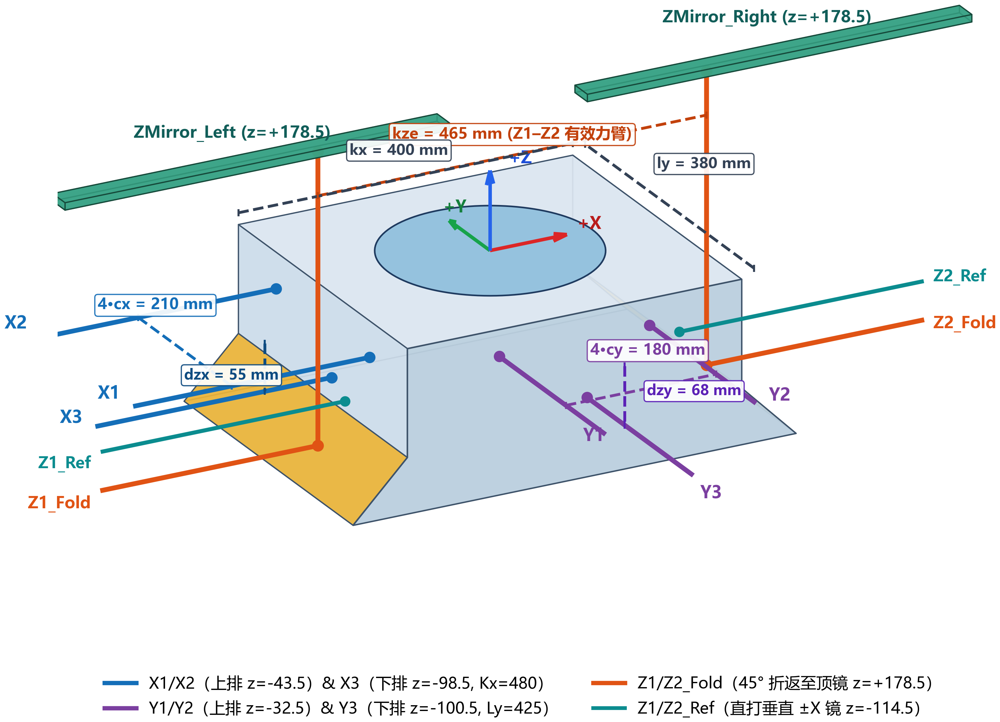

# 晶圆台干涉仪 WS-IFM 技术文档

[模型选择](#ifm-model-selection) · [坐标和光路](#ifm-geometry) · [八路读数](#ifm-readout) · [公式变更](#ifm-differences) · [标定与解算](#ifm-solver) · [机器常数](#ifm-constants) · [验证结果](#ifm-validation) · [资料出处](#ifm-sources)

## 模型选择

| 正式名称 | 用途 | 依据 |
| --- | --- | --- |
| `ifm_raw` | 原始参考，保留六条手稿方程和未定义接口。 | 《ifm模型.docx》文件第 1–5 页。 [原始公式](ifm_raw.md) |
| `ifm_corr` | 当前仿真、光路复核及解算的公式基线。 | 用户提供的 C3 说明与 MATLAB v7。 [八通道完整公式](ifm_corr.md) · [v7 实现范围](ifm_corr.md#corr-runtime) |

## 坐标、光路和几何

采用右手系、主动旋转和列向量。原点在晶圆上表面中心，`T=[X,Y,Z]^T` 是旋转前的平移参数。实验室坐标中的台体原点位移为 `R*T`。

~~~text
R = RotZ(Rz) * RotX(Rx) * RotY(Ry)
p_world = R * (p_local + T)
~~~

矩阵右端先作用，即固定轴 Y、X、Z 的依次作用。X/Y 读数头分别位于负 X 和负 Y 一侧，朝向台体竖直测量面。两路 Z 分别从台体两侧经 45° 斜面折向固定计量框架顶镜，每侧另有一条照射同侧竖直镜的直返参考。两条 Z 净读数对应两条折返测量与各自的参考差。图和以下数值用于当前 M 侧 CAD。

图示按《build_ifm_c3_manuscript_pdf.py》的图 1、`render_fig1_3d` 生成。图中的 `kze=465 mm` 指两斜面名义反射点的 X 距离。由净 Z 差分光程求出的零位角度灵敏度约 554 mm，详见[高度验证](#ifm-validation)。

| 组成 | 名义坐标与基线（mm） | 对应观测 |
| --- | --- | --- |
| X1、X2、X3 | 读数头 `x=-480`，上束 `y=-105,+105, z=-43.5`，X3 为 `y=-20,z=-98.5`。竖直测量面 `x=-200`。 | 上两束差分观测偏航，X3 与上束均值构成主俯仰基线。 |
| Y1、Y2、Y3 | 读数头 `y=-425`，上束 `x=-90,+90,z=-32.5`，Y3 为 `x=+15,z=-100.5`。竖直测量面 `y=-190`。 | 上两束差分观测冗余偏航，Y3 与上束均值构成滚转基线。 |
| Z1/Z2 折返 | 两头 `x=±490`，`y=-50,z=-159`。名义折返点 `x=±232.5`。计量框架固定顶镜 `z=+178.5`。 | 两路折返与直返分别作差。 |
| Z1/Z2 直返 | 参考光束 `y=-50,z=-114.5`，打到 `x=±200` 竖直面。 | 消去两个 Z 路的主要水平共模成分。 |

## 八路读数及主控输出

对原始几何光程先按同一光路折算并扣零。以 `delta_OPL = OPL - OPL0` 记光程变化。

~~~text
x_i = delta_OPL_Xi / 4                  i = 1, 2, 3
y_i = delta_OPL_Yi / 4                  i = 1, 2, 3
z_i = (delta_OPL_Zi_ref - delta_OPL_Zi_fold) / 2   i = 1, 2

mx1 = (x1+x2)/2        mx2 = x1-x2
my1 = (y1+y2)/2        my2 = y2-y1
mz1 = (z1+z2)/2        mz2 = z1-z2
~~~

XY 采用经角锥映射的四段往返，Z 折返为四段、直返为两段。若输入已是位移归一的八路读数，直接做均值和差分。模拟束线偏斜时，读数头参考面法向随其发射方向一起转动。对一个平面，名义追迹可用下式计算交点和反射。

~~~text
t = dot(P_plane - P_start, n) / dot(d, n)
P_hit = P_start + t*d
d_out = d - 2*dot(d,n)*n
~~~

| 输出 | 主要读数 | 在 v7 中的作用 |
| --- | --- | --- |
| `X、Y、Z` | `mx1、my1、mz1` | 辅以角度及位置补偿得到主平移。 |
| `Rx` | `y3、my1` 和偏航 | Y 三束主滚转。 |
| `Ryx` | `x3、mx1` 和偏航 | X 三束主俯仰。 |
| `Rzx` | `mx2` 和滚转、俯仰 | X 路主偏航。 |
| `Rzy、Ryz` | `my2、mz2` | 冗余偏航及冗余俯仰，保留输出供校核。 |

同一位姿报告使用 `(X,Y,Z,Rx,Ryx,Rzx)`。安装偏角、头面方向及差分极性以同一个工位和同一套束号约定输入。 [完整模型公式](ifm_corr.md#corr-xy)

## 原式与修正式的对应

下表两栏使用各自资料的有向定义。M 侧补偿符号以附件说明与实际 v7 为准。手稿表 3 中用原手稿方向列出的 X、Y 号保留为出处说明。

| 项 | ifm_raw 手稿 | ifm_corr 的 M 侧定义 |
| --- | --- | --- |
| X 阿贝项 | `-ax*Ry` | `+ax*Ry`。下方 X 上束在正 Ry 时光程变短，反解补回。 |
| Y 阿贝及余弦 | `+ay*Ry`，死程项含 `Ry^2+Rz^2`。 | `-ay*Rx`，基于 Y 镜法向采用 `Rx^2+Rz^2`，M 侧死程和气隙距离按 `Yb` 定义。 |
| 光束归零 | 保留原式的束线偏角与气隙项。 | X、Y 各有零位余弦扣除，偏航和下束不平行项按归零后的位置与姿态写入。 |
| 偏心、上束方向 | 原表中 `dd/ee` 效应互换，`Rzix0/dRzixh` 字段和 Y 组作用列有异文。 | `ee` 对应 X，`dd` 对应 Y。`Rzix0/dRzixh` 对应 X 光路。水平差方向量归于各自的上束对，Y 组作用于 `Rzy`。 |
| Rx 和 Ryx | 原件没有两条显式解算方程。 | 给出完整下束式，含高度基线、横偏、上下束不平行和零倾角余弦差。 |
| Z 的位置×姿态 | `+X*Rx*Rz`。 | `+czxrz*X*Rx*Rz`，按实际折返拓扑拟合。 |
| Ryz 的首末两项 | `mz2*((1-2*Z/kze)/kze)^2`、`dryya*Ry`。 | `(mz2/kze)*(1-2*Z/kze)`、`dryya*Ry^2`。 |

[原件六式](ifm_raw.md#xy-ifm-原式) · [XY、偏航](ifm_corr.md#corr-xy) · [Z、Ryz](ifm_corr.md#corr-z)

## 标定与解算步骤

v7 通过独立已知位姿标定四个最小二乘向量。它用 `rng(7)`，角度组和高度组各 250 点。X/Y 分别分布在 ±100 mm，Z 分布在 ±0.4 mm，角度组的三角振幅为 1.0 mrad，高度组为 1.2 mrad。下表以 `r=Rx、b=Ryx、c=Rzx` 表示当前运行的角。标定时用独立的预设位姿构造角度与位置部分，运行时用迭代值。

| 向量 | 特征顺序 | 标定目标 |
| --- | --- | --- |
| `Phi_Rx` | `[(y3-my1)/dzy, c, -(Yb*r-Y*Rxiy0)/dzy, -(Yb*c-Y*Rziy0)/dzy, -Y/dzy]` | Rx |
| `Phi_Ryx` | `[(mx1-x3)/dzx, c+r*b, -(Xb*b-X*Ryix0)/dzx, -(Xb*c-X*Rzix0)/dzx, -X/dzx]` | Ry |
| `Phi_Z` | `[mz1, X*r*c, Y, X, r, b, c, X*b, X*c, Y*b, X*r, b^2, c^2, r^2, r*c]` | Z |
| `Phi_Ryz` | `[L, X, Y, Z, r, c, X*r, X*b, X*c, r^2, r*c, b^2]`，其中 `L=(mz2/kze)*(1-2*Z/kze)+(2/kze)*X*r^2+(4/kze)*X*b^2`。 | Ry |

每组估计 `theta = Phi \ reference`。Z 的首系数对应 `sfz`，第二个系数与首系数的比值对应 `czxrz`。Rx/Ryx 的首系数对应垂向基线修正，后续系数按附带说明依次表示总横向偏心耦合、两个方向差和余弦差。若用完整常数形式实现，应先核对拟合系数与外乘尺度、方向差以及实际基线之间的换算。

1. 用 `mx1、my1` 初始化 X/Y，以 Y 上束差值初始化偏航，以两组上下束差初始化 Rx/Ryx。
2. 每轮用 `mx2/(4*cx)-Rx*Ryx` 更新主偏航。再按当前气隙和特征向量更新 Rx，使用刚更新的 Rx 求 Ryx，随后更新 X、Y。v7 执行四轮。
3. 使用收敛的 X、Y、Rx、Ryx、Rzx 及 `mz1` 求 Z。将已求 Z 和 `mz2` 代入冗余俯仰式，返回 `Ryz`。`Rzy` 从 Y 上束独立给出。
4. 可记录 `Rzx-Rzy`、`Ryx-Ryz` 及各通道有效性，用于识别束序、镜面、倍率和倾斜残差。实机从报告字段装载有向、分工位及卡盘的参数。 [完整模型与 v7 实现差异](ifm_corr.md#corr-runtime) · [校准项目清单](WS-IFM%E6%9C%BA%E5%99%A8%E5%B8%B8%E6%95%B0%E6%A0%A1%E5%87%86%E9%A1%B9%E7%9B%AE_v1.md#core-calibrations)

## 机器常数与几何基准

| 字段或组 | 物理含义及适用条件 |
| --- | --- |
| `Kx,Ly`；`kx,ly` | 参考点到各自读数头参考面的有向轴向距离 480、425 mm。当前光学镜面间距为 400、380 mm。 |
| `ax,ay`；`cx,cy` | 焦面到 X/Y 上束的高度差 43.5、32.5 mm。水平束间距的四分之一为 52.5、45 mm。 |
| `dzx,dzy`；`yx3,xy3` | 上下束垂向基线 55、68 mm；下束相对上束中心的有向横偏 −20、+15 mm。 |
| `sfx,sfy,sfz,sfryz`；`sxy` | 分通道比例、XY 非正交。标定字段需按部署流程确认是否已合入读数。 |
| `ee,dd`；`ux,wy`；`vx,vy` | X/Y 的横向偏心；上束不等高；下束在名义横偏之外的安装误差。 |
| `Ryix0,Rzix0,Rxiy0,Rziy0` | X、Y 上束的平均方向偏角，分别为绕 Y/Z、绕 X/Z 的分量。 |
| `dRyixh,dRzixh,dRxiyh,dRziyh`；`dRyixv,dRzixv,dRxiyv,dRziyv` | 后缀 `h` 对应同组上束间方向差，`v` 对应上下束方向差。差分顺序决定有向常数。 |
| `c_X,c_Y`；`sxz,syz` | 零倾角下上下排的余弦差；可选的 X/Y 侧镜铅垂安装补偿。 |
| `szxa,szya`；`ezxa,ezya,ezza` | 高度随 X/Y 的一阶斜率；姿态对 Z 的一阶耦合。 |
| `czxya,czxza,czyya,czxxa`；`dzyya,dzzza,dzxxa,dzxza` | Z 模型的位置×姿态与二次纯姿态系数。 |
| `kze,czxrz` | Z 折返几何名义臂与 `X*Rx*Rz` 折返系数。 |
| `srxa,srya,srza`；`erxa,erza` | 冗余俯仰随 X/Y/Z 的线性斜率与 Rx/Rz 交叉项。 |
| `crxxa,crxya,crxza`；`drxxa,drxza,dryya` | 冗余俯仰的位置×姿态及二次姿态系数。 |

原件的 C0 `kx` 称为台体 X 尺寸。此前同读数对照采用 530 mm 外包络，附件 v7 的 400 mm 指光学两面距离。工作站上 M 侧 AA、E 侧 TIS 和 CAD O 点使用各自的参考位置。WZIM、WGIM、WTAF/WGTD 对应的原文图表和机台常数证据见[机台常数校准项目](WS-IFM%E6%9C%BA%E5%99%A8%E5%B8%B8%E6%95%B0%E6%A0%A1%E5%87%86%E9%A1%B9%E7%9B%AE_v1.md#core-calibrations)。

## FreeCAD 验证与适用范围

来源为附件 v7 的原函数与 FreeCAD 0.21.2 独立追迹。按附件的四段 XY、两段直返 Z 和四段折返 Z 口径，十条原始几何光程的最大差异为 `1.82e-12 mm`。

| 测试集 | 装调 | X/Y/Z 最大绝对误差（nm） | Rx/Ryx/Rzx 最大误差（µrad） | Ryz 最大误差（µrad） |
| --- | --- | --- | --- | --- |
| v7 的 +Y 121 帧 | 理想 | 0.300 / 0.020 / 0.701 | 0.000363 / 0.000644 / 0.001385 | 0.374164 |
| v7 的 +Y 121 帧 | 默认装调偏差 | 0.362 / 0.026 / 0.706 | 0.000402 / 0.001553 / 0.001454 | 0.374164 |
| 81 个历史位姿，按附件坐标重追 | 默认装调偏差 | 0.086 / 0.031 / 18.800 | 0.000528 / 0.000928 / 0.000419 | 3.475659 |

装调偏差按 v7 注入。121 帧及 81 个历史位姿的交点落在 CAD 实体镜面有效范围。每批 250 个随机标定位姿中有 43 例镜面越界，以 207 组有效样本再次标定的结果可在验证报告核对。81 组中的 `Z=±5 mm` 超出校准范围，在 Z 与 Ryz 上暴露了尺度和有效臂的高度依赖。FreeCAD 在零位的净 Z 差分有效臂约 554 mm，v7 通过 `sfryz≈0.839318` 部分吸收 465 mm 与 554 mm 的差异。附件的历史精度数字与本次可重复结果均在验证报告列出。 [自由度与误差明细](WS-IFM%E9%99%84%E4%BB%B6C3-FreeCAD%E9%AA%8C%E8%AF%81_v1.md#attached-c3-scan) · [同一八路输入的原式和修正式对照](WS-IFM-C0-v7C3%E5%85%AD%E8%87%AA%E7%94%B1%E5%BA%A6%E8%AF%AF%E5%B7%AE_v1.md#six-pose-summary)

## 资料出处

- 《ifm模型.docx》文件第 1、4 页载六条原式，第 2–4 页载 XY 机器常数，第 5 页定义 Z 输入。原件位置 `参考文献/ifm模型.docx`。 [原件转录](ifm_raw.md)
- 《build_ifm_c3_manuscript_pdf.py》附带 v9 手稿图 1、表 2–9。图、光路和常数字段用于定位，附注中保留的原手稿方向符号以具体表和 M 侧定义阅读。手稿页码随渲染平台变化，本 Markdown 以图表编号定位。
- 《ws_ifm_c3_agent_spec.md》`1–5 和 `6–8 定义 C3 输入、公式、标定、参数及附件基准。《sim_ws_ifm_6dof_animation_v7.m》第 383–642 行为几何、解算、标定和读数，第 744–786 行为传播段和旋转。三份附件的本机留档位于 `work/ifm-canonical-v1/ifm_corr/`。 [代码对应范围](ifm_corr.md#corr-runtime)
- 原始装配《ws-ifm-agent.FCStd》和 CAD 宏《build_ifm_agent.FCMacro》位于本机 `参考文献/`。Level 3《09-TT-L3-WSbook.pdf》文件第 58 页图 1.60、1.61 用于识别 M/E 两侧折返与直返光路。《12-TT-L3-L3-ME_book.pdf》文件第 92 页表 2.2 用于查机台输出字段及坐标参考。 [校准原页图表定位](WS-IFM%E6%9C%BA%E5%99%A8%E5%B8%B8%E6%95%B0%E6%A0%A1%E5%87%86%E9%A1%B9%E7%9B%AE_v1.md#原页图表索引) · [本机资料规则](../../AGENTS.md#read-only-references)
